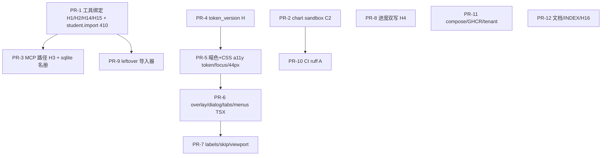

# teacherAgent 2026-10-10 全量审计修复方案

| 字段 | 值 |
| --- | --- |
| 文档标题 | Complete audit remediation for teacherAgent (2026-10-10) |
| 作者 | TBD（平台 Owner 签字后生效） |
| 日期 | 2026-10-10 |
| 状态 | Draft（2026-10-10 吸收 Grok Issues 1–18 与 Codex Issues 19–22） |
| 产品 | 单校作业产品（teacher 上传/确认/进度；student 今日列表/陪练/显式提交；admin 学校面板） |
| 仓库 | `/home/tdcasual/codework/teacherAgent` |
| 权威关系 | 产品身份：08-28。安全历史：08-26。09-05：部分落地、其余由本文件承接。09-06：**catalog vis** 仍是 persist 权威；**进度数字**由本文件 KD-7 明示修订（compute-primary + 双写，直到 discussion/submission 迁表）。本文件：2026-10-10 审计修复权威。 |
| 治理 | `CONTRIBUTING.md` L/M/H；M/H 必须 TDD；H 需回滚 + 安全测试 + 风险登记更新或明示「为何不需要」 |
| 团队 | 2 人。`.github/CODEOWNERS` 全是 `@tdcasual`。不发明编制。 |
| 硬约束（不重开） | fail-closed authz；Bearer not Cookie；无 git filter-repo；保留 chart sandbox（不删 `chart.exec`）；MCP sidecar 保留在 `127.0.0.1`；不为 LOC 拆 `auth_registry_service.py` / `services/api/auth/identity_graph_service.py` / `chat_job_processing_service.py`；无 Grafana / 30 天 SLO 平台；不加新 structure-test 文件；不发明 CODEOWNERS 编制；Python 3.13 / Node 24 / Compose；生产 compose：`APP_ENV=production`、`AUTH_REQUIRED=1`、`PUBLISH_HOST=127.0.0.1` |

---

## Overview

作业 HTTP 闭环已经能跑：老师上传 → confirm → 进度；学生今日列表 / 陪练 / 显式提交；管理员学校面板在教师 SPA 内。2026-10-10 对照源码的全仓审计确认：**产品身份没有再漂回考试平台**，但五类缺口会让「HTTP 已 fail-closed」变成假安全感。

1. **LLM 工具面 ≠ HTTP 授权面。** `tool_dispatch_service.py:555-569` 仍把 `args.get("teacher_id") or teacher_id` 合并进 memory/workspace handler。HTTP 已用 `resolve_teacher_scope` / `resolve_student_scope` / `resolve_student_profile_path`。
2. **chart.exec sandbox 是正则 + `builtins.open`，不是隔离。** 本波收紧已知旁路（`DATA_DIR` env、`os.open`、LLM `auto_install`），**不声称这是 jail**。`pathlib`/`io.open` 等列为接受残余，风险保持开放。
3. **暗色主按钮不达标。** 师生 `tailwind.css` dark `--color-accent: #4c9aff`；主 CTA `bg-accent text-white`（13 处 class）+ `.teacher-rail-cta … text-white`。`:root` 已声明 `color-scheme: light dark`。
4. **`assignment_progress` 表只在 JSON 导入时写入。** vis 已 SQL-gated；数字仍扫盘 + 只写 `progress.json`。本波双写，**不**把 GET 改成 09-06 SQL-primary。
5. **门禁 / leftover 考试导入器 / MCP 过期路径 / 文档漂移。** CI ruff 仍是文件名白名单；MCP allowlist 指向 **不存在的** `skills/physics-student-coach/`（活文件是 `skills/student-coach/scripts/update_profile.py`）；`docs/INDEX.md` 仍把 09-05 写成「当前下一阶段」。

本方案把全部 C/H/M/L 编号映射到 **12 个有序切片**。切片按文件所有权串行；**不是** 12 个互不碰文件、可任意顺序合入的 PR。禁止把教师 SPA 视觉重构和工具 IDOR 混在同一 PR。

---

## Background & Motivation

### 产品与规模（上下文，不是增长目标）

单校部署。Compose 上限沿用 09-05：`LLM_MAX_CONCURRENCY_STUDENT=12`、`LLM_MAX_CONCURRENCY_TEACHER=2`、`CHAT_STUDENT_INFLIGHT_LIMIT=1`、API `--workers ${API_WORKERS:-2}`、api `mem_limit: 2g`。SQLite WAL + `timeout=3s` 足够；不引入连接池中间件。

对照 2026-10-10 工作区：

| 范围 | 事实 |
| --- | --- |
| 教师 `App.tsx` | 853 行；`tests/test_teacher_frontend_structure.py` 预算 `<900`；hotspot `<930` |
| 学生 `App.tsx` | 880 行；`tests/test_tech_debt_targets.py` 预算 `<920` |
| `TeacherTopbarAdminMenu.tsx` | 819 行（无独立预算；`TeacherTopbar.tsx` `<400`） |
| `frontend/apps/teacher/src/features/workbench/hooks/useAssignmentWorkflow.ts` | 985 行；hotspot `<1020` |
| `auth_registry_service.py` | 1698 行（本波不拆） |
| structure 测试冻结 glob | 见 §M14；2026-10-10 唯一文件 **84** |
| `mypy_max` | JSON = 19。`tests/test_backend_quality_budget.py:38` 已是 `<= 19`。`tests/test_ci_backend_hardening_workflow.py:118-120` 仍钉 `== 19`（本波只改后者） |
| 覆盖率 | CI `--cov-fail-under=85`；`pytest.ini` 只有 `pythonpath` / `filterwarnings` / `stress` marker |

### 已落地、本波不重做

| 主题 | 代码事实 |
| --- | --- |
| 作业产品身份 | `docs/architecture/module-boundaries.md`：upload → confirm → progress；exam HTTP 已卸 |
| 作业 catalog vis | `list_assignments` 走 `list_assignment_rows`；`compute_assignment_progress` 无 SQL 作业行 → `assignment_not_found` |
| confirm 2PC | `BEGIN IMMEDIATE` → `upsert_assignment`（未提交）→ `atomic_write_json` → 失败 `ROLLBACK`+500 → `COMMIT`（`assignment_upload_confirm_service.py:455-470`）。**不是** SQLite 包住文件系统 |
| HTTP 师生 scope | `resolve_teacher_scope` / `resolve_student_scope`；HTTP memory `scoped_teacher_id` |
| HTTP 学生档案路径 | `paths.resolve_student_profile_path` 拒绝 `../` |
| HTTP `/student/import` | 410 `gone` |
| MCP 暴露面 | compose `127.0.0.1:9000`；空钥 503 |
| chart FS roots | `allowed_roots` = `[output_dir, uploads_dir]`，**不含** `data/` |
| chart trusted | LLM 不可选 trusted（`RISK-CHART-TRUSTED-001` 已关）。C2 是另一条残余 |
| 生产发布 | 默认 `PUBLISH_HOST=127.0.0.1`；compose 前端 build-arg 默认 `VITE_API_URL=http://localhost:8000`（`docker-compose.yml:128,146`）；GHCR bake 是 `http://127.0.0.1:8000`（`docker.yml:79`） |
| Admin Web | `AdminSchoolPanel.tsx`；`POST /auth/admin/login` |
| prettier | `apps/**/*.{ts,tsx,css}`（AR-L3 已关） |
| KaTeX CSS | `markdown.ts:190` 动态 import（已是目标态） |
| RISK-ADMIN-BOOTSTRAP-001 复审日期 | 已是 2026-12-01；本波只补勾选表，不改日期 |

### 痛点（对照行号）

**工具 IDOR。** `tool_dispatch_service.py:555-569` 把 `{**args, "teacher_id": args.get("teacher_id") or teacher_id}` 传入 `teacher.workspace.init` 与 `teacher.memory.get/search/propose/apply`。这些 handler **没有** `_teacher_only_handler`。`_teacher_memory_get:113` 与 `:396-439` 再调 `deps.resolve_teacher_id(args.get("teacher_id"))`。Wiring 里 `deps.resolve_teacher_id` 实际是 `_ac.require_teacher_id`（空则 400，否则 `safe_fs_id`），**不是** `auth_service.resolve_teacher_scope`，也不是绑定检查。`_resolve_tool_teacher_id:148-155` **已定义从未调用**（死代码）；修它不等于修 H1。`MUTATING_TOOL_NAMES` 含 `apply`，不含 `propose` / `workspace.init`。

**档案路径。** `profile_service.py:93-97` 把 `args.get("student_id")` 拼进 CLI；`skills/student-coach/scripts/update_profile.py:86-87` 为 `Path(args.profile_dir) / f"{args.student_id}.json"`。

**全校扫描。** `student_directory_service.student_search:23` glob 全档案。HTTP `GET /student/profile/{id}` 经 `resolve_student_scope(roles=("student","admin"))`，教师 403。

**render `--out`。** `assignment_generate_tool_service.py:137-144` 用 `_resolve_app_path`；无 `--out` 时默认 `output/pdf/assignment_{id}.pdf`（`APP_ROOT` 相对）。MCP `_require_contained_path` 限 DATA_DIR/UPLOADS_DIR。

**Sandbox。** `_ENV_WHITELIST` 含 `DATA_DIR`/`UPLOADS_DIR`。扫描无 `os.open`。guard 只补丁 `builtins.open`。LLM schema 仍有 `auto_install`/`packages`。

**MCP 过期路径。** `services/mcp/app.py:94` 与 `:305` 指向 `skills/physics-student-coach/scripts/update_profile.py`。**`skills/physics-student-coach/` 不存在**；活脚本是 `skills/student-coach/scripts/update_profile.py`。`tests/test_mcp_script_allowlist.py:75-92` mock subprocess，绿测不证明文件在磁盘上。

**进度表。** `_upsert_progress` 只被导入调用。`compute_assignment_progress:390-396` 打开连接做 vis 检查后 **关闭**；`:468-469` 只写 JSON。无 SQL 行时 404；**folder 不存在时即使 SQL 有行也 404**（`:400-403`）。

**暗色。** dark `#4c9aff` + `text-white`。`bg-accent text-white` **13** 处 class。`.teacher-rail-cta` 在 CSS 用 accent 填充 + TSX `text-white`（`TeacherWorkbench.tsx:169`）。

**tv。** `set_password:676-699` 不升 `token_version`。HTTP 直接返回 store 结果。`TeacherSetPasswordResponse`（`TeacherTopbarAdminMenu.tsx:51-55`）无 `access_token`；成功文案「token 仍可用」（`:366`）。**学生 SPA 无改密 UI**（`useVerification.ts` 只有 identify/login）。缺 `tv`：admin 401，teacher/student 放行（`auth_service.py:219-223`）。Login 已 stamp `tv`（`auth_route_handlers.py:79,96`）。

---

## Goals & Non-Goals

### Goals

1. 工具循环的 teacher_id / student_id / 写路径与 HTTP 同一套 fail-closed 规则：绑定 actor 胜；模型不能指定他人。
2. 收紧现有 chart sandbox 的**已知**旁路；公开残余（pathlib/`io.open` 等）；**不**把 C2 标成 jail。
3. 暗色作为支持模式：`--color-on-accent` + `--color-accent-text`；对比用公式断言 ≥4.5:1。
4. `assignment_progress` / attempts / grades 在 compute/submit/grade **双写**（confirm 同款 2PC，**不是**一条 SQLite 事务包住 JSON）。GET 仍 compute-primary。
5. MCP allowlist 指向存在的 `skills/student-coach/scripts/update_profile.py`，且 `path.is_file()`。
6. `set_password` 递增 `tv` 并返回新 `access_token`；缺 `tv` 的 teacher/student Bearer fail-closed。仅教师 AdminMenu 持久化新 token。
7. 全局 `:focus-visible`；关闭 overlay 不可聚焦；Confirm/Prompt **body overflow lock + 现有 trap**（不 inert `#root`）；工作台 tablist 键盘；skip link。不得破坏 session-sidebar e2e。
8. CI **保留** ruff step = `services/api` + 安全文件；budget 脚本 **跳过 ruff**；`mypy_max` 天花板棘轮；README badge → `ci.yml`。
9. 打开所列 RISK_* ；H16 勾选表；09-06 进度数字权威由本文件修订并改 `CURRENT_PLAN_AUTHORITIES`。
10. 每个 C/H/M/L ID 进覆盖矩阵；推迟项有日期、Owner、残余风险、复审日。

### Non-Goals

- 考试产品、skill marketplace、多校 SaaS、拆 MCP、绑 MCP 到 `0.0.0.0`。
- `git filter-repo`。
- Grafana / 30 天 SLO。
- 为行数拆 god file / 虚荣抽取 `App.tsx`。
- 新增 `tests/test_*structure*` 文件。
- live compose / `E2E_REAL=1` 进 PR。
- 同一 PR 把 black 扩到整树。
- 第一波 Landlock/seccomp。
- native `<dialog>`。
- 教师 HTTP GET 全校学生档案。
- 把 PDF 默认输出放到 `UPLOADS_DIR`（会扩大 chart sandbox 可读面）。
- 对 `#root` 或 dialog 祖先设 `inert`。
- 把 SQL+JSON 说成「一条事务」。
- 关闭 `RISK-ASSIGNMENT-DUALWRITE-001` 当作 SQL-primary GET 已落地。
- 关闭 C2 / 新 RISK 当作 sandbox jail。

---

## Key Decisions

| # | 决定 | 理由 |
| --- | --- | --- |
| KD-1 | **绑定 actor 胜。** `bind_tool_teacher_id` / `bind_tool_student_id`（学生绑定来自 chat principal `actor_id`）。teacher 角色返回 JWT/`teacher_id` 绑定值，**永不**把 `paths.resolve_teacher_id`（会默认 `"teacher"`）当授权。缺绑定 400/403。**`teacher.memory.*` 与 `teacher.workspace.init` 仅 teacher：** 包现有 `_teacher_only_handler`（`role == "teacher"`）。本波 **不** 让 admin/service 经工具冒充 MEMORY.md；学校面板走 HTTP，不走这些工具。admin/service 仅对学生 search/get/update 允许显式 `student_id`。 | 对齐 HTTP `resolve_teacher_scope`。Live `_teacher_only_handler` 已是 teacher-only；不要发明 `_teacher_or_admin_handler`。 |
| KD-2 | confirm 只加写工具：`teacher.memory.propose`、`teacher.workspace.init`。get/search 不加 confirm。 | confirm ≠ 授权。 |
| KD-3 | 学生工具按名册。get/update 名册外 **403**（不是 glob 再滤）。search 名册外交集为空。HTTP GET profile 角色门不变。 | 教师 HTTP 403 是产品边界。 |
| KD-4 | 档案写路径走 `resolve_student_profile_path`；脚本再校验。 | HTTP 已安全。 |
| KD-5 | **默认 PDF 保持 `output/pdf/assignment_{id}.pdf`（APP_ROOT 相对，现状）。Jail 只约束显式 `--out`，且只允许 `DATA_DIR` 下（不含 `UPLOADS_DIR`）。** | 放到 UPLOADS_DIR 会让 `chart.exec` 可读作业 PDF。MCP 仍可 DATA/UPLOADS；HTTP 工具更严。 |
| KD-6 | 收紧 sandbox，不是 jail。去掉 DATA_DIR env；扫描+补丁 `os.open`/`fdopen`；剥 LLM `auto_install`/`packages`。**接受残余：** `pathlib.Path.open`/`read_text`（绑定 import 时的 `io.open`）、`shutil.copyfile`、`glob`、`mmap`、`os.mkdir`/`rename`。`RISK-CHART-SANDBOX-RESIDUAL-001` **保持开放**。 | 正则+补丁关已知旁路；声称 jail 会误导。 |
| KD-7 | **09-06 修订（明示取代进度数字条款，不取代 catalog vis）：** 09-06 KD-1/KD-2 **继续**约束 catalog/today **vis**（SQL 无作业行 → 不可见）。进度 **数字** 本波 = live compute + 双写；GET 不以 `assignment_progress` 为权威，直到 discussion/submission 迁表（目标 **2026-12-01**）。`RISK-ASSIGNMENT-DUALWRITE-001` 双写后仍 **开放/观察**。SQL 有作业行且 `assignments/<id>/` **不存在**：返回 SQL snapshot 或空 counts，**不 404、不 2PC、不 mkdir**（`atomic_write_json` 会 `mkdir` 父目录，禁止写-on-GET）。仅 folder 已存在时跑 confirm 式 2PC。 | 讨论/提交仍在盘上。无条件 2PC 会在 GET 时创建目录，违背 09-06 vis。 |
| KD-8 | 修暗色。`@theme`：`--color-accent` = **填充**；`--color-on-accent` = 按钮字；`--color-accent-text` = 表面上的 accent 字。组件层 `.text-accent { color: var(--color-accent-text); }`。对比用公式 ≥4.5:1。 | Tailwind v4 同一 `--color-accent` 生成 `bg-accent` 与 `text-accent`。 |
| KD-9 | **Dialog DOM 拓扑：不 portal、不 inert `#root`。** Confirm/Prompt 保持 in-tree（`dialog.tsx` 的 `.app-dialog-backdrop` 在 `#root` 内）。Open：`document.body.style.overflow='hidden'` + 现有 trap/Escape/unmount。关闭 overlay：**卸载**，不用 `pointer-events:none` 冒充不可聚焦。不换 `<dialog>`。 | `#root` inert 会把 in-tree dialog 一并 inert，打断 trap 与 e2e。 |
| KD-10 | `set_password` +1 `tv`，HTTP 返回 `access_token`。缺 `tv` fail-closed。PR-4 = **H**。SPA 只改 `TeacherTopbarAdminMenu.tsx`。学生无改密 UI，重新 login 已 mint `tv`。 | 改密不撤销是洞。 |
| KD-11 | MCP 脚本 `is_file()`；路径改为 student-coach。`assignment.list` 仍 JSON meta。MCP H15：unbound 的 `student.search` **与** `student.profile.get` **与** `student.profile.update` 一律 403 `mcp_teacher_unbound`。Bound：同一条 enrollment `SELECT` 用于 search **和** get **和** update；库缺失 403 `mcp_roster_unavailable`。 | sidecar 不 import `services/api/auth/identity_graph_service.py`。get/update 不能只滤 search。 |
| KD-12 | **方案 A：** 保留 CI ruff step = `services/api` + 现有安全文件；`check_backend_quality_budget.py` 加 `--skip-ruff`（CI 调用时跳过，只测 mypy+行数）。pytest 不再 spawn ruff。`mypy_max` 禁止 `== 19`。black 不扩面。 | 不可同时「删 CI ruff」又「测试要求 yml 含 ruff check services/api」。Budget 脚本今日只 ruff `services/api`，会丢掉 mcp 钉死文件。 |
| KD-13 | GHCR 文档化为 loopback-only（bake `127.0.0.1`）。校园 compose 用 `localhost:8000` 或显式 `VITE_API_URL`。 | 运行时注入成本高。 |
| KD-14 | 空 `TENANT_ADMIN_KEY` → `_build_runtime_entrypoint` 返回 `default_app`，不挂 dispatcher。`/health` 仍在 default_app。key 非空则 `TENANT_DATA_BASE_DIR` 必填。 | 缩小生产入口。 |
| KD-15 | 结构测试冻结 84（公布 glob）。不加新 structure 文件。行数预算冻结。 | 09-06 KD-3。 |
| KD-16 | live E2E 不进 PR。`waitForTimeout(5400/7600)` → `expect.poll`。 | 09-05 KD-E1。 |
| KD-17 | 不 filter-repo。H16 = 勾选表。复审日期已是 2026-12-01。 | Owner 08-26。 |
| KD-18 | **12 个有序切片 + 文件所有权表。** 热文件一写者。可并行仅当文件不相交（PR-1∥PR-2；PR-8∥PR-5–7；PR-10 与/在 PR-2 之后）。 | 「独立可合」对热文件为假。 |

---

## Proposed Design

### 切片顺序与并行



**可并行：** PR-1 ∥ PR-2；PR-8 ∥ PR-5–7（无共享文件）；PR-11 ∥ 多数。PR-10 **与/在 PR-2 之后**（ruff 全 `services/api` 会扫 sandbox）。PR-4 在 PR-5 前合入 AdminMenu（PR-5 不再改该文件）。PR-12 最后。

两人：A = PR-1 → PR-3 → PR-4 → PR-8 → PR-9；B = PR-2 → PR-10，且 PR-5 → PR-6 → PR-7。会合 PR-11/12。

### 文件所有权（热文件一写者）

| 文件 | 写者 PR | 他人 |
| --- | --- | --- |
| `tool_dispatch_service.py` | PR-1（含 `student.import` → 410） | PR-9 **不**改此文件 |
| `tests/test_tool_dispatch_security.py` | PR-1 | PR-2 **不**加测试于此；C2 用 `test_chart_sandbox.py` / `test_tool_registry_sync.py` |
| `wiring/misc_wiring.py` | PR-1 | — |
| `services/api/auth/identity_graph_service.py` | PR-1（新增 `list_enrolled_student_ids`，旁路现有需 `subject_id` 的 `list_enrollment_student_ids`） | — |
| `chart_sandbox.py` / `tool_registry.py` / runner / agent_run | PR-2 | — |
| `services/mcp/app.py` | PR-3 | — |
| `auth_registry_service.py` / `auth_service.py` / `auth_route_handlers.py` | PR-4 | — |
| `TeacherTopbarAdminMenu.tsx` | **PR-4**（persist token + 该文件内 CTA `text-on-accent`） | PR-5 不碰 |
| 师生 `tailwind.css` | **PR-5**（token、focus-visible、reduced-motion、`.ghost` 44px、`.teacher-rail-cta` on-accent） | PR-6/7 不碰 CSS |
| `uiTokens.test.ts` | PR-5 | PR-6 不扩展 |
| hex/`bg-accent text-white` TSX（除 AdminMenu） | PR-5 | — |
| 师生 `ErrorBoundary.tsx` | PR-5 | — |
| `dialog.tsx` | PR-6 | — |
| `TeacherSessionRail.tsx` | PR-6 | — |
| 教师 `SessionSidebar.tsx` | PR-5（hex/`bg-white`）然后 PR-6（卸载/`transition-all`）然后 PR-7（`aria-label`）— **同一人 B 串行** | — |
| `AssignmentDraftSection.tsx` | PR-5 hex → PR-7 LabeledField（B 串行） | — |
| `TeacherWorkbench.tsx` | PR-5（rail CTA `text-on-accent`）然后 PR-6（`useTabListKeyboard`）— **同一人 B 串行** | — |
| `assignment/store.py` + progress/submit/grade | PR-8 | — |
| `student_import_service.py` | PR-9 | — |
| `.github/workflows/ci.yml` | PR-10 | — |
| `services/api/app.py` dispatcher | PR-11 | — |
| `docker-compose.yml` | PR-11 | — |
| `docs/reference/risk-register.md` | **只追加**自己的 `RISK-*` 节，不改他人段落 | PR-12 可重排索引，不改 H PR 已写正文 |
| `docs/INDEX.md` / ARCHIVE / `test_docs_architecture_presence.py` | PR-12 | — |

`risk-register.md` 冲突用「只追加节」约定，而不是三人改同一段。

### 1. 工具授权统一（H1 / H2 / H14 / H15）

#### 1.1 绑定 helper 与 deps

删除死代码 `_resolve_tool_teacher_id`。**不要**把它「修好」当 H1。

`ToolDispatchDeps` 增加：

```python
list_enrolled_student_ids: Callable[[str], Set[str]]
# student_search 第三参：
student_search: Callable[[str, int, Optional[Set[str]]], Dict[str, Any]]
```

保留 `resolve_teacher_id` **仅**在 bind **之后**做 FS 消毒（今日 wiring 已是 `require_teacher_id`）。**禁止**在 bind 内调用 `paths.resolve_teacher_id`（缺省 `"teacher"`）。

```python
class ToolAuthzError(Exception):
    def __init__(self, status_code: int, detail: str) -> None:
        self.status_code = int(status_code)
        self.detail = str(detail)

def bind_tool_teacher_id(
    args: dict[str, Any],
    *,
    bound_teacher_id: str | None,
    role: str | None,
) -> str:
    bound = str(bound_teacher_id or "").strip()
    requested = str(args.get("teacher_id") or "").strip()
    role_norm = str(role or "").strip().lower()
    if role_norm == "teacher":
        if not bound:
            raise ToolAuthzError(400, "teacher_id_required")
        if requested and requested != bound:
            raise ToolAuthzError(403, "forbidden_teacher_scope")
        return bound  # JWT/chat-job actor; no resolve_teacher_id
    if role_norm in {"admin", "service"}:
        target = requested or bound
        if not target:
            raise ToolAuthzError(400, "teacher_id_required")
        return target  # caller then require_teacher_id for FS only
    raise ToolAuthzError(403, "permission denied")


def bind_tool_student_id(
    args: dict[str, Any],
    *,
    bound_student_id: str | None,
    bound_teacher_id: str | None,
    role: str | None,
    deps: ToolDispatchDeps,
) -> str:
    """Student tools: JWT/chat actor_id wins. Teacher: roster. Never glob-then-filter get/update."""
    requested = str(args.get("student_id") or "").strip()
    role_norm = str(role or "").strip().lower()
    if role_norm == "student":
        bound = str(bound_student_id or "").strip()  # chat principal actor_id
        if not bound:
            raise ToolAuthzError(400, "student_id_required")
        if requested and requested != bound:
            raise ToolAuthzError(403, "forbidden_student_scope")
        return bound
    if role_norm == "teacher":
        tid = str(bound_teacher_id or "").strip()
        if not tid:
            raise ToolAuthzError(400, "teacher_id_required")
        if not requested:
            raise ToolAuthzError(400, "student_id_required")
        enrolled = deps.list_enrolled_student_ids(tid)
        if requested not in enrolled:
            raise ToolAuthzError(403, "forbidden_student_scope")
        return requested
    if role_norm in {"admin", "service"}:
        if not requested:
            raise ToolAuthzError(400, "student_id_required")
        return requested
    raise ToolAuthzError(403, "permission denied")
```

`bound_student_id` 来自 `tool_dispatch(..., actor_id=...)`（chat principal）。`tool_dispatch` 捕获 `ToolAuthzError` 与现有 `TeacherIdentityError` 一样变成 `{"error": detail, "status_code": code}`。

AUTH_REQUIRED=0：chat job 仍传 `role` + 绑定 `teacher_id`。缺 role → 403。禁止用默认 `"teacher"` 填 bound。

#### 1.2 每个 handler

`:555-569` 的 merge **删除**。grep 仓库 `args.get("teacher_id") or teacher_id` 必须为 **0**。

`teacher.memory.*` 与 `teacher.workspace.init` 包 **现有** `_teacher_only_handler`（`role == "teacher"` 才放行；admin/service **403**，本波不冒充 MEMORY.md）。内部 `bind_tool_teacher_id` 后再用 `require_teacher_id` 做 FS 消毒。学生 get/update 走 `bind_tool_student_id`（在 glob/`resolve_student_profile_path` 之前）。

#### 1.3 名册（H15）

已有 `list_enrollment_student_ids(store, *, teacher_id, subject_id, class_name=None)`（`:773-795`）**要求 `subject_id`**。工具循环没有 subject。**在旁边新增**：

```python
def list_enrolled_student_ids(store: Any, *, teacher_id: str) -> List[str]:
    # SELECT DISTINCT student_id FROM student_enrollments WHERE teacher_id = ?
    # uses idx_enrollments_teacher
```

不要重载旧函数。实现于 `services/api/auth/identity_graph_service.py`。Wiring：`list_enrolled_student_ids=lambda tid: set(list_enrolled_student_ids(store, teacher_id=tid))`。

`student_search(..., allowed_student_ids)`：`None` 且非 admin → **空 matches**（search 方言）。get/update 名册外 → **403** `forbidden_student_scope`，在 glob 之前。

#### 1.4 角色 × 工具表（fail-closed）

| role | 工具 | 缺 bound | 他人 id | 空名册 |
| --- | --- | --- | --- | --- |
| teacher | memory/workspace * | 400 `teacher_id_required` | 403 `forbidden_teacher_scope` | n/a |
| teacher | student.search | 400 | n/a（无 student_id） | `{matches:[]}` |
| teacher | student.profile.get/update | 400 | 403 | 403 |
| student | student.profile.get/update | 400 `student_id_required` | 403 `forbidden_student_scope` | n/a（只自己） |
| student | student.search | 403 `permission denied` | — | — |
| admin/service | student.search/get/update **仅这些** | 400 若无显式 `student_id`（get/update） | 允许显式目标 | search 可全校 |
| admin/service | memory/workspace * | **403**（`_teacher_only_handler`；不冒充 MEMORY.md） | 403 | — |
| `""` / None | 任何上列 | 403 `permission denied` | 403 | 403 |
| 非 teacher | memory/workspace | 403（`_teacher_only_handler`） | 403 | — |

#### 1.5 档案路径（H2）

`student_profile_update`：bind 后 `resolve_student_profile_path(sid)`；失败 `invalid_student_id`。CLI 只传已消毒 id。脚本：拒绝 `/` `\` `..` 空；resolve 必须在 profile_dir 下。

测试放 `tests/test_tool_dispatch_security.py` 与现有 profile 测试，**不是**只改 `test_paths.py`（那只测 `paths.py`）。

#### 1.6 render `--out`（H14）

`core_utils._resolve_data_dir_path(path_value, *, must_exist: bool) -> Optional[Path]`：相对路径相对 APP_ROOT 解析；结果必须在 `DATA_DIR` 下（**不是** UPLOADS_DIR）。

- 显式 `--out`：走该 helper；越狱 → `out_outside_data_dir`。
- **无 `--out`：保持 `output/pdf/assignment_{id}.pdf`**（现状，`assignment_generate_tool_service.py:144`）。默认不走 jail（默认本就不在 DATA_DIR）。
- `--assignment-questions` 仍 `_resolve_app_path`。

#### 1.7 Wiring

`services/api/wiring/misc_wiring.py:_tool_dispatch_deps`（`:188+`）增加 `list_enrolled_student_ids`；`student_search` 改为接受第三参。`student_import` 可在 PR-1 改成恒 410 lambda（HTTP 已 410），避免 PR-9 再碰 dispatch。

### 2. Chart sandbox（C2）— 收紧，不是 jail

1. `_ENV_WHITELIST` 删除 `DATA_DIR`。保留 `UPLOADS_DIR`（本来就是 allowed_roots）。
2. 扫描增加 `os.open` / `os.fdopen` / `os.read(` / `os.write(` / `os.replace`。
3. guard 补丁 `os.open` / `os.fdopen`（与 open 同一 root 判断）。
4. LLM schema 删除 `auto_install`/`packages`。tool_loop 强制 `auto_install=False`。
5. **接受残余（写入 RISK，保持开放）：** `pathlib.Path.read_text/write_text/open`（`io.open` 在 import 时绑定，不走补丁后的 `builtins.open`）、`shutil.copyfile`、`glob`、`mmap`、`os.mkdir`/`rename`。第一失败测试之一是 **断言残余仍存在**：`Path.read_text(DATA_DIR/...)` 在 guard 下仍可能成功 — 标记 accepted，防止后人以为 C2 已是 jail。

Landlock 后续可选。confirm 仍是 UX。

### 3. MCP（H3 + sidecar H15）

- 路径改为 `skills/student-coach/scripts/update_profile.py`。**`skills/physics-student-coach/` 不存在；活文件是 student-coach。**
- `if not path.is_file(): raise HTTPException(500, "mcp_script_missing")`。
- Unbound：`student.search`、`student.profile.get`、`student.profile.update` 一律 JSON-RPC 403 `mcp_teacher_unbound`（get 今日在 `MCP_UNBOUND_TOOL_NAMES` 里可调用，必须关上）。
- Bound：只读打开 **`DATA_DIR/auth/auth_registry.sqlite3`**（与 `assignment_meta_ownership_migrate_service.py:68-69` 同路径）。**同一条** enrollment 查询用于 search **和** get **和** update：

```sql
SELECT DISTINCT student_id FROM student_enrollments WHERE teacher_id = ?
```

  `student_id` 不在结果中 → 403 `forbidden_student_scope`（get/update 在读盘/跑脚本之前）。文件/表缺失或 sqlite 错误 → 403 `mcp_roster_unavailable`（fail-closed，禁止回退 glob 全档案）。不 import `services/api/auth/identity_graph_service.py`。
- `assignment.list` 仍扫 JSON meta。

### 4. 进度双写（H4）— 2PC，不是一条事务

**09-06 取代声明（进度数字）：** 见 KD-7。catalog vis 仍 09-06。进度数字 compute-primary + 双写至 2026-12-01 或讨论/提交迁表。

`compute_assignment_progress` 今日：conn1 `ensure`+`get` 后 **close**；扫盘；`atomic_write_json`。双写必须 **compute 在锁外**（与 confirm 在 IMMEDIATE 前算 expected_students 相同，`:522-525`）。

```
# 1. vis（已有）：conn_vis = connect(); ensure; get; close
#    SQL 无作业行 → 404
#    SQL 有行、folder 不存在 → 读 assignment_progress snapshot（无行则空 counts）；
#      return；禁止 2PC、禁止 atomic_write_json、禁止 mkdir
#      （fs_atomic.atomic_write_json 会 path.parent.mkdir(parents=True)）
# 2. folder.exists()：扫 submissions/sessions（无锁）
# 3. 仅当 folder 已存在时 2PC（复制 confirm :455-470）：
conn = assignment_connect(data_dir)          # 新连接
conn.execute("BEGIN IMMEDIATE")
try:
    upsert_progress_snapshot(conn, assignment_id=..., students=..., now_iso=...)
    atomic_write_json(folder / "progress.json", result)   # FS，不在 SQLite 里
    conn.execute("COMMIT")
except:
    rollback
    500 assignment_persist_failed
finally:
    conn.close()
```

**禁止**把步骤 3 写成「一条事务」。崩溃窗（与 confirm 相同）：

| 窗 | 盘面 | 恢复 |
| --- | --- | --- |
| JSON rename 成功、COMMIT 前被杀 | JSON 新、SQL 回滚/旧 | 下次 compute heal upsert SQL |
| COMMIT 成功 | 一致 | — |
| `atomic_write_json` 失败 | JSON 旧（temp 未 rename）、SQL ROLLBACK | 500；下次重试 |
| COMMIT 后、返回前被杀 | 一致 | — |

#### 精确签名

列来自 `assignment/store.py:47-79`。

```python
def upsert_progress_snapshot(
    conn: sqlite3.Connection,
    *,
    assignment_id: str,
    students: list[dict[str, Any]],
    now_iso: str,
) -> None:
    """For each student dict, call existing _upsert_progress.
    Required keys: student_id, submitted, overdue, official_score,
    process_archive_status|process_status, plus full student payload for payload_json.
    PK (assignment_id, student_id). include_students=False: still upsert expected
    students with payload_json='{}'.
    """

def upsert_attempt(
    conn: sqlite3.Connection,
    *,
    assignment_id: str,
    student_id: str,
    attempt_id: str,
    submitted_at: str,
    grading_report: dict[str, Any],
    files: list[Any],
) -> None:
    """INSERT OR REPLACE student_submission_attempts
    (assignment_id, student_id, attempt_id, submitted_at,
     grading_report_json, files_json)."""

def upsert_teacher_grade(
    conn: sqlite3.Connection,
    *,
    assignment_id: str,
    student_id: str,
    payload: dict[str, Any],
    now_iso: str,
) -> None:
    """UPSERT teacher_grades (assignment_id, student_id, payload_json, updated_at)."""

def reconcile_progress(conn: sqlite3.Connection, data_dir: Path) -> dict[str, Any]:
    """{sql_row_count: int, json_student_count: int, orphan_ids: list[str]}
    orphan = progress.json student_id missing in assignment_progress for that assignment.
    """
```

**连接所有权：** vis 用短连接并关闭。progress 2PC 用新连接，且 **仅 `folder.exists()`**。attempt 2PC 与 progress 2PC **分开**，不要在扫盘时持有 IMMEDIATE。

**submit 挂钩（禁止改 `scripts/grade_submission.py`）：** 全部在 `student_submit_service.submit`（`:372+`）。`_run_grade_script`（`:354-369`）成功返回 CLI stdout，或在 timeout/HTTP 失败时调用 `_write_ungraded_grading_report`（`:297-330`，mkdir attempt 目录并写 `grading_report.json`）再返回。两条路径都在 **返回 `submit` 之前** 已在 `student_submissions/` 落盘 attempt。在 `_run_grade_script(...)` **返回之后**（覆盖成功与 ungraded）调用同一 helper `_persist_latest_attempt_sql(deps, assignment_id, student_id)`：解析刚写入的 `submission_*` 目录 → 新连接 `BEGIN IMMEDIATE` → `upsert_attempt` → `COMMIT`。然后才 `_read_progress` / `compute_assignment_progress`。CLI 脚本零改动。

**grade：** `save_teacher_grade`（`:227-265`）仅在 `atomic_write_json(teacher_grade.json)` **成功之后** 开连接 `upsert_teacher_grade`。JSON 失败则不写 SQL（无需 ROLLBACK，尚未 BEGIN）。

GET 仍返回 live compute 结果。`RISK-ASSIGNMENT-DUALWRITE-001` **不关闭**。

### 5. 主题（C1 / H11 / H13）

Tailwind v4 决定：

```css
@theme {
  --color-accent: #0052cc;       /* FILL → bg-accent */
  --color-on-accent: #ffffff;    /* 按钮字 */
  --color-accent-text: #0052cc;  /* 表面上的字 */
}
@media (prefers-color-scheme: dark) {
  :root {
    --color-accent: #4c9aff;
    --color-on-accent: #071427;     /* vs #4c9aff ≥4.5:1 */
    --color-accent-text: #8ab4f8;   /* vs #22262e ≥4.5:1 */
    --color-warning: #ffc14d;       /* vs #22262e ≥4.5:1；替换 #ffab00 的 ~2.05:1 */
    --color-accent-soft: #1b3a6b;
  }
}
@layer components {
  .text-accent { color: var(--color-accent-text); }
  .teacher-rail-cta { color: var(--color-on-accent); }
}
```

`bg-accent text-white` → `bg-accent text-on-accent`（13 处）。`.teacher-rail-cta` 去掉依赖 `text-white`。

`uiTokens.test.ts` glob = `apps/**/*.{tsx,css}` 中的 TSX：禁止 `text-[#…]`/`bg-[#…]`。文件清单 **等于** glob 命中（2026-10-10）：

- `student/.../ChatMessages.tsx`
- `student/.../ChatComposer.tsx`
- `student/.../SessionSidebarHistorySection.tsx`
- `teacher/.../SessionSidebar.tsx`
- `teacher/.../MentionPanel.tsx`
- `teacher/.../workflow/AssignmentDraftSection.tsx`
- `teacher/.../workflow/WorkflowTimeline.tsx`
- `teacher/.../tabs/SkillsTab.tsx`
- 另改（非 hex 禁令但对比）：`MemoryTab.tsx` `bg-white/70` → `bg-surface/70`；`max-[900px]:bg-white` → `bg-surface`
- **两个** `ErrorBoundary.tsx`（teacher + student）去掉 `#444`/`#f6f6f6`
- `TeacherWorkbench.tsx` `.teacher-rail-cta … text-white`
- AdminMenu 四颗 CTA 在 **PR-4** 改掉，PR-5 glob 时已干净

对比公式（相对亮度，WCAG 2）写进 `uiTokens.test.ts`，断言：

- `contrast('#071427','#4c9aff') >= 4.5`
- `contrast('#8ab4f8','#22262e') >= 4.5`
- `contrast('#8ab4f8','#1b3a6b') >= 4.5`  /* H13 accent-text on accent-soft；抽查 ≈5.1:1 */
- `contrast('#ffc14d','#22262e') >= 4.5`
- 源码无 `bg-accent text-white`；`.teacher-rail-cta` 规则含 `color: var(--color-on-accent)`

实现时若公式失败，改 token 值，不放宽断言。

### 6. 无障碍

**DOM 拓扑（H7）— 不 inert `#root`：**

```
#root
  TeacherAppLayout | student App
    主 UI（聊天/侧栏/工作台）
    DialogFrame          ← in-tree，无 portal
      .app-dialog-backdrop
        .app-dialog[role=dialog]   ← trap + Escape
    SettingsModal        ← in-tree
      .settings-overlay  ← 无 role=dialog
        .settings-dialog[role=dialog]
```

Open：`document.body.style.overflow='hidden'`（DialogFrame 补上；Settings 已有）。关闭：卸载（已有 `if (!open) return null`）。**不对 `#root`、backdrop 祖先、或含 dialog 的节点设 inert。**

**H5：** `frontend/apps/teacher/src/features/chat/TeacherSessionRail.tsx:53-61` 关闭时 **不渲染** 遮罩 button。学生 `SessionSidebar.tsx:9-14` 的 `.sidebar-overlay` 仅 `show` 时 mount。折叠侧栏：卸载或容器 `inert`（侧栏不是 dialog 祖先）。

**H6 / M8 / M9：** CSS 全部在 PR-5 的 `tailwind.css`（所有权）。全局 `:focus-visible`；`prefers-reduced-motion`；`.ghost`/`session-menu-trigger` min 44px。

**H8：** Overflow 子按钮 `role="menuitem"`。新行为测试文件允许。

**H12：** 抽出 `frontend/apps/shared/useTabListKeyboard.ts`；`TeacherWorkbench.test.tsx`（已存在）加方向键。

**H9–H11 / M10–M13：** 见覆盖矩阵。Skip link 放在 `#root` **内部** 最前（M12 接受 html/body overflow:hidden；skip 仍是第一个可聚焦节点）。

### 7. 认证 tv（PR-4 = H）

Store `set_password`：`token_version = token_version + 1`，返回 `token_version`。

Handlers 成功：`mint_access_token(..., token_version=new_tv)`，JSON 含 `access_token`、`token_type: bearer`。

`TeacherSetPasswordResponse` 加 `access_token?`；AdminMenu 200 后走与 login 相同的 `accessToken` 写入。成功文案不再写「token 仍可用」。

**学生无改密 UI** — 不改 student SPA。`POST /auth/student/set-password` 仍返回 token，供将来/脚本；学生继续 login mint `tv`。

缺 `tv` → 师生也 `token_revoked`。`_auth_headers` 必须给 teacher/student 加 `tv`（这是第一面红）。另测：login 签发的带 `tv` token 在改动后 **仍 200**。

how-to 当日：「无 tv 的师生 Bearer 失效，请重新登录」。

**回滚：** revert 代码后，旧代码再忽略缺 tv，**且仍接受带 tv 的新 token**（`mint_access_token` 在 `token_version is not None` 时写入 tv；校验匹配则通过）。若生产已发出新 token 后必须回滚：旋转 `AUTH_TOKEN_SECRET` / `AUTH_TOKEN_SECRET_FILE`，使新旧 token 全部失效，校园重新登录。

### 8–11. leftover / CI / ops / docs

**M3：** 删 exam CSV 函数。`student.import` 410 已在 PR-1。PR-9 只删 service + 改 split 测试为「符号不得存在」。

**M14 glob（写入 `tests/test_tech_debt_targets.py`，不新建 structure 文件）：**

```python
STRUCTURE_TEST_GLOBS = (
    "tests/test_*structure*.py",
    "tests/test_*split*.py",
    "tests/test_*budget*.py",
    "tests/test_*leftover*.py",
    "tests/test_no_*.py",
    "tests/test_*guard*.py",
)
# unique Path names; NEVER substring "_no_"
# 2026-10-10 count == 84
```

**CI 方案 A：** CI ruff step：

```yaml
python -m ruff check services/api services/mcp/app.py \
  services/api/auth_service.py services/api/chart/policy_service.py \
  services/api/rate_limit.py
```

（`auth_service`/`policy_service`/`rate_limit` 已在 `services/api` 树下，列出以满足现有 security pin；实际 ruff 对 `services/api` 已覆盖。）

Budget：`python scripts/quality/check_backend_quality_budget.py --skip-ruff`。脚本内 ruff 分支不跑。`test_backend_quality_budget_regression.py` 不再 subprocess 跑 ruff。

`test_ci_backend_hardening_workflow.py::test_mypy_max_budget_remains_observation_only`：`assert data["mypy_max"] <= 19`（去掉 `==`）。`test_backend_quality_budget.py:38` 已是 `<= 19`，不作为本波工作。

**M15：** `tests/test_tenant_admin_and_dispatcher.py::test_empty_tenant_admin_key_skips_dispatcher`（新）。空 key 不 404 `/health`。非空 key 缺 `TENANT_DATA_BASE_DIR` → 启动失败。现有测试已设非空 key。

**文档权威（PR-12）：** `CURRENT_PLAN_AUTHORITIES` 改为：

```python
CURRENT_PLAN_AUTHORITIES = {
    "docs/plans/2026-08-28-assignment-core-product-design.md",
    "docs/plans/2026-08-26-audit-remediation-design.md",
    "docs/plans/2026-09-06-strict-score-floor-design.md",
    "docs/plans/2026-10-10-audit-remediation-design.md",
}
```

INDEX「设计与演进」与此集合相等。09-05 移出该节，ARCHIVE 标明「部分落地，其余 10-10 承接」。09-06 旁注：catalog vis 权威；进度数字见 10-10 KD-7。H16 勾选表断言放 `tests/test_docs_architecture_presence.py::test_bootstrap_rotation_checklist_in_howto`（**不**创建 `test_docs_governance_baseline.py`）。

---

## API / Interface Changes

| 面 | 之前 | 之后 |
| --- | --- | --- |
| memory/workspace 工具 | 模型 `teacher_id` 优先 | 绑定胜；403 `forbidden_teacher_scope` |
| student.search | 全档案 | 名册；缺绑定 400；空名册 `matches:[]` |
| student.profile.get/update | 任意 id | 名册外 403；路径 jail |
| `assignment.render --out` | 任意 APP_ROOT | 显式 `--out` 仅 DATA_DIR；默认路径不变 |
| `student.import` 工具 | 跑 exam CSV | 410（PR-1） |
| MCP update_profile | 缺失的 physics-student-coach | 存在的 student-coach + `is_file()` |
| MCP unbound search/get/**update** | search/get 可调用 | 一律 403 `mcp_teacher_unbound` |
| MCP bound search/get/**update** | glob 全档案 | 同一 enrollment SELECT；他人 403；库缺失 403 |
| `POST /auth/teacher/set-password` | 无 token | `access_token`；AdminMenu 写入 |
| `POST /auth/student/set-password` | 无 token | 返回 token；**无 SPA 调用方** |
| 师生 Bearer 无 `tv` | 放行 | 401 `token_revoked` |
| 空 TENANT_ADMIN_KEY | 仍挂 dispatcher | `default_app` only |

---

## Data Model Changes

无新表。列即现 schema。无 migration。`ensure()` 后 `reconcile_progress` warning。回滚双写：JSON 仍被 GET 使用。

---

## Alternatives Considered

### (a) Sandbox 隔离 vs 收紧

| 方案 | 结论 |
| --- | --- |
| A 收紧已知旁路 | **采用**；残余公开 |
| B 第一波 Landlock | 拒绝 |
| C 删除 chart.exec | 拒绝（硬约束） |

### (b) 进度

| 方案 | 结论 |
| --- | --- |
| A 双写 + compute GET | **采用**；09-06 进度数字条款本文件取代 |
| B 冻表 | 拒绝 |
| C 立即 SQL-primary GET | 拒绝至 2026-12-01 |

### (c) 暗色 vs 仅亮色 — 修暗色。

### (d) GHCR — 文档 loopback。

### (e) 剥 LLM `teacher_id` schema vs bind-and-ignore

剥 schema 挡不住手工 JSON。**bind-and-ignore + 他人 403**。Schema 可顺手删属性，不是授权。

### (f) H14 默认 `DATA_DIR/output/pdf` vs 保持 APP_ROOT/output vs UPLOADS

UPLOADS **拒绝**（扩大 sandbox 读）。`DATA_DIR/output/pdf` 合法但改默认路径。**保持 APP_ROOT/output 默认；只 jail 显式 `--out`。**

### (g) Overlay 卸载 vs inert vs hidden vs portal

Portal + inert 壳：改动 e2e 选择器。inert `#root`：**禁止**（dialog 在树内）。hidden 仍可能聚焦。**关闭卸载；打开 trap + body overflow。**

### (h) MCP unbound 403 vs 保持 unbound 但名册

Unbound 无 teacher。名册无法定义。**unbound 403**；bound 才 sqlite。

---

## Security & Privacy Considerations

| 威胁 | 严重度 | 缓解 |
| --- | --- | --- |
| 模型他人 teacher_id | 高 | KD-1 + `_teacher_only_handler` + grep 0 |
| `../` student_id | 高 | KD-4 |
| `--out` 写 APP_ROOT | 高 | KD-5 显式 jail DATA_DIR |
| 全校档案扫描 | 高 | KD-3；MCP sqlite fail-closed |
| `os.open(DATA_DIR)` | 高 | KD-6 扫描+补丁 |
| pathlib/io.open 读 DATA_DIR | 中（残余） | RISK 开放；接受测试锁死 |
| 改密不升 tv | 高 | KD-10 |
| 回滚后新 token 仍活 | 中 | 必要时旋转 AUTH_TOKEN_SECRET |
| git 历史 admin 明文 | 高 | H16 勾选；不 filter-repo |
| PDF 进 UPLOADS | — | **不做** |

---

## Observability

不新增 Grafana。工具 403 打 `tool`/`actor`/`requested`。persist reconcile warning。文档删除已死 `analysis_runtime`。

---

## Rollout Plan

无 flag。顺序见切片图。PR-4 当日 how-to；无 tv 师生立即 401。Login 已带 tv 的会话继续有效。

---

## Open Questions

文档内已关闭：暗色、进度 A、Landlock、GHCR、`<dialog>`、MCP list JSON、live E2E、H14 默认路径、H7 inert、CI ruff A、MCP sqlite、**memory/workspace 仅 teacher**、H4 submit 挂钩在 `student_submit_service`、folder 缺失不 2PC。

**OQ-1** 生产 admin 密码与 `AUTH_TOKEN_SECRET` 是否已轮换？（H16 退出。设计不能代做。）

---

## Coverage Matrix

推迟/接受行格式：状态；Owner；决定日；残余；复审日。

| ID | 摘要 | 状态 | PR | 风险 | TDD（`file::new_or_existing_test`） | 回滚 | 文档 |
| --- | --- | --- | --- | --- | --- | --- | --- |
| C1 | 暗色 CTA 2.85:1 | 修 | PR-5 | H | `frontend/apps/shared/uiTokens.test.ts::it('dark on-accent contrast is at least 4.5')` **新** | revert CSS | — |
| C2 | sandbox 收紧 | 收紧非 jail | PR-2 | H | `tests/test_chart_sandbox.py::test_sandboxed_whitelist_excludes_data_dir` **改写现有 includes**；`::test_scan_blocks_os_open` **新**；`::test_pathlib_read_text_data_dir_is_accepted_residual` **新（断言仍可能）**；`tests/test_tool_registry_sync.py` 断言 schema 无 `auto_install` **新** | revert | RISK-CHART-SANDBOX-RESIDUAL-001 **保持开放** |
| H1 | 绑定 teacher_id | 修 | PR-1 | H | `tests/test_tool_dispatch_security.py::test_teacher_memory_get_ignores_foreign_teacher_id` **新**；`::test_workspace_init_ignores_foreign_teacher_id` **新**；`::test_args_get_teacher_id_or_bound_is_absent_in_source` **新**；`::test_teacher_memory_get_denied_for_admin` **新** | revert | permissions |
| H2 | profile 路径 | 修 | PR-1 | H | `tests/test_tool_dispatch_security.py::test_student_profile_update_rejects_dotdot_student_id` **新** | revert | — |
| H3 | MCP physics- 路径 | 修 | PR-3 | H | `tests/test_mcp_script_allowlist.py::test_update_profile_allowlist_path_is_student_coach_and_exists` **新** | revert mcp | mcp_api.md |
| H4 | progress 双写 | 修（GET 仍 compute） | PR-8 | H | `tests/test_assignment_progress_service.py::test_compute_writes_sql_progress_rows` **新**；`::test_sql_row_without_folder_is_not_404` **新**（断言 GET 后 **不存在** `assignments/<id>/`）；`::test_compute_json_write_failure_rolls_back_sql` **新**；`tests/test_student_submit_service.py::test_submit_upserts_attempt_sql` **新**（成功路径）；`::test_ungraded_submit_upserts_attempt_sql` **新**；`tests/test_teacher_grade_service.py::test_save_teacher_grade_upserts_sql` **新** | revert | RISK 保持开放 |
| H5 | overlay 可聚焦 | 修 | PR-6 | H | **新文件** `frontend/apps/teacher/src/features/chat/TeacherSessionRail.test.tsx::hides_overlay_button_when_closed`（`TeacherAppLayout.test.tsx` mock 了 Rail，不能承载）；学生 overlay：`frontend/apps/student/src/features/chat/SessionSidebar.test.tsx` **新行为文件** | revert | — |
| H6 | focus-visible | 修 | PR-5 | H | `uiTokens.test.ts::it('global focus-visible rule exists in teacher and student css')` **新** | revert css | — |
| H7 | dialog overflow | 修 | PR-6 | H | `frontend/apps/shared/dialog.test.tsx::locks_body_overflow_when_open` **新**；**不断言** `#root` inert | revert dialog | — |
| H8 | menuitem | 修 | PR-6 | M | **新文件** `TeacherTopbarOverflowMenu.test.tsx::menu_items_have_menuitem_role` | revert | — |
| H9 | labels | 修 | PR-7 | M | **新文件** `frontend/apps/teacher/src/features/workbench/workflow/AssignmentDraftSection.test.tsx::draft_requirement_fields_associate_labels`（`WorkflowTab.test.tsx` mock 了 Draft，不能承载）。搜索：保留 e2e `getByPlaceholder('搜索会话')` + `aria-label` | revert | — |
| H10 | role=alert | 修 | PR-7 | M | draft 错误 alert **新** | revert | — |
| H11 | hex glob | 修 | PR-5 | H | `uiTokens.test.ts::it('apps tsx have no raw text-[#] or bg-[#]')` **新**；glob=清单 | revert | — |
| H12 | tab 键盘 | 修 | PR-6 | M | `frontend/apps/teacher/src/features/workbench/TeacherWorkbench.test.tsx::arrow_right_moves_tab` **新** | revert | — |
| H13 | warning/accent-text | 修 | PR-5 | H | 同 C1 公式，**必须含** `contrast('#8ab4f8','#1b3a6b') >= 4.5` | revert | — |
| H14 | `--out` jail | 修 | PR-1 | H | `tests/test_tool_dispatch_security.py::test_assignment_render_explicit_out_rejects_app_root_outside_data_dir` **新**；`::test_assignment_render_default_path_unchanged` **新** | revert | — |
| H15 HTTP | 名册 + 学生 bind | 修 | PR-1 | H | `tests/test_tool_dispatch_security.py::test_teacher_student_profile_get_forbidden_out_of_roster` **新**；`::test_teacher_student_search_omits_out_of_roster` **新**；`::test_student_profile_get_self_ok` **新**；`::test_student_profile_get_foreign_forbidden` **新**；`::test_student_profile_get_missing_bound_400` **新** | revert | permissions |
| H15 MCP | sqlite 名册 search/get/update | 修 | PR-3 | H | `tests/test_mcp_server.py::test_unbound_student_search_returns_mcp_teacher_unbound` **新**；`::test_unbound_student_profile_get_returns_mcp_teacher_unbound` **新**；`::test_bound_student_search_uses_enrollments_not_all_profiles` **新**；`::test_bound_profile_get_foreign_student_forbidden` **新**；`::test_bound_profile_update_foreign_student_forbidden` **新**；`::test_bound_profile_get_missing_sqlite_is_mcp_roster_unavailable` **新** | revert mcp | mcp_api |
| H16 | bootstrap | 清单 | PR-12 | H | `tests/test_docs_architecture_presence.py::test_bootstrap_rotation_checklist_in_howto` **新** | 文档 | how-to；风险已开放 |
| M1 | set_password tv | 修 | PR-4 | **H** | `tests/test_auth_token_password_flow.py::test_set_password_increments_tv_and_returns_access_token` **新** | revert；必要时旋转 SECRET | auth-and-token-model |
| M2 | 缺 tv | 修 | PR-4 | **H** | `tests/test_auth_token_password_flow.py::test_teacher_token_without_tv_is_revoked` **新**；`::test_login_minted_teacher_token_with_tv_still_works` **新** | 同 M1 | how-to |
| M3 | exam 导入器 | 修 | PR-9 | M | `tests/test_student_import_split.py::test_import_students_from_responses_symbol_must_not_exist` **改写** | revert 删 | http_api 已 410 |
| M4 | CI ruff | 修 | PR-10 | M | `tests/test_ci_workflow_quality.py::test_ci_ruff_gate_is_scoped_and_covers_security_critical_files` **改写** 要求 step 含 `ruff check services/api` + mcp/auth/chart/rate_limit | revert yml | — |
| M5 | mypy ==19 | 修 | PR-10 | M | `test_ci_backend_hardening_workflow.py::test_mypy_max_budget_remains_observation_only` 改为 `<= 19` | revert | — |
| M6 | App 预算 | 冻结 | PR-12 | L | 现有 `<920/<900/<1020`。Owner 平台；2026-10-10；残余=预算松于 09-06 800/770；复审 2026-12-01 | n/a | KD-15 |
| M7 | app_core / HTTPException | 部分 | PR-12 | L | 删未用 import。`run_script` HTTPException **推迟**。Owner 平台；2026-10-10；残余=application 层仍 raise HTTPException；复审 2026-12-01 | revert import | — |
| M8 | reduced-motion | 修 | PR-5 | M | uiTokens 含 `prefers-reduced-motion` | revert css | — |
| M9 | 44px | 修 | PR-5 | M | css `.ghost` min-height 44 | revert css | — |
| M10 | viewport-fit | 修 | PR-7 | M | 师生 `index.html` 含 `viewport-fit=cover` | revert html | — |
| M11 | skip / h1 | 修 | PR-7 | M | skip link 在 layout 单测 | revert | — |
| M12 | overflow hidden | 接受 | PR-7 | L | skip 仍可聚焦。Owner 前端；2026-10-10；残余=桌面 html/body overflow:hidden 可能影响滚动阅读；复审 2026-12-01 | n/a | 本文件 |
| M13 | Settings role | 修 | PR-6 | M | **新文件** `SettingsModal.test.tsx::role_dialog_is_on_inner_panel` | revert | — |
| M14 | structure 84 | 冻结 | PR-9 | M | `tests/test_tech_debt_targets.py::test_structure_test_count_frozen` **新**；glob 见上 | revert 断言 | — |
| M15 | dispatcher | 修 | PR-11 | M | `tests/test_tenant_admin_and_dispatcher.py::test_empty_tenant_admin_key_skips_dispatcher` **新** | revert app.py | RISK-ADMIN-WEB-001 |
| M16 | GHCR URL | 文档 | PR-11 | M | quickstart 含 `127.0.0.1:8000` bake 句 | 文档 | RISK-GHCR |
| M17 | E2E_REAL | 推迟 | PR-12 | L | Owner 平台；2026-10-10；残余=PR 无 live 作业环；复审 2026-12-01 | n/a | 本文件 |
| M18 | badge | 修 | PR-10 | L | README 含 `workflows/ci.yml/badge` | revert | README |
| M19 | learning-loop 文案 | 修 | PR-9 | M | spec 无「personalized practice generation」产品承诺 | revert spec | — |
| M20 | waitForTimeout | 修 | PR-12 | L | `student-high-risk-resilience.spec.ts` 无 `waitForTimeout(5400)` | revert spec | — |
| M21 | pytest.ini | 小补 | PR-10 | L | pytest.ini `testpaths = tests`；CI 仍 `-x` cov 85 | revert | — |
| M22 | PYSEC | 修 | PR-11 | M | `tests/test_docs_architecture_presence.py::test_pip_audit_ignore_ids_are_in_risk_register` **新** | revert | risk-register |
| M23 | 三重跑 | 修 | PR-10 | M | `test_backend_quality_budget_regression.py` 不 spawn ruff；CI budget `--skip-ruff` | revert | — |
| M24 | SLO analysis | 修 | PR-12 | L | slo 文档无 `analysis_runtime` | revert 文档 | SLO |
| M25 | compose healthy | 修 | PR-11 | M | `tests/test_compose_publish_host.py::test_api_depends_on_redis_healthy` **新** | revert compose | — |
| L-pycache | 空缓存 | 接受 | PR-12 | L | gitignore 已有。Owner 平台；残余=本地目录；复审 2026-12-01 | n/a | — |
| L-gateway | llm_gateway 根 | 推迟 | PR-12 | L | Owner 平台；2026-10-10；残余=根模块；复审 2026-12-01 | n/a | 本文件 |
| L-npm | npm name | 修 | PR-12 | L | package.json name | revert | — |
| L-manifest | Physics PWA | 修 | PR-12 | L | manifest 无 Physics Teaching | revert | — |
| L-contrib | CONTRIBUTING CI | 修 | PR-12 | L | CONTRIBUTING 含 ci.yml | revert | CONTRIBUTING |
| L-index | INDEX | 修 | PR-12 | L | `test_index_design_section_lists_current_plan_authorities_only` 随 CURRENT_PLAN_AUTHORITIES | revert | INDEX/ARCHIVE/map |
| L-exc | exception `*:` | 冻结 | PR-12 | L | 现有 `tests/test_exception_policy_guard.py::test_exception_policy_guard_script_passes` + `config/exception_policy_allowlist.txt`；本波不加 `*:` | n/a | — |
| L-eb | ErrorBoundary 色 | 修 | PR-5 | L | 两文件无 `#444` | revert | — |
| L-katex | 动态 CSS | 已是目标 | — | L | 现有 `test_teacher_frontend_structure.py::test_katex_css_loads_with_markdown_renderer_not_chrome` | n/a | — |
| L-memo | React.memo | 推迟 | PR-12 | L | Owner 前端；2026-10-10；残余=无 memo；复审 2026-12-01 | n/a | 本文件 |
| L-lazy | fallback null | 修 | PR-6 | L | TeacherAppLayout settings fallback ≠ null | revert | — |

无静默丢弃。Low 审计清单无独立编号，本表 `L-*` 即该包。无 `L3` 行（AR-L3 已关）。

---

## Risks（实现）

| 项 | 缓解 |
| --- | --- |
| bind 漏 handler | grep 0；逐工具测试 |
| 空名册 search 空 | 正确；get 403 |
| 显式 `--out` 不能写 APP_ROOT/output | 默认路径仍可；文档 |
| tv 切割长会话 | login 已有 tv；how-to |
| overlay 卸载 vs e2e | 必跑 sidebar spec |
| 2PC JSON 新 SQL 旧 | 下次 compute heal |
| pathlib 残余 | 接受测试 + RISK 开放 |

---

## References

- `docs/plans/2026-08-28-assignment-core-product-design.md`
- `docs/plans/2026-08-26-audit-remediation-design.md`
- `docs/plans/2026-09-05-next-phase-after-audit-design.md`
- `docs/plans/2026-09-06-strict-score-floor-design.md`
- `docs/reference/risk-register.md`
- `docs/architecture/module-boundaries.md`
- `CONTRIBUTING.md`

---

## PR Plan

每个独立 H **行为** 有 `file::test_name`。先红后绿。H：回滚 + 安全测试 + 风险节（只追加）。

### PR-1 — `fix(tools): bound actor wins; jail profile and render paths`

- **风险：** H
- **覆盖：** H1, H2, H14, H15（HTTP）, M3 的工具 410
- **依赖：** 无
- **文件：** `tool_dispatch_service.py`；`tool_confirm_service.py`；`profile_service.py`；`student_directory_service.py`；`services/api/auth/identity_graph_service.py`（新 `list_enrolled_student_ids`）；`assignment_generate_tool_service.py`；`core_utils.py`；`skills/student-coach/scripts/update_profile.py`；`wiring/misc_wiring.py`；`tests/test_tool_dispatch_security.py`；`tests/test_tool_confirm_service.py`；`docs/reference/permissions-and-security.md`
- **变更：** §1。默认 PDF **不变**。显式 `--out` 仅 DATA_DIR。
- **TDD：** 矩阵 H1/H2/H14/H15 HTTP 行（全在 `test_tool_dispatch_security.py`，含学生 self/foreign/missing bound 与 admin 调 memory 403）。
- **回滚：** revert。HTTP 路由未改。

### PR-2 — `fix(sandbox): drop DATA_DIR; patch os.open; strip auto_install; document residual`

- **风险：** H
- **覆盖：** C2
- **依赖：** 无（∥ PR-1）
- **文件：** `chart_sandbox.py`；`tool_registry.py`；`chart/runner_service.py`；`chart_agent_run_service.py`；`tests/test_chart_sandbox.py`；`tests/test_tool_registry_sync.py`；`tests/test_chart_executor_runtime_paths.py`；risk-register **追加** RISK-CHART-SANDBOX-RESIDUAL-001
- **不改** `test_tool_dispatch_security.py`
- **TDD：** 矩阵 C2 行
- **回滚：** revert。RISK 保持开放。

### PR-3 — `fix(mcp): student-coach path, is_file, sqlite roster`

- **风险：** H
- **覆盖：** H3, H15 MCP
- **依赖：** PR-1 之后更顺（名册语义），文件不相交，可在 PR-1 后 rebase
- **文件：** `services/mcp/app.py`；`tests/test_mcp_script_allowlist.py`；`tests/test_mcp_server.py`；`docs/mcp_api.md`
- **sqlite：** `DATA_DIR/auth/auth_registry.sqlite3` 只读；search **与** get **与** update 共用 enrollment SELECT；缺失 403
- **TDD：** 矩阵 H3 / H15 MCP
- **回滚：** revert mcp

### PR-4 — `fix(auth): token_version on set_password; fail-closed missing tv`

- **风险：** **H**
- **覆盖：** M1, M2
- **依赖：** 无；**先于 PR-5**（拥有 AdminMenu.tsx）
- **文件：** `auth_registry_service.py`；`auth_service.py`；`auth_route_handlers.py`；**仅** `TeacherTopbarAdminMenu.tsx`（persist + 该文件 CTA `text-on-accent`）；`TeacherTopbarAdminMenu.test.tsx`；`tests/test_auth_token_password_flow.py`；how-to；auth-and-token-model；risk-register 追加 tv 迁移
- **不改学生 SPA**
- **TDD：** 矩阵 M1/M2
- **回滚：** revert。已发出的 tv token 在旧代码下仍有效。若需作废：旋转 `AUTH_TOKEN_SECRET`。

### PR-5 — `fix(ui): dark-mode tokens, hex ban, focus-visible, 44px`

- **风险：** H
- **覆盖：** C1, H6, H11, H13, M8, M9, L-eb
- **依赖：** PR-4（AdminMenu 已无 `text-white`）
- **文件：** 师生 `tailwind.css`；`uiTokens.test.ts`；`mobileStyles.test.ts`；矩阵所列 hex TSX；两 ErrorBoundary；`TeacherWorkbench.tsx` **仅** rail CTA class（tab 键盘留给 PR-6）；`MemoryTab.tsx` `bg-white/70`
- **TDD：** 矩阵 C1/H6/H11/H13
- **回滚：** revert CSS/class

### PR-6 — `fix(a11y): unmount overlays; dialog overflow lock; tabs; menus`

- **风险：** H
- **覆盖：** H5, H7, H8, H12, M13, L-lazy
- **依赖：** PR-5（B 串行 SessionSidebar **与** `TeacherWorkbench.tsx`）
- **文件：** `TeacherSessionRail.tsx`；教师 `SessionSidebar.tsx`（卸载/transition）；学生 overlay TSX；`dialog.tsx`；`SettingsModal.tsx`；Overflow menus；`TeacherWorkbench.tsx`（**仅** tablist 键盘，rail CTA 已在 PR-5）；`useTabListKeyboard.ts`；`TeacherAppLayout.tsx` fallback；e2e sidebar specs
- **不 inert `#root`。不改 tailwind.css**
- **TDD：** 矩阵 H5/H7/H8/H12/M13
- **回滚：** revert TSX；跑 sidebar e2e

### PR-7 — `fix(a11y): labels, alerts, skip, viewport-fit`

- **风险：** M
- **覆盖：** H9, H10, M10, M11, M12（接受）
- **依赖：** PR-6
- **文件：** `AssignmentDraftSection.tsx`；搜索 input `aria-label`；错误 alert；师生 `index.html`；layout skip + 教师 chat h1
- **不改 tailwind.css**
- **TDD：** 矩阵 H9（**新** `AssignmentDraftSection.test.tsx`，不经 WorkflowTab）/ H10/M10/M11
- **回滚：** revert。placeholder e2e 保持

### PR-8 — `feat(persist): dual-write progress/attempts/grades`

- **风险：** H
- **覆盖：** H4
- **依赖：** 无（∥ a11y）
- **文件：** `assignment/store.py`；`assignment_progress_service.py`；`student_submit_service.py`（挂钩在 `submit` / `_run_grade_script` 返回后；**不改** `scripts/grade_submission.py`）；`teacher_grade_service.py`；`tests/test_assignment_progress_service.py`；`tests/test_student_submit_service.py`；`tests/test_teacher_grade_service.py`；risk-register **打开并保持开放** RISK-ASSIGNMENT-DUALWRITE-001
- **TDD：** 矩阵 H4 全行（compute SQL、folder 缺失不 mkdir、JSON 失败 ROLLBACK、submit/ungraded `upsert_attempt`、grade SQL）
- **回滚：** revert。GET 仍 JSON/compute

### PR-9 — `chore: remove exam CSV importer; freeze structure-test count`

- **风险：** M
- **覆盖：** M3, M14, M19
- **依赖：** PR-1（import 工具已 410）
- **文件：** `student_import_service.py` 及引用（**不含** `tool_dispatch_service.py`）；`test_student_import_split.py`；learning-loop spec；`test_tech_debt_targets.py` 冻结 84
- **TDD：** 矩阵 M3/M14/M19
- **回滚：** revert 删除

### PR-10 — `ci: ruff services/api plus security files; budget --skip-ruff`

- **风险：** M
- **覆盖：** M4, M5, M18, M21, M23
- **依赖：** 与/在 PR-2 之后
- **文件：** `ci.yml`；`check_backend_quality_budget.py`（`--skip-ruff`）；`test_ci_workflow_quality.py`；`test_ci_backend_hardening_workflow.py`；`test_backend_quality_budget_regression.py`；`pytest.ini`；`README.md`
- **第一失败测试：** `test_ci_workflow_quality.py::test_ci_ruff_gate_is_scoped_and_covers_security_critical_files`（要求 yml 含 `ruff check services/api` 且仍含 mcp/auth/chart/rate_limit；**保留 CI ruff step**）
- **回滚：** revert yml/脚本

### PR-11 — `fix(ops): skip empty-key dispatcher; compose healthy; GHCR; PYSEC`

- **风险：** M
- **覆盖：** M15, M16, M22, M25
- **依赖：** 无
- **文件：** `app.py`；`tenant_admin_api.py`；`docker-compose.yml`；`check_backend_dep_audit.sh`；quickstart；`test_tenant_admin_and_dispatcher.py`；`test_compose_publish_host.py`；risk-register 追加
- **TDD：** 矩阵 M15/M25/M22
- **回滚：** revert app.py/compose

### PR-12 — `docs: INDEX/ARCHIVE/SLO; H16 checklist; lows`

- **风险：** L（M20 改 e2e 等待则按 M）
- **覆盖：** H16, M6, M7 部分, M17, M20, M24, Low 包, L-index
- **依赖：** 行为 PR 之后
- **文件：** INDEX；ARCHIVE；plan-migration-map；`tests/test_docs_architecture_presence.py`（`CURRENT_PLAN_AUTHORITIES` + H16 勾选 + PYSEC 若未在 PR-11 测完）；slo 文档；CONTRIBUTING；package.json；manifest；`student-high-risk-resilience.spec.ts`；`app_core.py` 未用 import
- **TDD：** H16 / L-index / M20 / M24
- **回滚：** 文档 revert

---

## 风险登记本波条目

### RISK-ASSIGNMENT-DUALWRITE-001（PR-8 打开，**保持开放**）

- 描述：进度数字仍 compute-primary；表双写。非 SQL-primary GET。
- 退出：discussion/submission 迁表且 GET 以 SQL 为权威（目标 2026-12-01）。
- Owner：平台。复审：2026-12-01。

### RISK-CHART-SANDBOX-RESIDUAL-001（PR-2 打开，**保持开放**）

- 描述：C2 收紧后 pathlib/`io.open`/shutil/glob/mmap 仍可能绕过 `builtins.open` 补丁。
- 退出：Landlock/seccomp 或等价隔离。
- Owner：后端。复审：2026-12-01。

### RISK-ADMIN-WEB-001（PR-11）

- 空 key 跳过 dispatcher；非空强制 `TENANT_DATA_BASE_DIR`。

### RISK-GHCR-VITE-URL-001（PR-11，接受）

- GHCR bake `http://127.0.0.1:8000`。校园 compose 另建。

### RISK-PIP-AUDIT-IGNORES-001（PR-11）

- PYSEC-2026-161, 248, 249, 2280, 2281, 2636。原因：FastAPI 0.128.7 caps starlette&lt;1；mem0 1.0.3。复审 2026-12-01。

### RISK-ADMIN-BOOTSTRAP-001

- 保持开放。下次复审已是 2026-12-01。本波只加 how-to 勾选表。

---

本文不包含实现。签字后按 PR Plan 与文件所有权表执行。
