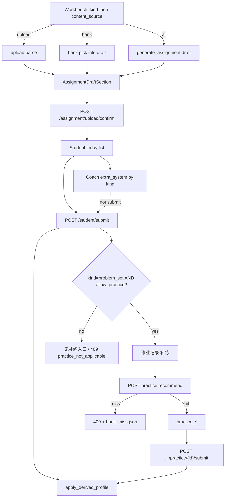
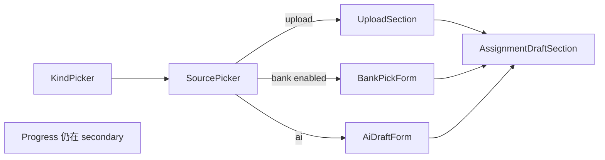
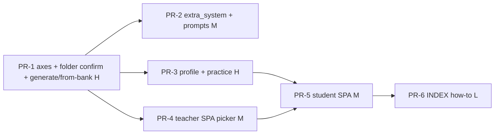

# teacherAgent 下一阶段：作业体裁 × 草稿来源 + 做题查漏补缺

| 字段 | 值 |
| --- | --- |
| 文档标题 | Next-phase: assignment_kind × content_source + problem_set bank gap-fill |
| 作者 | TBD（平台 Owner 签字后生效） |
| 日期 | 2026-10-11（修订 2026-10-10 gap-fill 稿；吸收 Owner 产品纠偏） |
| 状态 | Draft（吸收 2026-10-11 设计复审 Issue 1–12 与 round-3 Issue 1–3） |
| 产品 | 单校作业产品（teacher 布置/确认/进度；student 今日列表/陪练/显式提交；admin 学校面板） |
| 仓库 | `/home/tdcasual/codework/teacherAgent` |
| 权威关系 | 产品身份：`docs/plans/2026-08-28-assignment-core-product-design.md`。审计修复：`docs/plans/2026-10-10-audit-remediation-design.md`。本文件：作业闭环下一阶段（布置轴 + 画像写回 + 做题题库补练 + prompt 瘦身）。catalog vis 仍 09-06；进度数字仍 10-10 KD-7（compute-primary，至 2026-12-01）。 |
| 治理 | `CONTRIBUTING.md` L/M/H；M/H 必须 TDD；H 需回滚 + 安全测试 + 风险登记更新或明示「为何不需要」 |
| 团队 | 2 人。`.github/CODEOWNERS` 全是 `@tdcasual`。PR **正好 6**。 |
| 纠偏 | **撤回**上一稿隐含的「作业 = 题库做题」和「AI 出题只存在于老师 generate leftover」。学生仍不得被静默 AI 编题干；做题类查漏补缺仍只走自建题库。 |

---

## Overview

作业 HTTP 闭环已经能跑：老师上传 → confirm → 进度；学生今日列表 / 聊天陪练 / `POST /student/submit`。对照产品定义与 2026-10-10 评分，缺口仍是 **作业之后没有证据→画像→（做题才有的）题库补练**，以及陪练 extra_system 还在指令模型「动态生成 Q1–Q4」。

上一稿把「禁止对学生静默编题」推成了「布置也只能题库选题」。Owner 纠偏：

> 老师可以在布置作业时选择模式：AI出题 和 题库模式，并不是只能题库模式。作业也会有很多种，比如情景类作业、科学史类作业，等等，并不一定是做题，甚至包括实践作业的讨论等等。

本波把布置拆成 **两条正交轴**，写进 `meta.json`，工作台主线在上传/生成之前先选：

1. **`assignment_kind`**：学生怎么完成、agent 怎么陪练、交后要不要题库补练。本波只落地 4 个闭集：`problem_set` / `scenario` / `science_history` / `practical`。
2. **`content_source`**：草稿从哪来。闭集：`upload` / `bank` / `ai`。三者都是 **老师草稿**，**confirm 仍是唯一发布门闩**（08-28 D2）。学生永不发布。空今日态保持「老师尚未布置」。

查漏补缺 **只对 `problem_set`**：提交作业后学生显式点补练，服务端从 `DATA_DIR/question_bank` 做确定性选择，持久化为同一 `assignment_id` 下的 `practice_*`。空库 → 409 `question_bank_insufficient`，不 `make_generated`。其它体裁 POST 补练 → 409 `practice_not_applicable`。

同时做工程卫生：prompt 按 kind 注入、删学生编题指令、SKILL.md 对齐运行时。不为 LOC 拆 `app_core.py`，不加新 `test_*structure*.py`（冻 84），不把 GET 进度改成 SQL-primary，不做考试产品，不做题库 CMS（follow-on）。

---

## Demand Analysis

该需求 **合理**。上一稿的错误是把两条轴揉成一条「作业=题库做题」。下面分开写，后面的 Goals / KD / PR 都按这个拆。

### 轴 A — `content_source`（老师布置时选，草稿从哪来）

闭集，**confirm 时写入** `meta.json`。不要复用 CLI `--mode`。

| value | 含义 | 今日活代码 |
| --- | --- | --- |
| `upload` | 老师上传材料，解析草稿，confirm | 工作台主线。`assignment_upload_confirm_service._build_assignment_meta` 已写 `"mode": "upload"`。how-to 只写这条。 |
| `bank` | 从 `DATA_DIR/question_bank` 选题进草稿，老师审核 confirm | CLI `skills/student-coach/scripts/select_practice.py` 存在；**教师 SPA 无 picker**；学生不得调。CSV 0 行。 |
| `ai` | 模型帮老师起草。做题则题干；非做题则情景/史/实践 brief+rubric。**必须 confirm** 才对学生可见 | `POST /assignment/generate` + 工具 `assignment.generate` + `--generate` 已是 HTTP/tool。日常 how-to 不走它。`WorkflowTab` 只有 UploadSection + Draft + Progress。 |

规则：

- **Never** 让学生 publish。空今日保持「老师尚未布置」。学生工具仍只有 `assignment.my_today` / `assignment.my_result`。
- `bank` **仅当** `assignment_kind=problem_set`（或未来 mixed kind，本波不发明）。其它 kind + `content_source=bank` → **400** `bank_requires_problem_set`。
- `ai` 对每个 kind 合法。`problem_set` 可填 `questions.csv`（现有 generate）。其它 kind 起草 `brief.md` / requirements / rubric，**不**伪造 `questions.csv` 行。
- `upload` 对每个 kind 合法。`problem_set` 解析 0 题仍失败。非做题允许 0 题，但必须有 `requirements.brief`。

#### 名碰撞：不要超载 `meta.mode`

活代码已经撞名：

- 上传 confirm 写 `meta.mode = "upload"`（`_build_assignment_meta`）。
- generate CLI `--mode` 是选题算法 `kp | explicit | hybrid | auto`，并写进 generate 的 `meta.mode`（`select_practice.build_generated_assignment_meta`）。

**本波引入 `content_source`。** CLI `--mode` 继续只表示内部 pick 算法，不出现在产品 UI。`meta.mode` **保留一版**作为遗留回声（upload 仍写 `"upload"`；generate 仍可写 `kp|explicit|hybrid|auto`），新代码读写 `content_source` / `assignment_kind`。

缺字段迁移（读路径 helper，不扫盘改历史文件，除非 confirm 重写）：

```python
CONTENT_SOURCES = ("upload", "bank", "ai")
ASSIGNMENT_KINDS = ("problem_set", "scenario", "science_history", "practical")

def effective_content_source(meta: dict, *, folder: Path | None = None) -> str:
    raw = str(meta.get("content_source") or "").strip()
    if raw in CONTENT_SOURCES:
        return raw
    if meta.get("source_files"):
        return "upload"
    mode = str(meta.get("mode") or "").strip()
    if mode in {"kp", "explicit", "hybrid", "auto"}:
        return "ai"
    if folder is not None and (folder / "generated_stems").exists():
        return "ai"
    return "upload"

def effective_assignment_kind(meta: dict) -> str:
    raw = str(meta.get("assignment_kind") or "").strip()
    return raw if raw in ASSIGNMENT_KINDS else "problem_set"
```

旧作业全部按 `problem_set` + 上表 source 解释。这与「今天所有已发布作业都是做题上传/生成」一致。

### 轴 B — `assignment_kind`（作业体裁）

闭集，小。Owner 举例是体裁，不是无界 CMS。本波 **只这 4 个**；再多的体裁先写进 `requirements.brief` / `extra_constraints`，直到出现真正的第二产品。

| value | 学生完成 | 陪练 | 题库补练 |
| --- | --- | --- | --- |
| `problem_set` | 做题 + 照片/PDF 提交 + OCR 评分 | 解释数据块内题干 | 作业已交后允许（上一版形态 B） |
| `scenario` | 读情景 brief，讨论 + 提交书面/照片产物 | 只围绕老师 brief，不另编情景 | 默认关 |
| `science_history` | 读材料，讨论/短答 | 只引用老师材料；不编日期/人物/「补一段历史故事」（§3.3） | 默认关 |
| `practical` | 实践证据（照片）+ 讨论 | 引导描述现象/步骤，不编实验 | 默认关 |

`completion_policy` 已有 `requires_discussion` / `requires_submission`（`assignment_catalog_service._default_assignment_completion_policy`；上传 confirm 写 discussion=false、submission=true）。**复用，不新开完成引擎。**

默认（confirm 可改 discussion/submission；`allow_practice` 见 KD-25）：

| kind | `requires_submission` | `requires_discussion` | `allow_practice` | `min_graded_total` |
| --- | --- | --- | --- | --- |
| `problem_set` | true | false | true | 1 |
| `scenario` | true（产物） | **true** | false | 0 |
| `science_history` | true | **true** | false | 0 |
| `practical` | true（照片证据） | true | false | 0 |

**轻改 08-28 D4（完成语义不改，旗标语义写清）：** 非做题默认 `requires_discussion=true` 是 **展示/陪练提示**，不是完成门闩。`assignment_progress_service._is_completed` **仍然只看** `requires_submission`（`completed = submitted if requires_submission else True`）。进度可显示 `discussion_required`；学生交了照片/产物后 `complete` 仍为 true，即使从没聊天。Draft 上的「需要讨论」复选框必须标明「陪练提示，不作为完成条件」，否则老师会以为勾了就不能完成。讨论仍不能替代提交，除非老师把 `requires_submission` 设为 false（默认保持 true，以便有证据）。**禁止**把讨论重新做成完成门闩。

非做题 0 题时不得假装 OCR 出逐题分：走「收到即交」报告（§4.4），让 today/history 的 `submitted` 为真。做题 OCR 失败仍是今日的 ungraded / `submitted=false`。

### 「AI出题」是什么、不是什么

| 是 | 不是 |
| --- | --- |
| 老师拥有的草稿起草。`POST /assignment/generate` / `homework-generator` / 工作台 `content_source=ai`。 | 学生聊天发明作业、补练题干、额外 Q1–Q4。 |
| Confirm 仍是发布门闩（08-28 D2）。draft `visibility_status=draft` 对学生不可见。 | 空库时 `make_generated` 对学生可见。 |
| 非做题 AI：**模型**根据 topic/grade/可选 seed 起草 `brief` + `discussion_goals` + 可选 `rubric.md`（§2.3 option A）。老师在 Draft 里改。Confirm 才发布。不编假 `questions.csv` 行。 | 学生 extra_system 倒答案、调用老师工具。把老师手打 brief 冒充「AI出题」。 |

教师 `homework-generator` / `POST /assignment/generate` **保留**，并在工作台以 `content_source=ai` 露出，而不是只藏在聊天。学生路径永不调用 `--generate` / `make_generated` / `generate_with_llm`。

### 8 点要求是做题形的 — 按 kind 门闩

活代码：`assignment_requirements_service.py` 强制 subject/topic/grade_level/class_level、typical_problem、3–8 core_concepts、≥4 misconceptions、duration ∈ {20,40,60}、≥1 preference。Confirm 缺项 → `requirements_missing`。教师 UI 缺项禁用「创建作业」（`AssignmentDraftSection` + `formatMissingRequirements`）。

对非 `problem_set` 强制 typical_problem + 4 条易错点是产品错误。

**一个函数，按 kind 分支，禁止复制 4 套 validator。**

```python
def compute_requirements_missing(
    requirements: dict,
    *,
    assignment_kind: str = "problem_set",
) -> list[str]:
    ...
```

| kind | 必填 | 不要求 |
| --- | --- | --- |
| 所有 | `subject`, `topic`, `grade_level` | — |
| `problem_set` | 现行 8 点（含 `class_level`、typical_problem、core_concepts 3–8、misconceptions ≥4、duration 20/40/60、preferences ≥1） | — |
| `scenario` / `science_history` / `practical` | 新字段 `requirements.brief`（非空字符串）。`class_level` **可选**。duration 可选。可选 `discussion_goals` list，最多 5 条非空字符串 | typical_problem、misconceptions、preferences、core_concepts **均非必填** |

`extra_constraints` 继续表示约束（计算器/步骤规范等），**不要**拿它当 brief，以免「限制」和「情景正文」混义。`validate_requirements` / `save_assignment_requirements` / `ensure_requirements_for_assignment` / 草稿 missing 列表全部走这一个函数。Confirm + Draft UI 的缺失项来自它。`format_requirements_prompt` 按 kind 换文案，非做题不要再写「请按 8 项补全」。

前端 `workbenchUtils.requirementLabels` 增 `brief` / `discussion_goals`。

### 学生陪练 / extra_system 按 kind（prompt craft）

不新增 prompt 版本目录。改 `prompts/v1`。

- 共用学生 `10_role.md`：首行保持「学生端学习助手」；保留「不要生成作业」。禁止发明作业、调老师工具、再要身份。
- Kind 规则放进 extra_system（与今日 study 规则同一通道），**不要** 4 个新 manifest 模块。编译期不把未用 kind 塞进每个请求。
- `problem_set`：注入 stems 块（§3.2）；删除 F/G/I Q1–Q4 编题；规则在题干前；cap 6000 从尾部切（活代码 `_cap_extra_system` 已是 `text[:max_chars]`，规则必须在前）。
- `scenario` / `science_history` / `practical`：注入 **brief + discussion_goals + 老师 requirements**；**无** stems 块，除非 `questions.csv` 真有行；**无**「动态生成 Q1–Q4」；只讨论老师 brief；提醒「对话不是提交」。
- 从学生 manifest 归档 `25_question_quality.md` / `30_tutoring_style.md`（仍是出题形）。
- **不改** 共用 `common/90_self_check.md` 的图引用条（老师 generate 仍要）。学生「另编题干/另编情景」自检只写在学生 10_role / coach overlay / extra_system kind 规则。
- extra_system 编题规则删除与 prompt 瘦身 **合并进 PR-2**。PR-4 不依赖 PR-2（只依赖 PR-1 folder-draft）。

### 题库补练：上一稿机械保留，按 kind 门闩

`problem_set` 补练 KD（形态 B、`--attempt-dir`、principal-only、确定性选题、submit 不自动 pick）全部保留，见 Key Decisions KD-1…15。

非 `problem_set`：`POST .../practice` → **409 `practice_not_applicable`**（与 `homework_not_submitted` / `question_bank_insufficient` 三个码互不复用）。画像仍在 submit 时更新：无逐题分时 fallback KP 来自 `core_concepts` 或 `discussion_goals`（最多 3），`source=ungraded_fallback` / `brief_fallback`。

---

## Background & Motivation

### 产品定义（Owner，不重开）

老师布置作业，并可给出说明，作为 agent 考查与解释的基础（可选）。学生在此自主完成作业。评估能力并自主查漏补缺。根据完成情况描绘学生画像。接受图片提交。

老师布置时可选 **上传 / 题库 / AI 起草**；作业体裁不限于做题。查漏补缺从自建题库选题 **仅适用于做题类**。**不是** AI 对学生自主编题。

### 当前运行时（对照代码，禁止把 SKILL.md 当现状）

| 能力 | 活代码 | 产品后果 |
| --- | --- | --- |
| 工作台主线 | `WorkflowTab.tsx`：UploadSection + AssignmentDraftSection + AssignmentProgressSection。无 kind/source picker，无 generate UI。 | 老师在 SPA 只能上传做题稿。AI/题库只存在于聊天/HTTP。 |
| 上传 meta | `_build_assignment_meta` 写 `mode: upload`、`completion_policy.requires_discussion=false`、`requires_submission=true`、`source_files`。无 `content_source` / `assignment_kind` / `allow_practice`。 | 无法区分体裁与草稿来源。 |
| 生成 | `assignment_generate_service.generate_assignment` 调 `select_practice.py`；`--mode` = kp/explicit/hybrid/auto；`--generate` 可选；`DRAFT_VISIBILITY_STATUS=draft`。工具路径同样。`ensure_requirements_for_assignment` 按 8 点。 | 非做题也会被 8 点挡住；无 brief 草稿。 |
| 解析 0 题 | `assignment_upload_parse_service` 无题 → job failed `"no questions parsed"`。`write_uploaded_questions` 空列表则 **不写** `questions.csv`。 | 情景/实践上传会失败。 |
| 学生工具 | `chat_support_service.allowed_tools("student")` = `{assignment.my_today, assignment.my_result}`。 | 模型不能 generate、不能改画像、不能选题。保持。 |
| 学习上下文 | `_student_extra_system`：`include_text=False`；**仅 `study_mode`** 才 `build_assignment_context`。无 `stem_text`。F/G/I：动态生成 Q1–Q4，「禁止预置题干」。`build_verified_student_context`：「直接输出【诊断问题】Q1」。`10_role.md`：「进入诊断问题」。 | 做题陪练看不见本题；非做题会被指令另编情景。 |
| 正式完成 | `POST /student/submit` → `grade_submission.py`。后缀 `STUDENT_ALLOWED_SUFFIXES`。Grader 一次写两棵 `submission_<ts>`（`:594` 与 `:628`）。`valid_submission = graded_total > 0`。today/history 用 `_qualifying_attempt`（要 valid_submission）。 | 聊天仍是侧信道。0 题实践照片会 ungraded 且 **不算已交**。 |
| 画像 | CLI `grade_submission.py:837-872` 写 `ROOT/data/student_profiles`；`total < 2` 丢 KP。Ungraded **不写**画像。`update_profile.py` 空 weak 跳过。`POST /chat` Layer 1 用 `extract_diagnostic_signals` 覆盖 `weak_kp`。SPA job 路径已是 note-only。 | 租户 DATA_DIR 可能看不到 CLI 写入；满分无法清 weak。 |
| 题库 | `data/question_bank/questions.csv` 只有表头。`select_practice.py` **模块顶层** `LLMGateway()`。不带 `--generate` 不足时仍 `make_generated` 写「【待生成】」。 | 学生若 import 该模块会拉 LLM；空库会编占位题。 |
| Prompt | 学生 manifest：guardrails + 10_role + 20_math_rules + **25_question_quality** + 30_tutoring_style + 90_self_check。`test_prompt_builder.py:39` `assertNotIn("生成作业")` 与「不要生成作业」冲突。老师 `20_tool_policy.md` 仍写 `student.import`、`auto_install`。 | 出题指令还在学生栈。 |
| 文档 | `docs/how-to/teacher-daily-workflow.md` 只写上传。`SKILL.md` 仍是 Diagnose → generated second。 | 后人按文档实现假闭环。 |
| 结构测试 | `tests/test_tech_debt_targets.py` `STRUCTURE_TEST_COUNT_FROZEN = 84`。 | 本波禁止新 `test_*structure*.py`。 |

### 为什么现在做

Owner 纠偏之后，本波要同时做三件事，而不是把工作台继续锁死在上传做题：

1. 布置面：kind × source 成为一等字段，工作台能选，AI/题库进入同一 confirm。
2. 陪练面：按 kind 注入题干或 brief，删 Q1–Q4。
3. 做题闭环：证据 → 画像 → 题库补练（禁止对学生编题）。

---

## Goals & Non-Goals

### Goals

1. **两条轴落盘。** 新确认作业的 `meta.json` 含 `content_source`、`assignment_kind`、`completion_policy.allow_practice`。读路径用 `effective_*` helper。非法组合 400。
2. **8 点按 kind 门闩。** 一个 `compute_requirements_missing(..., assignment_kind=)`。非做题要 `brief`，不要 typical_problem/4 条易错。Draft UI 与 confirm 共用 missing 列表。
3. **老师三条草稿来源，一个发布实现。** 工作台：先 kind、再 source，然后 upload / bank picker / AI 表单。结果都进同一 `AssignmentDraftSection`。`POST /assignment/upload/confirm`（文档称「发布草稿」）与 `assignment.publish` 共用 `_finalize_published_from_folder`。`POST /assignment/generate` 是唯一 AI 起草栈（非做题在同一函数内 LLM 写 brief，不另起 generate-brief 服务）。
4. **提交即证据。** `POST /student/submit` 成功落盘后（含 ungraded / received_without_items），进程内 lock+merge 写 `resolve_student_profile_path`。空 KP 列表也覆盖。history 含 `question_ids`。
5. **陪练看见老师给的材料。** 绑定 `assignment_id` 即注入。做题：stems + 8 点。非做题：brief + discussion_goals + requirements。永不 `json.dumps(detail["questions"])`，不注入答案。
6. **做题查漏补缺 = 题库确定性选择。** 仅 `problem_set` 且已交后显式 POST。`practice_*` + `--attempt-dir`。空库 409 + `bank_miss.json`。学生路径零 LLM。
7. **画像对学生可见。** 画像卡只放「作业记录」页，读 `recent_weak_kp` / `next_focus` / `practice_history`。不发明 `weak_kp` 键。补练入口按 kind/`allow_practice` 隐藏。Profile GET 本波不改授权。
8. **Prompt 变短、可测。** 学生身份串不变。禁编题/编情景祈使句。归档 25/30。不改共用 `90_self_check.md` 图引用条。
9. **卫生。** SKILL.md 对齐运行时。INDEX / `CURRENT_PLAN_AUTHORITIES` **只在 PR-6**。

### Non-Goals（本波明确不做）

- 考试产品、survey/class_report 复活、多校、双师共教。
- 学生 `assignment.generate`；空今日改成「生成任务」。
- 把聊天/附件当正式提交。讨论默认不是完成门闩（非做题 `requires_discussion=true` 只是展示/陪练提示；仍不替代 submit，除非老师关 `requires_submission`）。
- 老师题库 CMS / 可视化 CRUD（**记为 follow-on PR-F**；本波 CSV + picker；空库 409 是预期）。
- 第 5 种 kind、mixed kind、无界 CMS。
- SQL-primary GET 进度、Landlock、Grafana、拆 god file、新 structure-test、学生 SPA 改密。
- 改 `chart.exec` 去留。MCP 不绑 `0.0.0.0`。git filter-repo。
- 从老师 **AI** 路径删除 `--generate` / `make_generated`（可保留 leftover）。**学生路径与 `content_source=bank` 永不调用。**
- LLM rerank 补练题。改 `skill.yaml` `allowed_roles`（遗留 teacher+student，本波不碰）。

---

## Key Decisions

上一稿 KD-1…15 **对 `problem_set` 补练/画像/stems 仍然有效**。本表是完整集合；纠偏新增从 KD-16 起。

| # | 决定 | 理由 |
| --- | --- | --- |
| KD-1 | 补练形态 **B**：`practice_attempt` 隶属源 `assignment_id`，文案「补练」，不进 `GET /assignment/today`。推荐 **仅当** 该生该作业已有 qualifying homework attempt（`valid_submission`）。否则 409 `homework_not_submitted`。 | 今日列表语义已锁定「老师布置」。 |
| KD-2 | 学生路径 **禁止** `select_practice --generate`、`make_generated`、`generate_with_llm`、core-example variants。选择函数不得 import `llm_gateway`。本波只确定性选择。 | 空库不得变成编题。 |
| KD-3 | 推荐 409 `question_bank_insufficient` 时写入 `bank_miss.json`。history GET **只读**该标记。成功推荐后清除 miss。 | 否则 GET 不稳定。 |
| KD-4 | 画像权威 = **submit/practice-submit 派生 + 老师工具覆盖**。`POST /chat` Layer 1 不再写 KP。Job 路径保持 note-only。 | SPA 已是 note-only；`/chat` 仍会覆盖。 |
| KD-5 | `_write_derived_profile` **进程内**写 `resolve_student_profile_path`：与 `update_profile.py` 同款 lock（`*.json.lock`）、atomic tmp+replace、merge。空 `recent_*_kp` / 空 `next_focus` **覆盖**。失败 `diag_log`，**不 5xx**。HTTP 调 grader 恒带 `--skip-profile-update`。 | 现 CLI 不能清 empty、不走 profile path jail。 |
| KD-6 | 补练路由 **body/query 不收 `student_id`**。只信 principal.actor_id。无 principal → **400 `principal_required`**（含 `AUTH_REQUIRED=0`；钉死此字符串，测试断言 `detail`/`error`）。`meta.student_id` ≠ actor → 403 `forbidden_student_scope`。不新增学生 chat 工具。 | 比 `resolve_student_scope` 无 principal 回传 raw id 更严。 |
| KD-7 | extra_system **永不** `json.dumps(detail["questions"])`。做题 stems 块只有 `question_id/kp_id/difficulty/stem_text`。Join：verified → **kind 学习规则** → 作业要求/brief → stems（若有行）→ 补练（仅 problem_set）→ 最近一次补练短反馈 → cap（切尾，保住规则）。不注入 `feedback.md`。 | `include_text=True` 的 CSV 行带 `answer_ref`。 |
| KD-8 | 绑定合法 `assignment_id` 即注入材料+规则（不依赖「开始作业」口令）。删除 F/G/I。 | extra_system 会打败 role。 |
| KD-9 | 进度 GET 仍 compute-primary。补练计数只从盘上 `practice_*` + `bank_miss.json` 计算，**不写入** `student_submission_attempts`。`counts.submitted` / `official_score` 不变。 | `RISK-ASSIGNMENT-DUALWRITE-001` 保持开放。 |
| KD-10 | Prompt 不发明新版本目录。学生栈：guardrails + 10_role + math_rules + coach overlay + self_check + pack overlay。身份首行「学生端学习助手」。保留「不要生成作业」。`common/90_self_check.md` **原样保留**图引用自检。学生「另编题干/另编情景」只在 10_role / overlay / extra_system kind 规则。 | `assertNotIn("生成作业")` 与目标稿冲突，PR-2 改该断言。身份串断言不改。 |
| KD-11 | 老师覆盖画像：工具 `student.profile.update`。HTTP `GET /student/profile/{id}` **保持** `resolve_student_scope`（无 principal 时回传 raw id）；**本波不加固** 该 IDOR 形。画像卡只放「作业记录」页，读 `recent_weak_kp`。 | 10-10 Non-Goal；practice 路由已经更严，profile GET 不混进本波。 |
| KD-12 | 派生：取消 `total < 2` 丢弃；1 题错即 weak。满分 → `recent_weak_kp=[]`。无逐题分：`core_concepts` 或 `discussion_goals`（最多 3），`source=ungraded_fallback` / `brief_fallback`。 | 小作业/实践否则无画像。 |
| KD-13 | 补练评分：`grade_submission.py --attempt-dir <已有 practice_dir>` **只往该目录写**。不创建任何 `submission_*`。泄漏 → 删除 + 500。作业 submit **不传**该 flag。 | 拒绝 rehome。 |
| KD-14 | `practice_id` = `"practice_" + secrets.token_hex(6)`。HTTP：`POST /student/assignment/{assignment_id}/practice/{practice_id}/submit`。 | 秒级 ts 碰撞；URL 无 assignment 就要全盘扫描。 |
| KD-15 | `POST /student/submit` **不**自动 pick。extra_system 只注入 **最新一轮** 补练题干/短反馈。 | 避免 submit 热路径选库。 |
| KD-16 | 产品轴用 **`content_source`**，不超载 `meta.mode`。CLI `--mode` 仍是 kp/explicit/hybrid/auto。缺 `content_source` 按 §Demand 迁移。 | 活代码 `mode` 已撞名。 |
| KD-17 | 本波 kind 闭集 4 个。未知值 400 `invalid_assignment_kind`。缺省读作 `problem_set`。 | Owner 举例是体裁不是 CMS。 |
| KD-18 | `content_source=bank` 仅 `problem_set`。其它 → 400 `bank_requires_problem_set`（prepare、confirm、generate 都查）。 | 题库行是题目，不是情景 brief。 |
| KD-19 | 要求校验 **一个函数按 kind 分支**。非做题 **confirm** 必填 `requirements.brief`，不把 brief 塞进 `extra_constraints`。AI generate 之前 brief 可空（模型起草）。Confirm 把 `requirements.brief` 写入 `brief.md`；extra_system 先读 requirements，缺则读 `brief.md`。**不**强制两文件字节相等。 | 避免 4 套 validator；关闭原 OQ-2。 |
| KD-20 | Kind 陪练规则只在 extra_system 按当前作业选择；不新增 4 个 manifest 模块。PR-2 **合并** extra_system 删编题 + prompt 瘦身。 | 未用 kind 不膨胀每个请求；避免跨 PR 窗口。 |
| KD-21 | **一个发布实现、一个 AI generate 栈。** 工作台三条来源都进 `AssignmentDraftSection`。HTTP 仍用 `POST /assignment/upload/confirm`（locator = `job_id` 或 `assignment_id`）；老师 overlay 称之为 **「发布草稿 / publish draft」**，不暗示只有 upload。`_finalize_published_from_folder` 是 **唯一** folder 发布函数：confirm（无 job）与工具 `assignment.publish` **都调用它**，同一套 400（`requirements_missing` / `bank_requires_problem_set` / `questions_missing`）。禁止 `publish_assignment` 只翻 `visibility_status`。AI 只走 `generate_assignment()`；非做题是该函数内的 LLM brief 分支，不新建 draft-brief 服务。 | 聊天 generate 不能绕过 kind 门闩。 |
| KD-22 | 教师 SPA kind+source picker **本波必做**（PR-4），不是 vaporware。Bank 在非 `problem_set` 禁用。 | Owner：老师要能选 AI 和题库。 |
| KD-23 | 补练 409 三码分开：`practice_not_applicable`（kind/`allow_practice`）≠ `homework_not_submitted` ≠ `question_bank_insufficient`。 | UI 文案不同。 |
| KD-24 | `questions.csv` 无数据行：作业 submit **跳过**逐题 OCR，写 `received_without_items=true` 的 `submission_*` 报告，`compute_submission_attempt.valid_submission=True`。`official_score` 仍 null 直到老师覆盖。做题 OCR 失败保持今日 ungraded/`submitted=false`。 | 否则实践/情景照片永不记已交（today 走 `_qualifying_attempt`）。 |
| KD-25 | `allow_practice` 默认随 kind。老师可在 confirm **关掉** 做题补练。非做题即使误写 true，推荐仍 409 `practice_not_applicable`（kind 赢）。`requires_discussion=true`（非做题默认）= 展示/陪练提示，**不是** `_is_completed` 输入（D4 完成语义保留）。 | 补练机械是做题形的；复选框不得假装完成门闩。 |
| KD-26 | `content_source=bank`（老师草稿或学生补练）不足 → 409，**永不** `make_generated`。`make_generated` / `--generate` 仅 `content_source=ai` ∧ `kind=problem_set`。对该组合，**HTTP Form 默认 true**；工具路径必须 `args.get("generate", True)`（今日 `bool(args.get("generate"))` 在省略键时是 False——schema default **不会**被 dispatch 填上）。**只有显式 False** 才是 bank-only。preflight 可省略 `generate`（工具默认 true）或显式 True。同一 PR 改 `homework_generator.md`。 | 空库上 chat 省略 `generate` 键不能在收紧 `make_generated` 后变成「只能题库」。 |
| KD-27 | INDEX / `CURRENT_PLAN_AUTHORITIES` 只 PR-6。 | 集合相等测试。 |
| KD-28 | **Folder-draft locator（save + confirm + HTTP handler）。** `UploadDraft.job_id` 改为可选。`POST /assignment/upload/draft/save` 与 confirm 在 `visibility_status=draft` 时接受 `assignment_id`（无 job）。**Handler**（`assignment_upload_handlers.py`）在 `assignment_id` 且无 `job_id` 时跳过 `load_upload_job` / job gate，直接 folder save / `_finalize_published_from_folder`。Gate 只用于 job locator。`_finalize_published_from_folder` **禁止**走上传 confirm 的「新建作业」2PC。SPA：`handleConfirmUpload` 在无 `job_id` 时不得 early-return。服务层 `confirm_assignment_upload` 保持 &lt;130 行。 | 活代码 handler 先 load job；只改 service 会 404 `job not found`。 |
| KD-29 | 老师 from-bank **confirm（发布）时** 把 stem/answer **字节** 快照进 `assignments/<id>/bank_stems/`（及 `bank_answers/`），并改写该作业 `questions.csv` 的 `stem_ref`/`answer_ref` 为快照路径。Pick 阶段可仍复制 bank 字符串。学生 **practice** 保持活题库 ref（短命）。发布后改 bank 文件不得改变该作业 `get_expected_answer`。 | 否则 CMS/改 CSV 会改已布置作业的评分。 |
| KD-30 | 非做题 AI（option A）：`_draft_non_problem_set` 调 **一个** 指定 prompt（topic / grade_level / 可选 seed）→ brief + discussion_goals + 可选 rubric。复用老师 generate 已有的 `LLMGateway`（lazy import，与 `generate_with_llm` 同通道）。**不是**第二个 generate 服务/agent。Generate 前 brief 可空；confirm 仍要 brief。 | Owner：情景/史/实践也可以 AI 出题，不是手打 brief 贴文件夹。 |

---

## Proposed Design

### 目标回路



Confirm 之前学生对作业不可见。Submit 不连到 Pick。非做题没有补练卡。

### 1. Meta 轴 + 完成策略

#### 1.1 写入点

| 路径 | 文件 | 写入 |
| --- | --- | --- |
| 上传 confirm | `assignment_upload_confirm_service._build_assignment_meta` | `content_source="upload"`（现 `mode="upload"` 保留）、`assignment_kind` 来自 job、`allow_practice` 默认随 kind、completion_policy 可被 override |
| 题库草稿 | 新 prepare（§2.2）写 draft `meta.json` | `content_source="bank"`、`assignment_kind="problem_set"`、`visibility_status=draft` |
| AI 草稿 | `generate_assignment` + `try_postprocess_assignment_meta` | `content_source="ai"`、kind 来自请求、draft |
| 旧文件 | 不强制 migration 写回 | 读用 `effective_*` |

`_build_upload_record`（`assignment_upload_start_service.py`）增加 `assignment_kind`、`content_source="upload"`。`POST /assignment/upload/start` 增表单字段 `assignment_kind`（路由：`services/api/routes/assignment_upload_routes.py`）。

**kind 缺省策略（写死，避免 §1.1 与 §2.3 打架）：**

| 入口 | 缺 `assignment_kind` | 非法值 |
| --- | --- | --- |
| `POST /assignment/upload/start` | 默认 `problem_set` + 日志 `assignment.kind.defaulted`（旧 SPA） | 400 `invalid_assignment_kind` |
| `POST /assignment/generate` 与工具 `assignment.generate` | 默认 `problem_set` + 同一日志。preflight **可以省略** kind | 400 `invalid_assignment_kind` |
| `POST /assignment/draft/from-bank` | 服务端 **强制** `problem_set`（不是客户端选项） | n/a |
| confirm / draft save | 不读 body 上的 kind；用 job 或 folder `meta.assignment_kind`（缺则 `effective_assignment_kind` → `problem_set`） | body 若带非法 override → 400 |

禁止在 generate 上对「缺 kind」返回 400（否则 chat/preflight 在 PR-1 会断）。

`generated_assignment_completion_policy()` 与 `_default_assignment_completion_policy` 增加 `allow_practice`；按 kind 填默认（表见 Demand）。老师 override 在 confirm 合并。

#### 1.1.1 Folder-draft locator（KD-28；PR-1 必须落地，否则 PR-4 不得开工）

活代码全是 job 作用域：

- `UploadConfirmRequest.job_id: str`（`services/api/api_models.py`）
- `UploadDraftSaveRequest.job_id: str`
- `saveDraft` 只 POST `{ job_id, requirements, questions }`（`useAssignmentWorkflow.ts`）
- `handleConfirmUpload`：无 `resolvedJobId` 立即 return；confirm body 只有 `job_id`
- `UploadDraft.job_id` 在 `frontend/apps/teacher/src/appTypes.ts` 是必填 `string`
- 上传 confirm 见已有 `assignments/<id>/meta.json` → `_try_heal_existing_meta` / `_persist_new_assignment` → **409 `assignment already exists`**
- `publish_assignment`（`assignment_archive_service.py:84`）只翻 `visibility_status`，**不算** `expected_students`。today 用 `student_on_snapshot` → `meta.expected_students`。Generate 能进 today 是因为 `postprocess_assignment_meta` 填了快照；from-bank 若只写 questions.csv + draft meta 则名册为空。
- **HTTP 仍进不了 folder 路径：** `handlers/assignment_upload_handlers.py:105–118` 先 `load_upload_job(req.job_id)`；缺 job → 404 `job not found`。`assignment_upload_draft_save`（handlers:90–94）永远把 `req.job_id` 交给 job-only saver。`assignment_upload_confirm_gate_service.py` 只认 job `status in {done, confirmed}`。路由是一行 `assignment_app.confirm_assignment_upload(req)` 透传；只改 models/routes/service 不够。

本波 locator：

| 操作 | job 上传流 | folder draft（bank / AI） |
| --- | --- | --- |
| 物化草稿 | upload job `parsed.json` | `DATA_DIR/assignments/<id>/` 且 `visibility_status=draft` |
| 保存编辑 | `POST /assignment/upload/draft/save` + `job_id` | **同一 URL**，body 带 `assignment_id`、无 `job_id`；仅当该 folder `visibility_status=draft` 且 `meta.teacher_id==principal`。就地写 `requirements.json` / `questions.csv` / `brief.md`（及可选 rubric）。published → 409 `invalid_visibility_status` |
| 发布 | confirm + `job_id` → `_finalize_published_from_job`（今日 2PC 新建） | confirm + `assignment_id` → **`_finalize_published_from_folder`**（更新已有 draft，**禁止** create-new 409） |
| 重载草稿 | `GET /assignment/upload/draft?job_id=` | `GET /assignment/{assignment_id}/draft`：owner + draft only；payload 与 upload draft 同形，`job_id` 省略。**注册在已冻结的 `assignment_upload_routes.py`**。**不要**新增 `assignment_delivery_routes.py`（`GET /assignment/{assignment_id}` 已在那里，与 `/draft` 不撞） |
| HTTP 入口 | `handlers.assignment_upload_confirm` / `_draft_save`：有 `job_id` 时现路径（`load_upload_job` + gate） | **同一 handler**：`assignment_id` 且无 `job_id` 时 **跳过** `load_upload_job` 与 job gate，改调 folder save / `_finalize_published_from_folder` |
| job gate | `ensure_assignment_upload_confirm_ready(job)` | **只在 job locator** 调用。folder 路径不进 `assignment_upload_confirm_gate_service.py` |

`UploadConfirmRequest` / `UploadDraftSaveRequest`：`job_id: Optional[str] = None`，增 `assignment_id: Optional[str] = None`、confirm 另增 `completion_policy_override: Optional[dict] = None`。两者都缺 → 400 `job_or_assignment_required`；两者都有 → `job_id` 赢（上传流）。

**Handler 分发（PR-1 必改，否则 KD-28 到不了 HTTP）：**

```text
assignment_upload_confirm(req):                         # handlers/assignment_upload_handlers.py
  if req.assignment_id and not req.job_id:
      return _finalize_published_from_folder(...)       # skip load_upload_job / gate
  job = load_upload_job(req.job_id)                     # 404 job not found
  gate = ensure_assignment_upload_confirm_ready(job)    # job-only
  return confirm_assignment_upload(job_id, job, ...)    # existing service

assignment_upload_draft_save(req):
  if req.assignment_id and not req.job_id:
      return save_assignment_folder_draft(...)          # skip job saver
  return save_assignment_upload_draft(req.job_id, ...)
```

服务层 `assignment_upload_confirm_service.confirm_assignment_upload` **保持短 dispatcher**（job 2PC），**不要**把 folder 逻辑塞进去。已有冻结构测试 `tests/test_assignment_upload_confirm_structure.py` 限制该函数 **&lt; 130 行**；folder 走 `_finalize_published_from_folder`。Gate 文件只在 job locator 使用。

`_finalize_published_from_folder(assignment_id, *, requirements_override, completion_policy_override, strict_requirements)`：

1. 打开 `assignments/<id>/`；缺 → 404。`effective_visibility_status != draft` → 409 `invalid_visibility_status`。`meta.teacher_id` ≠ principal → 403。
2. 合并 override。kind-gated `compute_requirements_missing(..., assignment_kind=meta)` → 400 `requirements_missing`。
3. KD-18：`content_source=bank` 且 kind≠`problem_set` → 400 `bank_requires_problem_set`。
4. `problem_set` 且 questions 数据行 0 → 400 `questions_missing`。
5. 合并 `completion_policy_override`（含 `allow_practice`）。
6. **`compute_expected_students`** 与上传 confirm `_compute_confirm_expected_students` / `postprocess_assignment_meta` **同一实现**；写入 `meta.expected_students` + `expected_students_generated_at`。
7. 若 `content_source=bank`：执行 KD-29 快照，改写该作业 CSV refs。
8. `visibility_status=published`；SQL vis 与今日 publish/confirm 一样 upsert（**不是** insert-new）。
9. 把 `requirements.brief` 写入 `brief.md`（KD-19）。

**禁止**对该路径调用 `_try_heal_existing_meta` / `_persist_new_assignment`。工具 `assignment.publish` **改为调用本函数**（KD-21），不得再只翻 vis。同一套 400。

SPA（PR-4，**硬依赖**本 locator 已在 PR-1）：

- `UploadDraft.job_id?: string`
- 无 job 时：不跑 upload job 轮询；`saveDraft` POST `{ assignment_id, requirements, questions }`；`handleConfirmUpload` **不得** `if (!resolvedJobId) return`，改为 save-by-assignment_id 再 confirm `{ assignment_id, strict_requirements: true, completion_policy_override }`。

必测（名称钉死）：

- `tests/test_assignment_upload_confirm_service.py::test_confirm_from_assignment_id_publishes_draft_folder`
- `tests/test_assignment_upload_draft_save_service.py::test_draft_save_by_assignment_id`
- `tests/test_assignment_draft_from_bank.py::test_from_bank_confirm_writes_expected_students`
- `tests/test_assignment_upload_confirm_service.py::test_confirm_existing_draft_is_not_assignment_already_exists`
- `tests/test_assignment_archive_service.py::test_assignment_publish_runs_kind_gated_requirements`
- `tests/test_upload_handlers.py::test_confirm_without_job_id_calls_folder_finalize`
- `tests/test_upload_handlers.py::test_draft_save_without_job_id_writes_folder`

#### 1.2 Kind-gated requirements

改 `assignment_requirements_service.py`，保持一个模块：

- `_extract_requirement_fields` 增 `brief: str`、`discussion_goals: list[str]`（`parse_list_value`，截断 5 条）。
- `compute_requirements_missing(requirements, *, assignment_kind="problem_set")`：**仅叶函数**可默认 kind。`core_services_io.compute_requirements_missing`、`core_services_application.ensure_requirements_for_assignment` / `format_requirements_prompt`（generate wiring 绑的就是这些包装器）、confirm deps `Callable` **全部改为接受 kind**（`Callable[..., List[str]]` 或显式两参）。每个 wiring 点传 job/meta kind：`assignment_upload_parse_service`、`assignment_upload_draft_save_service`、`assignment_upload_query_service`、`upload_llm_service`、confirm、generate。
- `validate_requirements(..., assignment_kind=)` 同样分支；归一化结果含 `brief` / `discussion_goals`（做题可空字符串 / 空列表）。
- `ensure_requirements_for_assignment` 把「请先提交作业要求（8项）」改成 kind 文案。非做题 AI generate **不**因缺 brief 失败（模型会写）；confirm 仍失败。
- Confirm dataclass 里 `compute_requirements_missing` 今日是 `Callable[[Dict[str, Any]], List[str]]`，必须改签名，否则非做题 confirm 仍要 4 条 misconceptions。

非做题 LLM autofill（`upload_llm_service`，**upload 解析**用）：只补 subject/topic/grade_level/brief，**不要**为凑 8 点编 4 条 misconceptions。这与 §2.3 老师 AI 起草是不同调用点。

`format_requirements_prompt(errors=None, *, assignment_kind)`：非做题列出 brief / discussion_goals，不列 8 项。包装器必须传 kind。

### 2. 三条草稿来源，一个 confirm

#### 2.1 上传（`content_source=upload`）

保持 `POST /assignment/upload/start` → status/draft/save → confirm。

变化：

1. start 记录 `assignment_kind`。
2. `_require_questions`（今日 `"no questions parsed"`）**仅** `problem_set`。其它 kind：0 题 job 仍 `status=done`；若 `requirements.brief` 空，用 OCR/解析文本前 4000 字填 brief（老师可改）。
3. Confirm 时 `problem_set` 且 0 行 → 400 `questions_missing`。其它 kind 写 **表头-only** `questions.csv`（与题库表头一致：`question_id,kp_id,difficulty,type,stem_ref,answer_ref,source,tags`），避免 grader `Assignment questions not found`。
4. `write_uploaded_questions` 空列表今日不落 CSV；confirm 补 `_ensure_questions_csv_header(out_dir)`。

#### 2.2 题库（`content_source=bank`，仅 problem_set）

新建 **一个** 选择库：`services/api/question_bank_select_service.py`。

从 `select_practice.py` **搬**纯函数：`contains_figure_reference`、`read_question_bank`、`select_by_difficulty`、`fill_any`、`parse_kp_list`、`compute_mix`。CLI 改为 import；`LLMGateway` 只留在 `generate_with_llm` 函数内 lazy import。API **禁止** import `select_practice` 模块（避免顶层 `LLMGateway()`）。

```python
def pick_practice_items(
    *,
    data_dir: Path,
    app_root: Path,
    kp_list: list[str],
    excluded_ids: set[str],
    count: int = 3,
) -> dict[str, Any]:
    """Deterministic: KP match, unused ids, difficulty mix, no figure stems.
    Never calls LLM. Returns {ok, items, reason?}."""
```

题库钉死 `(DATA_DIR / "question_bank" / "questions.csv").resolve()`。stem/answer 必须在 `DATA_DIR/question_bank/` jail。相对 `stem_ref` → `app_root / ref`。`contains_figure_reference` 跳过。有效题 &lt; 1 → `{ok: False, reason: "question_bank_insufficient"}`。1–N 题也交付（不足 count 仍 ok，只要 ≥1）。

老师草稿与学生补练 **共用** 此函数，参数不同：

| 调用方 | count | excluded_ids | 不足 |
| --- | --- | --- | --- |
| 老师草稿 | 表单，clamp 1–20，默认 5 | 近 14 天已布置 id（可复用 `load_recent_assignments` 迁入 select 服务） | 409 `question_bank_insufficient`，不写 draft |
| 学生补练 | 1–3 | 本作业 questions.csv id ∪ 该生该作业 `practice_*/meta.json` ∪ `practice_history[].question_ids` | 409 + `bank_miss.json` |

老师 HTTP：

```
POST /assignment/draft/from-bank   # teacher/admin Bearer；admin 写作业仍 403（与 generate 相同 _forbid_admin_assignment_write）
```

表单：`assignment_id, subject_id, kp, count, date, due_at, class_name, student_ids`。服务端强制 `assignment_kind=problem_set`、`content_source=bank`。命中则写 `DATA_DIR/assignments/<id>/`：`questions.csv`（pick 阶段可复制 bank 行的 `stem_ref`/`answer_ref` **字符串**）、`meta.json` `visibility_status=draft`、requirements 若已有则保留。返回与 upload draft **同形** 的 JSON（`job_id` 省略），供 SPA 塞进 `uploadDraft`。

**冲突：** 若 `assignments/<id>/` 或 SQL 行已存在，且 **不是** 当前老师的 `visibility_status=draft` → **409 `assignment already exists`**。是该老师自己的 draft → 允许覆盖选题（仍 draft）。

**快照不在 pick、在 confirm（KD-29）：** `_finalize_published_from_folder` 把 stem/answer 文件字节拷进 `assignments/<id>/bank_stems/` 与 `bank_answers/`，CSV refs 改成这些相对路径（APP_ROOT-relative，与 `get_expected_answer` cwd=`APP_ROOT` 兼容）。测试：confirm 后改/删 `DATA_DIR/question_bank/` 下原文件，该作业 `get_expected_answer` 仍读到快照。

不走 `generate_assignment`，不传 `--generate`。from-bank 不足 → 409 `question_bank_insufficient`，不写 draft。Pick 成功后应调用 `postprocess_assignment_meta` 填 owner 字段（draft vis）；**`expected_students` 以 confirm 为准**（测试 `test_from_bank_confirm_writes_expected_students`）。

#### 2.3 AI（`content_source=ai`，所有 kind）— 一个栈

只扩展 `assignment_generate_service.generate_assignment`（HTTP 与 `assignment_generate_tool_service.assignment_generate` 共用）。

新增参数：`assignment_kind`（**缺省 `problem_set` + 日志 `assignment.kind.defaulted`**，与 §1.1 表一致；非法值才 400）、`content_source`（本端点缺省 `ai`；若传入非 `ai` → 400 `generate_requires_content_source_ai`）。preflight **可以省略** kind。

```text
generate_assignment(...)
  normalize kind/source
  if source != "ai": 400 generate_requires_content_source_ai
  if kind != "problem_set":
      generate_flag = False   # ignore HTTP default true; do not 400 scenario AI
  if kind == "problem_set":
      existing select_practice CLI
      append --generate IFF generate_flag   # HTTP/tool 默认 true（KD-26）
      postprocess meta: content_source=ai, assignment_kind, draft, allow_practice=true
  else:
      _draft_non_problem_set(...)   # same module; LLM brief; no second service
```

**默认 `generate=true`（KD-26）。** 今日 `POST /assignment/generate` 是 `generate: bool = Form(False)`（`assignment_generation_routes.py`），工具 schema `"default": False`（`services/common/tool_registry.py:179`）。**dispatch 不会填 schema default。** 活代码 `assignment_generate_tool_service.py:107` 是 `enabled=bool(args.get("generate"))`：省略键 → `None` → False → 不带 `--generate`。空库 + 收紧 `make_generated` 会让「按 schema 省略 generate」的 chat 变成 409。本波：

- HTTP Form 默认 **True**。
- tool_registry `generate` default **true**（文档/schema）。
- **工具实现钉死** `args.get("generate", True)`：省略或 `None` → True；**只有显式 False** 才是 bank-only（不要再 `bool(args.get("generate"))`）。
- preflight 可省略 `generate`（走工具默认 true）或显式 True。
- `homework_generator.md`：AI出题依赖默认 true；写明 `generate=false` = 只选题、不足 409。
- 以上与 CLI 收紧 **同一 PR（PR-1）**。
- 测试：`test_generate_http_defaults_generate_true_for_problem_set_ai`；`tests/test_assignment_generate_tool_service.py::test_omitted_generate_defaults_true`。
- 非做题：忽略 `generate`（即使 Form 默认 true）。实现上在分支前 `if kind != "problem_set": generate_flag = False`。不因此 400。

`generate=false` 在 **problem_set** 仍合法：显式 bank-only，短则 409 `question_bank_insufficient`，不 `make_generated`。

`_draft_non_problem_set`（**option A**，KD-30）：

- 不调用 `select_practice.py`，不写假题行。
- 输入：`subject` / `topic` / `grade_level`（老师表单必填）+ 可选 `seed`（短提示，可空；**不是**已完成 brief）。
- **调用一次 LLM**：lazy import `LLMGateway`（与 `select_practice.generate_with_llm` 同通道，禁止新 agent、禁止第二套 generate 服务）。Prompt 模块 **仅** `prompts/v1/teacher/skills/assignment_brief_draft.md`（PR-1 新建）。**禁止**复用 `generate_with_llm` 的「你是高中物理出题助手」系统词。
- 失败（非 JSON / 空 brief / gateway error）→ 400 `generate_failed`，不留下 published 作业；已有 draft 不改 vis。

`assignment_brief_draft.md` 目标稿（PR-1 按此落地；**PR-2 的 `prompts/v1/**` glob 不得改写本文件**）：

```text
你是老师的作业草稿助手，不是出题器。只根据用户给出的学科、主题、学段、assignment_kind 和可选 seed 起草 JSON。
禁止在提示或输出里写死「物理」「高中物理题」。禁止输出 questions.csv 行或题干。
只输出一个 JSON 对象，不要 Markdown 围栏，键只能是：
  brief (string, 非空),
  discussion_goals (string 数组, 最多 5 条),
  rubric (string, 可省略或 "")
brief 必须非空。discussion_goals 超过 5 条时只保留前 5。

按 assignment_kind 写 brief：
【scenario】写情景设定与约束（人物/场所/已知条件）。不要另编老师 seed 没有的情节高潮。
【science_history】只根据 seed/主题概述可讨论的材料要点。禁止发明日期、人名、文献；禁止「补一段历史故事」。
【practical】写学生可观察的步骤与要记录的现象。不要写成可抄的实验报告或给出未做实验的「标准结果」。
【其它】用一段可讨论的作业说明，仍不要编题。
```
- 写 `requirements.json`（此时 **不** 用 8 点 validate；brief 由模型填上）。
- 写 `brief.md`、可选 `rubric.md`、表头-only `questions.csv`。
- 写 `meta.json`：`content_source=ai`、`assignment_kind`、`visibility_status=draft`、`question_ids=[]`、completion_policy 按 kind 默认。
- 调 `postprocess_assignment_meta`（draft vis + owner）。`expected_students` 以 confirm 为准。

`problem_set` + `generate=true`：保持今日 CLI（库内命中 + LLM leftover + 仍短则 `make_generated`）。

`POST /assignment/generate` 表单增 `assignment_kind`、可选 `seed` / `brief` 种子、`discussion_goals`。`kp` 对非做题改为可选。**非做题缺 brief 不 400**（模型起草）。Confirm 仍要 brief。

返回增加 `draft` 对象（questions/requirements/missing/kind/source，`job_id` 省略）。

工作台 AI 表单（§6）：非做题是 topic/grade + 可选 seed，**不是**「先手打完整 brief 再 generate」。Draft 里老师再改模型稿。

#### 2.4 一个发布实现（confirm HTTP + `assignment.publish`）

工作台按钮仍打 `POST /assignment/upload/confirm`（路径名历史包袱）。老师 overlay / how-to 称之为 **「发布草稿」**（publish draft），不说「只有 upload 才能创建」。

内部两个 locator，**两套写盘，一套校验清单**：

- `_finalize_published_from_job`：今日上传 2PC 新建 published 目录。
- `_finalize_published_from_folder`：§1.1.1。更新已有 draft。**不**走 `_persist_new_assignment`。

共用校验（缺一则 400）：kind-gated missing、KD-18、`questions_missing`、`completion_policy_override` 合并、写 `content_source` / `assignment_kind` / `allow_practice`、`compute_expected_students`。

`assignment.publish`（工具 + 任何 HTTP 包装）**必须**调用 `_finalize_published_from_folder`，因此 chat 生成的草稿不能再「只翻 vis」绕过 brief/8 点/bank 规则。测试 `test_assignment_publish_runs_kind_gated_requirements`。

不新增第二套 confirm 路由。

Draft UI：`AssignmentDraftSection` 按 kind 切换表单（§6）。missing 列表来自服务端。非做题隐藏 typical_problem/misconceptions/preferences（或标可选但不阻塞）。题目编辑器：无行则显示 brief 编辑，不渲染空题表。

### 3. 学生 extra_system + prompts（PR-2 一次做完）

#### 3.1 Join 顺序

`_student_extra_system`（`chat_job_processing_service.py:465`）今日仅 study_mode 注入。改为：绑定且 `_student_can_attach_assignment` 则始终注入。`detect_student_study_trigger` 可留，不再闸门。

顺序（cap 切尾，故规则在前）：

1. `build_verified_student_context`（删「输出【诊断问题】Q1」；保留「不要再要姓名」）。
2. **Kind 学习规则**（§3.3）——只拼接当前 kind 一段。
3. 作业要求数据块：现 `build_assignment_context` 的 requirements 段 + `brief` + `discussion_goals`；`Mode:` 行改为打印 `assignment_kind` 与 `content_source`，不要只打印遗留 `meta.mode`。
4. **Stems 块**：仅当 `load_assignment_stems` 返回非空。
5. 若 kind=`problem_set` 且有 `status=open` 的 practice：补练 stems。PR-2 **可以**留下 `load_open_practice_stems` 返回 `[]`；**不是** PR-3 的硬依赖——PR-3 若发现函数缺失则自己补上。
6. 若有已提交 practice：仅最新一轮 `grading_report` 短反馈（`question_id, kp_id, status, score, reason`）。禁 `feedback.md` / `expected` / `answer_ref`。
7. `_cap_extra_system`（默认 6000，`settings.chat_extra_system_max_chars`）。先把每条 stem/反馈截到 400、最多 8 条，再整体 cap。日志 `assignment.context.truncated`。

学科 overlay 仍由 `_join_extra_system(overlay, extra_system)` 放最前。无 `assignment_id` 的自由提问：不注入作业块。

#### 3.2 Stems 块

`assignment_context_service.py`：

```python
def load_assignment_stems(folder: Path, *, app_root: Path, limit: int = 8) -> list[dict[str, str]]:
    """Read questions.csv; load stem_ref text only.
    Each item: question_id, kp_id, difficulty, stem_text.
    Never copies answer_ref / answer_text into the dict.
    Missing file → stem_text='（题干文件缺失）'.
    """
```

测试：最终 extra_system 字符串不含 `answer_ref` / `answer_text` / `expected`。

#### 3.3 Kind 规则（一段，按 kind 选）

放在 `assignment_context_service.build_kind_coach_rules(kind: str) -> str`，不要 4 个 prompt 模块。目标稿：

**共用头（所有 kind）**

```text
【学习规则】
A) 只讨论数据块里老师布置的材料。禁止另编题干、禁止另编情景/实验、禁止改数值/选项。
B) 一次只问一个问题，等学生回答。
C) 对话不是提交。提醒学生用「提交作业」交照片或书面产物。
D) 公式：$...$ / $$...$$。禁止编造数据块没有的条件。
E) 不要调用老师工具，不要生成作业，不要修改学生档案。
```

**`problem_set` 附加**

```text
F) 只解释数据块【作业题干】（及补练题干，若有）。禁止动态生成 Q1–Q4。
G) 不直接给最终答案；先让学生解释再脚手架（最多 3 层）。
H) 题库不足时告诉学生「题库不足」，不要补题。
```

**`scenario` 附加**

```text
F) 只围绕老师 brief 与 discussion_goals 讨论。禁止另编情景、禁止改设定人物/地点/条件。
G) 引导学生用自己的话解释，不替学生写可提交的全文成品。
```

**`science_history` 附加**（与 scenario 分开；Owner 单列科学史）

```text
F) 只引用数据块里老师提供的材料（brief、原文摘录、discussion_goals）。
G) 禁止发明日期、人名、实验或文献；不确定就说「材料里没写」，不要补一段历史故事。
H) 禁止用现代梗或未出现的类比改写史实。
I) 讨论目标是帮助学生理解材料中的因果与概念，不替学生写可提交的短答全文。
J) 自检：是否编造了数据块没有的年代、人物或故事情节。
```

**`practical` 附加**

```text
F) 引导学生描述自己的步骤、现象与记录，不编造未做的实验，不给出可直接抄的实验报告。
G) 提醒提交实践照片；对话不能代替提交。
```

删除今日 F/G/I（`assignment_context_service.py:57-64`）。

#### 3.4 Prompt 文件

| 模块 | 动作 |
| --- | --- |
| `prompts/v1/common/00_guardrails.md` | 保留 |
| `prompts/v1/student/10_role.md` | **重写**；首行「学生端学习助手」 |
| `prompts/v1/student/20_math_rules.md` | 保留 |
| `prompts/v1/student/skills/student_coach.md` | **重写** |
| `prompts/v1/common/90_self_check.md` | **不改** |
| pack `student_overlay.md` | 保留 |
| `25_question_quality.md` / `30_tutoring_style.md` | 移出 manifest → `prompts/v1/_archive/student/` |
| `teacher/20_tool_policy.md` | 删 `student.import`、`exam.*` 长尾、`auto_install/packages` |
| `teacher/30_assignment_workflow.md` | 收短：工作台先选 kind/source；upload/bank/ai 都是草稿；`POST /assignment/upload/confirm` = **发布草稿**；非做题收集 brief 而非 8 点；「需要讨论」不是完成门闩 |
| `teacher/skills/homework_generator.md` | 保留 draft+confirm；写清 bank vs ai；**AI出题必须 `generate=true`**；`generate=false` = 只选题、不足 409；发布走 `assignment.publish`（即 `_finalize_published_from_folder`，缺 brief/8 点会 400） |
| `teacher/skills/assignment_brief_draft.md` | **新建**（短）：非做题 AI 起草 brief/goals/rubric 的唯一 prompt |
| `teacher/skills/llm_routing.md` | 归档 `_archive/teacher/` |
| `teacher/skills/teacher_ops.md` | 删 ScoreBand/RankBand/Mem0 考试模板 |

`10_role.md` 目标稿：

```text
角色：学生端学习助手。
作业陪练：解释老师已布置的材料（数据块内的题干或 brief），引导学生自己说、自己做。
禁止：
- 不要生成或修改学生档案（服务器会在提交后更新）。
- 不要生成作业，不要布置新作业，不要调用老师工具。
- 不要编题干、不要另编情景或实验、不要改数据块里的数值/选项/条件。题库不足时告诉学生「题库不足」，不要补题。
- 不要再要姓名或身份（前端已验证）。
自检：是否另编了数据块以外的题干或情景。
对话不是提交；提醒学生用「提交作业」交照片、PDF 或书面产物。
```

`student_coach.md` 目标稿：

```text
【技能：学生教练】
查看今日作业用 assignment.my_today；查看自己的官方分用 assignment.my_result。不要生成作业。
1) 每次只问 1 个问题或给 1 个提示。
2) 先判定学生回答，再追问理由。
3) 只使用数据块中的材料。补练题同样不可改写。
4) 提交之前不要透露完整解法或可抄的成品；提交后只根据评分短反馈讲错因。
5) 自检：是否另编了数据块以外的题干或情景。
```

禁止短语测试扩 `tests/test_prompt_builder.py`（不新建 structure 文件）：

```python
AUTHORING = ("进入诊断问题", "【诊断问题】", "动态生成Q1", "列出考试", "考试分析")
FIGURE_EXAMPLES = ("如图所示", "见图2", "下图中")
```

同 PR 改掉 `assertNotIn("生成作业", student)`：改为断言含「不要生成作业」，并断言不含 `AUTHORING`。**不改**「学生端学习助手」期望串：`test_prompt_builder.py` 三处、`test_prompt_builder_security.py`、`test_app_build_system_prompt.py`。

另测：manifest 不含 25/30；老师栈仍含「若生成或展示题目」/「图引用词」；`build_kind_coach_rules("scenario")` 不含「补练题」指令中的编题祈使句。

### 4. Evidence → profile

挂钩点仍在 `student_submit_service.submit`：`_run_grade_script` 之后、`_persist_latest_attempt_sql` 之后调用 `_write_derived_profile`。0 题走 received 报告后同样调用。补练 submit 带 `practice_id` + bank `question_ids`。Memory proposal 仅作业 `signals.submitted` 才 `_maybe_propose_memory`。补练不触发 layer C。

`grade_submission.py` 增加 `--skip-profile-update`（与 `--attempt-dir` 同 PR-3）。作业 HTTP 只传 skip。CLI 默认不 skip。

#### 4.1 派生

新 `services/api/student_profile_derive_service.py`（不拆 `app_core.py`）：

```python
def derive_profile_from_grading_report(
    *,
    report: dict[str, Any],
    assignment_questions: list[dict[str, Any]],
    requirements: dict[str, Any],
    target_kp: list[str],
) -> dict[str, Any]:
    """weak: acc < 0.5 or (total>=1 and correct==0)
    medium: 0.5 <= acc < 0.8
    strong: acc >= 0.8
    next_focus: first weak else first medium else ""
    source: "graded" | "ungraded_fallback" | "brief_fallback"
    """
```

Join：`report.items[].kp_id` 缺或 `uncategorized` → `questions.csv` 同行。仍缺则该 item 不进 accuracy。

无逐题分（ungraded 或 `received_without_items` 或 items 空）：KP 链 `target_kp` → `requirements.core_concepts` → `requirements.discussion_goals` → `[]`，最多 3 条。`source=ungraded_fallback` 若来自 core_concepts/target_kp，否则 `brief_fallback`。`interaction_note` 一句。

#### 4.2 写盘

`profile_service.apply_derived_profile(student_id, derived)`：

1. `path = resolve_student_profile_path(student_id)`。
2. `acquire_lock(path.with_suffix(path.suffix + ".lock"))`，timeout 8s；抢不到 log 返回，不 5xx。
3. 坏 JSON 当 `{}`。
4. **替换** `recent_weak_kp` / `recent_medium_kp` / `recent_strong_kp` / `next_focus`。
5. merge `mastery_by_kp`。
6. append `practice_history`（末 20），含 `assignment_id`、`practice_id?`、`question_ids`、`source`。
7. atomic tmp+replace。`finally: release_lock`。

**不**调用 `update_profile.py` / `student_profile_update` / `run_script`。

#### 4.3 停掉聊天覆盖

`handlers/chat_handlers.py:54-61`：Layer 1 只留 `interaction_note`；删除 `signals.weak_kp` → payload。`extract_diagnostic_signals` 可留作日志。Job `history._update_student_profile_safe` 加回归：不得写 KP。测试 reply 必须匹配 `_WEAK_PREFIXES`（例如「你在力学方面比较薄弱」），不能用 `"ok"`。

#### 4.4 0 题作业：received_without_items

`student_submit_service.submit` 在组 grader 参数前读作业 `questions.csv` 数据行数。0 行或文件仅表头：

- **不**调用 grader 逐题 OCR。
- 写 `submission_<ts>`（仍两棵树中 **assignment_id/student_id** 那棵必须在，today 靠它；允许继续写 sid 那棵以保持今日双写，或只写 aid 树——**必须**让 `list_submission_attempts` 能 glob 到。推荐：仍 mkdir 两棵，与今日作业 submit 一致，避免只改一半双树）。
- `grading_report.json`：

```json
{
  "student_id": "...",
  "assignment_id": "...",
  "graded_total": 0,
  "ungraded": 0,
  "correct": 0,
  "received_without_items": true,
  "items": [],
  "files": ["..."]
}
```

`compute_submission_attempt`（`assignment_submission_attempt_service.py:143`）：

```python
valid = bool(report.get("received_without_items")) or bool(graded_total and graded_total > 0)
```

这样 today `_qualifying_attempt` 与 progress `min_graded_total=0` 都把实践/情景提交算已交。`official_score` 仍 null（`score_earned=0` 且无老师覆盖）。

做题 OCR 失败继续走现 `_write_ungraded_grading_report`（`valid_submission=false`）。**不要**给做题失败套 received。

### 5. Gap-fill（仅 problem_set）

机械与上一稿 §3 相同，另加 kind 门闩。

#### 5.1 推荐前置（全失败闭）

1. 有 principal；否则 400。
2. `assignment_id` 安全 id；published 且 actor 在名单；否则 403/404（与 submit 同源 helper）。
3. `effective_assignment_kind != "problem_set"` **或** `allow_practice is False` → **409 `practice_not_applicable`**。不写 `bank_miss.json`。
4. 无 qualifying homework attempt → **409 `homework_not_submitted`**。
5. 已有 open → 200 原样返回。
6. pick miss → 写 `bank_miss.json`，**409 `question_bank_insufficient`**。
7. hit → 建 `practice_*`，200。

同一学生同一作业最多 1 个 `open`。提交后可再推荐。本波不设轮次上限。

#### 5.2 磁盘

```text
DATA_DIR/student_submissions/<assignment_id>/<student_id>/<practice_id>/
  meta.json
  questions.csv
  files/
  ocr/
  grading_report.json
  feedback.md
DATA_DIR/student_submissions/<assignment_id>/<student_id>/bank_miss.json
```

`meta.json` schema `practice_attempt/v1`：`practice_id, assignment_id, student_id, teacher_id, subject_id, status, question_ids, kp_ids, created_at, submitted_at, bank_source`。

`questions.csv` 复制 bank 行。学生 **practice 保持活题库 ref**（短命；`get_expected_answer` 仍 cwd=`APP_ROOT` 读 `DATA_DIR/question_bank/`）。老师 **已发布作业** 不走活 ref（KD-29 快照）。单元测试：practice pick 的 fixture ref 能被 `get_expected_answer` 读到；**另测** published 作业 confirm 后篡改 bank 文件，作业答案不变。

#### 5.3 HTTP

路由 `services/api/routes/student_practice_routes.py`，由 `student_routes.build_router` 注册。

| 方法 | 路径 | 行为 |
| --- | --- | --- |
| POST | `/student/assignment/{assignment_id}/practice` | 推荐或返回已有 open。无 body `student_id`。 |
| GET | `/student/assignment/{assignment_id}/practice` | 该生该作业列表（stem，无解答）+ `bank_miss`。kind 不适用时 409 `practice_not_applicable`。 |
| POST | `/student/assignment/{assignment_id}/practice/{practice_id}/submit` | multipart，同 `STUDENT_ALLOWED_SUFFIXES`。 |

不把 `attempt_kind` 塞进 `/student/submit`。

Lookup submit：只打开 `student_submissions/<assignment_id>/<actor_id>/<practice_id>/`。禁止 `..`。缺目录/非 `practice_` 前缀 → 404。

`GET /student/assignments/history` 改 `_history_item`：

```json
"assignment_kind": "problem_set",
"allow_practice": true,
"practice": { "open": 0, "submitted": 1, "bank_miss": false }
```

非做题 `practice` 可全 0 且 SPA 不渲染入口。今日列表不加补练卡。

#### 5.4 `--attempt-dir`

`POST .../practice/{id}/submit`：

1. 校验 `meta.status=open` + 所有权。
2. `save_capped_uploads`；copy 进 `practice_dir/files/`。
3. `grade_submission.py --attempt-dir <practice_dir> --skip-profile-update --assignment-questions <practice_dir/questions.csv> ...`
4. Grader：`attempt_dir.resolve()` 必须已存在且位于 `out_root/<aid>/<sid>/practice_*`。OCR/report/feedback **只写**该目录。**不** mkdir 任何 `submission_*`。
5. 若仍创建 `submission_*`：服务端删除并 **500**，日志 `student.practice.attempt_dir_leak`。测试：submit 前后 `list_submission_attempts` 条数不变。
6. `meta.status=submitted`。不调用 `_persist_latest_attempt_sql`。
7. `_write_derived_profile`。
8. 响应：`ok, submitted`（此字段=该次补练已交）、`official_score=null`、`practice_id`。

Ungraded：与 homework 同形的 ungraded report **写到 practice_dir**，不走 `_write_ungraded_grading_report` 的 `submission_*` 路径。HTTP 200。

#### 5.5 老师进度

`compute_assignment_progress` 每生加 `practice: {assigned, submitted, open, bank_miss}`。**禁止**改 `counts.submitted`、`official_score`、`overdue`。教师 SPA 列在 PR-5。

### 6. 教师工作台（本波，PR-4）

`WorkflowTab.tsx` 今日直接渲染 `UploadSection`。改为主线 **先选择器，再来源表单，再同一 Draft**：



交互约束：

1. Kind 四选一，默认 `problem_set`（兼容现有老师肌肉记忆）。
2. Source 三选一。`bank` 在 kind≠`problem_set` 时 disabled + title「题库仅用于做题作业」。
3. 换 kind/source 若已有 draft：确认后清空，避免 bank 稿改成情景。
4. Upload：现 `handleUploadAssignment`，FormData 加 `assignment_kind`。
5. Bank：KP 文本 + count（1–20，默认 5）→ `POST /assignment/draft/from-bank` → `setUploadDraft`（无 `job_id`）。
6. AI：`problem_set` 显示 KP / per_kp（`generate=true` 固定）。其它 kind 显示 topic/grade + **可选 seed**（不是必填完整 brief）→ `POST /assignment/generate`（默认 generate=true）→ Draft 里编辑模型写的 brief/goals/rubric。
7. Draft 主按钮文案可仍是「创建作业」，老师 overlay 称 **发布草稿**。`handleConfirmUpload`：有 `job_id` 走今日路径；**仅有 `assignment_id`** 时先 `saveDraft({ assignment_id })` 再 confirm `{ assignment_id, ... }`。**禁止**无 job 就 return。
8. Completion 覆盖：需要提交；**需要讨论（陪练提示，不作为完成条件）**；允许补练（仅 problem_set 可开）。

新组件建议（保持薄，不拆 god App）：

- `frontend/apps/teacher/src/features/workbench/workflow/AssignmentKindSourcePicker.tsx`
- `BankPickForm.tsx` / `AiDraftForm.tsx`

`WorkflowTab.test.tsx` 今日 mock 掉子组件；补 picker 自己的 `*.test.tsx`：bank disabled unless problem_set；确认按钮缺 brief 时 disabled。

E2E：扩展 `teacher-workbench-flow.spec.ts` / locators，不要新 structure-test。覆盖：选 scenario+upload 不要求 4 条易错；选 problem_set+bank 空库看到不足文案。

`useAssignmentWorkflow.ts` 增加 kind/source state；`saveDraft` / `handleConfirmUpload` 按 locator 分支（KD-28）。confirm 传 `completion_policy_override`。`UploadDraft.job_id` 改为可选。

### 7. 学生 SPA（PR-5）

| 面 | 行为 |
| --- | --- |
| 今日空态 | 仍「老师尚未布置」。无生成、无补练卡。 |
| **今日列表**（`StudentTodayHome.tsx` 有作业时的 **list 行**，约 85–103 行；**不是** `TodayTaskCard`） | 活代码在 `showList` 时 **隐藏** `TodayTaskCard`，每行写死「进入任务」「提交作业」。本波改 **这两颗按钮** 与行内提示。`GET /assignment/today` 的 `_today_item` 必须带 `assignment_kind`（及 `allow_practice`）。做题：「提交作业」；情景/科学史：「提交书面/照片」；实践：「提交实践照片」。行内：「聊天是陪练，不是提交」。 |
| `TodayTaskCard` | 仅空态/已交 hero，不承担列表文案。不要只改它。 |
| `StudentSubmitPanel` | 标题/成功文案随 kind（实践「实践照片已交」等）。 |
| `StudentAssignmentHistoryPage` | 补练按钮 **仅当** `assignment_kind===problem_set && allow_practice && submitted`。否则不渲染。`practice.bank_miss` → 「题库不足」。**画像卡只放本页。** |
| 提交成功区 | 补练门闩同上。不放画像卡。 |
| 新 `StudentPortraitCard` | **只挂作业记录（history）**。`GET /student/profile/{self}` 读 `recent_weak_kp` / `next_focus` / `practice_history[0]`。禁止读 `weak_kp`。所有 kind 都可显示（提交仍写回）。Profile HTTP 仍 `resolve_student_scope`；本波不加固。 |
| `appTypes.ts` | `TodayAssignmentItem` 与 history 均增 `assignment_kind`（today 至少 kind；history 另加 `allow_practice` / `practice`）。 |

教师进度列（同 PR-5）：`AssignmentProgressSection` 加补练列；非做题显示「不适用」。

不改学生改密。不改 how-to/INDEX（PR-6）。

### 8. Hygiene

`skills/student-coach/SKILL.md` 改成运行时真相：

- 工具只有 `assignment.my_today` / `assignment.my_result`。
- 不要 verify identity。
- 不要「assign targeted exercises via generate」。
- 补练：仅做题作业已交后学生点「补练」；**服务器**选题；模型只讲数据块。
- 画像由 submit 写回。
- Tools 节删除对学生的 `generate_variants.py`、`student_session_finalize.py`、`profile_to_mem0.py`、`render_assignment_pdf.py` 广告。

`skill.yaml` `desc` → 「作业陪练（只读今日/成绩）」。`allowed_roles` 不改。

`select_practice.py`：纯函数迁出后，无 `--generate` 时不足 → `SystemExit("question_bank_insufficient")`，不再 `make_generated`。

INDEX / `CURRENT_PLAN_AUTHORITIES`：**只 PR-6**。SKILL.md 与 prompt archive 在 PR-2。

---

## API / Interface Changes

| 面 | 之前 | 之后 |
| --- | --- | --- |
| 学生工具 | `my_today` / `my_result` | **不变** |
| `_student_extra_system` | study_mode 才注入、无题干、F/G 编题 | 绑定即按 kind 注入；stems 仅当有行；无 CSV 行序列化 |
| `POST /assignment/upload/start` | 无 kind | `assignment_kind`（旧 SPA 兼容默认 `problem_set` + 日志） |
| `POST /assignment/upload/draft/save` | 仅 `job_id` | `job_id` **或** `assignment_id`（draft only）。**Handler** 无 job 时跳过 job saver |
| `POST /assignment/upload/confirm` | handler 先 `load_upload_job`；无 job → 404 | locator = `job_id` 或 `assignment_id`。**Handler** 无 job 时跳过 load/gate，调 `_finalize_published_from_folder` |
| `GET /assignment/{id}/draft` | 无 | 挂在 `assignment_upload_routes.py`；owner + `visibility=draft`；无 `job_id`。不改 `assignment_delivery_routes.py` |
| `POST /assignment/generate` | `generate` 默认 false；工具 `bool(args.get("generate"))` | HTTP Form 默认 true；工具 `args.get("generate", True)`；缺 kind → `problem_set`+日志；非做题 **LLM** 写 brief |
| `assignment.publish` | 只翻 vis | 调用 `_finalize_published_from_folder`，同一套 400 |
| `POST /assignment/draft/from-bank` | 无 | 老师选题进 draft；空库 409；非本人非 draft folder → 409 exists |
| `POST /student/submit` | 评分 + memory；可能 ROOT profile | + `apply_derived_profile`；0 题 received_without_items；**不** pick |
| `POST /student/assignment/{id}/practice` | 无 | 见状态码表 |
| `GET /assignment/today` | 无 kind | `_today_item` 含 `assignment_kind`（及 `allow_practice`） |
| `GET /student/assignments/history` | 无 kind/practice | `assignment_kind`, `allow_practice`, `practice{open,submitted,bank_miss}` |
| `GET /teacher/assignment/progress` | 无补练 | 每生可选 `practice`；counts.submitted 不变 |
| `GET /student/profile/{id}` | SPA 未用 | 作业记录页画像卡读 `recent_weak_kp`；授权仍 `resolve_student_scope`，本波不加固 |
| `POST /chat` Layer 1 | 可写 weak_kp | 只写 interaction_note |
| 学生 prompt | 含 25/30 | 不含；身份串与「不要生成作业」保留 |

### HTTP 状态码（practice / generate / draft / confirm）

| 条件 | HTTP | `error` / detail |
| --- | --- | --- |
| **非法** `assignment_kind`（非闭集） | 400 | `invalid_assignment_kind` |
| generate/start **缺** kind | 200 路径 | 默认 `problem_set` + `assignment.kind.defaulted`（不是 400） |
| 未知 `content_source` | 400 | `invalid_content_source` |
| `bank` + 非 `problem_set` | 400 | `bank_requires_problem_set` |
| confirm 缺 kind-gated 字段 | 400 | `requirements_missing` + `missing: [...]` |
| `problem_set` confirm 0 题 | 400 | `questions_missing` |
| generate 无 teacher principal | 400 | `teacher_id_required` |
| generate 无 `subject_id` | 400 | `subject_id_required` |
| generate `content_source`≠`ai` | 400 | `generate_requires_content_source_ai` |
| 非做题带 `generate=true`（含 HTTP 默认） | — | **忽略**该旗标，走 LLM brief；不 400 |
| 非做题 AI LLM 失败 / 空 brief 输出 | 400 | `generate_failed` |
| confirm/save 无 `job_id` 且无 `assignment_id` | 400 | `job_or_assignment_required` |
| 补练无 principal（含 `AUTH_REQUIRED=0`） | 400 | **`principal_required`**（钉死；测试断言此字符串） |
| 补练 `meta.student_id`≠actor / 传他人 id | 403 | `forbidden_student_scope` |
| 作业不存在 / 不在名单 / 非 published | 403/404 | 与 submit 同源 |
| 补练目录不存在或非 `practice_` | 404 | — |
| kind 非做题或 `allow_practice=false` | 409 | `practice_not_applicable` |
| 作业未交（无 valid_submission） | 409 | `homework_not_submitted` |
| 题库 0 命中（老师 bank 或学生补练） | 409 | `question_bank_insufficient` |
| 作业 id 已存在（**上传新建** 或 from-bank 撞上 **别人的 / 已发布** folder） | 409 | `assignment already exists` |
| folder-draft confirm 已有 **本老师 draft** | 200 | 发布；**不是** `assignment already exists` |
| save/confirm folder 但 vis≠draft | 409 | `invalid_visibility_status` |
| `--attempt-dir` 仍写下 `submission_*` | 500 | `attempt_dir_leak` |
| 管理员写作业（generate/from-bank/confirm） | 403 | `forbidden`（保持今日 `_forbid_admin_assignment_write`） |

学生 SPA 映射：`practice_not_applicable` 不展示入口（防御性）；`homework_not_submitted` →「请先提交作业」；`question_bank_insufficient` →「题库不足」。

---

## Data Model Changes

无新 SQLite 表。practice 不进 `student_submission_attempts`（KD-9）。GET 进度仍扫盘。

`DATA_DIR/assignments/<id>/meta.json` 增：

```json
{
  "content_source": "upload",
  "assignment_kind": "problem_set",
  "mode": "upload",
  "completion_policy": {
    "requires_discussion": false,
    "requires_submission": true,
    "allow_practice": true,
    "min_graded_total": 1,
    "version": 2
  }
}
```

`requirements.json` 增可选 `brief`、`discussion_goals`。非做题作业有 `brief.md`、可选 `rubric.md`。KD-19：confirm 用 `requirements.brief` 覆盖写入 `brief.md`；extra_system 先读 requirements，缺则读文件。不要求字节级双写校验。

`content_source=bank` 发布后：`assignments/<id>/bank_stems/`、`bank_answers/`，CSV refs 指向快照。`completion_policy.requires_discussion` 对非做题默认 true 只表示展示/陪练，不进 `_is_completed`。

档案：`DATA_DIR/student_profiles/<id>.json` via `resolve_student_profile_path`。`practice_history[]` 增 `practice_id?`、`question_ids`、`source`。

磁盘：`practice_*` + 可选 `bank_miss.json`。回滚删目录即可。

题库 schema 不变。现状 0 行；CI 用 DATA_DIR fixture。Follow-on 灌题时 ref 写成 APP_ROOT-relative 且位于 `DATA_DIR/question_bank/`。

非做题 `min_graded_total=0` + `received_without_items` 不改表结构。

---

## Alternatives Considered

### 布置模型

| 方案 | 结论 |
| --- | --- |
| 只保留题库做题（上一稿） | **拒绝**。Owner 纠偏：老师要 AI 出题，作业不只有做题。 |
| 无限 kind CMS | **拒绝**。本波 4 个闭集。 |
| 超载 `meta.mode` 表示 upload/bank/ai | **拒绝**。已与 CLI `--mode` 撞名。用 `content_source`。 |
| 学生聊天编题填空库 | **拒绝**。不可审计。 |

### Confirm / generate 栈

| 方案 | 结论 |
| --- | --- |
| 上传 confirm、generate publish、bank 第三套 | **拒绝**。老师会迷路。`assignment.publish` 必须走同一 `_finalize_published_from_folder`。 |
| 新建 `POST /assignment/draft-brief` 第二套 AI | **拒绝**。在 `generate_assignment` 内 LLM brief 分支，复用 `LLMGateway`。 |
| 非做题「AI」= 老师手打 brief 写进文件夹 | **拒绝**（option B）。Owner 要模型起草情景/史/实践。 |
| 工作台 AI 走聊天 preflight | **拒绝**。必须出现在 `WorkflowTab` 主线。 |
| folder confirm 复用上传 create-new 2PC | **拒绝**。已有 draft 会 409 `assignment already exists`。 |
| 发布作业继续活链到 `question_bank/` | **拒绝**。confirm 快照字节。practice 可活链。 |

### 补练挂载 / 选题 / 画像

A/C 拒绝、B + `--attempt-dir` 采用；确定性选题；进程内 merge。与上一稿相同。非做题补练 409 而不是静默空列表（避免 SPA 当加载失败）。

### 0 题提交

| 方案 | 结论 |
| --- | --- |
| 走今日 ungraded（`valid_submission=false`） | **拒绝**。实践照片永不已交。 |
| 改全局 `valid_submission` 定义 | **拒绝**。做题 OCR 失败仍应 `submitted=false`。 |
| **`received_without_items` 专用旗标** | **采用**。 |

---

## Security & Privacy Considerations

| 威胁 | 严重度 | 缓解 |
| --- | --- | --- |
| 模型/客户端传他人 student_id | 高 | 补练路由无 student_id；只信 principal；无学生工具 |
| `AUTH_REQUIRED=0` 无 principal 用 raw id | 高 | 缺 principal 400 |
| 学生下载整表 / 解答 | 高 | API 只已选题干；extra_system 无 `answer_ref` 文本 |
| 补练计进官方分 | 高 | `--attempt-dir` 禁 `submission_*`；泄漏 500+删除 |
| 题库 / attempt-dir 逃逸 | 高 | jail 在 `DATA_DIR/question_bank` 与 `.../<aid>/<sid>/practice_*` |
| extra_system 泄漏答案或切掉规则 | 中 | 专用 stems；规则在前；禁 `feedback.md`；kind 规则不含解答 |
| `practice_id` 猜测跨作业 | 高 | 路径含 `assignment_id`；不扫 `*` |
| 学生触发 `--generate` | 高 | 学生无 generate 工具；practice 服务不 import CLI |
| 非做题被 bank 塞题 | 中 | 400 `bank_requires_problem_set` |
| AI 草稿未 confirm 对学生可见 | 高 | 保持 `visibility_status=draft`；today 只 published |
| `AUTH_REQUIRED=0` 读他人 profile | 中 | 既有 `resolve_student_scope`；本波不加固（KD-11）；practice 已 400 `principal_required` |
| 已布置作业被改题库 | 高 | KD-29 confirm 快照；测试篡改 bank |

Fail-closed：缺 actor 400；他人 403；缺目录 404。Bearer，绑定 actor 上工具（10-10 审计范围，本波不重开工具 IDOR）。

MCP 仍 `127.0.0.1`。不注册学生补练工具。

---

## Observability

不新增 Grafana。

- `assignment.draft.from_bank` / `assignment.draft.generate`：kind、source、ok/reason
- `assignment.confirm.published`：kind、source、allow_practice
- `student.profile.derived`：`student_id, assignment_id, practice_id?, source`
- `student.profile.derive_failed`：不 5xx
- `student.practice.picked` / `bank_miss` / `homework_not_submitted` / `practice_not_applicable`
- `student.practice.attempt_dir_leak` → 500
- `student.submit.received_without_items`
- `assignment.context.truncated`

---

## Rollout Plan

无 feature flag。空题库时：upload/ai 布置仍可用；bank 草稿与补练 409。非做题作业不依赖题库。

回滚：各 PR revert。磁盘 `practice_*` / `bank_miss.json` 可留（官方 glob 忽略）。`--attempt-dir` 对作业路径无影响。新 meta 字段缺省读作 `problem_set`+`upload`/`ai` helper，旧作业不崩。

工作台 picker 与 API 同 PR-4 发布；**PR-4 不得先于 PR-1 folder-draft locator**。若只合 PR-1，旧 SPA 上传不传 kind → upload/start 可默认 `problem_set`+日志，行为与今日上传一致；bank/AI 只能走 HTTP。

---

## Tests

M/H TDD。允许行为新文件；**禁止** `tests/test_*structure*.py`。冻 84。

| 行为 | 风险 | `file::test_name` |
| --- | --- | --- |
| confirm 写 `content_source`/`assignment_kind`/`allow_practice` | H | `tests/test_assignment_upload_confirm_service.py::test_confirm_writes_kind_and_content_source` |
| folder confirm 发布 draft 且不算 exists | H | `tests/test_assignment_upload_confirm_service.py::test_confirm_from_assignment_id_publishes_draft_folder`；`::test_confirm_existing_draft_is_not_assignment_already_exists` |
| draft save by assignment_id | H | `tests/test_assignment_upload_draft_save_service.py::test_draft_save_by_assignment_id` |
| from-bank confirm 写 expected_students | H | `tests/test_assignment_draft_from_bank.py::test_from_bank_confirm_writes_expected_students` |
| `assignment.publish` 跑 kind-gated 要求 | H | `tests/test_assignment_archive_service.py::test_assignment_publish_runs_kind_gated_requirements` |
| HTTP generate 默认 true | H | `tests/test_assignment_generate_service.py::test_generate_http_defaults_generate_true_for_problem_set_ai` |
| 工具省略 generate 键 → true | H | `tests/test_assignment_generate_tool_service.py::test_omitted_generate_defaults_true` |
| generate 缺 kind 默认 problem_set | M | `tests/test_assignment_generate_service.py::test_generate_omitted_kind_defaults_problem_set` |
| handler confirm/save 无 job_id | H | `tests/test_upload_handlers.py::test_confirm_without_job_id_calls_folder_finalize`；`::test_draft_save_without_job_id_writes_folder` |
| `confirm_assignment_upload` 仍 &lt;130 行 | M | 已有 `tests/test_assignment_upload_confirm_structure.py`（不改冻计数） |
| 非做题 AI 调 LLM 写 brief | H | `tests/test_assignment_generate_service.py::test_scenario_ai_draft_calls_llm_for_brief` |
| confirm 后改 bank 不影响作业答案 | H | `tests/test_question_bank_select_service.py::test_published_assignment_answers_survive_bank_mutation` |
| 缺字段读路径默认 | M | `tests/test_assignment_meta_axes.py::test_effective_content_source_defaults` |
| bank+scenario 400 | H | `tests/test_assignment_draft_from_bank.py::test_bank_requires_problem_set` |
| from-bank 撞别人的/已发布 folder | M | `tests/test_assignment_draft_from_bank.py::test_from_bank_conflict_if_not_own_draft` |
| 非做题缺 brief 不能 confirm | H | `tests/test_assignment_requirements_service.py::test_scenario_requires_brief_not_misconceptions` |
| 做题仍要 8 点 | M | `tests/test_assignment_requirements_service.py::test_problem_set_still_requires_eight_point` |
| 非做题 upload 0 题 parse 不失败 | M | `tests/test_assignment_upload_parse_service.py::test_non_problem_set_allows_zero_questions` |
| 做题 0 题 confirm 400 | M | `tests/test_assignment_upload_confirm_service.py::test_problem_set_confirm_requires_questions` |
| generate 非做题不写假 questions 行 | H | `tests/test_assignment_generate_service.py::test_scenario_ai_draft_has_brief_not_generated_stems` |
| today JSON 含 kind | M | `tests/test_assignment_student_list_service.py::test_today_item_includes_assignment_kind` |
| generate 非做题忽略 `generate=true` 默认 | M | `tests/test_assignment_generate_service.py::test_non_problem_set_generate_ignores_generate_flag` |
| 作业提交 merge 画像 | H | `tests/test_student_submit_service.py::test_submit_writes_derived_profile_from_grading_report` |
| 满分清空 `recent_weak_kp` | H | `tests/test_student_submit_service.py::test_all_correct_report_replaces_weak_kp_with_empty_list` |
| ungraded/brief fallback | H | `tests/test_student_submit_service.py::test_ungraded_submit_writes_fallback_kp_from_requirements` |
| 0 题 received 算已交 | H | `tests/test_student_submit_service.py::test_zero_question_submit_is_received_without_items` |
| 写盘走 `resolve_student_profile_path` | H | `tests/test_profile_service.py::test_apply_derived_profile_uses_resolve_student_profile_path` |
| `/chat` 不再写 KP | H | `tests/test_chat_handlers.py::test_student_chat_profile_update_does_not_include_weak_kp` |
| extra_system 有 stem 无答案字段 | H | `tests/test_assignment_context_service.py::test_stems_block_excludes_answer_fields` |
| 非做题 extra_system 有 brief 无 Q1–Q4 | H | `tests/test_chat_job_processing_service.py::test_scenario_extra_system_uses_brief_not_authoring_rules` |
| 绑定即注入、规则在 stems 前 | M | `tests/test_chat_job_processing_service.py::test_student_extra_system_includes_stems_when_assignment_bound` |
| pick 不 import llm_gateway | H | `tests/test_question_bank_select_service.py::test_pick_module_does_not_import_llm_gateway` |
| 空库不足 | H | `tests/test_question_bank_select_service.py::test_empty_bank_is_insufficient` |
| 未交作业推荐 409 | H | `tests/test_student_practice_service.py::test_recommend_requires_homework_submitted` |
| 情景作业推荐 409 `practice_not_applicable` | H | `tests/test_student_practice_service.py::test_recommend_rejects_non_problem_set` |
| 空库 409 且写 `bank_miss.json` | H | `tests/test_student_practice_service.py::test_bank_miss_persists_marker_file` |
| 无 student_id；他人 403；无 actor 400 `principal_required` | H | `tests/test_student_practice_routes.py::test_practice_recommend_ignores_foreign_student_id_and_uses_principal` |
| `--attempt-dir` 不创建 `submission_*` | H | `tests/test_student_practice_service.py::test_practice_submit_does_not_count_as_homework_attempt` |
| 进度 counts.submitted 不变 | M | `tests/test_assignment_progress_service.py::test_practice_dirs_do_not_change_submitted_count` |
| history 含 kind + practice | M | `tests/test_assignment_student_list_service.py::test_history_item_includes_kind_and_practice_counts` |
| 学生栈禁编题祈使句、保留身份与不要生成作业 | M | `tests/test_prompt_builder.py::test_student_active_stack_forbids_authoring_imperatives` |
| 老师栈仍有图引用自检 | M | `tests/test_prompt_builder.py::test_teacher_stack_keeps_figure_reference_self_check` |
| manifest 不含 25/30 | M | `tests/test_prompt_builder.py::test_student_manifest_omits_archived_authoring_modules` |
| CLI 无 `--generate` 不再 make_generated | H | `tests/test_select_practice_cli.py::test_without_generate_flag_does_not_make_generated` |
| 工作台 bank 非做题禁用 | M | `AssignmentKindSourcePicker.test.tsx` |
| 学生 history 非做题无补练按钮；画像只在 history | M | `StudentAssignmentHistoryPage.test.tsx` |
| 今日 **列表** 实践 vs 做题按钮文案；无 practice 作业卡；空态 | M | `StudentTodayHome.test.tsx`（改 list 行，不是只测 `TodayTaskCard`） |
| 画像读 `recent_weak_kp` | M | `StudentPortraitCard.test.tsx` |

Layer 1 测试 reply 必须匹配 `_WEAK_PREFIXES`。现有 `test_chat_student_profile_update_async` 用 `"ok"` 的，本波不把它当成覆盖删除 KP 的测试。

---

## Open Questions

文档内已关闭：两条轴命名、4 种 kind、bank+非做题=400、practice 按 kind 门闩、kind-gated 8 点、dedicated `brief`、folder-draft locator、`assignment.publish` 共用 `_finalize_published_from_folder`、非做题 AI option A（LLM brief）、HTTP/tool `generate` 默认 true、today `_today_item` 带 kind、bank confirm 快照、`requires_discussion` 仅展示/陪练、science_history 独立规则、`principal_required`、from-bank 冲突 409、confirm 路径文档化为「发布草稿」、brief.md 读路径（原 OQ-2，现 KD-19）、画像只在作业记录、profile GET 本波不加固、extra_system+prompts 合并 PR-2、工作台 picker 本波、received_without_items、B 挂载、`--attempt-dir`、INDEX 仅 PR-6、不改共用 `90_self_check.md`、身份串「学生端学习助手」。

**OQ-1** 校园题库谁在 follow-on CMS 之前往 `DATA_DIR/question_bank/questions.csv` 填第一批题？（Owner 教研；空库 409 是预期，不阻塞 upload/ai 布置。）

---

## Risks（实现）

| 项 | 严重度 | 缓解 |
| --- | --- | --- |
| 工作台 picker 拖成 follow-on | 高 | PR-4 独立可审；无 picker 本设计不算落地 |
| 空库像功能没做 | 中 | 409 + UI「题库不足」；文档写明 0 行；upload/ai 仍可用 |
| `--attempt-dir` 漏旧双树 | 高 | 测试：practice submit 后 glob `submission_*` 不增加；泄漏 500 |
| 题干撑爆 6000 切掉规则 | 中 | 规则在前；cap 切尾；测试规则子串仍在 |
| `select_practice` 顶层 LLM | 高 | 纯函数迁出；测试不 import llm_gateway |
| Layer 1 与 submit 抢写 | 高 | 删 handlers 写 KP；reply 用「薄弱」 |
| 非做题 0 题不算已交 | 高 | KD-24 测试锁死 today qualifying |
| extra_system 仍含 Q1–Q4 | 高 | PR-2 合并 prompt；测试 AUTHORING 短语 |
| INDEX 与测试集合不同步 | 低 | 只在 PR-6 同时改 |
| 学生看见解答 | 高 | stems 无 answer 键；禁 `feedback.md` |
| confirm 分叉 | 中 | 一个 `_finalize_published_from_folder`；confirm 与 `assignment.publish` 共用；folder vs job 只是 locator |

---

## References

- `docs/plans/2026-08-28-assignment-core-product-design.md`（D2 老师唯一发布者）
- `docs/plans/2026-10-10-audit-remediation-design.md`
- `docs/reference/agent-runtime-contract.md`
- `docs/how-to/teacher-daily-workflow.md`（今日仅 upload；PR-6 改）
- `docs/how-to/student-login-and-submit.md`
- `docs/architecture/module-boundaries.md`
- `docs/http_api.md`（`POST /assignment/generate`、upload confirm）
- `CONTRIBUTING.md`

活代码锚点：`assignment_upload_confirm_service._build_assignment_meta`；`assignment_generate_service.generate_assignment`；`assignment_generate_cli_service.DRAFT_VISIBILITY_STATUS`；`assignment_catalog_service._default_assignment_completion_policy`；`assignment_requirements_service.compute_requirements_missing`；`assignment_context_service.build_assignment_context` F/G/I；`chat_job_processing_service._student_extra_system`；`chat_support_service.allowed_tools` / `build_verified_student_context`；`student_submit_service.submit` / `_write_ungraded_grading_report`；`scripts/grade_submission.py` 双树 `:594`/`:628`；`skills/student-coach/scripts/select_practice.py`；`profile_service.derive_kp_from_profile`；`paths.resolve_student_profile_path`；`assignment_submission_attempt_service.list_submission_attempts`；`assignment_student_list_service._history_item`；`frontend/apps/teacher/src/features/workbench/tabs/WorkflowTab.tsx`；`prompts/v1/student/10_role.md`；`prompts/v1/common/90_self_check.md`；`prompts/v1/manifest.json`；`tests/test_tech_debt_targets.py`（84）。

---

## PR Plan

2 人，**正好 6 个** PR（不增加第 7 个）。热文件一写者。先红后绿。CODEOWNERS 全是 `@tdcasual`：**A 审 B 的 H 测试，B 审 A 的 H 测试**（互相 review，满足 CONTRIBUTING H 双人审）。

PR-1 是整条关键路径（H）。**时间盒 + 文件冻结**（下表以外的文件本 PR 不得再加）。合入前 B 必须审完 PR-1 契约测试。**禁止**把 PR-1 拆成第 7 个 PR。

**去掉 PR-3 → PR-2 硬依赖。** PR-3 若发现 `load_open_practice_stems` 不存在就自己加；不必等 PR-2 留 hook。A 在 PR-1 后可立刻开 PR-3，B 开 PR-2。**PR-4 不得开工，直到 PR-1 的 folder-draft save/confirm（KD-28）已合入。**



所有权：Author A = PR-1、PR-3；Author B = PR-2、PR-4、PR-5；PR-6 任一。`grade_submission.py` 只 PR-3。`chat_job_processing_service.py`：B 的 PR-2 为主；A 的 PR-3 只允许新增/填充 `load_open_practice_stems`（若缺失）。

### PR-1 — `feat(assignment): kind/content_source + folder-draft confirm + generate/from-bank`

- **风险：** H
- **依赖：** 无
- **时间盒：** 契约测试先红；文件冻结如下，超出必须拆进后续已编号 PR，**不**开 PR-7
- **文件冻结：**
  - 叶：`assignment_requirements_service.py`；`assignment_upload_start_service.py`；`assignment_upload_parse_service.py`；`assignment_upload_confirm_service.py`；`assignment_upload_draft_save_service.py`；`assignment_upload_query_service.py`；`upload_llm_service.py`
  - 包装/模型/路由：`services/api/api_models.py`（`UploadConfirmRequest` / `UploadDraftSaveRequest`）；`services/api/routes/assignment_upload_routes.py`（**含** `GET /assignment/{assignment_id}/draft`；**不要**动 `assignment_delivery_routes.py`）；`services/api/routes/assignment_generation_routes.py`；`services/api/core_services_io.py`；`services/api/core_services_application.py`；confirm deps `Callable` 与 `wiring/assignment_wiring.py`（及 generate 绑定的 `ensure_requirements_for_assignment` 包装）
  - **HTTP 分发（缺则 folder confirm 404 `job not found`）：** `services/api/handlers/assignment_upload_handlers.py`（`assignment_id` 且无 `job_id` → 跳过 `load_upload_job` / job gate，调 folder save / `_finalize_published_from_folder`）；`services/api/assignment_upload_confirm_gate_service.py`（gate **仅** job locator）；`tests/test_upload_handlers.py`（无 `job_id` 的 confirm/save）
  - generate/bank：`assignment_generate_service.py`；`assignment_generate_cli_service.py`；`assignment_generate_tool_service.py`（`args.get("generate", True)`）；`assignment_archive_service.py`（`publish_assignment` → `_finalize_published_from_folder`）；`teacher_assignment_preflight_service.py`（可省略 kind 与 generate）；`services/common/tool_registry.py`（generate default true）；新 `question_bank_select_service.py`；`select_practice.py`（纯函数迁出 + 无 `--generate` 不 `make_generated`）；新 from-bank 服务+路由；`assignment_catalog_service.py`（policy 默认）
  - prompt：`prompts/v1/teacher/skills/assignment_brief_draft.md`（新建，§2.3 目标稿）；`prompts/v1/teacher/skills/homework_generator.md`（默认 generate true / 发布草稿）
  - 对应 tests（上表 PR-1 行，含 handler 无 job_id、tool omitted generate、confirm/save/expected_students/publish）
- **结构测试：** `tests/test_assignment_upload_confirm_structure.py` 已冻 `confirm_assignment_upload` &lt; 130 行。本 PR **保持**该函数为 job 短 dispatcher；folder 逻辑放 `_finalize_published_from_folder`。不新增 structure-test 文件。
- **行为：** meta 三字段；kind-gated 要求（包装器传 kind）；**handler** folder locator；folder-draft save/confirm；`assignment.publish` 同校验；from-bank + 409 冲突；bank **confirm** 快照；HTTP/tool generate 默认 true（工具 `args.get("generate", True)`）；generate 缺 kind 默认 `problem_set`+日志；非做题 LLM brief；CLI 无 `--generate` 不占位
- **不改** 学生 extra_system、学生/教师 SPA、INDEX、`app_core.py` 拆分、进度 GET
- **TDD：** 上表 PR-1 行。B 审这些 H 测试后才能合
- **回滚：** revert。旧作业缺字段 helper 仍解释为 problem_set

### PR-2 — `feat(coach): kind extra_system + slim prompts; drop Q1–Q4`

- **风险：** M（无答案/无编题按 H 测）
- **依赖：** PR-1（读 `assignment_kind`）
- **含：** extra_system join、删 F/G/I、stems 仅当有行、brief 注入、science_history 独立规则、prompt 10_role/coach overlay、归档 25/30、老师 overlay 收短（发布草稿、讨论非完成门闩）、SKILL.md 卫生、改 `assertNotIn("生成作业")`
- **文件：** `assignment_context_service.py`；`chat_job_processing_service.py`（join；**不要**序列化 `detail["questions"]`）；`chat_support_service.py`；`prompts/v1/**` **但排除** `prompts/v1/teacher/skills/assignment_brief_draft.md`（PR-1 已钉目标稿，本 PR 不得改写）；`skills/student-coach/SKILL.md` + references；`skill.yaml` desc；`tests/test_prompt_builder.py` 等
- **不改** INDEX / `CURRENT_PLAN_AUTHORITIES` / `common/90_self_check.md`
- **必须仍绿、不改期望串：** 「学生端学习助手」三处 + security + `test_app_build_system_prompt.py`
- **TDD：** stems 无 answer；scenario / science_history 无 AUTHORING；科学史规则含「不要补一段历史故事」；规则在前。A 审 H 级无答案测试
- **回滚：** revert

### PR-3 — `feat(practice): derived profile + bank practice_attempt --attempt-dir`

- **风险：** H
- **依赖：** **仅 PR-1**（kind / `allow_practice` / pick 服务）。**不**依赖 PR-2。若 `load_open_practice_stems` 缺失，本 PR 添加。
- **文件：** 新 `student_profile_derive_service.py`；`profile_service.py`（`apply_derived_profile`）；`student_submit_service.py`（derived + received_without_items）；`handlers/chat_handlers.py`；`question_bank_select_service.py`（学生 exclusion；PR-1 已建则只加）；新 `student_practice_service.py` / `routes/student_practice_routes.py`；`assignment_student_list_service.py`（**`_today_item` + `_history_item`** 写 `assignment_kind` / `allow_practice` / practice 计数）；`assignment_progress_service.py`（只加 `practice` 对象）；`scripts/grade_submission.py`（`--skip-profile-update`、`--attempt-dir`）；可选 `chat_job_processing_service.py`（仅 practice stems loader）；**不**改 `assignment/store.py` 表
- **禁止** 学生路径 `--generate`。空 fixture 409 + `bank_miss.json`。非做题 409 `practice_not_applicable`。无 principal → 400 `principal_required`
- **TDD：** 上表 profile/practice/today-kind 行。B 审 H 测试
- **回滚：** revert 路由；残留 `practice_*` 无害
- **风险登记：** **不**打开 `RISK-PRACTICE-REHOME-001`。可选 `RISK-PRACTICE-ATTEMPT-DIR-001` 仅当无法证明零泄漏

### PR-4 — `feat(teacher-ui): kind/source picker + bank/ai draft entry`

- **风险：** M
- **依赖：** **PR-1 已合入 folder-draft save/confirm**（KD-28）。不依赖 PR-2/3
- **文件（教师 SPA + 其 test/e2e）：** `WorkflowTab.tsx`；新 picker/forms；`AssignmentDraftSection.tsx`（kind-gated 8 点 vs brief）；`useAssignmentWorkflow.ts`（无 job 不 early-return）；`workbenchUtils.ts` labels；`types/workflow.ts`；`frontend/apps/teacher/src/appTypes.ts`（`job_id?`）；`WorkflowTab.test.tsx`；e2e locators
- **不改** how-to、INDEX、http_api
- **TDD：** bank disabled unless problem_set；scenario 缺 brief 不能 **发布**；AI/bank 进入同一 Draft；无 `job_id` 仍能 save/confirm
- **回滚：** revert SPA。API 仍可用 HTTP

### PR-5 — `feat(student-ui): kind-gated 补练/画像/文案`

- **风险：** M
- **依赖：** **PR-3**（today/history JSON 的 kind、practice API）。建议 PR-2、PR-4 已合（聊天不再编题；工作台能布置非做题）
- **文件（学生 SPA + 教师进度列）：** `StudentTodayHome.tsx`（**list 行按钮**，不是只改 `TodayTaskCard`）；`StudentAssignmentHistoryPage.tsx` + 本页 `StudentPortraitCard`；`StudentSubmitPanel` 标题/成功文案；`useAssignmentHistory.ts`；`appTypes.ts`（today + history）；`AssignmentProgressSection.tsx`；对应 `*.test.tsx`
- **约束：** 空态「老师尚未布置」；补练不是新今日卡；非做题无补练按钮；画像只在作业记录
- **TDD：** history 门闩；today list 实践 vs 做题文案；画像 `recent_weak_kp`
- **回滚：** revert SPA

### PR-6 — `docs: INDEX + how-to + CURRENT_PLAN_AUTHORITIES`

- **风险：** L
- **依赖：** PR-5 之后
- **文件：** `docs/INDEX.md`；`docs/plans/ARCHIVE.md`；`docs/http_api.md`；`docs/how-to/student-login-and-submit.md`；`docs/how-to/teacher-daily-workflow.md`（主线：选 kind → 选 source → upload|bank|ai → **发布草稿**；补练仅做题；「需要讨论」不是完成条件）；`tests/test_docs_architecture_presence.py` 的 `CURRENT_PLAN_AUTHORITIES` **与 INDEX 设计节同一 commit** 加入 `docs/plans/2026-10-10-next-phase-gapfill-design.md`
- **TDD：** 现有 INDEX 集合测试
- **回滚：** 文档 revert

### Follow-on — `feat(bank): teacher seed/CRUD for question_bank`

- 老师向 `DATA_DIR/question_bank/` 增补；lint 图引用；APP_ROOT-relative refs。
- **不是** PR-1…6。无此 PR 靠手工 CSV；选择路径已是真代码。空库 409 是预期。

## 风险登记本波条目

**不打开** `RISK-PRACTICE-REHOME-001`：实现不用 rehome。

### RISK-PRACTICE-ATTEMPT-DIR-001（仅当 PR-3 合入时仍可能误建 `submission_*` 才打开）

- 描述：`--attempt-dir` 若漏改双树 mkdir，补练会进入 `list_submission_attempts`。
- 退出：测试证明 practice submit 不增加 `submission_*`；grader 两处 mkdir 在 attempt-dir 模式下不可达。
- Owner：后端。复审：2026-12-01。
- 补偿：服务端发现泄漏则删并 500。

`RISK-ASSIGNMENT-DUALWRITE-001` **保持开放**。本波 GET 仍 compute；practice 不入 attempts 表。

---

## Revision Summary（相对 2026-10-10 稿）

- **撤回**「作业 = 题库做题」和「AI 只作为老师 generate leftover」的隐含模型。
- **新增**正交轴 `content_source` ∈ {upload, bank, ai} 与 `assignment_kind` ∈ {problem_set, scenario, science_history, practical}；禁止超载 `meta.mode`。
- **新增** kind-gated 8 点 / `requirements.brief`；非做题 0 题合法。
- **新增** 工作台 kind+source picker 为本波 PR-4，AI/题库进入 **同一发布实现**（confirm HTTP + `assignment.publish` 都走 `_finalize_published_from_folder`）；**一个** `generate_assignment` 栈（非做题 LLM brief）。
- **保留** 学生不得静默编题、problem_set 题库补练形态 B、`--attempt-dir`、principal-only、prompt 身份串、不改 `90_self_check.md` 图引用、GET compute-primary、PR=6、CODEOWNERS `@tdcasual`、冻 structure-test 84、不拆 `app_core.py`。
- **补练** 对非做题 409 `practice_not_applicable`；画像仍写回，卡只在作业记录。
- **PR 切分** 改为轴/folder-confirm/generate → extra_system+prompts → profile+practice（不硬依赖 PR-2）→ 教师 SPA → 学生 SPA → 文档。

### Revision Summary（相对本文件 2026-10-11 初稿 / 设计复审 27d3b9e2）

- Folder-draft locator：save/confirm by `assignment_id`；不走上传 create-new 409；写 `expected_students`；`UploadDraft.job_id` 可选。
- `assignment.publish` 与 confirm 共用 `_finalize_published_from_folder`。
- 非做题 AI option A：一次 LLMGateway + `assignment_brief_draft.md`。
- HTTP/tool `generate` 默认 true；preflight + homework_generator 同 PR-1。
- today `_today_item` 带 kind；改 `StudentTodayHome` **列表**按钮。
- PR-1 文件冻结含 api_models / upload routes / core_services 包装器。
- 去掉 PR-3→PR-2；A/B 互审 H；PR-4 等 folder-confirm。
- Bank confirm 快照 `bank_stems/`；practice 活 ref。
- `requires_discussion` = 展示/陪练提示，D4 完成语义不变。
- science_history 独立 5 条规则。
- 钉 `principal_required`；from-bank 409 冲突；confirm 文档化为「发布草稿」；关闭 OQ-2。
- 画像只在作业记录；profile GET 本波不加固。

### Revision Summary（复审 round 3）

- PR-1 冻结补上 `handlers/assignment_upload_handlers.py`、`assignment_upload_confirm_gate_service.py`、`tests/test_upload_handlers.py`。无 `job_id` 时 handler 跳过 load/gate。`GET /assignment/{id}/draft` 只加在 `assignment_upload_routes.py`。`confirm_assignment_upload` 保持 &lt;130 行。
- 工具 `args.get("generate", True)`；generate 缺 kind 默认 `problem_set`+日志，非法才 400。preflight 可省略 kind/generate。
- §2.3 贴上 `assignment_brief_draft.md` 目标稿（JSON-only，不写死物理，kind 分节）。PR-2 不得改写该文件。

本文不包含实现。签字后按 PR Plan 与文件所有权执行。
