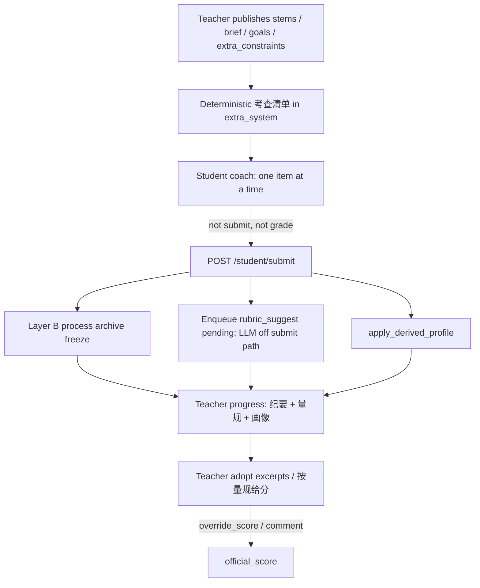
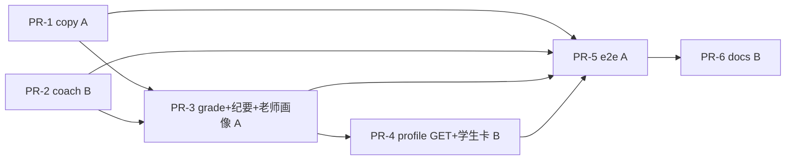

# teacherAgent 提分方案：无题库填充的作业闭环（考查清单 × 非做题量规 × 画像 × 文案诚实）

| 字段 | 值 |
| --- | --- |
| 文档标题 | Score-up without bank fill: teacher-material examiner + non-problem_set rubric + portrait + copy honesty |
| 作者 | TBD（平台 Owner 签字后生效） |
| 日期 | 2026-10-12 |
| 状态 | Draft（2026-10-12 复审修订：吸收 Grok Issue 1–10 与 Codex Issue 11–13） |
| 产品 | 单校作业产品（teacher 布置/确认/进度；student 今日列表/陪练/显式提交；admin 学校面板） |
| 仓库 | `/home/tdcasual/codework/teacherAgent` |
| HEAD | `09c168f` (`docs: align 补练 error copy with SPA gates`) |
| DESIGN_ID | `52b4dc9e` |
| 权威关系 | 产品身份：`docs/plans/2026-08-28-assignment-core-product-design.md`（D2/D4/D5 不重开；**L370 confirm 按钮「创建作业」文案由本文件取代为「发布草稿」，发布门闩仍是 D2**）。审计：`docs/plans/2026-10-10-audit-remediation-design.md`。体裁×来源 + 做题题库补练：`docs/plans/2026-10-10-next-phase-gapfill-design.md`（**不重开**其轴；本波 **不** 填 `DATA_DIR/question_bank/questions.csv`）。catalog vis 仍 09-06；进度数字仍 10-10 KD-7（GET compute-primary）。本文件：在 **0 行题库** 下把产品定义缺口补到可用。 |
| 治理 | `CONTRIBUTING.md` L/M/H；M/H 必须 TDD；H 需回滚 + 安全测试 + 风险登记更新或明示「为何不需要」 |
| 团队 | 2 人。`.github/CODEOWNERS` 全是 `@tdcasual`。PR **正好 6**。 |

---

## Overview

作业 HTTP 闭环与 kind × source 已经能跑：老师选体裁/来源 → 上传或 AI 起草进草稿 → `POST /assignment/upload/confirm` 发布 → 学生今日列表 / 陪练 / `POST /student/submit`。对照 Owner 产品定义与 2026-10-12 评分，**最大缺口不是题库 CMS**，而是：

1. Agent 仍是「看见老师材料的家教」，没有把老师已发布材料收成 **考查清单**；过程纪要（Layer B）已冻结，老师进度只露 `stuck_points` 摘要。
2. 非做题提交走 `received_without_items`，`official_score` 一直 null，直到老师手填覆盖；`rubric.md` **仅 AI generate 会写**（`assignment_generate_service.py:320-321`），上传路径没有；进度没有量规清单，也没有「老师确认后才给分」。
3. 学生画像卡读 `practice_history[0]`（那是 **最旧** 保留项：`apply_derived_profile` append 后 `items[-20:]`，最新是 `[-1]`）；老师进度没有画像；`GET /student/profile/{id}` 在无 principal 时回传 raw id（10-10 KD-11 故意不加固）。
4. 工作台主按钮与指示器仍写「创建作业」，how-to 已称「发布草稿」。

本波 **明确不填题库**。空库 409 `question_bank_insufficient` / 文案「题库不足」是预期，查漏补缺可用性保持 ~6.4。本波必须在 **0 行 `questions.csv` 数据** 下仍然有用：上传 + AI 布置、提交、画像、非做题量规、老师查看。

选定的产品闭环（实现按 PR 切开，不新开考试产品、不把聊天当官方分）：



---

## Background & Motivation

### 产品定义（Owner，不重开）

老师布置作业；可选的老师说明是 agent 考查与讲解的依据。学生自主完成。评估能力并查漏补缺。根据完成情况描绘学生画像。接受图片提交。

查漏补缺 **仅做题 + 自建题库**。空库 409 是正确失败，不是本波要修的洞。本波不建设题库 CMS，不 seed `DATA_DIR/question_bank/questions.csv`。

### 当前分数（Grok，2026-10-12，main `09c168f`）

对照 Owner 定义，总体 **7.8**：

| 维度 | 分 | 活代码事实 | 本波是否动 |
| --- | --- | --- | --- |
| 老师布置 | 8.9 | kind × source picker、upload/bank/AI 进同一草稿、confirm 发布 | 文案诚实（发布草稿）；不改布置轴 |
| Agent 以老师材料考查/讲解 | 7.4 | extra_system 注入 stems/brief；F/G/I Q1–Q4 已删；聊天是侧信道；`include_text=False` 后单独 `load_assignment_stems`；学生工具只有 `assignment.my_today` / `assignment.my_result` | **主缺口。** 考查清单 + 纪要露出 |
| 学生自主完成 | 8.0 | 今日列表、kind 门闩提交按钮、对话不是提交 | 聊天条/10_role 与按钮对齐 |
| 评估+查漏补缺 | 7.3 | 做题 OCR 管线在；**题库空所以跳过补练填充**；非做题评估薄（`received_without_items`，官方分 null）；`rubric.md` 只在 AI 起草 | 量规可见 + 老师覆盖；照片-only **不是**一键分；**不填库** |
| 画像 | 7.5 | 历史页 `StudentPortraitCard` 读 `practice_history[0]`（最旧）；老师进度无画像。`list_all_student_profiles()` 只返回 `{student_id, student_name, class_name}`（`student_directory_service.py:117-136`） | 老师进度 **按 expected student 读完整 profile JSON**；学生卡用 `[-1]` |
| 图片提交 | 8.4 | `STUDENT_ALLOWED_SUFFIXES`、提交面板、0 题 received | 保持 |

其它：产品身份 8.6；作业主闭环 8.5；查漏补缺可用性 **6.4（跳过 — 题库）**；Prompt 8.1；安全 8.0；工程 7.6；前端 7.4；测试文档 8.0；运维 6.8；校园日用 6.6。

### 当前运行时（对照代码，禁止把 SKILL.md 当现状）

| 能力 | 活代码 | 产品后果 |
| --- | --- | --- |
| 发布按钮 | `AssignmentDraftSection.tsx:158`「创建作业」；`data-testid="assignment-confirm-button"`。同文件 `:98`「补全后才能创建」、`:101`「可创建」、`:145`「暂不可创建」、`:154`「创建中…」、`:157`「已创建」。`workflowIndicators.ts:150` step「创建作业」；`:180`「已创建作业」；`:55/:86/:94` nextStepLabel「确认创建作业」；`:207`「创建失败」。`workbenchFormatters.ts:10-11` `confirmed/created` =「已创建作业」。`useAssignmentWorkflow.ts:928`「正在创建作业…」；`:939`「再创建作业」；`:1009` fallback「作业已确认创建。」。gate `assignment_upload_confirm_gate_service.py:20`「作业已创建（已确认）。」、`:27`「请稍后再创建作业。」。confirm `assignment_upload_confirm_service.py:190` **与** `:767`「无法创建作业。」。draft-save `:107` **与** `:239`「将用于创建作业。」。e2e：`assignment-core-loop.spec.ts:170`、`teacher-workbench-regression.spec.ts:140`、`teacher-system-assignment.spec.ts` **五处** `:329/:552/:554/:555/:608` `getByRole(..., { name: '创建作业' })`。08-28 L370 仍写按钮保持「创建作业」=publish——**本波取代该 UX 句，不重开 D2。** | 老师以为在「创建」而不是「发布已审核草稿」。 |
| 上传说明 | `UploadSection.tsx:141` 固定「生成作业 8 点描述」「确认创建作业」。`WorkflowTab.tsx:116-141` **不传** `assignmentKind`（`types/workflow.ts:56-80` `UploadSectionProps` 无该字段）。 | 情景/实践上传仍被说成 8 点做题。 |
| 学生提交文案 | 首页/提交面板已 `submitActionLabel`（`assignmentKind.ts:30-35`）。`ChatPanel.tsx:47` 硬编码「提交作业」。`onOpenSubmit` 绑 `state.selectedAssignmentId`（`frontend/apps/student/src/App.tsx:747-751`）。`submitKind` 绑的是 `submitAssignmentId`（`:654-662`），**不是**聊天选中行。学生 App **892/920** 行（`tests/test_tech_debt_targets.py:31-37`）。`prompts/v1/student/10_role.md:9`「提醒学生用『提交作业』」。 | 实践作业聊天条与 10_role 撒谎；复用 `submitKind` 会标错作业。 |
| 陪练注入 | `_student_extra_system` 定义在 `chat_job_processing_service.py:484`；`include_text=False` 在 `_load_attachable_student_assignment` `:478`。绑定后 `build_bound_student_assignment_extra`。join 活代码：kind 规则 → 数据块 → stems → 补练（`assignment_context_service.py:347-382`）。`_student_extra_system` **先** prepend verified student context（`:495-517`）。`_cap_extra_system` 切尾，默认 6000（`settings.py:260`）。数据块里 `extra_constraints` 注入为「额外限制」（`:334-335`），**不是**「讲解依据」（10-10 KD-19）。规则 B：一次一个问题。 | 材料在，没有考查清单；cap 测试必须把 student-context 前缀算进去。 |
| Layer B | submit 走 `trigger_on_submit`：**写 pending skeleton + enqueue**，不在请求内 freeze（`assignment_process_archive_service.py:520-557`；wiring `wiring/student_wiring.py:146-153`）。`_attach_process_archive` 在 payload 之后（`student_submit_service.py:233-257`, `:680-685`）。盘上 JSON 已有 `quotes` / `coach_comment_excerpts`（`_empty_archive` `:238-242`，`MAX_QUOTES=20`）。`read_process_archive_summary` **只**返回 `status` / `stuck_points` / `process_archive_id`（`:102-116`）。summary 测试在 `tests/test_process_archive_worker.py`（import `:19`），**没有** `test_assignment_process_archive_service.py`。 | 考查纪要已存在，老师看不见原话。 |
| 采纳摘录 | `TeacherGradeRequest.adopted_coach_excerpts`；`save_teacher_grade_from_request` → `updates_from_grade_request` **整表替换**（`teacher_grade_service.py:202-216`, `:225-226`, `:299-312`）。进度表单今天 POST 整份 textarea（`AssignmentProgressSection.tsx:75-78`）。HTTP 路径 **不是** 只调 `save_teacher_grade`。 | 一键采纳若只 POST 一条会抹掉旧摘录。 |
| 非做题提交 | 0 数据行 → `_write_received_without_items_report`（两棵目录：`student_submissions/<aid>/<sid>/submission_<ts>` 与遗留 `student_submissions/<sid>/submission_<ts>`，`:430-447`）。`list_submission_attempts` 只扫 jailed 树（`assignment_submission_attempt_service.py:20-33`, `:155`）。`LLMGateway._target_from_override` **要求** `model`/`base_url`/`endpoint`（`llm_gateway.py:783-791`）；仅 `{"timeout_sec": 15}` 会 `ValueError: target_override.model required`（`:873-874`）。`Target.timeout_sec` 是 `(connect, read)` 元组（`:64`）；registry 默认 120（`:727-729`）。`allow_fallback=True` 会再追加 120s fallback（`:880-886`）。RQ `PROCESS_ARCHIVE_JOB_TIMEOUT = 60`（`workers/rq_tasks.py:90-99`）。 | 超时钉法必须 copy 完整 Target；worker 必须带 `attempt_id`。 |
| 画像 | `apply_derived_profile` append 后 `practice_history[-20:]`（`profile_service.py:187-205`），最新=`[-1]`。学生卡用 `[0]`（`StudentPortraitCard.tsx:24-30`）。`compute_assignment_progress` 用 `list_all_student_profiles()` 只取姓名班级（`assignment_progress_service.py:597-610`）。`AssignmentProgressDeps` **无** `load_profile_file`（`wiring/assignment_wiring.py:273-288`）。完整 JSON 路径：`paths.resolve_student_profile_path`（`services/api/paths.py:255`）+ `profile_service.load_profile_file`。老师 GET profile：`resolve_student_scope(roles=("student","admin"))` → 教师 403；无 principal 回传 raw id。未认证 `GET /student/profile/%2e%2e` 今日 404（`test_assignment_progress.py:719-725`）。 | 按 directory listing 派生画像会永远「暂无」。 |
| 题库 | `data/question_bank/questions.csv` 仅表头。补练 / from-bank 409 `question_bank_insufficient`。 | **保持。** |
| 进度 GET | live compute + 双写。`RISK-ASSIGNMENT-DUALWRITE-001` 开放。 | compute-primary。 |
| 结构测试 | `STRUCTURE_TEST_COUNT_FROZEN = 84`。教师 `frontend/apps/teacher/src/App.tsx` **897/900**（`test_teacher_frontend_structure.py:38`）；学生 `frontend/apps/student/src/App.tsx` **892/920**。`auth_service.py` C901 预算 0 / 上限 14（`config/function_complexity_budget.json`）。 | 不加新 `test_*structure*.py`；不拆 `app_core.py`。 |

### 为什么现在做

10-10 gap-fill 把布置轴和做题补练机械落地了。Owner 定义里「Agent 以老师材料考查/讲解」和「评估 + 画像」仍明显低于布置/提交。题库为空时，再开 CMS 或 seed CSV **不能**把非做题学校日用救起来。本波把提分压在 **无题库也成立** 的轨道上。

---

## Goals & Non-Goals

### Goals

1. **Agent 只考查老师已发布材料。** 绑定 `assignment_id` 后 extra_system 在 kind 规则之后注入确定性 **【考查清单】**（来自 stems / brief / `discussion_goals` / `extra_constraints`）。一次仍只问一项。不发明学生可见题干。聊天仍不是官方分。
2. **考查纪要可看可用。** 复用已有 Layer B：进度展开 `quotes` + `coach_comment_excerpts`；一键写入已有 `adopted_coach_excerpts`。讨论仍不是完成门闩（08-28 D4 / 10-10 KD-25）。
3. **非做题可评。** 进度展示 assignment 级 `rubric.md` 检查单（上传草稿也要能写该文件）。submit **只 enqueue** 建议（pending skeleton，与 Layer B 同模型）；LLM 不挡 200。无 `.txt/.md` 则 `suggested_score=null`，**隐藏**「按量规给分」，老师手填覆盖。有建议分时老师 `adopt_rubric_suggestion=true` 才写 override。禁止 LLM 直接写 `official_score`。照片-only 的 Δ 是 **量规可见性 + 手填覆盖**，不是一键分。
4. **画像两边可见。** 老师进度：对 `expected_students` **逐人读完整 profile JSON**（`resolve_student_profile_path` + `load_profile_file`），**禁止**从 `list_all_student_profiles()` 的三字段 listing 抽 KP。学生卡：最近 5 次 history 作业 + `practice_history.at(-1)`（有 `practice_id` 才标「最近补练」）。不使用 `[0]`。不新建数据库。复用 `apply_derived_profile`。
5. **Profile GET fail-closed（只加固 GET）。** POST `/student/profile/update` **保持** student+admin（教师 HTTP 写仍 403；老师覆盖继续走工具 `student.profile.update`）。GET：`AUTH_REQUIRED=1` 缺 Bearer → 中间件 **401** `missing_authorization`（helper **不再**发第二个 401）；`AUTH_REQUIRED=0` / pytest 无 principal → **400** `principal_required`（与 practice 同码）；学生只能 self；老师只能名册或自己 published/archived 作业快照。
6. **文案诚实。** 工作台主按钮/指示器/上传说明 = **发布草稿**；上传 copy 按 kind；学生 10_role 与聊天条随 kind。不改 `common/90_self_check.md` 图引用条。不新增 prompt 版本目录。
7. **0 行题库仍有用。** 上传 + AI 布置、提交、画像、非做题量规、老师查看。空库 409 保持。INDEX / `CURRENT_PLAN_AUTHORITIES` 只在 PR-6。

### Non-Goals（本波明确不做）

- 题库 CMS、可视化 CRUD、seed / 填写 `DATA_DIR/question_bank/questions.csv`、把空库 409 改成编题。
- 考试产品、survey/class_report 复活、第 5 种 kind、mixed kind。
- 学生 `assignment.generate`；空今日改成「生成任务」；把聊天/附件当正式提交。
- 讨论重新做成完成门闩。
- 学生可见的新题干 / 动态 Q1–Q4 / 另编情景。
- SQL-primary GET 进度；关闭 `RISK-ASSIGNMENT-DUALWRITE-001`（除非出现极小安全切片——本波没有）。
- Grafana / 30 天 SLO 平台；MCP 绑 `0.0.0.0`；拆 `app_core.py`；新 `test_*structure*.py`。
- 新 prompt 版本目录；改 `common/90_self_check.md` 图引用条；改身份串「学生端学习助手」；删「不要生成作业」。
- 在本波 PR 内轮换 `AUTH_TOKEN_SECRET`（Owner 运维，见 how-to 勾选，不进 PR）。
- 学生 SPA 改密；Landlock；git filter-repo。

---

## Demand / Score-up mapping

保守目标：产品定义总体 **~8.3**，不是 9+。查漏补缺可用性 **保持 6.4** 直到题库有行。

| 评分维度 | 现在 | 目标 | 具体工作 | 预期 Δ | PR |
| --- | --- | --- | --- | --- | --- |
| 老师布置 | 8.9 | 9.0 | 发布草稿文案与 picker→confirm 诚实；不改轴 | +0.1 | 1, 6 |
| Agent 考查/讲解 | 7.4 | 8.3 | 考查清单 + 纪要露出 + 采纳摘录；仍非官方分 | +0.9 | 2, 3 |
| 学生自主完成 | 8.0 | 8.2 | ChatPanel / 10_role 与 kind 按钮一致 | +0.2 | 1, 2 |
| 评估+查漏补缺 | 7.3 | **7.7** | 量规清单可见（含上传草稿 `rubric.md`）+ 老师覆盖。一键「按量规给分」**仅当** `suggested_score != null`。照片-only / 无文本：Δ = 可见性不是一键分。**不填库** | +0.4 | 1, 3 |
| 画像 | 7.5 | 8.2 | 老师进度按 expected student **读盘上完整 JSON**；学生卡 history 5 条 + `practice_history[-1]` | +0.7 | 3, 4 |
| 图片提交 | 8.4 | 8.4 | 不改后缀/提交管线 | 0 | — |
| 产品身份 | 8.6 | 8.8 | 定义闭环在无题库下可演示 | +0.2 | 全 |
| 作业主闭环 | 8.5 | 8.7 | 发布→考查→提交→老师给分可见 | +0.2 | 1–5 |
| 查漏补缺可用性 | 6.4 | **6.4** | 空库 409 文档化；不假装能补练 | 0 | 6 |
| Prompt | 8.1 | 8.4 | 10_role kind 提交；老师 overlay 发布草稿 | +0.3 | 2 |
| 安全 | 8.0 | 8.4 | profile GET fail-closed + 教师名册/作业 ACL | +0.4 | 4 |
| 工程 | 7.6 | 7.7 | 热文件一写者；不拆 god file | +0.1 | 全 |
| 前端 | 7.4 | 8.0 | 文案 + 进度量规/纪要/画像 | +0.6 | 1, 3, 4 |
| 测试文档 | 8.0 | 8.2 | e2e 钉发布草稿/情景提交/画像；PR-6 INDEX | +0.2 | 5, 6 |
| 运维 | 6.8 | 7.0 | how-to 空库预期 + 可选 env 检查 | +0.2 | 6 |
| 校园日用 | 6.6 | 7.0 | 无题库也能布置/交/评/看画像 | +0.4 | 全 |
| **总体（产品定义）** | **7.8** | **~8.3** | 评估只收到 7.7（照片路径无一键分）。不靠填库冲 9 | **+0.5** | |

---

## Proposed Design

### 0. 选定的考查策略（Fork A，必须选一个）

活代码已经注入材料。三个具体选项：

| 选项 | 做法 | 对 7.4 的作用 | 决定 |
| --- | --- | --- | --- |
| 1. 只露出 Layer B | 进度展开 quotes；agent 行为不变 | 老师看见陪练，agent 仍泛泛讲 | 不够，作 **配套** |
| 2. 考查清单 | 从老师材料派生清单注入 extra_system；一次一项 | 直接补「以老师材料考查」 | **主路径** |
| 3. 只把采纳摘录做可用 | textarea 已在 | 评语可用，考查行为不变 | 不够，作 **配套** |

**KD-S1：主路径 = 选项 2。** 选项 1+3 在老师进度落地（PR-3），不另做学生可见题干，不把讨论当完成门闩。

确定性清单，**禁止 LLM 生成清单**（否则等于另编题）。

### 1. 考查清单（PR-2）

#### 1.1 放置

新纯函数，仍在 `services/api/assignment_context_service.py`（不新 prompt 模块、不 4 套 manifest）：

```python
def build_exam_checklist(
    *,
    kind: str,
    stems: list[dict[str, str]],
    brief: str,
    discussion_goals: list[str],
    extra_constraints: str,
) -> str:
    ...
```

`build_bound_student_assignment_extra` join 顺序（修订 10-10 KD-7，不重开「永不 json.dumps questions」）：

1. `build_kind_coach_rules(kind)`（必须在前，cap 切尾）
2. **`build_exam_checklist(...)`** ← 本波新增
3. `build_assignment_context` 数据块（含 brief / goals / extra_constraints；已有）
4. `format_stems_block`（仅当 `load_assignment_stems` 有行）
5. 补练题干 + 短反馈（仅 `problem_set`）

`include_text=False` **保持**。stems 继续 `load_assignment_stems`。禁止 `json.dumps(detail["questions"])`。

#### 1.2 派生规则（钉死，测字符串）

公共头（所有 kind）：

```
【考查清单】只考查下列老师已发布材料。一次只问一项，等学生回答。对话不是提交，也不是官方分。
```

然后按 kind 追加，每条 `clip(text, 200)`，最多 8 条，整块再 `clip(..., 1500)`：

| kind | 条目来源 | 禁止 |
| --- | --- | --- |
| `problem_set` | 每条 stem：`{i}. 考查 {question_id}（kp={kp_id}）：先让学生复述条件，再解释思路。禁止改题干或数值。` 若 `extra_constraints` 非空，末条 `遵守老师限制：{clip(extra,200)}` | 不写答案；不编 Q1–Q4；无 stem 则清单只有头 +「数据块无题干，只根据作业总要求提问」 |
| `scenario` | 每条 `discussion_goals`：`{i}. 讨论目标：{goal}`；若 goals 空：`1. 围绕老师 brief 考查理解，不要另编情节。`；+ extra_constraints | 不另编情景/人物/地点 |
| `science_history` | 同 goals；空则 `1. 只根据老师材料问因果与概念。材料没写的年代/人名就说「材料里没写」。`；+ extra_constraints | 不补历史故事 |
| `practical` | 同 goals；空则 `1. 引导学生描述自己的步骤与现象，不编未做实验。`；末条提醒提交实践照片；+ extra_constraints | 不给可抄实验报告 |

`extra_constraints` 只当 **额外限制**（10-10 KD-19；活注入键名就是「额外限制」，`assignment_context_service.py:334-335`）。清单末条「遵守老师限制：…」引用该字段。**不要**把它叫「讲解依据」，也不要把 brief 塞进去。

#### 1.3 仍不是官方分

kind 规则 C + 清单头重复「对话不是提交/不是官方分」。Layer B 冻结仍在 submit 时发生。老师采纳摘录才进评语（D5）。

#### 1.4 Prompt（同一 PR，不新版本目录）

`prompts/v1/student/10_role.md` 第 9 行改为 kind 门闩（身份首行与「不要生成作业」不动）：

```
对话不是提交；提醒学生用界面按钮交照片、PDF 或书面产物（做题「提交作业」／情景与科学史「提交书面/照片」／实践「提交实践照片」）。
```

`prompts/v1/student/skills/student_coach.md` 保持「每次只问 1 个」；补一句「按【考查清单】顺序，不要跳到清单外」。

老师 overlay：

- `prompts/v1/teacher/30_assignment_workflow.md:5`「学生仍须用『提交作业』」改为与上表相同的 kind 按钮名。发布草稿句已存在，保持。
- 工作台 UI 的「创建作业」不在 prompt 里改（PR-1 改 UI）。若 `20_tool_policy.md` / skill 仍把 confirm 说成创建，改成发布草稿。
- **不改** `prompts/v1/common/90_self_check.md` 图引用条。

#### 1.5 测试钉名

- `tests/test_assignment_context_service.py::test_exam_checklist_problem_set_uses_stems_not_answers`
- `tests/test_assignment_context_service.py::test_exam_checklist_scenario_uses_goals_not_new_stems`
- `tests/test_assignment_context_service.py::test_exam_checklist_science_history_forbids_invented_dates`
- `tests/test_assignment_context_service.py::test_bound_extra_joins_checklist_after_kind_rules`
- `tests/test_assignment_context_service.py::test_checklist_excludes_answer_ref`
- `tests/test_chat_job_processing_service.py::test_scenario_extra_system_uses_brief_not_authoring_rules`（扩：断言含 `【考查清单】`，仍无编题祈使句）
- `tests/test_chat_job_processing_service.py::test_extra_system_cap_keeps_kind_rules`：活测试 `chat_extra_system_max_chars=800` 且默认 `student_id="S001"`（`:307-336`, fixture `:25`）。**不要**在 800 字窗口里假设「规则+清单+完整 profile 上下文」都能留下。做法二选一（钉在测试里）：(a) 该用例把 verified student context stub 成空，并断言 `extra` 含 `【学习规则】` 与 `【考查清单】`；(b) 将该用例 cap 提到足够覆盖「空 profile + 规则头 + 清单头」。生产 cap 仍 6000。
- `tests/test_prompt_builder.py`：身份串「学生端学习助手」三处不改；含「不要生成作业」；含三种提交按钮名；不含编题祈使句。`20_tool_policy.md` 已写发布草稿；PR-2 overlay 主要改 `30_assignment_workflow.md:5`。

### 2. 考查纪要 + 采纳摘录（PR-3 配套）

#### 2.1 扩 summary，不改冻结管线

`read_process_archive_summary`（`assignment_process_archive_service.py:102`）今日丢弃 `quotes` / `coach_comment_excerpts`。改为额外返回：

```python
{
  "status": ...,
  "stuck_points": ...[:2],
  "process_archive_id": ...,
  "quotes": quotes[:5],                 # {text, turn_ref, speaker}
  "coach_comment_excerpts": excerpts[:5],  # {text, ...}
  "reasoning_types": types[:5],
}
```

PII 过滤继续走现有 `_filter_quotes` / `_quote_blocked`。进度 GET 仍 compute-primary：`_student_progress` 已把 summary 放进 `process_archive`。

#### 2.2 老师 UI

`AssignmentProgressSection.tsx` 每生过程列下增加可折叠「考查纪要」（`data-testid="progress-exam-notes-{student_id}"`）：

- 无 archive / `status=none`：显示「无陪练纪要」（不是错误）。
- `pending`：生成中（已有过程列文案）。
- `frozen` / `partial`：列出 quotes（学生/陪练）与 coach excerpts。
- 每条 excerpt 按钮「采纳为评语」：HTTP 的 `adopted_coach_excerpts` 是 **整表替换**（`teacher_grade_service.py:225-226`）。客户端必须 POST **合并后的完整列表**：`(s.teacher_grade?.adopted_coach_excerpts || [])` 按 `text` 去重追加本条，再 `saveStudentGrade(sid, { adopted_coach_excerpts: merged })`。禁止只 POST `[{text: this}]`。走现有 `POST /teacher/assignment/{id}/student/{sid}/grade`（handler 调 `save_teacher_grade_from_request`）。不改官方分，除非老师同时填覆盖分。
- 不把纪要当作完成条件；不扫 `【个性化作业】`。

前端类型：`appTypes.ts` `process_archive` 增 `quotes` / `coach_comment_excerpts`。

测试：

- `tests/test_process_archive_worker.py::test_summary_includes_quotes_and_excerpts`（**加在现有模块**，该文件已 import `read_process_archive_summary`。不要新建 `test_assignment_process_archive_service.py`）
- `frontend/apps/teacher/src/features/workbench/workflow/AssignmentProgressSection.test.tsx`：采纳摘录时 `saveStudentGrade` 的 `adopted_coach_excerpts` 含 **旧条目 + 新条目**

### 3. 非做题量规（PR-3）

#### 3.1 问题

0 行 submit 已是已交。`official_score` null 直到老师覆盖。`grade_submission.py:379` 只在有 question 行且无 expected 时读逐题 `rubric_ref`。0 行作业不会走逐题量规。

`rubric.md` **今天只由 AI generate 写入**（`assignment_generate_service.py:320-321`）。上传 confirm **不写**该文件，所以无库的 upload+photo 学校若只做 PR-3 读盘，进度 `source=none`。

**禁止** 在 `POST /student/submit` 热路径阻塞调用 LLM，也禁止 LLM 写 `official_score`（D5）。

#### 3.2 上传/草稿如何落到 `rubric.md`（PR-1 写字段，PR-3 读）

非做题 `AssignmentDraftSection` 在 brief / `discussion_goals` 之后加 textarea `data-testid="draft-rubric"`（label「量规（可选，每行一条）」）。

**钉死字段：`uploadDraft.requirements.rubric`（string）。** 禁止并列 `uploadDraft.rubric`。`UploadDraftRequirements` 已有 `[k: string]: unknown`（`frontend/apps/teacher/src/appTypes.ts:251-265`），PR-1 **不必**改 `appTypes.ts`（该文件是 PR-3 热文件）。save 已从 `requirements.brief` 写 `brief.md`（`assignment_upload_draft_save_service.py:215-217`）；量规是兄弟字段，同一函数再写 `rubric.md`。

- folder/job `draft/save` 把 `requirements.rubric` 写入 `assignments/<id>/rubric.md`（空则不写或写空文件后 confirm 可覆盖）。
- `_finalize_published_from_folder` / 上传 confirm 与 KD-19 的 `brief.md` 一样：confirm 时用草稿量规覆盖写入 `rubric.md`。
- AI generate 已有的写路径保持。

无量规文件 → 进度 `rubric.source="none"`，老师仍手填覆盖。有文件 → 检查单可见。这就是 upload+photo 路径的评估 Δ：**可见性**，不是一键分。

`problem_set` **不**展示 assignment 级量规，也不保存该 textarea。

#### 3.3 解析 `rubric.md`

新模块 `services/api/assignment_rubric_service.py`（不要塞进 `grade_submission.py`）：

```python
def load_assignment_rubric(folder: Path) -> dict[str, Any]:
    """{source: "rubric.md"|"none", items: [{id, text, max_points?}], raw_excerpt}"""

def parse_rubric_markdown(text: str) -> list[dict[str, Any]]:
    # ^\s*(?:[-*]|\d+[.)])\s+(.+)$  → items
    # 若 0 条：单条 {id:"whole", text: clip(raw, 500)}
```

进度响应（assignment 级一次，不要每生复制 raw）：

```json
"rubric": {
  "source": "rubric.md",
  "items": [{"id": "1", "text": "能指出情景约束", "max_points": null}]
}
```

每生读 `DATA_DIR/student_submissions/<aid>/<sid>/rubric_suggestion.json`：

```json
"rubric_suggestion": {
  "status": "none"|"pending"|"ready"|"failed",
  "suggested_score": 12.0,
  "max_score": null,
  "checks": [{"id": "1", "pass": true, "note": "..."}],
  "comment": "...",
  "source": "llm"|"heuristic_none"
}
```

**不新建表。**

#### 3.4 submit 后建议 = Layer B 模型（enqueue，不阻塞）

对照：`trigger_on_submit` 写 pending + `queue_runtime.enqueue_process_archive`（`assignment_process_archive_service.py:520-557`；`wiring/student_wiring.py:146-153`）。`StudentSubmitDeps.trigger_process_archive` 默认 `None`（`:62`），现有 submit 测试继续可构造。

本波同样：

1. 仅 `effective_assignment_kind != problem_set` 且 received/0 行路径。
2. **请求内**只写 `rubric_suggestion.json` `status=pending`（无 LLM），然后 `trigger_rubric_suggest`（`StudentSubmitDeps` 新可选回调，默认 `None`）。
3. wiring 与 archive 共用 `queue_runtime.enqueue_process_archive`。**不**新加 `QueueBackend` 方法。enqueue payload **必须**含 jailed 树刚写下的目录名（`_write_received_without_items_report` 的 `trees[0].name`，即 `student_submissions/<aid>/<sid>/submission_<ts>`，**不是**遗留 `student_submissions/<sid>/`）：

```python
{
  "job_kind": "rubric_suggest",
  "assignment_id": aid,
  "student_id": sid,
  "attempt_id": "submission_<ts>",  # trees[0].name
}
```

4. `process_archive_worker_service.run_process_archive_job`（`:68`）**先**看 `job_kind=="rubric_suggest"`：lazy import `run_rubric_suggest_job` 后 return；否则 `freeze_process_archive`。缺 `job_kind` 的 payload 仍走 freeze（回归）。RQ `run_process_archive` 已走该函数。RQ job_timeout=60（`PROCESS_ARCHIVE_JOB_TIMEOUT`），15s 读超时必须 `allow_fallback=False`，否则 registry fallback 仍是 120s。
5. `run_rubric_suggest_job`（worker 内，fail-open）：
   - 解析 jail：`base = jailed_student_submission_dir(data_dir, aid, sid)`（`assignment_context_service.py:107-118`；与 `_resolve_submission_base` 同形，`assignment_submission_attempt_service.py:20-33`）。`attempt_id` 必须非空、`_SAFE_ID_RE`、以 `submission_` 开头。`attempt_dir = (base / attempt_id).resolve()`；`attempt_dir.parent != base` 或非目录 → `status=failed` + diag，**不** freeze、**不** glob、**不**读 `student_submissions/<sid>/`。
   - 只扫 **该** `attempt_dir` 下 `.txt/.md`，合计 clip 4000。**不**新开图片 OCR。
   - 无文本：`status=ready`, `source=heuristic_none`, `suggested_score=null`, `comment="无文本摘录，请老师按量规目测给分"`。不调 LLM。
   - 有文本：先 `gw = LLMGateway(); t = gw.resolve_target()`（`llm_gateway.py:680`），再：

```python
gw.generate(
    req,
    allow_fallback=False,  # 禁止 120s registry fallback
    target_override={
        "provider": t.provider,
        "mode": t.mode,
        "model": t.model,          # required; timeout-only dict → ValueError :783
        "base_url": t.base_url,    # required :786-787
        "endpoint": t.endpoint,    # required :790-791
        "headers": t.headers,
        "timeout_sec": 15,         # 进 _build_timeout_pair 的 timeout_value :812-814
    },
)
```

     **禁止** `target_override={"timeout_sec": 15}`。**禁止**设进程级 `LLM_TIMEOUT_SEC`。`UnifiedLLMRequest` 无 timeout 字段（`:26-35`）。`Target.timeout_sec` 是 `(connect, read)` 元组（`:64`）；传整数 15 合法。系统词：本模块字符串或 `prompts/v1/teacher/skills/assignment_rubric_suggest.md`。失败 → `status=failed`，diag `assignment.rubric.suggest_failed`。
6. submit HTTP **在 enqueue 后立即 200**。测试 `test_non_problem_set_submit_does_not_wait_for_rubric_llm`：enqueue 记录器，submit 路径未调用 `LLMGateway.generate`。
7. **不**调用 `official_score_from` / 不写 `override_score_earned`。

做题 OCR 路径不跑本建议。Enqueue 失败：保持 pending + diag，仍 200。

#### 3.5 「按量规给分」——改 `save_teacher_grade_from_request`

HTTP handler 已是 `save_teacher_grade_from_request`（`assignment_listing_routes.py:95`）。`updates_from_grade_request` 只复制 `model_fields_set` 里的键（`:202-216`）。必须扩展：

```python
# TeacherGradeRequest 保持 extra=forbid
adopt_rubric_suggestion: Optional[bool] = None
rubric_checks: Optional[List[Dict[str, Any]]] = None
```

`updates_from_grade_request` / `_apply_updates` / `_empty_grade` 都要认识新字段。不要只改 `save_teacher_grade` 而让 HTTP 丢字段。

优先级（同一 body）：

1. 若请求带了 `override_score` / `override_score_earned`（字段在 `model_fields_set`）→ **该值赢**，adopt 不再覆盖分数（仍可写 `rubric_checks`）。
2. 否则若 `adopt_rubric_suggestion is True`：读建议；`status!="ready"` 或 `suggested_score is None` → 400 `rubric_suggestion_unscored`；否则 `override_score_earned=float(suggested_score)`，comment 未带则用建议 comment。
3. 老师手填覆盖（今日表单）始终可用。

UI：

- 量规清单：`assignment.rubric.items`（`source=none` 时显示「无量规，请老师覆盖」）。
- 「按量规给分」`data-testid="progress-adopt-rubric-{sid}"` **仅当** `rubric_suggestion.status==="ready"` **且** `suggested_score != null`。否则 **不渲染**该按钮；文案「请按量规目测后手填覆盖」。
- 照片-only（`heuristic_none` / null 分）：无一键分，这是预期，不是 bug。

`useAssignmentWorkflow.saveStudentGrade` 与 `WorkflowTab.tsx:34-41` 的 payload 类型 **同一作者 A 在 PR-3 于 PR-1 之后** 增加 `adopt_rubric_suggestion?` / `rubric_checks?`（禁止与 PR-1 平行改该 hook）。

#### 3.6 测试钉名

- `tests/test_assignment_rubric_service.py::test_parse_markdown_checklist`
- `tests/test_assignment_rubric_service.py::test_missing_rubric_is_source_none`
- `tests/test_student_submit_service.py::test_zero_question_submit_writes_pending_rubric_suggestion`
- `tests/test_student_submit_service.py::test_non_problem_set_submit_does_not_wait_for_rubric_llm`
- `tests/test_student_submit_service.py::test_rubric_suggest_enqueue_includes_attempt_id`
- `tests/test_assignment_rubric_service.py::test_rubric_suggest_generate_override_is_full_target`（mock `generate`：override 含 `model`/`base_url`/`endpoint` 且 `timeout_sec==15`；`allow_fallback is False`；**不是** timeout-only dict）
- `tests/test_assignment_rubric_service.py::test_rubric_suggest_foreign_attempt_id_does_not_read`
- `tests/test_process_archive_worker.py::test_run_job_without_job_kind_still_freezes`
- `tests/test_student_submit_service.py::test_non_problem_set_submit_skips_llm_without_text`（worker/job 函数，不是 submit() 内）
- `tests/test_teacher_grade_service.py::test_adopt_rubric_suggestion_writes_override`（经 **`save_teacher_grade_from_request`**）
- `tests/test_teacher_grade_service.py::test_adopt_rubric_suggestion_does_not_run_without_flag`
- `tests/test_teacher_grade_service.py::test_override_score_wins_over_adopt_flag`
- `tests/test_teacher_grade_service.py::test_adopt_null_suggested_score_is_400`
- `tests/test_assignment_progress_service.py::test_non_problem_set_progress_includes_rubric_not_practice`
- `AssignmentProgressSection.test.tsx`：无建议分时 **没有** adopt 按钮；有建议分才有；做题不显示 assignment 量规

### 4. 画像（PR-3 老师片段 + PR-4 学生卡与 GET）

#### 4.1 老师进度片段：读完整 JSON，不用 directory listing

**禁止**从 `list_all_student_profiles()` 抽 KP。该函数只返回 `{student_id, student_name, class_name}`（`student_directory_service.py:117-136`）。进度用它填姓名班级（`assignment_progress_service.py:429-449`, `:597-610`）。`AssignmentProgressDeps` 今日无 `load_profile_file`（`wiring/assignment_wiring.py:273-288`）。跟着旧稿实现，生产每行都是「暂无」。

**不**扩大 `list_all_student_profiles` 的返回合同（其它调用方依赖三字段 listing）。

PR-3：

1. `AssignmentProgressDeps` 增 `load_student_profile: Callable[[str], Dict[str, Any]]`。
2. wiring：对 `sid` 调 `paths.resolve_student_profile_path(sid, core=...)`（`services/api/paths.py:255`）再 `profile_service.load_profile_file`。路径非法 / 缺文件 → `{}`。只对 **该作业 `expected_students`** 读 N 个文件，不是全校 glob，也不是 N 次 HTTP GET。
3. `list_all_student_profiles` 继续只提供 name/class。

```python
def portrait_snippet(profile: dict) -> dict:
    history = profile.get("practice_history") or []
    last = history[-1] if history else {}  # newest; apply_derived_profile append + [-20:]
    return {
        "recent_weak_kp": list(profile.get("recent_weak_kp") or [])[:5],
        "next_focus": str(profile.get("next_focus") or ""),
        "last_source": str(last.get("source") or ""),
        "last_assignment_id": str(last.get("assignment_id") or ""),
    }
```

挂 `payload["portrait"]`。UI：`薄弱：… · 下一步：… · 最近：{source}`，`data-testid="progress-portrait-{sid}"`。无文件：薄弱「暂无」。不发明 `weak_kp`。进度 SPA **不**打 profile GET。

必测（deps 返回 **活的三字段 listing**，KP 仍须从盘上 JSON 来）：

- `tests/test_assignment_progress_service.py::test_portrait_reads_full_json_not_directory_listing`
  - `list_all_student_profiles` mock = `[{"student_id":"S1","student_name":"甲","class_name":"1班"}]`
  - 盘上 `student_profiles/S1.json` 含 `recent_weak_kp` / `next_focus` / `practice_history`
  - assert `payload["portrait"]["recent_weak_kp"]` 非空，且 listing dict 本身没有这些键

#### 4.2 学生卡：最近作业 + `practice_history[-1]`

`apply_derived_profile` 最新项是 `practice_history[-1]`，`[0]` 是最旧保留项（`profile_service.py:187-205`）。活卡片用 `[0]` 标「最近练习」是 bug，本波修掉。

`StudentAssignmentHistoryPage` 把 `items` 传入 `StudentPortraitCard`：

- 保留 `recent_weak_kp` / `next_focus`
- 「最近作业」最多 **5** 条 history：`{kind} · {已提交|未提交} · {官方分 | 已交未评分 | —}`
- 「最近补练」：`practice_history` **从尾向前** 第一条带 `practice_id` 的；没有则「暂无」。**禁止**用 `[0]`。homework `brief_fallback` 行不得标成补练。
- `data-testid="student-portrait-recent-outcomes"` 与现有 `student-portrait-practice-history`
- 禁止渲染 `weak_kp`

测试：保留文件 `StudentPortraitCard.test.tsx`，改断言为 **最后一条**（可保留 describe 名，但期望值用 `history.at(-1)`）。夹具：`practice_history: [{assignment_id:'OLD'}, {assignment_id:'NEW', practice_id:'practice_ab'}]` → 补练行含 `NEW` 不含把 OLD 当最近。

两条字段 **故意不同源**，不要合成一条规则：

- 老师进度 `portrait.last_source` = `practice_history[-1].source`（任意最新派生，含 `brief_fallback` / `graded`）。
- 学生卡「最近补练」= 从尾向前第一条带 `practice_id` 的；没有则「暂无」。homework 行不当补练。

#### 4.3 Profile GET 加固（PR-4，H）——只加固 GET

今日 GET：`_scoped_student_id` → `resolve_student_scope(..., required_for_admin=False)`，`require_principal(roles=("student","admin"))`。无 principal 回传 raw id。教师 403。practice：无 principal → 400 `principal_required`（`test_student_practice_routes.py:57-59`）。

**不改**全局 `resolve_student_scope`。

**POST `/student/profile/update` 保持 student+admin**（继续 `resolve_student_scope`）。本波 **不**给教师开 HTTP 写 `weak_kp`。老师覆盖仍走工具 `student.profile.update`（`chat_support_service.py:296-297`）。「写路径不得比读路径松」用 **不开放教师 HTTP 写** 满足，而不是把 POST 扩到 roster。

GET 换新 helper。为保住 `auth_service.py` C901=0（`config/function_complexity_budget.json`），把 ACL 放到 `services/api/auth/profile_read_scope_service.py`（新文件，mypy gate **grow-only 追加**）。`auth_service.resolve_profile_read_scope` 只做角色分支后委托。

```python
def resolve_profile_read_scope(student_id: str) -> str:
    raw = str(student_id or "").strip()
    principal = require_principal(roles=("student", "teacher", "admin"))
    if principal is None:
        raise AuthError(400, "principal_required")  # AUTH_REQUIRED=0 / pytest only
    ...
```

401 vs 400（与 practice 相同，**不要**在 helper 里再 raise 401）：

| 条件 | 码 | 谁发出 |
| --- | --- | --- |
| `AUTH_REQUIRED=1` / 生产，缺 Bearer | **401** `missing_authorization` | 中间件 / `require_principal` 在 `auth_required()` 为真时 |
| `AUTH_REQUIRED=0` 或 pytest，`get_current_principal() is None` | **400** `principal_required` | 本 helper（`require_principal` 返回 None 之后） |
| 学生读他人 | **403** `forbidden_student_scope` | helper |
| 教师非名册且非快照 | **403** `forbidden_student_scope` | helper |

`teacher_can_read_student_profile`：

1. **名册：** `services/api/auth/identity_graph_service.py:836` `student_enrolled(store, student_id=..., teacher_id=...)`（`subject_id=""` = 该师任一科）。
2. **作业快照：** `assignment/store.py` **新**无分页 helper，例如 `teacher_owns_student_snapshot(conn, teacher_id, student_id) -> bool`：扫描该师 `visibility_status IN ('published','archived')` 的行，解析 `expected_students_json`。**禁止**用 `list_assignment_rows(..., limit=50)`（`:219-225`）当授权预言机。**禁止**读 `assignment_progress`。**禁止**用 `student_auth.class_name`。

**禁止** `auth_service` import `assignment_student_list_service`（该模块 import `teacher_grade_service`，后者 import `auth_service` → 环）。store helper 可被 profile_read_scope_service lazy import。

`AUTH_GUARD_MARKERS` 追加 `resolve_profile_read_scope(`。GET 路由 `_scoped_student_id` 对 GET 改调新 helper；POST 继续旧 `_scoped_student_id` → `resolve_student_scope`。

必测：

- 新 `tests/test_student_profile_routes.py`（GET 组）
- **必须改** `tests/test_student_history_flow.py::test_student_profile_route_uses_student_profile_get_directly`（无 principal 不再 200）
- **必须改** `tests/test_assignment_progress.py::test_student_profile_rejects_invalid_student_id_path`：无 principal 后 `%2e%2e` 为 **400** `principal_required`（不再 404）。另加：有学生 principal 时非法 id 仍 400/404
- `test_profile_get_requires_principal` → 400
- `test_student_cannot_read_other_profile` → 403
- `test_teacher_cannot_read_unrelated_student` → 403
- `test_teacher_can_read_enrolled_student` → 200
- `test_teacher_can_read_snapshot_student_after_unenroll` → 200
- `test_admin_can_read_any` → 200
- `test_teacher_http_update_still_403`：教师 POST `/student/profile/update` 仍 403（钉 GET-only）
- `test_security_auth_hardening.py` 学生跨写保持绿

diag：`student.profile.scope_denied`（GET 403，不含档案正文）。

### 5. 前端诚实（PR-1）+ e2e（PR-1 改 locator，PR-5 加场景）

#### 5.1 发布草稿（grep 完整清单；PR-1 漏一条即 teacher-e2e 红）

08-28 L370「confirm 按钮文案保持『创建作业』= publish」**只被本波 UX 取代**；D2 发布门闩不重开。`skill_auto_router.py:245` 的「创建作业」意图词 **不要改**（布置意图）。今日 `assignment_intent_service.py` **没有**「创建作业」命中，不必动。

| 位置 | 现在 | 改为 |
| --- | --- | --- |
| `AssignmentDraftSection.tsx:158` 主按钮 | 创建作业 | **发布草稿**（`data-testid` 保持 `assignment-confirm-button`） |
| 同文件 `:154` / `:157` | 创建中… / 已创建 | 发布中… / 已发布 |
| `:98` / `:101` | 补全后才能创建 / 可创建 | 补全后才能发布 / 可发布 |
| `:145` title | 暂不可创建 | 暂不可发布 |
| `:144` title | 作业已创建，无需重复创建 | 作业已发布，无需重复发布 |
| 非做题草稿 | （无量规框） | textarea `data-testid="draft-rubric"`；save/confirm 写 `rubric.md`（§3.2） |
| `workflowIndicators.ts:150` | 创建作业 | 发布草稿 |
| `:180` | 已创建作业 | 已发布草稿 |
| `:55` `:86` `:94` nextStepLabel | 确认创建作业 | 发布草稿 |
| `:184` `:207` | 创建中 / 创建失败 | 发布中 / 发布失败 |
| `workbenchFormatters.ts:10-11` | 已创建作业 | 已发布草稿 |
| `useAssignmentWorkflow.ts:928` | 正在创建作业… | 正在发布草稿… |
| `:939` | 再创建作业 | 再发布草稿 |
| `:1009` | `作业已确认创建。` | `作业已发布草稿。` |
| `UploadSection.tsx:141` | 8 点 + 创建作业 | **kind 门闩**（见下）。`WorkflowTab.tsx` 必须把 `assignmentKind` 传入；`types/workflow.ts` `UploadSectionProps` 增该字段 |
| `assignment_upload_confirm_service.py:190` **和** `:767` | 无法创建作业 | 无法发布草稿 |
| `assignment_upload_draft_save_service.py:107` **和** `:239` | 将用于创建作业 | 将用于发布 |
| `assignment_upload_confirm_gate_service.py:20` | 作业已创建（已确认）。 | 作业已发布（已确认）。 |
| `:27` | 请稍后再创建作业 | 请稍后再发布草稿 |
| `AssignmentDraftSection.test.tsx` | 只 assert testid（`:115-116`） | **新增**按钮文本「发布草稿」断言（先红） |
| TeacherTaskStrip / WorkflowTab / TeacherWorkbench / WorkflowSummaryCard 测试 | 「确认创建作业」 | 「发布草稿」 |
| e2e `assignment-core-loop.spec.ts:170` | `toHaveText('创建作业')` | `toHaveText('发布草稿')` |
| `teacher-workbench-regression.spec.ts:140` | 同上；mock `作业已确认创建。` | 按钮文本；mock message 可改「作业已发布草稿。」 |
| `teacher-system-assignment.spec.ts` | **五处** role name `:329/:552/:554/:555/:608` | **改为** `assignmentConfirmButton(page)` / `getByTestId('assignment-confirm-button')`，避免 role-name 再漂。`playwright.teacher.config.ts` 会跑该文件 |

**不要**改 `skill_auto_router.py:245`。

UploadSection 需传入 `assignmentKind`（WorkflowTab 已有）：

- `problem_set`：`上传后将解析题目与答案，并生成 8 点描述。解析完成后请发布草稿。`
- 其它：`上传后将从材料提取作业说明（brief）。非做题允许 0 题。解析完成后请发布草稿。`

#### 5.2 学生聊天条（kind 来自 **选中作业**，不是 submit 面板）

文件：`frontend/apps/student/src/App.tsx`（892/920 行，预算 `test_tech_debt_targets.py:31-37`）。**不是** `src/app/App.tsx`。

活代码：`submitKind` 绑 `submitAssignmentId`（`:654-662`）。`ChatPanel` 的 `onOpenSubmit` 绑 `state.selectedAssignmentId`（`:747-751`）。二者可以不是同一份作业。

PR-1：

1. `const selectedRow = useMemo(() => today+history find selectedAssignmentId, ...)`（与 `submitRow` 同查找，键不同）。
2. `<ChatPanel assignmentKind={selectedRow ? coerceAssignmentKind(selectedRow.assignment_kind) : undefined} ...>`
3. **禁止**把 `submitKind` 传给 ChatPanel。
4. `ChatPanel.tsx` 用已有 `submitActionLabel`。无 selected 行则不渲染提交条（今日已用 `onOpenSubmit` 门闩）。

学生 App 只加一段 `useMemo` + 一个 prop，保持 &lt;920。

#### 5.3 e2e

PR-1 必须把现有断言改绿：

- `frontend/e2e/assignment-core-loop.spec.ts:170` `toHaveText('发布草稿')`（CI `e2e:smoke` 含此文件）
- `frontend/e2e/teacher-workbench-regression.spec.ts:140` 按钮文本「发布草稿」
- `frontend/e2e/teacher-system-assignment.spec.ts` **五处** `:329/:552/:554/:555/:608`：**全部**改 `assignmentConfirmButton(page)` / `getByTestId('assignment-confirm-button')`。不要再 `getByRole(..., { name: '创建作业' })`。

`workflowLocators.ts` 的 `assignmentConfirmButton` 已是 testid，**不必**改函数名。

PR-5 新文件（mock API，不依赖题库行、不依赖真 LLM）：

- `frontend/e2e/teacher-publish-draft-kind.spec.ts`：picker `scenario` → 上传 copy 非 8 点 → 草稿 brief + `draft-rubric` → **testid** 按钮发布草稿
- `frontend/e2e/student-kind-submit.spec.ts`：scenario 今日按钮「提交书面/照片」；practical「提交实践照片」；聊天条随 kind；断言不出现补练卡
- `frontend/e2e/teacher-progress-portrait.spec.ts`：进度行 `progress-portrait-S001` + 非做题量规区（mock progress payload）
- `frontend/e2e/student-portrait-history.spec.ts`：作业记录页 outcomes

CI：`e2e:smoke` 已跑 assignment-loop（PR-1 覆盖发布草稿）。新 spec **加入** `playwright.assignment.config.ts` 或 teacher/student config，使 `teacher-e2e.yml`（path `frontend/**`）与 student-critical 能跑到的用 mock 跑。需要真浏览器点选、CI 未列入的，**宿主 Playwright 是门禁**：`npm run e2e:teacher -- e2e/teacher-progress-portrait.spec.ts` 与 `npm run e2e:student -- e2e/student-kind-submit.spec.ts`。本波实现 PR 的 PR 描述必须贴宿主或 CI 的 Playwright 输出，禁止只靠 unit。

### 6. 运维与文档（PR-6）

- `docs/how-to/teacher-daily-workflow.md`：步骤 7 删除「文案可仍是创建作业」；主按钮就是「发布草稿」。进度节补：考查纪要、非做题量规、画像片段。空库：题库来源 409 是预期，本波不填 CSV。
- `docs/how-to/student-login-and-submit.md`：10_role 与聊天条已 kind 门闩；画像卡含最近作业。
- `docs/http_api.md`：progress 增 `portrait` / `rubric` / `rubric_suggestion` / 纪要 quotes；grade 增 `adopt_rubric_suggestion`；`GET /student/profile/{id}` 授权改为 `resolve_profile_read_scope`（学生 self / 教师名册或作业快照 / admin）。
- 可选 env 检查（how-to，不是新脚本）：

```bash
python3 - <<'PY'
from pathlib import Path
import os
p = Path(os.environ.get("DATA_DIR", "data")) / "question_bank" / "questions.csv"
lines = p.read_text(encoding="utf-8").splitlines() if p.is_file() else []
print(p, "data_rows", max(0, len(lines) - 1))
PY
```

`data_rows==0` → 补练/from-bank 409 `question_bank_insufficient` 为预期。

- INDEX 设计节与 `CURRENT_PLAN_AUTHORITIES` **同一 commit** 加入本文件。ARCHIVE 现行权威列表同步。
- **不**在本波 PR 轮换 `AUTH_TOKEN_SECRET`。how-to `生产 bootstrap 轮换勾选` 保持 Owner 运维。

---

## API / Interface Changes

| 方法 | 路径 | 变更 | 状态码 |
| --- | --- | --- | --- |
| GET | `/teacher/assignment/progress` | 计算主路径增 `rubric`（assignment 级，非做题）、每生 `portrait`、`process_archive.quotes/coach_comment_excerpts`、`rubric_suggestion`。`counts.*` / `official_score` 公式不变 | 200 同今日；仍 compute-primary |
| POST | `/teacher/assignment/{assignment_id}/student/{student_id}/grade` | 经 **`save_teacher_grade_from_request`**。body 增 `adopt_rubric_suggestion?: bool`、`rubric_checks?: list`。同请求若带 `override_score` 则覆盖 adopt。`adopt=true` 且 `suggested_score is None` → **400** `rubric_suggestion_unscored`。`adopted_coach_excerpts` 仍整表替换 | 400/403/404 同 `TeacherGradeError` |
| POST | `/student/submit` | 非做题：写 pending `rubric_suggestion.json` + enqueue `job_kind=rubric_suggest`。**不**等 LLM。响应不新增官方分 | 200 同今日 |
| GET | `/student/profile/{student_id}` | `resolve_profile_read_scope`。`AUTH_REQUIRED=1` 缺 Bearer → **401** `missing_authorization`（中间件）。pytest / `AUTH_REQUIRED=0` 无 principal → **400** `principal_required`。学生他档 / 教师非名册非快照 → **403**。200 形体不变 | 只改 GET 授权 |
| POST | `/student/profile/update` | **不改授权**：仍 `resolve_student_scope` student+admin。教师 403 | 与今日同 |
| POST | `/assignment/upload/confirm` | 仅 `message` 文案 | 400 `requirements_missing` 等不变 |

不新增学生 chat 工具。不新增 practice 路由。不把 profile GET 做成「任意 student_id」。

Chat extra_system：无新 HTTP；行为见 §1。

---

## Data Model Changes

**不新建 SQLite 表、不加列。** GET 进度仍 compute-primary；双写 JSON 快照可多几个键，不把 SQL 当权威。

| 位置 | 变更 |
| --- | --- |
| extra_system 字符串 | 增【考查清单】块；不落盘 |
| `process_archives/<sid>.json` | schema 已有 quotes/excerpts；只改 **读 summary**（测试在 `test_process_archive_worker.py`） |
| `student_submissions/<aid>/<sid>/rubric_suggestion.json` | **新文件** schema `assignment_rubric_suggestion/v1` |
| process-archive 队列 payload | `job_kind=rubric_suggest` 时 **必须** 有 `attempt_id`（jailed `submission_<ts>` 目录名） |
| `teacher_grade.json` | 可选 `rubric_checks`；override 仍是官方分权威 |
| `assignments/<id>/rubric.md` | AI generate 已写；**上传/草稿 save+confirm 本波也写** |
| student profile JSON | **不新键**；snippet 从完整 JSON 的 `recent_weak_kp` / `next_focus` / `practice_history[-1]` 派生 |
| `assignments.expected_students_json` | 只读 ACL；新 unbounded store helper，不用 `limit=50` |

`RISK-ASSIGNMENT-DUALWRITE-001` 保持开放。progress payload 新键随现有 `upsert_progress_snapshot` 进 `payload_json`，GET 仍以 compute 为准。

---

## Alternatives Considered

### Fork A — Agent 考查（必须三选一）

| 方案 | 优点 | 缺点 | 结论 |
| --- | --- | --- | --- |
| A1 只露出 Layer B | 零 extra_system 风险 | 7.4 不涨：agent 仍泛泛讲 | 配套 |
| A2 确定性考查清单 | 只引用老师材料；可测；一次一项已有规则 B | 清单可能像题，但文案钉死「不是新题/不是官方分」 | **采用** |
| A3 LLM 生成考查题 | 「更像考试」 | 对学生编题；违背 10-10 与 Owner | **拒绝** |
| A4 聊天当官方分 | 分数涨得快 | 违背 D5 | **拒绝** |

### Fork B — 非做题给分

| 方案 | 优点 | 缺点 | 结论 |
| --- | --- | --- | --- |
| B1 维持只手填 override | 零风险 | 评估维度停在 7.3 | 不够 |
| B2 submit 时 LLM 直写 official_score | 自动 | 违背 D5；OCR 失败语义被污染 | **拒绝** |
| B3 把 `rubric.md` 塞进 `grade_submission.py` 当假 question | 复用 CLI | 0 行 received 路径会绕开；CLI 副作用 | **拒绝** |
| B4 建议文件 + 老师「按量规给分」写 override；无建议分则隐藏按钮 | 老师确认；无新表；照片路径不 400 | 一键分仅有文本+LLM 成功时 | **采用**。照片-only Δ = 量规可见性 + 手填覆盖 |

### Fork C — 老师画像

| 方案 | 优点 | 缺点 | 结论 |
| --- | --- | --- | --- |
| C1 误用 `list_all_student_profiles()` 当完整档案 | 零新 I/O | listing 只有三字段，画像永远「暂无」 | **拒绝**（Issue 1） |
| C1b 对 expected_students 读盘 JSON + fail-closed GET | 无 N HTTP；画像真实 | N 次磁盘 | **进度片段采用 C1b** |
| C2 教师 GET 任意 student_id | 实现快 | IDOR | **拒绝** |
| C3 进度片段 + fail-closed GET（名册 ∪ 作业快照） | 定义闭环 + 安全 | 多一个 helper | **采用**（GET 在 PR-4） |

### Fork D — 加固范围

| 方案 | 优点 | 缺点 | 结论 |
| --- | --- | --- | --- |
| D1 全局改 `resolve_student_scope` 无 principal 不再回传 raw | 所有学生路由变严 | today/history 测试面大，超出本波 | **本波不做** |
| D2 **GET-only** 新 helper，POST 仍 student+admin | 无新教师 HTTP 写面；Goal 5 只说 GET | GET 比 POST 宽（教师可读不可 HTTP 写） | **采用**。教师写继续走 tool。须测 POST 教师仍 403 |
| D3 GET+POST 都换 helper | 读写对称 | 新教师 HTTP 写 `weak_kp`，10-10 只授权工具 | **拒绝**（除非另开 H 测允许/拒绝写；本波不做） |

### Fork E — 建议存哪

| 方案 | 优点 | 缺点 | 结论 |
| --- | --- | --- | --- |
| E1 塞进 `teacher_grade.json` | 少文件 | 未确认建议与官方分混在权威文件 | **拒绝** |
| E2 新 SQL 表 | 可查 | 违背无新库；GET 仍 compute | **拒绝** |
| E3 `rubric_suggestion.json` 同目录 | 与 grade 并列；未采纳不影响官方分 | 多一个文件 | **采用** |

---

## Security & Privacy

- Bearer not Cookie。生产 `APP_ENV=production` 忽略 `AUTH_REQUIRED=0`。
- Profile **GET**：无 principal 不得回传 raw id。`AUTH_REQUIRED=1` 缺 Bearer = 中间件 401；pytest/`AUTH_REQUIRED=0` = 400 `principal_required`。教师 ACL = 名册 OR 自己 published/archived `expected_students_json`（unbounded store helper）。admin 仍可跨班。
- Profile **POST update**：本波不改；教师 HTTP 仍 403。
- extra_system 考查清单不得含 `answer_ref` / `answer_text` / `expected`（现有 stems 测试扩到清单）。
- Layer B quotes 继续 `_quote_blocked`（手机号/身份证等）。进度最多 5 条。
- 量规 LLM：把学生文本当不可信数据；prompt 禁止输出分数排名以外的 PII；失败不 5xx。
- 「按量规给分」走 `save_teacher_grade_from_request` 的 owner 检查（`forbidden_assignment_owner`）。`suggested_score is None` 不得露出 adopt 按钮。
- 学生工具 allow-list 不变。学生不得静默编题或发布。
- MCP 保持 `127.0.0.1`。本波不改 MCP 工具。
- H：PR-4 安全测试见 §4.3。风险登记：不关 dual-write；可加观察条 `RISK-PROFILE-GET-SCOPE-001` **已关闭**（本波修好）或在 PR-4 写关闭说明——若登记里没有旧开放条，PR-4 注明「为何不需要新开放 RISK」：这是修 IDOR 形，不是接受风险。
- `AUTH_TOKEN_SECRET` 轮换不在本波 PR。

---

## Observability

无 Grafana。沿用 `diag_log`：

| 事件 | 何时 |
| --- | --- |
| `assignment.context.truncated` | 已有；清单在规则后，切尾应保住清单 |
| `assignment.rubric.enqueued` | submit 写 pending 后入队（`job_kind` + `attempt_id`） |
| `assignment.rubric.suggest_failed` | worker 内 LLM 失败、缺/非法 `attempt_id`、jail 失败 |
| `assignment.rubric.suggest_ready` | `{source, has_score}`；`has_score=false` 表示 heuristic_none |
| `teacher.grade.rubric_adopted` | `save_teacher_grade_from_request` 采纳成功 |
| `student.profile.scope_denied` | 403 画像 |
| `process_archive.frozen` | 已有 |

不新增 30 天 SLO 看板。

---

## Rollout Plan

两人并行，热文件不双写：



PR-1 与 PR-2 可并行。**不要**说「PR-3 依赖 PR-1 进度 UI」——PR-1 不改 `AssignmentProgressSection.tsx`。真实耦合：`useAssignmentWorkflow.ts` 的 `saveStudentGrade` payload（`:188-195`, `:586-611`）及 `WorkflowTab.tsx:34-41` 由 **A 在 PR-1 之后、PR-3 内** 追加字段（顺序，不平行）。PR-4 **不改** `AssignmentProgressSection.tsx`。

回滚：每个 PR 独立 `git revert`。H（PR-4）回滚后 profile GET 回到 raw-id 行为，必须在 PR 描述写明。量规建议文件残留无害（只读）。

特性开关：无。fail-closed 授权直接上。空库行为不变。

---

## Tests

M/H 先红后绿。不加 `test_*structure*.py`。覆盖率地板 85% 保持。

| 风险 | 级别 | 测试 |
| --- | --- | --- |
| 清单含答案 / 编题 | H | `test_exam_checklist_*` / `test_checklist_excludes_answer_ref` / 扩 `test_scenario_extra_system_uses_brief_not_authoring_rules` |
| 切尾切掉规则+清单 | M | `test_extra_system_cap_keeps_kind_rules`：空 profile stub 或提高 cap，见 §1.5 |
| 讨论变完成门闩 | H | 不改 `_is_completed` |
| submit 阻塞 LLM | H | `test_non_problem_set_submit_does_not_wait_for_rubric_llm` |
| timeout-only `target_override` | H | `test_rubric_suggest_generate_override_is_full_target`（须含 model/base_url/endpoint；`allow_fallback is False`） |
| 扫错 attempt / 越狱 | H | `test_rubric_suggest_enqueue_includes_attempt_id`；`test_rubric_suggest_foreign_attempt_id_does_not_read` |
| LLM 写官方分 | H | `test_adopt_rubric_suggestion_does_not_run_without_flag`；submit 后 `official_score` 仍 null |
| 无建议分仍点 adopt | M | UI 无按钮；`test_adopt_null_suggested_score_is_400` |
| override vs adopt | M | `test_override_score_wins_over_adopt_flag` |
| 摘录替换丢旧值 | M | progress section：POST 合并全列表 |
| 老师画像用 listing | H | `test_portrait_reads_full_json_not_directory_listing` |
| 学生卡 [0] | M | portrait card 断言 `[-1]` / `practice_id` |
| profile IDOR | H | §4.3；改 `test_student_history_flow.py` 与 `test_assignment_progress.py` `%2e%2e` |
| 教师 HTTP 写被误开 | H | `test_teacher_http_update_still_403` |
| 教师任意学生 | H | `test_teacher_cannot_read_unrelated_student` |
| 发布草稿 e2e | M | assignment-loop + teacher-system **testid**；CI smoke |
| 做题进度出现量规 | M | progress section kind 门闩 |
| prompt 身份串漂 | M | `test_prompt_builder.py` |
| 结构测试 84 | L | 不新增 glob 文件 |
| App.tsx 预算 | L | 学生 `frontend/apps/student/src/App.tsx` 加 selectedRow useMemo，&lt;920 |

宿主 Playwright 门禁（CI 未跑或未列入 smoke 时）：见 §5.3 文件名。

---

## Open Questions

无未决项。下列已在 KD 关闭：

- 考查策略选清单而非「只露纪要」或「聊天即分数」。
- 量规 LLM **enqueue**（payload 含 `job_kind` + `attempt_id`）。Worker：`resolve_target()` 后 **完整** `target_override`（model/base_url/endpoint/headers + `timeout_sec: 15`），`allow_fallback=False`。禁止 timeout-only dict。无文本不调 LLM；无建议分隐藏 adopt。
- 教师画像：expected_students **读盘完整 JSON**，不用 `list_all_student_profiles` listing。
- 学生卡与老师 snippet 都用 `practice_history[-1]` / 带 `practice_id` 的最后一条。
- ChatPanel kind 来自 `selectedAssignmentId` 行，不用 `submitKind`。
- profile **只加固 GET**；POST 仍 student+admin。401/400 按 AUTH_REQUIRED 拆。
- 08-28 L370 按钮文案被本波取代；D2 不重开。`extra_constraints` 只叫额外限制。
- 空库保持 409；不填 CSV。
- `AUTH_TOKEN_SECRET` 轮换 = Owner 运维，非本波 PR。

---

## References

- `docs/plans/2026-08-28-assignment-core-product-design.md` D2 D4 D5 D6
- `docs/plans/2026-10-10-next-phase-gapfill-design.md` KD-7 KD-9 KD-10 KD-11 KD-24 KD-25 KD-27（本波重开 **仅** KD-11 的 profile GET）
- `docs/plans/2026-10-10-audit-remediation-design.md` KD-7 compute-primary
- `docs/reference/risk-register.md` `RISK-ASSIGNMENT-DUALWRITE-001`
- `CONTRIBUTING.md` L/M/H
- `.github/CODEOWNERS` 全 `@tdcasual`
- 活锚：`AssignmentDraftSection.tsx`、`workflowIndicators.ts`、`prompts/v1/student/10_role.md`、`assignment_context_service.py` `build_kind_coach_rules` / `build_bound_student_assignment_extra`、`student_profile_derive_service.py`、`StudentPortraitCard.tsx`、`student_profile_routes.py`、`auth_service.resolve_student_scope`、`services/api/auth/identity_graph_service.py:836` `student_enrolled`、`frontend/apps/student/src/App.tsx`（非 `src/app/App.tsx`）、`AssignmentProgressSection.tsx` `saveStudentGrade` / `adopted_coach_excerpts`、`save_teacher_grade_from_request`、`scripts/grade_submission.py` `rubric_ref`、`assignment_generate_service.py` `rubric.md`、`student_directory_service.list_all_student_profiles`、`tests/test_process_archive_worker.py`

---

## Key Decisions

| # | 决定 | 理由 |
| --- | --- | --- |
| KD-S1 | Agent 考查主路径 = 确定性【考查清单】注入 extra_system。Layer B 纪要 + 采纳摘录为老师配套。聊天不是官方分。 | 7.4 是定义最大缺口；A3/A4 违背禁编题与 D5。 |
| KD-S2 | 清单只从 stems / brief / `discussion_goals` / `extra_constraints` 派生。`extra_constraints` 文案只叫 **额外限制**（不是讲解依据）。禁止 LLM 生成清单。一次一项保持规则 B。 | 10-10 KD-19；活注入已是「额外限制」。 |
| KD-S3 | join：kind 规则 → 清单 → 数据块 → stems → 补练。`_student_extra_system` 仍把 verified student context 放在 bound extra **之前**。cap 切尾。cap 测试须 stub 空 profile 或提高 cap，避免 800 字窗口误红。永不 `json.dumps(questions)`。`include_text=False` 保持。 | 修订 KD-7 的 join 列表，不重开答案泄漏条款。 |
| KD-S4 | `read_process_archive_summary` 露出 quotes/excerpts（各 ≤5）。测试加在 `tests/test_process_archive_worker.py`。一键采纳：客户端 POST **合并后的完整** `adopted_coach_excerpts`（服务端替换语义）。讨论不是完成门闩。 | 冻结已存在；`:225-226` 是 replace。 |
| KD-S5 | 非做题：草稿字段 **仅** `requirements.rubric`（PR-1 不改 `appTypes.ts`）。建议 enqueue payload = `{job_kind, assignment_id, student_id, attempt_id}`；worker jail 到 `jailed_student_submission_dir / attempt_id`。LLM：`resolve_target()` 复制完整 override，`timeout_sec: 15`，`allow_fallback=False`。**禁止** `target_override={"timeout_sec": 15}`（`_target_from_override` 要 model/base_url/endpoint，`llm_gateway.py:783-791`）。无文本 → `suggested_score=null`，隐藏 adopt。HTTP 改 `save_teacher_grade_from_request`。同请求 `override_score` 赢。照片-only Δ = 可见性。 | D5；Layer B 队列；活 Target 合同。 |
| KD-S6 | 不改 `grade_submission.py` 热路径给 0 行作业打分。 | CLI 副作用；received 语义已正确。 |
| KD-S7 | 老师进度画像：对 `expected_students` 经 `resolve_student_profile_path` + `load_profile_file` 读完整 JSON。**禁止**用 `list_all_student_profiles()` 的三字段 listing。老师 `last_source` = `practice_history[-1].source`。学生卡「最近补练」= 最后一条带 `practice_id` 的（与 last_source **不必**同一条）。不新库、不新 profile 键。 | listing 没有 KP；`[0]` 是最旧项。 |
| KD-S8 | **重开 10-10 KD-11 仅限 profile GET。** `resolve_profile_read_scope`：`AUTH_REQUIRED=1` 缺 Bearer → 中间件 401；pytest / `AUTH_REQUIRED=0` 无 principal → 400 `principal_required`；学生 self；教师名册 ∪ unbounded snapshot helper；admin 任意。不改全局 `resolve_student_scope`。**POST update 保持 student+admin。** ACL 不放进会与 `auth_service` 成环的 `assignment_student_list_service`。`auth_service.py` 保持 C901=0。 | Goal 5 是 GET；避免新教师 HTTP 写面。 |
| KD-S9 | 工作台 confirm 文案与指示器 = **发布草稿**（§5.1 grep 全表，含 confirm `:190` **和** `:767`、draft-save `:107/:239`、gate `:20/:27`）。08-28 L370 按钮句被取代，D2 不重开。上传 copy kind 门闩。ChatPanel kind 来自 `selectedAssignmentId` 行。e2e 优先 `getByTestId('assignment-confirm-button')`。不改 `skill_auto_router.py:245`。 | how-to 已承认语义分裂；teacher-e2e 会跑 system-assignment 五处 locator。 |
| KD-S10 | 不新 prompt 版本目录。不改 `common/90_self_check.md` 图引用条。身份串「学生端学习助手」与「不要生成作业」保留。允许 **一个** 新 skill 文件 `assignment_rubric_suggest.md`（老师量规建议，非学生栈）。 | 与 KD-10 一致；量规 prompt 不进学生 extra_system。 |
| KD-S11 | 空库 409 /「题库不足」保持。本波 0 PR 写 `question_bank/questions.csv` 数据行。查漏补缺分保持 6.4。 | Owner：本波无库也要有用。 |
| KD-S12 | GET 进度仍 compute-primary。`RISK-ASSIGNMENT-DUALWRITE-001` 保持开放。不拆 `app_core.py`。structure-test 冻 84。MCP 127.0.0.1。无 Grafana。PR 正好 6。INDEX 只 PR-6。 | 不重开约束。 |
| KD-S13 | `AUTH_TOKEN_SECRET` 轮换是 Owner 运维（how-to 勾选），不是本波 PR。 | 安全基线已有清单。 |
| KD-S14 | 实现 PR 必须有 Playwright 证据（CI smoke 或宿主）。新 e2e 文件名钉死在 §5.3。 | 前端诚实否则只改字符串。 |
| KD-S15 | 热文件一写者：见 PR Plan。H 的第二评审 = 另一人审测试，CODEOWNERS 仍全 `@tdcasual`。 | 2 人团队。 |

---

## PR Plan

正好 **6** 个 PR。CODEOWNERS 全 `@tdcasual`。A / B 为两人角色（不是新 GitHub 编制）。M/H TDD。H 含回滚 + 安全测试。

### 热文件所有权（禁止平行双写；表 = 全写集）

| 文件 | 写者 | PR |
| --- | --- | --- |
| `AssignmentDraftSection.tsx` `AssignmentDraftSection.test.tsx` `UploadSection.tsx` `types/workflow.ts` `WorkflowTab.tsx`（传 `assignmentKind`；**PR-1 不改** `saveStudentGrade` 类型） `workflowIndicators.ts` `workbenchFormatters.ts` `TeacherTaskStrip*.tsx` | A | 1 |
| `useAssignmentWorkflow.ts` | A | **1 然后 3（顺序，不平行）**：PR-1 只改创建→发布文案（`:928/:939/:1009`）；PR-3 再给 `saveStudentGrade` payload 加 `adopt_rubric_suggestion` |
| `frontend/apps/student/src/App.tsx` `features/chat/ChatPanel.tsx` | A | 1 |
| `assignment_upload_confirm_service.py`（`:190` **和** `:767`） `assignment_upload_draft_save_service.py`（`:107` **和** `:239`） `assignment_upload_confirm_gate_service.py`（`:20` **和** `:27`） | A | 1 |
| `frontend/e2e/assignment-core-loop.spec.ts` `teacher-workbench-regression.spec.ts` `teacher-system-assignment.spec.ts`（改 testid） | A | 1 |
| `prompts/v1/student/10_role.md` `prompts/v1/student/skills/student_coach.md` `prompts/v1/teacher/30_assignment_workflow.md` `assignment_context_service.py` `tests/test_assignment_context_service.py` `tests/test_chat_job_processing_service.py` `tests/test_prompt_builder.py` | B | 2 |
| `AssignmentProgressSection.tsx` `appTypes.ts` `assignment_progress_service.py` `wiring/assignment_wiring.py` `teacher_grade_service.py` `api_models.py` `student_submit_service.py` `wiring/student_wiring.py` `assignment_process_archive_service.py` `workers/process_archive_worker_service.py` 新 `assignment_rubric_service.py` 可选 `prompts/v1/teacher/skills/assignment_rubric_suggest.md` `tests/test_process_archive_worker.py` `tests/test_teacher_grade_service.py` `tests/test_student_submit_service.py` `tests/test_assignment_progress_service.py` | A | 3 |
| `student_profile_routes.py` `auth_service.py` 新 `services/api/auth/profile_read_scope_service.py` `assignment/store.py`（unbounded snapshot helper） `StudentPortraitCard.tsx` `StudentAssignmentHistoryPage.tsx` `tests/test_student_history_flow.py` `tests/test_assignment_progress.py` 新 `tests/test_student_profile_routes.py` `tests/test_auth_route_guard_regression.py`（markers） `config/mypy_gate_files.txt` | B | 4 |
| `frontend/e2e/teacher-publish-draft-kind.spec.ts` `student-kind-submit.spec.ts` `teacher-progress-portrait.spec.ts` `student-portrait-history.spec.ts` | A | 5 |
| `docs/INDEX.md` `tests/test_docs_architecture_presence.py` `docs/plans/ARCHIVE.md` `docs/http_api.md` how-to | B | 6 |

`WorkflowTab.tsx`：PR-1 只加 UploadSection 的 `assignmentKind`。PR-3 若必须改 `saveStudentGrade` 类型（`:34-41` 与 hook 重复），仍是 **A、在 PR-1 合入之后**。

### PR-1 — `feat(ui-copy): 发布草稿 + kind-gated upload/chat copy + e2e locator`

- **作者：** A　**审：** B　**级别：** M
- **含：** §5.1 全表（含双份 confirm/draft/gate message、`:1009` fallback、gate `:20`）；§5.2 selectedRow；§3.2 非做题 `requirements.rubric` + `draft-rubric` 写 `rubric.md`（**不改** `appTypes.ts`）；ChatPanel `submitActionLabel`；UploadSection kind copy + WorkflowTab 传 kind；e2e 五处改 **testid**。
- **不含：** prompts（PR-2）；`AssignmentProgressSection`；`appTypes.ts`；`saveStudentGrade` 新字段；INDEX。
- **测试先红：** `AssignmentDraftSection.test.tsx` **按钮文本**「发布草稿」（今日只 assert testid）；`workflowIndicators` step/nextStepLabel；`assignment-core-loop.spec.ts` `toHaveText('发布草稿')`。
- **回滚：** revert。不改 `skill_auto_router.py:245`。

### PR-2 — `feat(coach): 考查清单 from teacher materials + 10_role submit-by-kind`

- **作者：** B　**审：** A　**级别：** M（答案泄漏回归按 H 测，不改授权故不升 H）
- **含：** §1；`30_assignment_workflow.md:5` kind 提交名。`20_tool_policy.md` 已是发布草稿，不必为按钮再改。
- **不含：** 进度纪要 UI；`90_self_check.md`。
- **测试先红：** §1.5（含 cap 测试 stub 约定）。
- **回滚：** revert。

### PR-3 — `feat(grade): non-problem_set rubric + 考查纪要 + teacher portrait snippet`

- **作者：** A　**审：** B　**级别：** M（给分仍老师确认；不改 authz）
- **含：** §2、§3.3–3.6、§4.1。`StudentSubmitDeps.trigger_rubric_suggest` 默认 None。worker dispatch `job_kind`。`save_teacher_grade_from_request`。progress 读完整 profile JSON。`useAssignmentWorkflow.saveStudentGrade` **在本 PR** 扩字段（PR-1 已合）。
- **不含：** profile GET；学生卡；INDEX；不改 `grade_submission.py` 打分热路径。
- **测试先红：** `test_process_archive_worker.py::test_summary_includes_quotes_and_excerpts`；§3.6；`test_portrait_reads_full_json_not_directory_listing`。
- **回滚：** revert。残留 `rubric_suggestion.json` 只读无害。
- **风险登记：** 不关 dual-write；建议非官方分，无需新 RISK。

### PR-4 — `feat(portrait): richer student card + profile GET harden`

- **作者：** B　**审：** A　**级别：** **H**
- **含：** §4.2–4.3。GET-only。新 `profile_read_scope_service.py` + store unbounded helper。mypy_gate 追加新文件。
- **不含：** `AssignmentProgressSection.tsx`；不开教师 HTTP update。
- **测试先红：** §4.3 全组；`test_student_history_flow.py`；`test_assignment_progress.py::test_student_profile_rejects_invalid_student_id_path`；`test_teacher_http_update_still_403`。
- **回滚：** revert。描述写明：回滚后 AUTH_REQUIRED=0 再次回传 raw id。
- **风险：** 修 GET IDOR；不新开放 RISK。H 第二评审 = A 审安全测试。

### PR-5 — `test(e2e): scenario/practical submit + teacher portrait (no bank)`

- **作者：** A　**审：** B　**级别：** M
- **含：** §5.3 四份新 spec；mock 进度含 portrait/rubric；**零题库数据行**。
- **CI：** assignment-loop/smoke 已在 PR-1 绿。新 spec 能进 teacher-e2e / student config 的就进；否则 PR 贴宿主 `npx playwright test` 输出。
- **回滚：** 删 spec 即可。

### PR-6 — `docs: INDEX + how-to + CURRENT_PLAN_AUTHORITIES`

- **作者：** B　**审：** A　**级别：** L
- **含：** `docs/INDEX.md` 设计节加入 `docs/plans/2026-10-12-score-up-without-bank-design.md`；`tests/test_docs_architecture_presence.py` `CURRENT_PLAN_AUTHORITIES` **同一 commit**；`docs/plans/ARCHIVE.md`；`docs/http_api.md`；`docs/how-to/teacher-daily-workflow.md`；`docs/how-to/student-login-and-submit.md`；空库 env 检查。不改 `90_self_check.md`。
- **集合相等：** `test_index_design_section_lists_current_plan_authorities_only` 必须含本文件及既有五份权威。
- **回滚：** revert 文档。

### 合并顺序与「独立绿」

每个 PR 合入时主测绿。PR-3 **顺序依赖** PR-1 的 `useAssignmentWorkflow.ts`（A 不平行改 hook）。PR-5 依赖 1–4 的 UI/API 形状。PR-6 最后。禁止把 INDEX 提前。禁止第 7 个 PR「再填题库」。

---

## 本波明确冻结（勿在评审重开）

- 老师布置 / 学生自主完成 / 评估+查漏补缺 / 画像 / 图片提交 的 **Owner 定义**。
- 08-28 D2（老师唯一发布者）、D4（完成=提交，讨论非门闩）、D5（官方分=客观分+老师覆盖）。**L370「按钮保持创建作业」仅 UX 被本波取代为「发布草稿」，不是重开 D2。**
- 10-10 体裁×来源轴、补练仅 problem_set、空库 409、学生不得编题。
- GET 进度 compute-primary；dual-write 风险开放。
- 2 人、6 PR、CODEOWNERS `@tdcasual`、冻 structure 84、不拆 `app_core.py`、MCP 127.0.0.1、无 Grafana、无考试产品。
- 不编辑 `common/90_self_check.md` 图引用条。
- 不填 `DATA_DIR/question_bank/questions.csv`。
