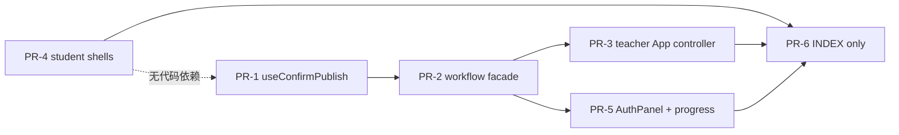
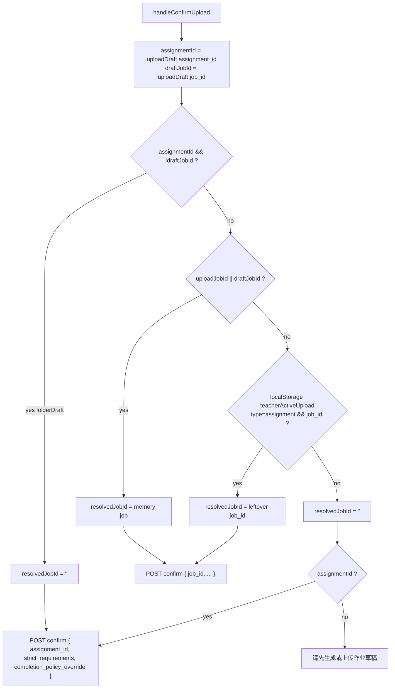
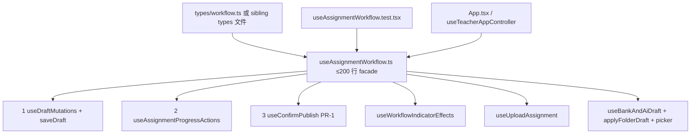

# teacherAgent 工程 + 前端结构优化（可维护性波，前端优先 6 PR）

| 字段 | 值 |
| --- | --- |
| 文档标题 | Engineering + frontend optimization: maintainability wave, frontend-first 6-PR DAG |
| 作者 | TBD（平台 Owner 签字后生效） |
| 日期 | 2026-10-13 |
| 状态 | Draft（2026-10-13 复审修订：吸收 Grok Issue 1–8 与 Codex Issue 9–10） |
| 产品 | 单校作业产品（teacher 布置/确认/进度；student 今日列表/陪练/显式提交；admin 学校面板） |
| 仓库 | `/home/tdcasual/codework/teacherAgent` |
| HEAD | `c22e2cb` (`docs: INDEX + how-to + CURRENT_PLAN_AUTHORITIES for score-up without bank`) |
| DESIGN_ID | `7e87a681` |
| 权威关系 | 产品身份：`docs/plans/2026-08-28-assignment-core-product-design.md`（D2/D4/D5 **不重开**；confirm 按钮 UX 已是「发布草稿」，发布门闩仍是 D2）。审计：`docs/plans/2026-10-10-audit-remediation-design.md`。体裁×来源 + 做题题库补练：`docs/plans/2026-10-10-next-phase-gapfill-design.md`（**不重开**其轴）。无题库提分：`docs/plans/2026-10-12-score-up-without-bank-design.md`。catalog vis 仍 09-06；进度数字仍 10-10 KD-7（GET compute-primary）。`RISK-ASSIGNMENT-DUALWRITE-001` **保持开放**。本文件：在 **不改产品行为** 的前提下，把活树最大前端热点抽成可维护结构。 |
| 治理 | `CONTRIBUTING.md` L/M/H；本波 **M**（结构/抽取）。M/H 必须 TDD。H 需回滚 + 安全测试 + 风险登记更新或明示「为何不需要」——本波不升 H：confirm locator 是既有契约，不是新授权模型；Confirm 是 UX 不是 authz。 |
| 团队 | 2 人。`.github/CODEOWNERS` 全是 `@tdcasual`。PR **正好 6**。 |

---

## Overview

活树 `c22e2cb` 的产品闭环已经能跑：老师选 `assignment_kind` × `content_source` → upload / bank / AI 进草稿 → `POST /assignment/upload/confirm` **发布草稿** → 学生今日列表 / 显式提交 → 老师进度。Owner 产品定义不重开。本波 **不是** 产品功能波，而是工程可维护性波：把已经过大、且正在顶预算的前端编排文件切开，使后续产品改动不再挤在 1400 行 hook 和 900 行 `App.tsx` 里。

选定策略：**可执行 DAG 前端优先、正好 6 个 PR**。后端 god file（`auth_registry_service.py` 1715、`identity_graph_service.py` 1174）本波 **不拆**；`chat_job_processing` extra/workflow 迁包、tiny `assignment_*.py` 合并、confirm job/folder/finalize 拆分、`assignment_wiring` 变薄，以及 SQL-primary GET 进度 / 关闭 dual-write RISK，全部列为 **显式后续波，不进本 DAG**。这 6 个 PR 对 `chat_job_processing_service.py`、`assignment_upload_confirm_service.py`、`app_core.py`、`auth_registry_service.py`、`identity_graph_service.py` **零 diff**。

活代码已经证明预算失守：`tests/test_teacher_frontend_hotspot_budgets.py::test_teacher_hotspot_files_remain_within_budget` 在 HEAD 上 **红**（`useAssignmentWorkflow.ts` 1413 行，断言 `< 1020`）。教师 `App.tsx` 897/900（再加 **3** 行即 `900 ≮ 900` 打红）、学生 `App.tsx` 900/920。prettier `printWidth: 100` 折行很容易吃掉这 3 行余量。本波用抽取还债，**禁止涨预算装绿**。



---

## Background & Motivation

### 产品定义（Owner，不重开）

老师布置作业；可选的老师说明是 agent 考查与讲解的依据。学生自主完成。评估能力并查漏补缺。根据完成情况描绘学生画像。接受图片提交。

保持身份串 **「学生端学习助手」** 与 **「不要生成作业」**。工作台主按钮 / 指示器 / 上传说明的 UX 文案已经是 **「发布草稿」**（`AssignmentDraftSection.tsx:158`、`data-testid="assignment-confirm-button"`）。E2E 稳定定位器用 `data-testid`，confirm 走 `getByTestId('assignment-confirm-button')`（`frontend/e2e/helpers/workflowLocators.ts:17-18`），不要用「创建作业」role name。Confirm 是 UX 不是 authz。

本波 **不填** `data/question_bank/questions.csv` 数据行。不改 `assignment_kind` × `content_source` 轴。GET `/teacher/assignment/progress` 仍 compute-primary。不关闭 `RISK-ASSIGNMENT-DUALWRITE-001`。

### 当前运行时（对照 HEAD `c22e2cb`，禁止把旧 plan 行号当现状）

#### 后端热点（本波冻结，不拆）

| 文件 | 行数 | 本波 |
| --- | ---: | --- |
| `services/api/auth_registry_service.py` | 1715 | **不拆**。无干净缝；历史 split 波失败。 |
| `services/api/auth/identity_graph_service.py` | 1174 | **不拆**。 |
| `services/api/chat_job_processing_service.py` | 1062 | 包已在 `services/api/chat_job_processing/{compute,confirm,history,timeline}.py`。把 extra/workflow 迁完是 **Follow-on A**。本 6 PR **零 diff** 该文件。 |
| `services/api/assignment_upload_confirm_service.py` | 900 | job vs folder vs `_finalize_published_from_folder` 缝已存在。confirm 双写 `upsert_assignment` + `atomic_write_json(meta.json)` 在 `:485-486`（`_persist_new_assignment`）与 `:738-739`（`_persist_folder_assignment`）。**本波零 diff、不关 dual-write。** |
| `services/api/assignment_progress_service.py` | 725 | live GET 先 `compute_assignment_progress`（`:615`）算 payload，再 `_persist_progress_2pc`（`:206-235`，调用点 `:714-722`）双写 SQL `upsert_progress_snapshot` **和** `progress.json`。SQL 回读 **不是** GET 权威。`assignment/store.py:_import_progress`（`:479-498`）也会 upsert，但不是「主要是 import」。GET 仍 compute-primary。 |
| `services/api/wiring/assignment_wiring.py` | 604 | `def` 40 个、`lambda` 23 个；公开 wrapper 从 `:529` 起重复私有 builder。后续波变薄。 |
| `services/api/app_core.py` | 245 / 预算 260 | **不拆**（`config/backend_quality_budget.json` `app_core_max_lines: 260`）。 |
| `services/api` 根上 `assignment_*.py` | 30 个文件 | 含过小文件：`assignment_today_service.py` 34、`assignment_upload_confirm_gate_service.py` 33、`assignment_generate_cli_service.py` 75。后续波合并。 |

其它门禁（本波只降不升、不新开 structure 文件）：

- `except Exception` 在 `services/` 约 415 处；`config/exception_policy_allowlist.txt` 98 行（含注释头）；`tests/test_exception_policy_budget_targets.py` 全局条目 `<= 139`。
- `ruff_max: 0`；`mypy_max: 19`（观测上限 `<= 19`）；`config/mypy_gate_files.txt` **只增不减**。
- `config/function_complexity_budget.json` `critical_files` C901 = 0：`agent_service.py`、`auth_service.py`、`chart_executor.py`、`tool_dispatch_service.py`、`chat_job_processing_service.py` 等。
- `STRUCTURE_TEST_COUNT_FROZEN = 84`（`tests/test_tech_debt_targets.py:17` 计数器本身）。禁止新增会命中 glob 的 `tests/test_*structure*.py` / `test_*split*.py` / `test_*budget*.py` / `test_*leftover*.py` / `test_no_*.py` / `test_*guard*.py`。`test_tech_debt_targets.py` **不在**这些 glob 里（文件名不含 structure/split/budget/leftover/no_/guard）；84 仍正确，因为它数的是 glob 命中集，不是「含自己」。

#### 前端热点（本波可执行面）

| 文件 | 行数 | 预算 / 事实 |
| --- | ---: | --- |
| `frontend/apps/teacher/src/features/workbench/hooks/useAssignmentWorkflow.ts` | **1413** | hotspot `< 1020`（`tests/test_teacher_frontend_hotspot_budgets.py:23`）——**HEAD 已红**。 |
| 同目录 `useAssignmentWorkflow.test.tsx` | 556 | **保持集成测试**；facade 导出必须仍是 `useAssignmentWorkflow`。 |
| 同目录 `useDraftMutations.ts` | 74 | **死文件**：仓库内无 import。自带 **非 kind 感知** 的 **9 个**必填键（`subject` / `topic` / `grade_level` / `class_level` / `core_concepts` / `typical_problem` / `misconceptions` / `duration_minutes` / `preferences`，`:24-32`），与活代码 `workbenchUtils.computeLocalRequirementsMissing(req, assignmentKind)`（`:97-125`，非做题只要求 subject/topic/grade/brief）不一致。PR-2 必须替换实现，禁止原样接线。 |
| `frontend/apps/teacher/src/App.tsx` | **897** | `test_teacher_frontend_structure.py:38` `< 900`（再加 3 行即红）；hotspot `< 930`。壳 JSX 已在 `TeacherAppLayout.tsx`（343 行）；App 仍解构 workbench 约 80 字段（`:79-163`）并内联 layout props（`:783-896`）。 |
| `frontend/apps/student/src/App.tsx` | **900** | `test_tech_debt_targets.py:31-37` `< 920`（文案：继续抽 send flow / session sidebar）。 |
| `TeacherTopbarAdminMenu.tsx` | 844 | 认证 + set-password + 学生重置。`writeTeacherAuthSession` 的 **唯一调用点**（`:187` admin login、`:279` teacher login、`:380` set-password）。 |
| `useTeacherChatApi.ts` | 738 | hotspot `< 750`。已抽 `useTeacherChatSend` / `useTeacherChatStream` / `useTeacherChatStatus`。本波 **不拆**。 |
| `useTeacherWorkbenchState.ts` | 338 | 已是 reducer。不重写。 |
| 学生 `useSessionManager.ts` / `useChatPolling.ts` | 646 / 592 | 本波不拆。 |
| `AssignmentDraftSection.tsx` | 452 | 主按钮已是「发布草稿」+ `assignment-confirm-button`。本波不拆。 |
| `AssignmentProgressSection.tsx` | 441 | 画像 / 量规 / 给分挤在同一 map。PR-5 抽子组件，**保留** `progress-portrait-*` 等 testid。 |
| `MemoryTab.tsx` | 500 | 本波不拆。 |
| 师生 `SessionSidebar.tsx` | 339 / 85 | **同名不同实现，禁止合并。** |

`handleConfirmUpload` 活代码在 `useAssignmentWorkflow.ts:893-1091`（**199 行**，不是旧 plan 的 ~345）。locator：

```896:912:frontend/apps/teacher/src/features/workbench/hooks/useAssignmentWorkflow.ts
    const folderDraft = Boolean(assignmentId && !draftJobId);
    const resolvedJobId = folderDraft
      ? ''
      : (() => {
          const jobId = String(uploadJobId || draftJobId || '').trim();
          if (jobId) return jobId;
          try {
            const raw = safeLocalStorageGetItem('teacherActiveUpload');
            if (!raw) return '';
            const active = JSON.parse(raw);
            if (active?.type === 'assignment' && active?.job_id)
              return String(active.job_id).trim();
          } catch {
            // ignore
          }
          return '';
        })();
```

`applyFolderDraft`（`:1179-1236`）**必须** `setUploadJobId('')`、`setUploadJobInfo(null)`、`safeLocalStorageRemoveItem('teacherActiveUpload')`。App 启动恢复（`App.tsx:520-541`）会把 leftover `teacherActiveUpload.job_id` 写回 `uploadJobId`——folder 草稿若不清 leftover，下一次 confirm 会被旧 job 赢。

学生移动壳：根节点 class `student-mobile-shell-v2`（`App.tsx:841`）+ `data-mobile-shell-v2`。桌面 `StudentLayout.tsx:13` 才有 `id="student-main"`；skip link（`App.tsx:845-850`，`href="#student-main"`）桌面/移动都渲染，但移动路径 **没有对应锚点**。PR-4：App **不再**渲染 skip；每个可见树 **一条** skip；桌面沿用 `StudentLayout` 的 id；移动把 `id="student-main"` 放在 `student-mobile-shell-main` 上。不算产品功能。

Tokens：`frontend/apps/shared/uiTokens.test.ts:125-141` 禁止 app tsx 原始 `text-[#]` / `bg-[#]`。师生都有 skip link「跳到主内容」。

学生 bundle：`tests/test_frontend_bundle_budget.py` `< 550 kB`，缺 `frontend/dist-student/assets` 则 skip；CI `frontend-quality` 在 `build:student` 之后用 node 脚本硬门禁。教师 bundle **没有** 对等测试。

### 为什么现在做、为什么前端优先

1. **预算已经破。** hotspot `useAssignmentWorkflow.ts` 1413/1020 在 `pytest tests/ -x` 全量步失败。教师 App 897，预算 `< 900`，再加 3 行即红。再改作业工作流（给分字段、kind 文案、locator）都会撞墙。
2. **后端大文件没有干净缝。** `auth_registry` / `identity_graph` 历史 split 失败；`app_core` 明确冻结。把 6 PR 花在无缝 god file 上会重复失败，且占用 execute-plan 配额。
3. **confirm 服务双写与 GET compute-primary 是持久化波。** 与前端抽取并行会制造 `assignment_upload_confirm_service.py` 热点冲突，并诱使评审重开 dual-write RISK。
4. **产品轴刚落地。** 10-10 / 10-12 刚把「发布草稿」和 kind×source 钉死。本波只搬结构，不搬行为。

---

## Goals & Non-Goals

### Goals

1. **Confirm locator 行为不变、可单测。** `handleConfirmUpload` 抽到 `useConfirmPublish`。folderDraft（有 `assignment_id`、无 draft `job_id`）走 `{ assignment_id }`；有 job 走 `{ job_id }`；leftover `teacherActiveUpload` **不得**赢过 folderDraft。`applyFolderDraft` 仍清 leftover。facade 仍导出 `handleConfirmUpload`。
2. **`useAssignmentWorkflow.ts` 变成 ≤~200 行 facade（hotspot `< 220`）。** 返回类型与导出名字不变。集成测试文件保持。`UseAssignmentWorkflowParams` / `Return` **必须**搬出 facade（`types/workflow.ts` 或同目录 types 文件）；`toFolderDraft` 跟 `applyFolderDraft` 走。子 hook 接 `params` 或小组 slice，禁止再抄一份 80 字段解构。hotspot 预算从 `< 1020` **降到** `< 220`（**只在 PR-2** 改现有 `test_teacher_frontend_hotspot_budgets.py`，PR-1 不改该断言）。
3. **教师 `App.tsx` < 350。** 抽 `useTeacherAppController`（路径 **必须** 是 `frontend/apps/teacher/src/useTeacherAppController.ts`，禁止放进 `features/layout`）。structure 与 hotspot 的 App 上限 **同为** `< 350`。壳仍在 `TeacherAppLayout`。`:520-541` leftover 恢复 effect 跟进 controller，不进 `useConfirmPublish`。
4. **学生 `App.tsx` < 600。** 抽 `useStudentNavigation` + 把 `:585-764` 内容构造搬进壳（或壳共享的 chrome）+ `StudentDesktopShell` + `StudentMobileShell`。四条 `lazy(() => import('./features/{home,submit,history,chat}/...'))` **留在 App.tsx**（`tests/test_leftover_survey_and_catalog.py::test_student_app_lazy_loads_page_chunks` 扫的是 App）。改 **现有** `test_student_app_line_budget`。保留 `student-mobile-shell-v2` 等 class/testid。每个可见树一条 skip；移动 `id="student-main"` 只挂在 `student-mobile-shell-main`。
5. **AdminMenu 认证面可测、进度面子组件化。** 抽 `TeacherAuthPanel`；**不得**丢掉 set-password 后 `writeTeacherAuthSession`（tv 递增后的新 token）。进度拆 portrait / rubric / grade / **exam-notes** 四个子组件，testid 不变。HTTP `adopted_coach_excerpts` 仍是整表替换；「采纳为评语」必须继续客户端 `mergeAdoptedExcerpts` 后再 POST。
6. **文档只在 PR-6。** INDEX 设计节 + `CURRENT_PLAN_AUTHORITIES` **同一 commit** 加入本文件。可选：在现有 `test_frontend_bundle_budget.py` 加教师 bundle（skip-if-missing），先测量再设上限。

### Non-Goals（本波明确不做）

- 填 `DATA_DIR/question_bank/questions.csv` 数据行；改空库 409；题库 CMS。
- 改 `assignment_kind` × `content_source`；第 5 种 kind；overload `meta.mode`。
- SQL-primary GET 进度；关闭 `RISK-ASSIGNMENT-DUALWRITE-001`。
- 拆 `auth_registry_service.py` / `identity_graph_service.py` / `app_core.py`。
- 把 confirm 后端 job/folder/finalize 拆进本 6 PR。
- 合并 tiny `assignment_*.py`；把 `assignment_wiring.py` 变薄（后续波）。
- 完成 `chat_job_processing` extra/workflow 迁包（Follow-on A）。本 6 PR **零 diff** `chat_job_processing_service.py`（以及 `assignment_upload_confirm_service.py` / `app_core.py` / `auth_registry_service.py` / `identity_graph_service.py`）。
- 拆 `useTeacherChatApi.ts` / `MemoryTab.tsx` / `AssignmentDraftSection.tsx` / 学生 `useSessionManager.ts` / `useChatPolling.ts`。
- 合并师生 `SessionSidebar.tsx`。
- 考试 / survey / class_report 复活。
- Grafana / 30 天 SLO；新 `test_*structure*.py`；涨 `STRUCTURE_TEST_COUNT_FROZEN`。
- 改 `prompts/v1/common/90_self_check.md` 图引用条。
- 改身份串「学生端学习助手」；删「不要生成作业」。
- 改 fail-closed Bearer；学生 SPA 改密 UI。
- 新 prompt 版本目录；feature flag。
- 把 Confirm 重新解释成授权模型。

---

## Key Decisions

| ID | 决定 | 活代码理由 |
| --- | --- | --- |
| KD-1 | 本波可执行面 = **前端优先正好 6 PR**。后端 follow-on 与 persist 波 **不进本 DAG**。 | execute-plan 配额 6。`auth_registry` 1715 / `identity_graph` 1174 无干净缝。`app_core` 245/260 冻结。confirm 双写与 GET compute-primary 是另一条 RISK。 |
| KD-2 | **不拆** `auth_registry_service.py`、`identity_graph_service.py`、`app_core.py`。 | 历史 split 波失败；`function_complexity_budget.json` 管的是 C901 不是行数虚荣。 |
| KD-3 | 不改 `assignment_kind` × `content_source`；不填 `questions.csv`；GET 进度仍 compute-primary；`RISK-ASSIGNMENT-DUALWRITE-001` 保持开放。 | Owner 定义与 10-10 / 10-12 刚钉死。本波是结构波。 |
| KD-4 | UX 文案保持 **「发布草稿」**。locator 保持 `data-testid="assignment-confirm-button"`。Confirm 是 UX 不是 authz。 | 10-12 已取代 08-28 L370 按钮句，D2 不重开。`workflowLocators.ts:17-18`。 |
| KD-5 | 身份串「学生端学习助手」「不要生成作业」不改。不改 `90_self_check.md` 图引用条。 | 10-10 KD-10 / 10-12 KD-S10。 |
| KD-6 | folderDraft（`assignment_id` 且 draft 无 `job_id`）confirm **禁止**读 leftover `teacherActiveUpload`。`applyFolderDraft` **必须**清 leftover。 | `useAssignmentWorkflow.ts:896-912`、`:1190-1196`。App `:520-541` 会把 leftover 写回 `uploadJobId`。已有测试 `from-bank confirm ignores leftover teacherActiveUpload job_id`。 |
| KD-7 | `useAssignmentWorkflow` **保持具名导出与返回类型**。`useAssignmentWorkflow.test.tsx` 保持 facade 集成测试。 | 唯一生产 import 在 `App.tsx:40`。禁止让测试改 import 路径绕过 facade。 |
| KD-8 | 抽 hook 时 **替换** 死文件 `useDraftMutations.ts`，改用 `workbenchUtils.computeLocalRequirementsMissing(req, assignmentKind)`。 | 死文件按 **9 个**做题键算 missing（无 kind 分支），会把非做题 brief 草稿标成缺 `typical_problem`。`test_frontend_type_hardening.py:85-92` 已扫该路径。 |
| KD-9 | 为打到 facade ≤~200 / hotspot `< 220`：PR-2 **必须**把 Params/Return 类型搬出 facade；子 hook 接 `params`（或 slice），禁止 80 字段二次解构；在四钩之外增加 `useAssignmentProgressActions`。调用顺序：`useDraftMutations` 与 `useAssignmentProgressActions` **先于** `useConfirmPublish`（confirm 需要 `saveDraft` / `fetchAssignmentProgress`）。 | 类型+解构+return 在 HEAD 已 ≥207 行（Params `:80-162`、Return `:168-204`、解构 `:210-273`、return `:1391-1413`）。不强制搬类型则 `< 220` 不可达。 |
| KD-10 | PR-1 **不涨** hotspot 1020。HEAD 已红（1413/1020）。PR-2 是第一条让该断言变绿的 PR。PR-1 **不可单独合进 main 装绿**；与 PR-2 同栈 / 一起 fast-forward。 | 涨预算 = 用纸覆盖本波存在的理由。`docs/how-to/maintainer-handoff.md:23`：「prettier printWidth 100 会增加物理行数，不要用涨预算代替抽取。」 |
| KD-11 | 教师 App 抽 `useTeacherAppController`，路径 **固定** `frontend/apps/teacher/src/useTeacherAppController.ts`（可退 `features/state/`，**禁止** `features/layout/`）。App 只组 `TeacherAppLayout` + `TeacherToolConfirmDialog`。structure 与 hotspot App 上限 **都** `< 350`。`:520-541` leftover 恢复留在 controller。 | `module-boundaries.md:83`：布局/顶栏/移动 tab 不承载 chat send / assignment upload/confirm/progress。controller 拥有今日 App `:56-782`（含 workflow）。禁止把 `.teacher-layout` / `TeacherTopbar` 回流 App（`test_teacher_app_layout_is_extracted`）。 |
| KD-12 | 学生抽 `useStudentNavigation` + 把 `:585-764` 内容构造搬进壳（或共享 chrome）+ `StudentDesktopShell` + `StudentMobileShell`。`lazy()` 四条留 App。改现有 `< 920` → `< 600`。每个可见树一条 skip；移动 `id="student-main"` 只在 `student-mobile-shell-main`。 | 只抽导航+移动 JSX 后 App 仍 ≈630，超 600。`test_student_app_lazy_loads_page_chunks` 钉 App 内 `lazy(` + 四条 `import('./features/...')`。`selectComposerHint` 在 App `:377`，`test_student_app_composer_hint_uses_selector_layer` 必须保持绿。 |
| KD-13 | 师生 `SessionSidebar.tsx` **禁止合并**。 | 同名不同实现（教师 339 / 学生 85，学生已是组合容器）。合并会破坏两边 e2e。 |
| KD-14 | `TeacherAuthPanel` 成为 `writeTeacherAuthSession` 的 **唯一 UI 调用点**（admin login / teacher login / set-password）。`teacherAuth.ts` 仍是存储 helper。学生重置只 `readTeacherAccessToken` 发 Bearer，不 persist。 | 活代码三处 persist 全在 `TeacherTopbarAdminMenu.tsx`。set-password 必须写入 **新** `access_token`（`RISK-TOKEN-VERSION-SET-PASSWORD-001` 已关：改密递增 `tv`）。禁止声称旧 token 仍可用（现测 `TeacherTopbarAdminMenu.test.tsx:117-171`）。 |
| KD-15 | 进度子组件必须保留 `progress-portrait-{sid}`、`progress-assignment-rubric`、`progress-adopt-rubric-{sid}`、`progress-exam-notes-{sid}`、`progress-row-{sid}`、`progress-practice-{sid}`、`progress-refresh`、`workflow-progress-section`。HTTP `adopted_coach_excerpts` 是 **整表替换**；「采纳为评语」客户端必须 `mergeAdoptedExcerpts` 后再 POST（现测 `posts merged adopted_coach_excerpts when adopting an excerpt`）。给分表单仍用 `parseAdoptedExcerpts` POST 整份 textarea。 | 10-12 脚枪：只 POST 新一行会抹掉旧摘录。服务端 `save_teacher_grade_from_request` 整表替换；客户端 merge 是补偿。 |
| KD-16 | 本波 **M**。不改 Bearer fail-closed。无新 SLO/Grafana。无 feature flag。回滚 = revert PR。INDEX / `CURRENT_PLAN_AUTHORITIES` **只 PR-6**。 | Confirm locator 不是新授权。`authFetch.ts:104-105` 注入 Bearer 的行为不动。 |
| KD-17 | 禁止新增会增加 structure glob 计数的 python 测试文件。PR-3/4 **只改现有** App 行预算断言（含 hotspot 里 `test_teacher_app_uses_extracted_state_hooks`）。教师 bundle 若做，写入 **现有** `tests/test_frontend_bundle_budget.py`。 | 冻 84 的 glob **不含** `test_tech_debt_targets.py` 自己。已含 `test_frontend_bundle_budget.py`、`test_teacher_frontend_hotspot_budgets.py`、`test_teacher_frontend_structure.py`、`test_leftover_survey_and_catalog.py`。 |
| KD-18 | 不拆 `useTeacherChatApi.ts`（738/750）、`MemoryTab`、`AssignmentDraftSection`、学生 session/polling hooks。 | 本波 6 PR 配额给 confirm locator、workflow facade、两个 App 壳、AdminMenu/进度。chat API 已有 send/stream/status 缝。 |
| KD-19 | 后续波（不在本 DAG）：(A) 完成 `chat_job_processing` extra/workflow 迁包 + 合并 tiny `assignment_*` + confirm job/folder/finalize + 薄 `assignment_wiring`；(B) persist：SQL-primary GET 进度并关闭 dual-write RISK。本 6 PR 对 `chat_job_processing_service.py` / confirm 服务 / `app_core.py` / `auth_registry_service.py` / `identity_graph_service.py` **零 diff**。 | 让评审不要把后端 LOC 拆或 dual-write 关进本 6 PR。禁止「不占 PR 位顺便完成进行中的拆」。 |

---

## Proposed Design

### 1. Confirm locator（PR-1 核心，行为冻结）



不变式：

1. folderDraft 时 **即使** `uploadJobId` 或 leftover 有值，confirm body **不得**含 `job_id`。活代码用 `folderDraft ? ''` 短路 leftover 闭包。抽 hook 时禁止改成「先读 leftover 再判断 folder」。
2. `applyFolderDraft` 清 `uploadJobId` / `uploadJobInfo` / `teacherActiveUpload`。`handleFromBank` / `handleGenerate` 必须继续走它。
3. `completion_policy_override.allow_practice` 用 **draft.assignment_kind**，不是 picker kind（已有测试 `confirm override uses draft.assignment_kind not picker kind`）。
4. 文案：`正在发布草稿…` / 成功 `作业已发布草稿。` / 解析未完成「请等待解析完成后再发布草稿。」按钮标签「发布草稿」/「已发布」不动。
5. 成功后仅当 leftover `job_id === resolvedJobId` 才 remove（`:1033-1039`）。folder 路径 `resolvedJobId` 为空，**不能**靠这段清 leftover——所以必须靠 `applyFolderDraft`。
6. App 启动 `useEffect`（`:520-541`）继续恢复 upload job polling。不要把它搬进 `useConfirmPublish`。PR-3 起该 effect 必须留在 `useTeacherAppController`（App 相邻文件），不是 layout 模块。

新文件：`frontend/apps/teacher/src/features/workbench/hooks/useConfirmPublish.ts`。facade **在** `useDraftMutations` / `useAssignmentProgressActions` 之后调用它，并再导出 `handleConfirmUpload`。

### 2. Workflow facade（PR-2）



目标布局（行数是抽取后的预算，不是虚荣）：

| 模块 | 职责 | 大约来源 |
| --- | --- | --- |
| `types/workflow.ts`（或 `hooks/assignmentWorkflowTypes.ts`） | **强制搬走** `UseAssignmentWorkflowParams`（HEAD `:80-162`，83 行）与 `UseAssignmentWorkflowReturn`（`:168-204`，37 行）。facade `export type` 再导出，签名不变。 | 现类型块 |
| `useAssignmentWorkflow.ts` | **禁止** 80 字段二次解构。把整个 `params`（或小组 slice）传给子 hook，按序调用，spread 成同一 Return。目标 ≤~200，hotspot `< 220`。 | 胶水 only |
| `useConfirmPublish.ts` | locator + POST confirm；入参含 `saveDraft` / `fetchAssignmentProgress` | `:893-1091` |
| `useWorkflowIndicatorEffects.ts` | indicator memo、auto-state、collapse/expand、job done 后 load draft、misconceptions sync | `:277-471` |
| `useDraftMutations.ts` | **覆盖死文件**：`updateDraftRequirement` / `updateDraftQuestion` / `saveDraft`；missing 必须调用 `computeLocalRequirementsMissing(next, assignmentKind)` | 活代码 `:473-510`、`:669-733` |
| `useUploadAssignment.ts` | `handleUploadAssignment`；成功写 `teacherActiveUpload` | `:735-889` |
| `useBankAndAiDraft.ts` | `toFolderDraft`（`:46-78`）+ `applyFolderDraft`、`handleFromBank`、`handleGenerate`、picker + `clearActiveDraft` | `:46-78`、`:1093-1389` |
| `useAssignmentProgressActions.ts` | `fetchAssignmentProgress` / archive / unarchive / `saveStudentGrade` / refresh / scroll | `:512-665` |

facade 调用顺序（Rules of Hooks 固定；confirm 依赖前两个的返回值）：

```ts
export function useAssignmentWorkflow(params: UseAssignmentWorkflowParams): UseAssignmentWorkflowReturn {
  const draft = useDraftMutations(params);
  const progress = useAssignmentProgressActions(params);
  const confirm = useConfirmPublish({
    ...params,
    saveDraft: draft.saveDraft,
    fetchAssignmentProgress: progress.fetchAssignmentProgress,
  });
  const effects = useWorkflowIndicatorEffects(params);
  const upload = useUploadAssignment(params);
  const bank = useBankAndAiDraft(params);
  return { ...draft, ...progress, ...confirm, ...effects, ...upload, ...bank };
}
```

子 hook **接 `params` 或显式 slice**（例如 `{ apiBase, uploadDraft, setUploadDraft, assignmentKind, ... }`），禁止在 facade 里再写一份 `:210-273` 解构再往下传 80 个具名参数。

禁止：子 hook 改变 POST 路径、FormData 字段、`generate=true`、folder 无 `job_id` 等契约。hotspot `< 1020` → `< 220` **只在 PR-2** 改，PR-1 不动该断言。

### 3. 教师 App controller（PR-3）

**必选路径：** `frontend/apps/teacher/src/useTeacherAppController.ts`（与 `App.tsx` 同层）。允许退到 `frontend/apps/teacher/src/features/state/useTeacherAppController.ts`。**禁止**放进 `features/layout/`（`module-boundaries.md:83`：布局不承载 chat send / assignment upload/confirm/progress）。**不要**新建 `features/routing`。

Controller 拥有今日 `App.tsx:56-782` 的 hook 装配与 view model，**包括** leftover 恢复 `useEffect`（`:520-541`，读 `teacherActiveUpload` 写回 `uploadJobId` / kind）。返回已分组的 `TeacherAppLayout` props + tool-confirm props。`App.tsx` 目标：

```tsx
export default function App() {
  const { layout, toolConfirm } = useTeacherAppController();
  return (
    <>
      <TeacherAppLayout {...layout} />
      <TeacherToolConfirmDialog {...toolConfirm} />
    </>
  );
}
```

约束：

- 继续 `useTeacherWorkbenchState` reducer，不把字段打回 `useState`。
- 不把 `.teacher-layout` / `teacher-mobile-shell-v2` / `TeacherTopbar` 回流 App。
- skip link 留在 `TeacherAppLayout.tsx:169-174`（`href="#teacher-chat-main"`，文案「跳到主内容」）。
- `useAssignmentWorkflow` 仍只从 facade import。
- **现有** `test_teacher_app_uses_extracted_state_hooks`（`tests/test_teacher_frontend_hotspot_budgets.py:42-47`）今日断言 `useTeacherSessionState` / `useTeacherWorkbenchState` **出现在 App.tsx**。PR-3 必须改该测试（仍是同一文件，不新增 structure 文件）：App 含 `useTeacherAppController`；controller 文件含 `useTeacherSessionState` 与 `useTeacherWorkbenchState`。

预算：**structure 与 hotspot 的 App 上限同为** `assert line_count < 350`。不要一个 350、一个 400。350 相对抽完后的 ~20–50 行 App 已含 prettier 余量；**上限不得回到 900/930**。

### 4. 学生导航 + 双壳（PR-4）

只抽导航（`:433-580` ≈148）+ 移动 JSX（`:765-836` + `:860-897`）后，App 仍留下 imports `:1-63`、hook 装配 `:64-432`（≈369）、内容构造 `:585-764`（`sessionSidebarContent` / submit / history / home / `learningContent` / `chatContent`，≈180）。算术：`900 - 148 - 72 ≈ 680` 再加新 import/调用 ≈ 630+，**仍超 600**。因此 `:585-764` **必须**离开 App。

| 新文件 | 来源 |
| --- | --- |
| `frontend/apps/student/src/hooks/useStudentNavigation.ts` | `App.tsx:433-580` 及关联 `homeOpen` / `assignmentHistoryOpen` / `submitAssignmentId` / `mobileTab` 状态 |
| `frontend/apps/student/src/features/layout/studentAppContent.tsx`（或等价，壳共享） | `:585-764` 内容构造：sidebar / submit / history / home / learning / chat 元素 |
| `frontend/apps/student/src/features/layout/StudentDesktopShell.tsx` | `StudentTopbar` + `StudentLayout` + **一条** skip（今日 `:879-888`） |
| `frontend/apps/student/src/features/layout/StudentMobileShell.tsx` | `:765-836` + `:860-897` 移动分支 + **一条** skip |

App 留下：imports、**四条 `lazy()` 常量**（`:56-62`）、hook 装配（`:64-432` 去掉已迁导航）、`useStudentNavigation` 调用、把 lazy 组件/元素传给壳的薄 compose。

`lazy()` 必须留在 App.tsx。现有 `tests/test_leftover_survey_and_catalog.py::test_student_app_lazy_loads_page_chunks`（leftover glob，已计入冻 84）断言 App 含 `lazy(` 以及：

- `import('./features/home/StudentTodayHome')`
- `import('./features/submit/StudentSubmitPanel')`
- `import('./features/history/StudentAssignmentHistoryPage')`
- `import('./features/chat/ChatPanel')`

若把 `lazy()` 搬进壳而不改该测试，CI 红。允许的替代：**改这个现有 leftover 测试**去扫壳文件；**禁止**新建 leftover/structure 文件。默认选择：`lazy()` 留 App，测试不改路径。

必须保留：

- 根 class `student-mobile-shell-v2` 与 `student-mobile-shell-main`（e2e / CSS 哨兵）。
- `data-testid="student-learning-overview-panel"`、`student-session-list-panel`。
- `data-mobile-shell-v2`。
- **每个可见树恰好一条** skip「跳到主内容」。PR-4 从 App **删除** `:845-850`。桌面壳依赖 `StudentLayout.tsx:13` 的 `id="student-main"`，不再复制 id。移动壳把 `id="student-main"` 设在 `student-mobile-shell-main` 上（仅移动分支）。禁止 App 与壳各画一条导致双 skip。
- `ChatPanel` 的 `assignmentKind` 继续来自 **`selectedRow`**（`App.tsx:735`，selectedAssignmentId 行），不是 `submitKind`（`:689`）。10-12 已修，勿回退。
- `selectComposerHint` 继续在 App 调用（`:377`），`test_student_frontend_structure.py::test_student_app_composer_hint_uses_selector_layer` 保持绿。
- 不把 send flow 从 `useStudentSendFlow` 抽回 App；不合并 `SessionSidebar`。

现有预算：`test_tech_debt_targets.py::test_student_app_line_budget` `< 920` → `< 600`，失败文案改为指向 navigation/shell/content 抽取。

### 5. TeacherAuthPanel + 进度子组件（PR-5）

`TeacherAuthPanel` 建议路径：`frontend/apps/teacher/src/features/auth/TeacherAuthPanel.tsx`（认证域，避免 layout 文件继续膨胀）。

搬迁：`handleAdminLogin` / `handleAuthSubmit` / `handleSetPassword` 及对应 JSX（约 `:151-398`、`:539-675`）。`TeacherTopbarAdminMenu` 保留学生密码重置、退出、`TeacherAdminPanel` 壳。

安全不变式（抽错即 H，本波按 M 但测试按安全回归写）：

1. set-password 成功且响应含 `access_token` → `writeTeacherAuthSession` 新 token。无 token 则 **不** 写、不声称旧 token 可用。
2. persist 调用点不得扩散到重置学生密码、Settings、ErrorBoundary。
3. 学生重置继续 `Authorization: Bearer ${readTeacherAccessToken()}`（`:467-472`）；非 admin 隐藏「全部学生」。
4. 不改后端 `token_version` / fail-closed Bearer。

进度（四个子组件都在 `workflow/`，**PR-5 文件清单必须含 ExamNotes**）：

- `ProgressPortraitSnippet` — `data-testid={progress-portrait-${sid}}`，文案仍 `portraitLabel`。
- `ProgressRubricBlock` — `progress-assignment-rubric`；无 `suggested_score` 隐藏「按量规给分」（现测 `hides adopt-rubric button without a suggested score and shows it when scored`，`AssignmentProgressSection.test.tsx:261`）。
- `ProgressGradeForm` — 覆盖分 / 评语 / 摘录 textarea；保存时 `parseAdoptedExcerpts` POST **整份** textarea。
- `ProgressExamNotes.tsx` — 搬 `examNotesBody`（`AssignmentProgressSection.tsx:92-134`），`data-testid={progress-exam-notes-${sid}}`。「采纳为评语」POST `mergeAdoptedExcerpts(existing, text)`（`:67-77`、`:117-123`）。现测 `posts merged adopted_coach_excerpts when adopting an excerpt`（`:224-258`）期望 `[{ text: '旧条目' }, { text: '新条目' }]`。

摘录不变式（一句话）：**HTTP `adopted_coach_excerpts` 是整表替换**（服务端 `save_teacher_grade_from_request`）；采纳按钮必须先 `mergeAdoptedExcerpts` 再 POST；禁止「修正」成只发新一行（会抹掉旧摘录，10-12 脚枪）。给分表单仍 POST 整份 textarea。

父组件 `AssignmentProgressSection.tsx` 继续拥有 `workflow-progress-section` 与行 `progress-row-*`。菜单级 AdminMenu 测试保持经 `TeacherAuthPanel` 的集成；`writeTeacherAuthSession` 只出现在 `teacherAuth.ts` 定义 + AuthPanel + 测试 spy。

### 6. 文档（PR-6）

把本文件落入 `docs/plans/2026-10-13-engineering-frontend-optimization-design.md`。INDEX 设计节与 `tests/test_docs_architecture_presence.py` 的 `CURRENT_PLAN_AUTHORITIES` **同一 commit**。`docs/plans/ARCHIVE.md` 现行权威列表同步。`docs/architecture/module-boundaries.md` / `ownership-map.md` 补 controller / shells / AuthPanel。

how-to：老师日常主线已是发布草稿，不必改产品步骤。`docs/how-to/maintainer-handoff.md` 加一行：作业工作流 hook 以 `useAssignmentWorkflow` facade 为入口；confirm locator 在 `useConfirmPublish`；HOTSPOT 预算以 facade 为准，禁止涨行数上限。

可选教师 bundle：先 `npm run build:teacher`，读 `frontend/dist-teacher/assets/index-*.js` 体积，在 **现有** `tests/test_frontend_bundle_budget.py` 加 `test_teacher_main_chunk_under_budget`，缺目录 skip（与学生相同）。上限 = 测量值 + 明确余量（建议 ≥20% 或 +100 kB，取宽者），写入设计/PR 正文。本波 **不改** `ci.yml` 的 node 硬门禁（避免 docs PR 变成 CI 行为变更）；pytest skip 足够。

### 7. 明确后续波（不在本 6 PR）

**Follow-on A — 后端结构（另开 6 PR DAG）：**

1. 完成 `chat_job_processing`：把 `_teacher_extra_system` / `_student_extra_system` / `_build_chat_extra_system`（约 `:418-666`）与 workflow normalize/resolve（约 `:151-407`、`:581-615`）迁入包内新模块；facade 保持 C901 0。
2. 合并 tiny：`assignment_upload_confirm_gate_service.py` → confirm；`assignment_today_service.py` → student list/catalog；`assignment_generate_cli_service.py` → generate。
3. confirm 按已有缝切开：job `confirm_assignment_upload` / folder `_finalize_published_from_folder` / persist helpers。**仍双写**，不关 RISK。
4. `assignment_wiring.py` 去掉公开/私有重复 wrapper，遵守现有 `_ac._` ≤ 10、`_ac.` ≤ 130（`test_assignment_wiring_structure.py`）。

**Follow-on B — persist：** discussion/submission 迁表后 GET 进度 SQL-primary，关闭 `RISK-ASSIGNMENT-DUALWRITE-001`（目标仍 2026-12-01）。无 folder 不 2PC、不 mkdir。退出条件不变：GET 以 SQL 为权威之前，live compute + 2PC 双写（SQL snapshot **和** `progress.json`）保持。

---

## API / Interface Changes

**无 HTTP / MCP / 作业轴变更。** 前端 hook 对 App 的契约保持：

```ts
export function useAssignmentWorkflow(
  params: UseAssignmentWorkflowParams,
): UseAssignmentWorkflowReturn;
```

`UseAssignmentWorkflowReturn` 仍含 `handleConfirmUpload`、`handleFromBank`、`handleGenerate`、`saveDraft`、`saveStudentGrade` 等（`useAssignmentWorkflow.ts:169-204`）。`types/workflow.ts:157` `AssignmentDraftSectionProps.handleConfirmUpload` 不变。

教师 layout：`TeacherAppLayoutProps` 保持；`src/useTeacherAppController.ts` 组装它，不改字段名。controller **不**放进 `features/layout/`。

学生：`StudentLayout` props 保持；新壳是组合层。

认证：仍 `POST /auth/admin/login`、`/auth/teacher/identify`、`/auth/teacher/login`、`/auth/teacher/set-password`、`/auth/teacher/student/reset-passwords`。无新路由。

---

## Data Model Changes

无 schema、无迁移、无 `questions.csv` 行、无 `meta.json` 形状变化。`teacherActiveUpload` localStorage 形状保持 `{ type: 'assignment', job_id, assignment_kind? }`。`teacherAuthAccessToken` / `teacherAuthSubject` 键名不变。

---

## Alternatives Considered

### 方案 1 — 先按 LOC 拆后端 god file

先拆 `auth_registry_service.py`（1715）与 `identity_graph_service.py`（1174），或再拆 `app_core.py`。

- 优点：后端行数看起来下降。
- 缺点：无干净缝；历史 split 明确失败；`app_core` 预算 260 且 10-10 冻结；C901 关键文件已是 0，LOC 拆会制造循环 import / 测试扇出，且 6 PR 会耗尽在不可合并的半拆上。前端 1413 行 hook 与 897/900 App **仍然红**。
- **拒绝。** KD-1 / KD-2。

### 方案 2 — 把后端 confirm job/folder/finalize 拆塞进本 6 PR

用 1–2 个 PR 拆 `assignment_upload_confirm_service.py`（900）。

- 优点：后端最大作业文件降温。
- 缺点：与前端 confirm locator 抽取并行编辑同一产品缝（发布路径）；评审会把 dual-write `:485-486`/`:738-739` 误认为本波要关 RISK；execute-plan 6 PR 装不下「前端 6 件套 + 后端拆」。
- **拒绝进本 DAG。** 列入 Follow-on A。本波 **禁止** 改该服务，降低并行冲突。

### 方案 3 — 本波做 persist dual-write / SQL-primary GET 进度

关闭 `RISK-ASSIGNMENT-DUALWRITE-001`，GET 改 SQL-primary。

- 优点：进度权威终于单一。
- 缺点：discussion/submission 仍在盘上（风险登记退出条件 2026-12-01）；GET 写-on-read 会 mkdir，违背 09-06 vis；这是 H 级持久化，不是 M 级结构抽取；会挤掉前端预算修复。
- **拒绝。** KD-3。GET 仍 live compute + 双写。

### 方案 4（选定）— 前端优先 6 PR，后端与 persist 显式后续

见 Proposed Design。以 confirm locator TDD 开场，再 facade，再两个 App 壳，再 AdminMenu/进度，最后文档。

---

## Security & Privacy Considerations

威胁模型（本波结构抽取）：

| 威胁 | 严重度 | 缓解 |
| --- | --- | --- |
| AuthPanel 抽取漏掉 set-password 新 token persist → 改密后旧 Bearer 仍像可用 | 高 | 现测 `persists access_token after set-password and does not claim old token still works` 必须仍绿；禁止 UI 文案「token 仍可用」。后端 `tv` 递增不在本波改。 |
| persist 调用点扩散（Settings / 学生重置 / 其它菜单） | 高 | KD-14：只有 AuthPanel 调 `writeTeacherAuthSession`。grep 门禁可写在现有 `TeacherTopbarAdminMenu.test.tsx` 或 AuthPanel 测试里，**不要**新 python structure 文件。 |
| 学生重置 Bearer 丢失或改成非 fail-closed | 高 | 重置路径继续显式 `Authorization: Bearer …`。不改 `authFetch.ts` 注入逻辑。 |
| Confirm 被误做成「前端授权」 | 中 | Confirm 仍是老师已认证后的 UX 发布门闩；ACL 在后端 `_folder_owner_teacher_id` / 403 `forbidden`。 |
| 进度子组件改 testid 导致老师误判画像/量规 | 中 | KD-15 钉 testid。 |
| leftover job 赢过 bank/AI folder 草稿，发布错作业 | 高（产品正确性） | PR-1 TDD：folderDraft 忽略 leftover；`applyFolderDraft` 后 `localStorage` 为 null。 |

不改：fail-closed Bearer、`AUTH_REQUIRED` 三态、profile GET ACL、学生无改密 UI、MCP 绑定、Landlock。

本波不更新 `risk-register.md`：无新开放 RISK；不关闭 dual-write；token_version RISK 已关闭。PR 正文写「为何不需要」：M 级抽取，无授权/持久化语义变化。

---

## Observability

沿用现有 `diag_log`（后端 chat/assignment）。前端抽取 **不** 加新埋点、不新 SLO、不引入 Grafana。`docs/operations/slo-and-observability.md` 已声明不是 Grafana 平台——本波不改该文件（除非 PR-6 索引需要，默认不需要）。

回归信号：CI 全量 pytest、frontend lint/format/typecheck/unit、assignment-loop smoke、teacher/student 既有 e2e（`assignment-confirm-button`、mobile shell v2、progress-portrait）。

---

## Rollout Plan

- 无 feature flag。结构抽取合入即生效。
- 实现顺序：worktree 6 PR 栈 → 独立验收 0 open → **fast-forward `origin/main`**（用户对完整实施方案的既定偏好）。
- 每个 PR **独立可审、可 revert**。PR-1 **允许**继续红在既有 `useAssignmentWorkflow.ts < 1020` 断言上；合入必须与 PR-2 **同栈 / 一起 fast-forward**。禁止为 PR-1 独绿涨 1020。
- 回滚 = `git revert` 该 PR。不需要数据迁移回滚。
- PR-1 之后文件约 1413−199 + 新 hook 调用 ≈ **1220+**，仍 `> 1020`——**预期**，KD-10。HEAD 在 `pytest tests/ -x` 上已经红。
- PR-2 合入后 hotspot facade `< 220` 必须绿。
- 生产：`APP_ENV=production AUTH_REQUIRED=1 PUBLISH_HOST=127.0.0.1` 不变。

---

## Risks

| 风险 | 严重度 | 缓解 |
| --- | --- | --- |
| leftover `teacherActiveUpload` 回归，bank/AI confirm 带上旧 `job_id` | **高** | PR-1 先红后绿：现有 `from-bank confirm ignores leftover…` + 明确断言 folderDraft 时 body 无 `job_id` 且 `applyFolderDraft` 后 storage null。禁止「先读 leftover」。 |
| e2e locator 动荡（role name / 文案） | **高** | 禁止改 `assignment-confirm-button` 与 `progress-portrait-*` 等 testid。禁止把按钮改回「创建作业」。e2e 继续 `getByTestId`。 |
| prettier `printWidth: 100` 折行把预算打红 | **中** | 教师 App 今日 897，`< 900` 再加 3 行即红。PR-1/2 尽量不碰 App。PR-3/4 **先抽后**降预算；structure 与 hotspot App **同为** `< 350`。禁止用涨上限代替抽取。 |
| 并行改 `assignment_upload_confirm_service.py` | **中** | 本波 6 PR **零 diff** 该文件。后续波单开。PR 模板写明。 |
| 死文件 `useDraftMutations` 原样接线，非做题 missing 算错 | **中** | KD-8：必须改用 kind 感知 `workbenchUtils`（不要保留死文件那 9 个做题键）。加/留测试：scenario draft 更新 brief 不算 typical_problem missing。 |
| AuthPanel 漏 persist | **高** | 见 Security。现有 AdminMenu 测试保持从菜单打到 persist（集成），不要只测抽离子组件而删菜单级用例。 |
| 学生 skip 重复或移动仍无 `#student-main` | **低** | PR-4 从 App 删除 skip；桌面沿用 `StudentLayout` id；移动只在 `student-mobile-shell-main` 设 id。每个可见树一条 skip。 |
| 采纳摘录抽到 ExamNotes 时改成只 POST 新一行 | **高** | 保留 `mergeAdoptedExcerpts` 与 `posts merged adopted_coach_excerpts when adopting an excerpt`。HTTP 整表替换 ≠ 客户端不 merge。 |
| HEAD hotspot 已红导致 PR-1 CI 仍红，被误判为 PR-1 引入 | **中** | PR-1 描述写明：失败断言是 `useAssignmentWorkflow.ts` 行数，本 PR 净减少但不到 1020；修复在 PR-2。 |
| 新 python structure 文件把 84 冻计数打红 | **中** | 只改现有预算文件。前端 vitest 新文件不算该 glob。 |

---

## Open Questions

本波关闭、不送评审重开：

- 是否先拆后端 god file？**否**（KD-1/2）。
- 是否本波关 dual-write？**否**（KD-3）。
- 是否涨 hotspot 1020 让 PR-1 独绿？**否**（KD-10）。
- 师生 SessionSidebar 是否合并？**否**（KD-13）。
- Confirm 是否变成授权层？**否**（KD-4/16）。

需要 Owner 在实现前拍板的只剩一项（可在 PR-6 测量后定，不挡 PR-1–5）：

- OQ-1：教师 bundle 可选测试的具体 kB 上限。实现时 `npm run build:teacher` 写入 PR-6 正文；若教师 chunk 显著大于学生 550 kB，用「测量 + ≥20% 余量」而不是抄 550。

---

## References

- `docs/plans/2026-08-28-assignment-core-product-design.md` — 产品身份；D2 发布门闩。
- `docs/plans/2026-10-10-audit-remediation-design.md` — KD-7 GET compute-primary；structure 84。
- `docs/plans/2026-10-10-next-phase-gapfill-design.md` — kind × source；folder locator。
- `docs/plans/2026-10-12-score-up-without-bank-design.md` — 「发布草稿」UX；画像/量规 testid。
- `docs/architecture/module-boundaries.md` / `ownership-map.md`
- `docs/reference/risk-register.md` — `RISK-ASSIGNMENT-DUALWRITE-001` 开放；`RISK-TOKEN-VERSION-SET-PASSWORD-001` 已关闭。
- `docs/how-to/teacher-daily-workflow.md` / `maintainer-handoff.md`
- `CONTRIBUTING.md` L/M/H
- `tests/test_tech_debt_targets.py`、`tests/test_teacher_frontend_structure.py`、`tests/test_teacher_frontend_hotspot_budgets.py`、`tests/test_frontend_bundle_budget.py`、`tests/test_docs_architecture_presence.py`
- 活代码：`useAssignmentWorkflow.ts`、`App.tsx`（师生）、`TeacherTopbarAdminMenu.tsx`、`AssignmentProgressSection.tsx`、`assignment_upload_confirm_service.py:485-486,738-739`、`assignment_progress_service.py:615,714-722`、`tests/test_leftover_survey_and_catalog.py:98-108`、`tests/test_teacher_frontend_hotspot_budgets.py:42-47`

---

## PR Plan

每个 PR **独立可审、可 revert**。PR-1 允许继续红在既有 `useAssignmentWorkflow.ts < 1020` 上；合入必须与 PR-2 同栈 / 一起 fast-forward，禁止为 PR-1 独绿涨 1020。测试运行器：`.venv/bin/python`；前端 `frontend/` 下 npm。级别默认 **M**（TDD）；PR-6 **L**。

### PR-1 — `refactor(teacher): extract useConfirmPublish and pin leftover job locator`

- **依赖：** 无
- **级别：** M
- **文件：**
  - 新 `frontend/apps/teacher/src/features/workbench/hooks/useConfirmPublish.ts`
  - `frontend/apps/teacher/src/features/workbench/hooks/useAssignmentWorkflow.ts`（改为调用该 hook，保留导出）
  - `frontend/apps/teacher/src/features/workbench/hooks/useAssignmentWorkflow.test.tsx`（保持 facade import；加强 locator 用例）
- **不含：** 其它 hook 拆分；App.tsx；后端 confirm 服务；INDEX。
- **行为：** 原样搬迁 `:893-1091` locator + POST + 成功/失败状态。禁止改 body 字段名。
- **TDD（先红）：**
  - 现有 `saves and confirms by assignment_id when job_id is missing`
  - 现有 `from-bank confirm ignores leftover teacherActiveUpload job_id`（断言 confirm body 无 `job_id`，且 from-bank 后 `teacherActiveUpload` 为 null）
  - 现有 `confirm override uses draft.assignment_kind not picker kind`
  - 补强：在 **同时** 存在 leftover `job_id` + folderDraft 时，confirm **只**发 `assignment_id`（防止抽取时改成先读 leftover）
  - 文案：`正在发布草稿…` 仍被设置
- **验证：** `cd frontend && npx vitest run apps/teacher/src/features/workbench/hooks/useAssignmentWorkflow.test.tsx`；prettier/typecheck。
- **回滚：** revert。hotspot 仍红（预期，HEAD 债，不是 PR-1 回归）。
- **注意：** 本 PR **不得**把 hotspot `< 1020` 改大。1413−199 + 新 hook 调用 ≈ **1220+**，仍 `> 1020`。与 PR-2 同栈合入。

### PR-2 — `refactor(teacher): split useAssignmentWorkflow into facade hooks`

- **依赖：** PR-1
- **级别：** M
- **文件：**
  - `frontend/apps/teacher/src/types/workflow.ts`（或 `hooks/assignmentWorkflowTypes.ts`）：**强制**迁入 `UseAssignmentWorkflowParams` / `UseAssignmentWorkflowReturn`；facade 再 export
  - `useAssignmentWorkflow.ts`（≤~200 行 facade；把 `params` 传给子 hook，无 80 字段二次解构）
  - 新/替换：`useWorkflowIndicatorEffects.ts`、`useDraftMutations.ts`（替换死实现）、`useUploadAssignment.ts`、`useBankAndAiDraft.ts`（含 `toFolderDraft`）、`useAssignmentProgressActions.ts`
  - `useConfirmPublish.ts`（接 `saveDraft` / `fetchAssignmentProgress`；调用顺序在 draft/progress 之后）
  - `useAssignmentWorkflow.test.tsx`（仍只 import facade）
  - `tests/test_teacher_frontend_hotspot_budgets.py`：`_ASSIGNMENT_WORKFLOW_PATH < 1020` → `< 220`（**本 PR 才改**，PR-1 不改）
  - `tests/test_frontend_type_hardening.py` 已扫 `useDraftMutations.ts`，保持无 `any`
- **不含：** App 行预算；AuthPanel；INDEX；涨 1020。
- **TDD：** 现有 facade 用例全绿：upload start 带 `subject_id`/`due_at`/`assignment_kind`；from-bank 无 `job_id`；generate `generate=true` 且 folder draft；picker confirm 清 leftover；`saveStudentGrade` 打 loaded `assignment_id` 不是输入框。新增：非做题 `updateDraftRequirement('brief', …)` 的 missing **不含** `typical_problem`（锁死 kind 感知 mutations，禁止死文件那 9 个做题键）。
- **验证：** vitest 上述测试；`.venv/bin/python -m pytest -q tests/test_teacher_frontend_hotspot_budgets.py tests/test_frontend_type_hardening.py`。
- **回滚：** revert。

### PR-3 — `refactor(teacher): extract useTeacherAppController and lower App line budget`

- **依赖：** PR-2（controller 只依赖 facade 导出；顺序上避免与 PR-2 同时改 App import 块）
- **级别：** M
- **文件：**
  - 新 `frontend/apps/teacher/src/useTeacherAppController.ts`（**禁止** `features/layout/`）
  - `frontend/apps/teacher/src/App.tsx`（目标 < 350）
  - **现有** `tests/test_teacher_frontend_structure.py::test_teacher_app_line_budget`：`< 900` → `< 350`
  - **现有** `tests/test_teacher_frontend_hotspot_budgets.py`：App `< 930` → **同样** `< 350`（与 structure 同一数字）；`test_teacher_app_uses_extracted_state_hooks` 改为 App 含 `useTeacherAppController`，controller 文件含 `useTeacherSessionState` 与 `useTeacherWorkbenchState`
  - 现有 `test_teacher_app_layout_is_extracted` 仍要求 App 不含 `teacher-layout` / `TeacherTopbar`
- **不含：** 新 python structure 文件；不改 `TeacherAppLayout` 壳 class；不把 leftover 恢复 effect 放进 `useConfirmPublish`。
- **TDD：** 先把现有 `test_teacher_app_line_budget` 上限改为 350（红，897 ≥ 350）再抽取至绿。controller 必须含 `:520-541` `teacherActiveUpload` 恢复。可选 vitest：controller 返回含 `workbenchViewModel.handleConfirmUpload`。
- **验证：** `.venv/bin/python -m pytest -q tests/test_teacher_frontend_structure.py tests/test_teacher_frontend_hotspot_budgets.py`；`npx vitest run apps/teacher/src/features/layout/TeacherAppLayout.test.tsx`；e2e 不强制，但 `teacher-layout-sentinel.spec.ts` 在有环境时应绿。
- **回滚：** revert。

### PR-4 — `refactor(student): extract navigation + desktop/mobile shells`

- **依赖：** 无（可与 PR-1–3 并行）。建议合入前 rebase PR-3 以免 docs 冲突，代码无冲突。
- **级别：** M
- **文件：**
  - 新 `frontend/apps/student/src/hooks/useStudentNavigation.ts`
  - 新 `frontend/apps/student/src/features/layout/studentAppContent.tsx`（或等价；承接 `:585-764`）
  - 新 `frontend/apps/student/src/features/layout/StudentDesktopShell.tsx`
  - 新 `frontend/apps/student/src/features/layout/StudentMobileShell.tsx`
  - `frontend/apps/student/src/App.tsx`（目标 < 600；**保留**四条 `lazy()`；**删除** skip link）
  - **现有** `tests/test_tech_debt_targets.py::test_student_app_line_budget`：`< 920` → `< 600`
  - **现有** `tests/test_leftover_survey_and_catalog.py::test_student_app_lazy_loads_page_chunks`（默认仍扫 App；只有把 lazy 搬壳时才改这个现有文件）
  - **现有** `tests/test_student_frontend_structure.py::test_student_app_composer_hint_uses_selector_layer` 保持绿
  - 新 vitest（frontend，不算 python structure glob）：移动根 class 含 `student-mobile-shell-v2`；`student-mobile-shell-main` 有 `id="student-main"`；可见树只有一条「跳到主内容」
- **不含：** 合并 SessionSidebar；改 send flow；INDEX；新建 leftover/structure python 文件。
- **TDD：** 先改 python 预算为 600（红）再抽导航 **和** `:585-764`。保留 `student-learning-overview-panel` / `student-session-list-panel`。e2e `student-session-sidebar.spec.ts`「mobile shell v2 keeps tab state stable without render loop errors」应仍绿。
- **验证：** `.venv/bin/python -m pytest -q tests/test_tech_debt_targets.py tests/test_leftover_survey_and_catalog.py::test_student_app_lazy_loads_page_chunks tests/test_student_frontend_structure.py`；vitest student layout；tokens 测试仍禁 raw `#`。
- **回滚：** revert。

### PR-5 — `refactor(teacher): extract TeacherAuthPanel and progress subcomponents`

- **依赖：** PR-2（进度给分仍经 facade `saveStudentGrade`；避免与 hook 拆分同一文件战争）。不依赖 PR-3。
- **级别：** M（set-password persist 按安全回归测，不升 H：不改授权模型）
- **文件：**
  - 新 `frontend/apps/teacher/src/features/auth/TeacherAuthPanel.tsx`（+ 测试）
  - `frontend/apps/teacher/src/features/layout/TeacherTopbarAdminMenu.tsx`
  - `frontend/apps/teacher/src/features/layout/TeacherTopbarAdminMenu.test.tsx`（**保留**菜单级 persist / admin-only reset-all / text-on-accent）
  - 新 `workflow/ProgressPortraitSnippet.tsx` / `ProgressRubricBlock.tsx` / `ProgressGradeForm.tsx` / **`ProgressExamNotes.tsx`**
  - `AssignmentProgressSection.tsx` + 现有 `AssignmentProgressSection.test.tsx`（含 `posts merged adopted_coach_excerpts when adopting an excerpt`）
- **不含：** 后端 auth；学生改密 UI；改 token_version。
- **TDD：**
  - 现有 `persists access_token after set-password and does not claim old token still works`（`TeacherTopbarAdminMenu.test.tsx:117-171`）
  - 现有 admin login persist `role=admin`（`:62`）
  - 现有非 admin 隐藏 reset-all（`:14`）
  - 现有进度：`progress-portrait-*`（组件 `:348`）、无「讨论通过/讨论未完成」（测试 `:72-73`）、摘录保存、恢复自动分、`hides adopt-rubric button without a suggested score`（`:261`）、**`posts merged adopted_coach_excerpts when adopting an excerpt`（`:224-258`，期望旧+新两条）**
  - grep 式断言：`writeTeacherAuthSession` 只出现在 `teacherAuth.ts` 定义 + AuthPanel + 测试 spy
- **摘录不变式：** HTTP 整表替换；采纳按钮保持 `mergeAdoptedExcerpts`；给分表单 `parseAdoptedExcerpts` POST 整份 textarea。
- **验证：** vitest AdminMenu + ProgressSection；tokens。
- **回滚：** revert。

### PR-6 — `docs: INDEX + CURRENT_PLAN_AUTHORITIES for engineering frontend optimization`

- **依赖：** PR-3、PR-4、PR-5（文档描述已落地的路径）
- **级别：** L
- **文件：**
  - 新 `docs/plans/2026-10-13-engineering-frontend-optimization-design.md`（本设计正文）
  - `docs/INDEX.md` 设计节
  - `tests/test_docs_architecture_presence.py` `CURRENT_PLAN_AUTHORITIES` **同一 commit**
  - `docs/plans/ARCHIVE.md`
  - `docs/architecture/module-boundaries.md`、`docs/architecture/ownership-map.md`（`src/useTeacherAppController.ts` / shells / AuthPanel；写明 layout 不拥有 controller）
  - `docs/how-to/maintainer-handoff.md` 一行（facade 入口 + 禁止涨 hotspot）
  - 可选：`tests/test_frontend_bundle_budget.py` 教师 skip-if-missing（测量后写死 kB）
- **不含：** `prompts/v1/common/90_self_check.md`；`questions.csv` 数据行；`ci.yml` node 硬门禁（除非 Owner 明确要求，默认不加）；不改老师日常 how-to 产品步骤（已是发布草稿）。
- **集合相等：** `test_index_design_section_lists_current_plan_authorities_only` 必须等于旧六份权威 **加** 本文件。
- **验证：** `.venv/bin/python -m pytest -q tests/test_docs_architecture_presence.py tests/test_tech_debt_targets.py::test_structure_test_count_frozen`（仍 84）。
- **回滚：** revert 文档/可选预算测试。

### 合并顺序与同栈绿

```
PR-1 → PR-2 → PR-3 ─┐
PR-4 ───────────────┼→ PR-6
PR-2 → PR-5 ───────┘
```

- PR-4 与 PR-1 无代码依赖，可并行实现，合入前 rebase。
- PR-5 依赖 PR-2 的 facade 稳定，不依赖教师 App controller。
- 禁止第 7 个 PR「顺便拆 auth_registry / 关 dual-write / 填题库 / 完成 chat_job_processing 进行中的拆」。
- 禁止把 INDEX 提前。
- PR-1 CI 上 hotspot 失败是 **已知 HEAD 债**，不是回归门禁放松；与 PR-2 同栈 fast-forward 后该断言必须绿。
- 这 6 PR 对 `chat_job_processing_service.py` / `assignment_upload_confirm_service.py` / `app_core.py` / `auth_registry_service.py` / `identity_graph_service.py` **零 diff**。

---

## 本波明确冻结（勿在评审重开）

- Owner 产品定义：老师布置；老师材料是考查/讲解依据；学生独立完成；评估+查漏补缺；画像来自完成；图片提交。
- 08-28 D2/D4/D5。按钮 UX 已是「发布草稿」，不是重开 D2。
- 10-10 体裁×来源轴、补练仅 `problem_set`、空库 409、学生不得编题。
- GET 进度 compute-primary；dual-write 风险开放。
- 2 人、6 PR、CODEOWNERS `@tdcasual`、冻 structure 84、不拆 `app_core.py`、无 Grafana、无考试产品。
- 不编辑 `common/90_self_check.md` 图引用条。
- 不填 `DATA_DIR/question_bank/questions.csv`。
- 不拆 `auth_registry_service.py` / `identity_graph_service.py` / `app_core.py`；本波零 diff `chat_job_processing_service.py` 与 `assignment_upload_confirm_service.py`。
- 不合并师生 `SessionSidebar.tsx`。
- Fail-closed Bearer 不变。
- `useTeacherAppController` 不放进 `features/layout/`。
