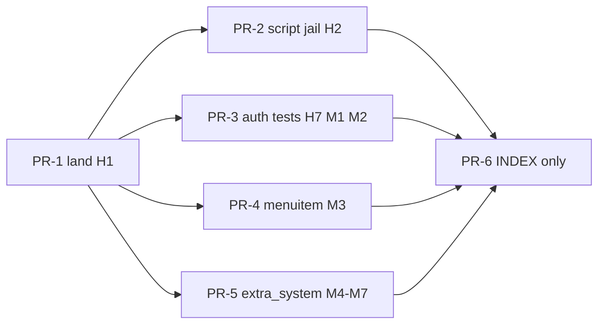
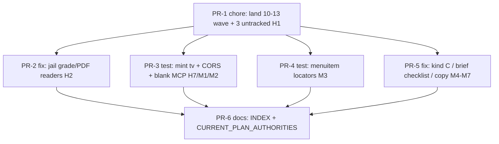
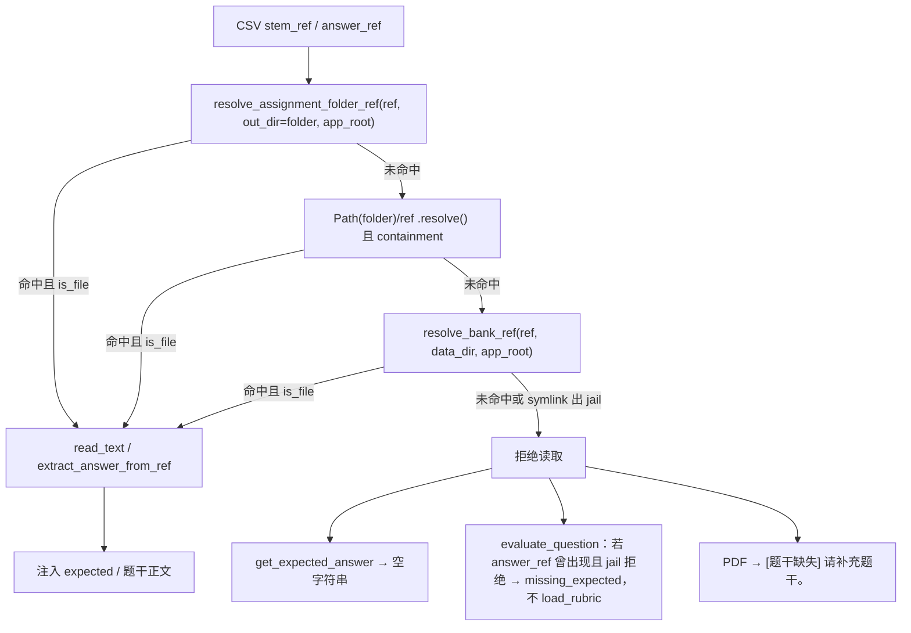

# teacherAgent 2026-10-14 审计残留修复方案

| 字段 | 值 |
| --- | --- |
| 文档标题 | Leftover audit remediation for teacherAgent (2026-10-14) |
| 作者 | TBD（平台 Owner 签字后生效） |
| 日期 | 2026-10-14 |
| 状态 | Draft |
| 产品 | 单校作业产品（teacher 布置/确认/进度；student 今日列表/陪练/显式提交；admin 学校面板） |
| 仓库 | `/home/tdcasual/codework/teacherAgent` |
| HEAD | `8a1bb10`（`8a1bb10ec00fbabaf23ddfb9e17bd23c347844ea`，`docs: INDEX + CURRENT_PLAN_AUTHORITIES for engineering frontend optimization`） |
| DESIGN_ID | `2ef5fb04` |
| 权威关系 | 产品身份：`docs/plans/2026-08-28-assignment-core-product-design.md`（D2/D4/D5 **不重开**）。审计修复：`docs/plans/2026-10-10-audit-remediation-design.md`（**KD-7 GET compute-primary + 双写仍有效**；`RISK-ASSIGNMENT-DUALWRITE-001` **保持开放**）。体裁×来源：`docs/plans/2026-10-10-next-phase-gapfill-design.md`。无题库提分：`docs/plans/2026-10-12-score-up-without-bank-design.md`。前端结构：`docs/plans/2026-10-13-engineering-frontend-optimization-design.md`。本文件：2026-10-14 脏树审计残留修复权威（对照 `/tmp/teacheragent-audit-2026-10-14/REPORT.md`，Codex session `01a137cc-f86a-7ee3-981e-6c1a4f18f47e` Verdict PASS）。 |
| 治理 | `CONTRIBUTING.md` L/M/H；M/H 必须 TDD；H 需回滚 + 安全测试 + 风险登记更新或明示「为何不需要」。GitHub Actions 额度耗尽，本地门禁 `.venv/bin/{ruff,python,mypy}` 计数；不等 GH。 |
| 团队 | 2 人。`.github/CODEOWNERS` 全是 `@tdcasual`。本 DAG **正好 6 PR**。 |

---

## Overview

活树是 `HEAD 8a1bb10` **加上**未提交的 10-13 Codex 验收修复波（`git diff --stat`：52 文件 `+631/−113`，另 3 个未跟踪文件）。脏树审计 **7.8 / 10 · 条件不通过**；`origin/main` 仍按 10-13 的 **7.4** 计，克隆/部署看不到学生详情 allowlist、catalog jail、生产拒 `change_me`、备份账号库。Codex 核验 W1–W10 全部 HOLD；N11 worker 缺 `./config` 与 N12「非法 kind 静默变 problem_set」被驳回，本波 **不修**。

本方案只消化 **本波 in-scope** 残留：把已实现波次连同 3 个未跟踪文件落地（H1）；把批改/PDF 脚本读路径接到既有 `resolve_readable_stem_ref`（H2）；把缺 `tv` 的 ACL 测例重新打到授权面且 **不放松** 产品 fail-closed（H7）；以及 Codex Fix-now 的 M1–M7。H3 persist_error、H4 pathlib sandbox、H5 bootstrap 轮换、H6 空题库、controller 902、Confirm HTTP 改名全部 **不进本 DAG**。



---

## Background & Motivation

### 产品定义（Owner，不重开）

老师是唯一发布者。体裁：`problem_set` / `scenario` / `science_history` / `practical`。来源：`upload` / `bank` / `ai`。题库仅做题。主闭环：`assignment_kind × content_source` → 草稿 → `POST /assignment/upload/confirm`（UX **发布草稿**，HTTP 路径不变）→ 学生今日列表 → 显式提交 → 老师进度。身份串 **「学生端学习助手」** / **「不要生成作业」**。空库 409 `question_bank_insufficient`，禁止编题。补练仅 `problem_set + allow_practice`，否则 409 `practice_not_applicable`。讨论不是完成门闩（D4）。归档学生 GET 在快照成员上返回、不再查现场名册。

生产：`APP_ENV=production AUTH_REQUIRED=1 PUBLISH_HOST=127.0.0.1`。Python 3.13 / Node 24 / Vite React 19 + Tailwind 4。Compose teacher:3002 student:3001 API:8000。

### 审计对象与分数

| 项 | 值 |
| --- | --- |
| 脏树 | HEAD `8a1bb10` + 未提交 10-13 波 |
| 脏树总分 | 7.8 / 10 条件不通过 |
| origin/main | 仍 7.4（不含本波） |
| Codex | session `01a137cc-f86a-7ee3-981e-6c1a4f18f47e` **PASS** |
| 报告 | `/tmp/teacheragent-audit-2026-10-14/REPORT.md` |
| 本地质量（脏树） | ruff 0 / mypy 0 / `app_core` 245≤260 / structure 84 |

### 10-13 波次已经在脏树上成立（HOLD — 禁止重做）

| 项 | 活代码 |
| --- | --- |
| 学生 GET allowlist | `public_student_assignment_detail`（`services/api/assignment/visibility.py:59-93`）；仅学生走 `application.py:154-160` |
| catalog/context 题干 jail | `resolve_readable_stem_ref`（`question_bank_select_service.py:176-198`）：folder jail → folder 相对 → bank jail，`.resolve()`，symlink 出 jail 拒绝 |
| 生产拒 `change_me` | `auth_service.py:108-120`；example 四项密钥为空 |
| 备份域 | `scripts/backup/common.sh:79-92` 含 `data/auth` + `data/student_submissions`；`sqlite_snapshot.py:17-26` `Connection.backup`；`build_payload_archive` 两阶段（`:116-149`） |
| 照片空分 | `extractBestScore` null-guard；UI「无官方分」 |
| 暗色 CTA | `text-on-accent` |
| 管理员 skip | `TeacherAppLayout.tsx:201` `id="teacher-chat-main"` |
| tablist | `useTabListKeyboard.ts` focus + `tabpanel` |
| README | 「发布草稿」+ LAN 三旋钮 |
| e2e / smoke | `e2e:student:critical` 含 kind-submit + portrait-history；smoke `assignment_kind` |

**未跟踪（必须进落地提交，禁止 `git add -u`）：**

- `scripts/backup/sqlite_snapshot.py`
- `tests/test_assignment_visibility_filter.py`
- `tests/test_backup_sqlite_snapshot.py`

`scripts/backup/run_backup.sh:101-105` 已调用 snapshotter。`git add -u` 会提交调用点、漏掉实现。

### 痛点（对照活代码行号，禁止抄旧 plan）

**H2 脚本仍裸读。** `scripts/grade_submission.py:271-294` `extract_answer_from_ref` / `get_expected_answer` 仍 `Path(ref)`；`evaluate_question`（`:351-398`）无 jail kwargs，空 expected 后 `:373-381` 裸 `Path(rubric_ref)`。`:728-731` 把 `expected` 写入每题 `results[]`（`grading_report.json` `items[]` `:741-750` / `:805-813` 不含 expected）。`compute_submission_attempt`（`assignment_submission_attempt_service.py:137-147`）不把 `expected` 放进 `my_result`。调用方：`student_submit_service.py:684-697`、`student_practice_service.py:618-635`。`scripts/render_assignment_pdf.py` 无 `sys.path`，`:59-60` `Path(stem_ref)`。教师 PDF：`AssignmentGenerateDeps` / `AssignmentIoHandlerDeps` **无** `data_dir`；`assignment_generate_tool_service.py:60-79` 只 jail 显式 `--out`；HTTP `assignment_io_handlers.py:53-56` 只传 `--assignment-id`。MCP `services/mcp/app.py:387-405` 有所有权与 `_optional_contained_arg`，**不约束 CSV 内嵌 ref**。Codex 用 `get_expected_answer` 读出 jail 外 README。`scripts/ocr_eval_prepare.py:56-68` 同样裸读，本波 DEFER。

**H7 测例打不到 ACL。** 产品 `auth_service.py:221-227` 对 teacher/student/admin 缺 `tv` → 401 `token_revoked`（`test_teacher_token_without_tv_is_revoked` PASS）；**service 跳过 tv**（`:223`）。`tests/test_assignment_ownership_authz.py:47-49` `_bearer` 不带 `tv`；`:230` `_bearer("svc", "service")` 期望 200。`tests/test_security_auth_hardening.py:22-34` 仅 admin 设 `tv=1`。未注册主体即使补 `tv=1`，`token_version_matches`（`auth_registry_service.py:897-914`）在缺行时返回 False → 仍 401。`bootstrap_admin` 幂等且不 bump tv（`auth/bootstrap_service.py:29-36`），默认用户名 `admin`。

**M1/M2 测例与波次打架。** `tests/test_docker_security_baseline.py:85-90` 要求非空 `MCP_API_KEY`，example 已空。`test_production_ignores_auth_required_0`（`test_security_auth_hardening.py:139-146`）在 `app.py:41-43` 先撞 `CORS_ORIGINS is required in production`。

**M3–M7 产品已对、文案/测例未跟。** Overflow `role="menuitem"`（`TeacherTopbarOverflowMenu.tsx:55-73,86-96`）；测例/e2e 仍 `getByRole('button')`。`_KIND_RULES_HEADER` C 一律「提交作业」（`assignment_context_service.py:23`），学生 `prompts/v1/student/10_role.md:9` 已按 kind 分。`build_exam_checklist` `:111` `del brief`；空 goals + 非空 brief 的 scenario（`:409-410` slogan + `assertNotIn("实验室小车")`）与 science_history（`:412-422` 旧 fallback slogan）都会在改写后变红。cap `:528-531` 是 4 行切片；该文件 C901 预算 0。`catalog.ts:27` vs `skills/student-coach/skill.yaml:4`（无前端 desc 断言）。`skills/teacher-assignment-ops/SKILL.md:22-23` ScoreBand 残留。

### 预算与冻结（本波只降不升）

- `ruff_max: 0`；`mypy_max: 19`；`app_core` 245/260。`config/mypy_gate_files.txt` **只增不减**。本波默认不往 gate 加 `scripts/*`。
- Black CI 仍只四文件（`settings.py` / `runtime_manager.py` / `test_ci_workflow_quality.py` / `test_ci_backend_scope.py`），**不扩面**。
- `STRUCTURE_TEST_COUNT_FROZEN = 84`。禁止新增会命中 glob 的 `test_*structure*` / `test_*split*` / `test_*budget*` / `test_*leftover*` / `test_no_*` / `test_*guard*`。
- 不为 LOC 拆 `app_core.py` / `auth_registry_service.py` / `identity_graph_service.py`。
- `useTeacherAppController.ts` 902 行：Codex R8 Low/DEFER。本波 **不加** controller 行预算（避免逼出拆分）。

---

## Goals & Non-Goals

### Goals

1. **H1** 一次提交纳入 52 个已改文件 **和** 3 个未跟踪文件。相对脏树零行为差。禁止 `git add -u`。
2. **H2** `grade_submission.py` / `render_assignment_pdf.py` 读 `answer_ref`/`stem_ref` 走同一套 `resolve_readable_stem_ref`（folder jail → bank jail，`.resolve()`，symlink-safe）。`get_expected_answer` 与 `evaluate_question` 的 jail kwargs **必填**（无裸 `Path(ref)` 回退）。**不**发明第三套 jail。**不**改写既有 WRITE jail。**不** jail `scripts/ocr_eval_prepare.py`（Non-Goals DEFER）。
3. **Jail-out HTTP 契约：** 学生提交仍 **200**。越狱 `answer_ref`（`resolve_readable_stem_ref` 返回 `None`）→ `expected=""`，该题 ungraded / `reason=missing_expected`，**禁止**再走 `Path(rubric_ref)` / `load_rubric`。禁止 500。PDF 越狱 `stem_ref`：Python 层仍返回既有 `[题干缺失] 请补充题干。`；脚本 **exit 0**（`draw_line` Helvetica 对 CJK encode-safe，禁止 `UnicodeEncodeError` 把 `run_script` 打成 HTTP 500）；PDF 字节 **不含** 越狱路径 / 题干秘密。**不**要求 PDF 流含 CJK。**不**加 CJK 字体。
4. **H7** fixture 对 teacher/student 按 **该行** `token_version` 签发；admin 读表；service **不**带 `tv`。缺 `tv` 专门测例保持 401。产品 tv 门闩 **零 diff**。
5. **M1–M7** 按 Codex 最小正确修复落地：MCP example 断言空白；生产 fixture 补合法 CORS；menuitem locator；kind 提交文案；空 goals 清单用 bounded brief 摘录并抽出 cap 保护前缀（C901=0）；catalog desc 用已有前端 vitest 断言；ScoreBand 文案。
6. **INDEX 只 PR-6：** INDEX 设计节 + `CURRENT_PLAN_AUTHORITIES` **同一 commit**。H2 在 PR-2 **修订** `RISK-STEM-REF-READ-001` 关闭说明，并修订 `permissions-and-security.md:32` 既有 catalog/context 子弹（脚本读路径）。PR-6 **不碰** permissions，**不碰** `risk-register.md`（PR-1 之后只有 PR-2 写该文件；不为头日期加第 7 个 PR）。

### Non-Goals（本波明确不做）

- H3 persist_error HTTP 200 / 用 persist 失败替换 live compute — **DEFER**，`RISK-ASSIGNMENT-DUALWRITE-001` 保持开放。GET 仍 compute-primary（10-10 KD-7）。
- H4 `RISK-CHART-SANDBOX-RESIDUAL-001` pathlib — 接受残余；本波不 Landlock。
- H5 `RISK-ADMIN-BOOTSTRAP-001` — 无 git filter-repo。OQ-1 轮换是运营，不是 PR（how-to 勾选表保持未勾）。
- H6 空题库 / CMS — 保持 409。任何 PR 不得写 `questions.csv` 数据行。
- Controller 902 拆分或涨 `useTeacherChatApi` 750。
- Worker 缺 `./config`（Codex REJECTED）。
- 非法显式 kind 静默 `problem_set`（Codex REJECTED：非法写 400；缺省 kind 打 `assignment.kind.defaulted`）。
- GHCR `VITE_API_URL` loopback、pip-audit ignores、unbounded `teacher_owns_student_snapshot`、拆 god file、Grafana / 30 天 SLO、Confirm HTTP 改名、学生改密 UI。
- `source-map-js` 1.2.2 — follow-on（本地 npmmirror advisories 404），本 DAG 不做 lock bump。
- 新增第 85 个 structure 测试文件；涨 ruff/mypy/app_core 预算；扩 Black CI。
- 改身份串；改空库 409；改补练门闩；把讨论做成完成条件。
- **`scripts/ocr_eval_prepare.py` 裸读 — DEFER。** 活代码 `:56-68` 本地 `get_expected_answer` 对 `answer_ref` 做 `Path(ref)`，相对路径拼 `questions_path.parent / ref`，**无** containment。这是离线评估 CLI，不在 `POST /student/submit` / PDF HTTP / MCP `assignment.render` 路径上。本 DAG **不** jail、不改该文件。禁止把「unless grep 证明它也裸读」写成 PR-2 扩面口子——grep 已证明，结论仍是 DEFER。
- **不加 CJK 字体 / fontconfig / Noto / CID。** `render_assignment_pdf.py:40-49` 保持 Helvetica。不改 `skills/physics-core-examples/scripts/render_core_example_pdf.py`（同样 Helvetica 残余，本 DAG 范围外）。不把 PDF 画布文案改成英文。

---

## Key Decisions

| ID | 决定 | 活代码理由 |
| --- | --- | --- |
| KD-1 | 本波可执行面 = **正好 6 PR**。PR-1 落地已实现波次；PR-2–5 新工作；**INDEX / `CURRENT_PLAN_AUTHORITIES` 只 PR-6**。新 PR 的基线是 PR-1 之后的脏树，不是今日 `origin/main`。 | 2 人团队；origin/main 缺波次。集合相等测试禁止把 INDEX 提前。 |
| KD-2 | **复用** `resolve_readable_stem_ref` / `resolve_assignment_folder_ref` / `resolve_bank_ref`。禁止第三套 jail。WRITE jail（folder-save / confirm snapshot）零改。 | catalog/context 已证明 symlink-safe。Codex：smallest correct fix = 同一套 reader。 |
| KD-3 | CLI 通过 **`--data-dir` / `--app-root`（argv）** 提供 jail 根；缺省 `APP_ROOT=Path(__file__).resolve().parents[1]`（与 `grade_submission.py:15` `parents[1]` 同为仓库根），`DATA_DIR=env DATA_DIR or APP_ROOT/"data"`。folder jail = **`questions.csv` 的 parent**（作业目录或 `practice_*`）。`main()` **唯一**作业根 `assignments_root = (data_dir / "assignments").resolve()`，同时用于默认 `questions.csv` **和** `resolve_assignment_pack_id(assignment_id, assignments_root)`（`:298-313` 读 `assignments_root/<id>/meta.json`）。`--assignment-questions` **只**覆盖 CSV 路径；pack 元数据仍走 `data_dir/assignments/<id>/meta.json`。不改 `--attempt-dir` 语义。MCP allowlist 仍是 **脚本路径** 集合，只加 argv 不加白名单项。**禁止**给 `AssignmentGenerateDeps` / `AssignmentIoHandlerDeps` 加 `data_dir` 字段。PDF HTTP 的 `--data-dir` 取 **`config.DATA_DIR`**（与 `_resolve_data_dir_path` 同源，`core_utils.py:151-158`），`--app-root` 取 `deps.app_root`。 | 今日 `:664-673` 一个 `assignments_root = ROOT/"data"/"assignments"` 同时喂 questions 默认路径和 pack。只改 questions 默认、留下 ROOT pack 根，tmp `--data-dir` 会加载错误 adapter。`AssignmentGenerateDeps`（`assignment_generate_service.py:40-47`）与 `AssignmentIoHandlerDeps`（`assignment_io_handlers.py:15-21`）只有 `app_root`。接线 `assignment_wiring.py:414-423` 不传 `DATA_DIR`。加字段会扩散到 wiring / 全部构造，与热文件一写者冲突。学生 submit/practice 已有 `deps.data_dir`。MCP 已有模块级 `DATA_DIR` / `APP_ROOT`（`services/mcp/app.py:22`）。 |
| KD-4 | **Jail-out 不 500。** 提交：`answer_ref` 非空且 `resolve_readable_stem_ref` 返回 `None` → `expected=""`，`evaluate_question` **停在** `status=ungraded` / `reason=missing_expected`，**禁止**进入今日 `:373-381` 的 `Path(rubric_ref)` / `load_rubric`。无 `answer_ref` 的主观题仍走今日 rubric 分支（本波不 jail `rubric_ref`）。`POST /student/submit` 与 practice submit 仍 **HTTP 200**。PDF：产品常量仍是 `:66` `[题干缺失] 请补充题干。`（Python 层 `stem_text_for_pdf` 返回它，禁止 `str(stem_ref)`）。画布保持 Helvetica（`:40-49`）；`draw_line` 对 CJK **encode-safe**（latin-1/WinAnsi 失败则 ASCII replace，禁止 `UnicodeEncodeError` 让脚本非 0）。PDF 字节 **不含** 越狱路径 / 题干秘密；**不**要求 PDF 流含 CJK。不加字体、不把画布文案改成英文。学生 `my_result` 本就不含 `expected`。 | `run_script` 非 0 → HTTP 500（`core_utils.py:53-54`）。Helvetica 是 WinAnsi，CJK 无法编码进 PDF 流。今日越狱 `answer_ref` 会读出非空 expected，rubric 分支被跳过；H2 变空 expected 后若不短路，会裸读 `rubric_ref`。`compute_submission_attempt` 在 `assignment_submission_attempt_service.py:123-147`（返回 dict `:137-147`）不放 `expected`。`grading_report.json` `items[]` 亦省略 `expected`（`:741-750`, `:805-813`）；泄漏面是 CLI/`results[]`/PDF/客观题评分。 |
| KD-5 | 产品缺 `tv` fail-closed **HOLDS**。`teacher`/`student` 测例必须 `_ensure_*_auth(..., regenerate_token=False)` 后按 **该行** `token_version` mint（禁止写死 `tv=1`）。`admin` 先 `bootstrap_admin()`（幂等、**不** bump tv，`auth/bootstrap_service.py:29-36`；默认用户名 `admin` 不是 `admin_a`），再读 minted `sub` 的 tv；缺行则不编造 admin 行，mint **不带** `tv`（保持今日 401）。`service` 及其它非 teacher/student/admin 角色：**不**注册、**不**带 `tv`，payload 与今日 `_bearer` 相同。禁止 helper 对未知角色 `raise`。禁止为绿测例放宽 `auth_service.py:221-227`。 | 产品跳过 tv：`auth_service.py:223` `if principal.role not in {"teacher", "student", "admin"}: return`。`tests/test_assignment_ownership_authz.py:230` `_bearer("svc", "service")` 期望 200 + orphan ids。`token_version_matches` 缺行 → False（`:910-911`）。`create_test_app` 仅在 `AUTH_REQUIRED=1` 时 `bootstrap_admin()`（`tests/helpers/app_factory.py:84-88`）。 |
| KD-6 | extra_system 规则 C 的提交按钮名 = 学生 UI `submitActionLabel`（`frontend/apps/student/src/assignmentKind.ts:30-35`）= `10_role.md:9`。Python 侧在 `assignment_context_service.py` 实现同表，**不**改 `10_role.md`。 | `problem_set`→「提交作业」；`scenario`/`science_history`→「提交书面/照片」；`practical`→「提交实践照片」。 |
| KD-7 | 空 goals 的考查清单用 **bounded brief 摘录**（非 LLM 题干）。确定性 examiner 不变。抽出 `_extra_system_protected_prefix(text) -> str`，`_cap_extra_system` 只裁后缀；每个函数 mccabe ≤ 14，该文件 C901 计数保持 **0**。禁止把 `stem_text` 塞进清单（做题清单仍是 qid/kp 指令）。 | `build_exam_checklist:111` `del brief`；how-to `student-login-and-submit.md:25`；今日 cap `:528-531` 是 4 行切片；overlay 在 cap **之前** join（`:653-658`）。现测 `test_exam_checklist_problem_set_uses_stems_not_answers` 已禁止清单含题干原文。 |
| KD-8 | 热文件一写者。并行仅文件不相交。 | 见文件所有权表。 |
| KD-9 | 落地 PR **显式 add** 三份未跟踪文件。禁止 `git add -u`。死函数 `build_archive()`（`common.sh:100-114`）**保留**（非 live 路径；本波不顺手删，避免卫生 PR 变行为审查）。 | Codex N8 High。 |
| KD-10 | H2 在 PR-2 **修订**已关闭的 `RISK-STEM-REF-READ-001`：关闭说明从「catalog/context」扩到脚本读路径，状态保持已关闭。同一 PR **修订** `permissions-and-security.md:32` 既有子弹（不另起一颗）。不另开永久开放 RISK。INDEX 仍只 PR-6。PR-1 之后 **只有 PR-2** 写 `docs/reference/risk-register.md`。PR-6 **不**改头日期、不碰该文件。不为日期加第 7 个 PR。 | 10-10 关闭条目目前未覆盖脚本；审计要求不要假装已覆盖。脏树已有 catalog/context 那一颗（PR-1）。PR-6 再改头日期会与 PR-2 抢同一热文件。 |
| KD-11 | Dual-write 仍 10-10 KD-7。本波任何 PR **零 diff** `assignment_progress_service.py` 的 persist_error 替换逻辑。 | H3 DEFER。 |
| KD-12 | 本波不涨预算、不加 structure 文件、不拆 god file、不等 GH Actions。H 级以本地 pytest + 安全测例 + revert 为回滚。实现后双出口：**Grok reviewer 0-open + Codex Verdict PASS**。本设计同样走双出口。 | 额度耗尽。 |
| KD-13 | 学生详情 allowlist 已省略 `answer_ref`；H2 泄漏面是磁盘 `grading_report`/反馈与教师 PDF，不是学生 GET。不把 H2 做成「再滤 my_result」。 | `visibility.py:59-93`；`services/api/assignment_submission_attempt_service.py:137-147`（`student_submit_service.py:137-147` 是 `_progress_signals` / `_official_score`，不是该函数）。 |

---

## Proposed Design

### 切片顺序与并行



两人：A = PR-1 → PR-2 → PR-5；B = PR-1 后 PR-3 ∥ PR-4。会合 PR-6。PR-2 与 PR-3/4/5 文件不相交，可在 PR-1 后 rebase 并行。

### 文件所有权（热文件一写者）

| 文件 | 写者 PR | 他人 |
| --- | --- | --- |
| 脏树 52 文件 + 3 未跟踪（落地原样） | **PR-1** | 之后 PR 只在此基线上改自己的热文件 |
| `scripts/grade_submission.py` | **PR-2** | — |
| `scripts/render_assignment_pdf.py` | **PR-2** | — |
| `student_submit_service.py` / `student_practice_service.py`（仅加 argv） | **PR-2** | PR-1 已落地波次 diff，PR-2 再加 flag |
| `assignment_generate_tool_service.py` / `handlers/assignment_io_handlers.py` / `services/mcp/app.py`（仅 argv） | **PR-2** | **不加** dataclass `data_dir`；MCP allowlist 集不改 |
| `tests/test_grade_submission_security.py` / `tests/test_question_bank_select_service.py`（`get_expected_answer` 调用） | **PR-2** | — |
| `tests/test_grade_submission_adapter.py` | **PR-2** | 仅补 `evaluate_question` 必填 jail kwargs（测例用 `answer_text`，folder 可为任意 tmp） |
| `tests/test_assignment_io_handlers.py` / `tests/test_tool_dispatch_security.py` | **PR-2** | 仅断言 render cmd 含 `--data-dir` / `--app-root`；**不**改 WRITE `--out` jail 测例 |
| `docs/reference/permissions-and-security.md` | **PR-2** | **只改**既有 catalog/context 那一颗子弹（`:32`）把 grade/PDF 脚本读路径写进去；**不**另起一颗。PR-6 不碰该文件 |
| `tests/helpers/auth_principals.py`（新）+ `test_assignment_ownership_authz.py` + `test_security_auth_hardening.py` | **PR-3** | 不改 `auth_service.py` |
| `tests/test_docker_security_baseline.py` | **PR-3** | — |
| `TeacherTopbar.test.tsx` / `frontend/e2e/teacher-session-sidebar.spec.ts` | **PR-4** | 产品 `role="menuitem"` 不改 |
| `assignment_context_service.py` | **PR-5** | PR-1 已落地 context jail；PR-5 只改 header C 与 checklist |
| `chat_job_processing_service.py`（抽出 `_extra_system_protected_prefix` + `_cap_extra_system` 调用它） | **PR-5** | 不拆包、不碰 confirm；该文件 C901 预算 **0**（`config/function_complexity_budget.json`） |
| `frontend/apps/teacher/src/features/chat/catalog.ts` | **PR-5** | — |
| `frontend/apps/teacher/src/features/chat/useTeacherChatApi.stream.test.tsx` | **PR-5** | 仅加一条 student-coach `desc` 断言；不改 stream 行为 |
| `skills/teacher-assignment-ops/SKILL.md` | **PR-5** | — |
| `docs/reference/risk-register.md` | PR-1 落地波次关闭项；其后 **只 PR-2** 改 `RISK-STEM-REF-READ-001` 关闭说明。PR-6 **零 diff** | — |
| `docs/INDEX.md` / `ARCHIVE.md` / `tests/test_docs_architecture_presence.py` | **只 PR-6** | — |

### 1. PR-1 落地波次（H1）

相对脏树 **零行为差**。提交清单 = `git status --short` 的 52 个 `M` **加上** 3 个 `??`。建议 `git add` 显式路径（或 `git add` 那 55 个文件），然后 `git status` 确认 `sqlite_snapshot.py` 已 staged。

验证（落地后，非实现）：

- `.venv/bin/python -m pytest -q tests/test_assignment_visibility_filter.py tests/test_backup_sqlite_snapshot.py tests/test_docker_security_baseline.py::test_compose_mcp_binds_loopback_and_requires_key`
- 备份：`run_backup.sh:101` 能 `python3 scripts/backup/sqlite_snapshot.py`

**不要**在本 PR 修 H2/H7/M*（那些测例在脏树上本就红/未写）。

### 2. 脚本读路径 jail（H2）

#### 2.1 读路径（唯一实现）



`folder` = `questions_path.parent`：

| 调用 | questions.csv | folder jail | bank jail |
| --- | --- | --- | --- |
| 作业提交 | `data/assignments/<id>/questions.csv`（confirm 后 bank 快照在 `bank_stems/` `bank_answers/`，ref 为 APP_ROOT 相对或绝对且落在 folder 内，`assignment_upload_confirm_service.py:686-720`） | 作业目录 | `data_dir/question_bank`（作业已快照，通常走 folder） |
| 补练 | `practice_*/questions.csv`（活题库 ref，短命） | practice 目录 | **必须** bank jail |
| PDF | 默认 `data_dir/assignments/<id>/questions.csv` | 作业目录 | 同上 |

Symlink：与 catalog 相同，**先 `.resolve()` 再 containment**。指向 jail 外的 link → None。

#### 2.2 CLI 根如何注入（不破坏现有 argv）

`scripts/grade_submission.py` `main()` 增加：

```python
parser.add_argument("--data-dir", default="")
parser.add_argument("--app-root", default="")
```

解析：

```python
app_root = Path(args.app_root).resolve() if str(args.app_root or "").strip() else ROOT
data_dir = Path(args.data_dir).resolve() if str(args.data_dir or "").strip() else Path(os.environ.get("DATA_DIR") or (app_root / "data")).resolve()
```

**唯一作业根（questions 默认路径 + pack meta，禁止拆成两套）：** 今日 `:664-673` 用同一个 `assignments_root = (ROOT / "data" / "assignments").resolve()` 既解析默认 `questions.csv`，又立刻 `pack_id = resolve_assignment_pack_id(assignment_id, assignments_root)`（`:298-313` 读 `assignments_root/<id>/meta.json`）。只改 questions 默认、留下 ROOT pack 根，会让 tmp `--data-dir` 加载仓库 adapter。PR-2 `main()` 必须写成：

```python
assignments_root = (data_dir / "assignments").resolve()
if args.assignment_questions:
    questions_path = Path(args.assignment_questions).resolve()  # 只覆盖 CSV
else:
    questions_path = resolve_under(assignments_root, assignment_id, "questions.csv")
pack_id = resolve_assignment_pack_id(assignment_id, assignments_root)
adapter = load_grade_adapter(pack_id)
```

`--assignment-questions` **只**覆盖 CSV（practice / 显式 CSV 继续工作）；pack 元数据 **始终** `data_dir/assignments/<id>/meta.json`。不发明第三套 jail。

`--attempt-dir` / `--out-dir` / `--skip-profile-update` **不动**。`resolve_under` 仍约束 attempt/out 写出。

`scripts/render_assignment_pdf.py` 同样加 `--data-dir` / `--app-root`；默认 questions：`data_dir/assignments/<id>/questions.csv`（今日 `:79` 是 cwd 相对 `data/assignments`）。

**手工 CLI 可 import 共享 jail：** 今日 PDF 脚本只 import `argparse`/`pathlib`（`:1-3`）。`run_script` 会设 `PYTHONPATH`（`core_utils.py:42-52`），HTTP/MCP 能 import；老师本机 `python3 scripts/render_assignment_pdf.py` 没有 HTTP `PYTHONPATH` 会 `ImportError`。PR-2 在 PDF 脚本顶部 **复制** `grade_submission.py:15-17`：

```python
import sys
ROOT = Path(__file__).resolve().parents[1]  # 仓库根
if str(ROOT) not in sys.path:
    sys.path.insert(0, str(ROOT))
from services.api.question_bank_select_service import resolve_readable_stem_ref
```

HTTP/MCP **必须**显式传两个 flag（不依赖 CLI 猜）。PDF HTTP **禁止**写 `deps.data_dir`（字段不存在），**禁止**给 dataclass 加字段：

| 调用方 | 今日 argv | PR-2 追加 |
| --- | --- | --- |
| `student_submit_service.py:685-697` | `--student-id --out-dir --files --assignment-id --skip-profile-update` | `--data-dir` `_data_dir(deps)`、`--app-root` `deps.app_root`；若 questions.csv 存在则同时 `--assignment-questions` folder/`questions.csv`（folder jail 不靠猜） |
| `student_practice_service.py:619-635` | 已有 `--attempt-dir` + `--assignment-questions` | `--data-dir` `_data_dir(deps)` / `--app-root` `deps.app_root` |
| `assignment_generate_tool_service.py:60-79` `assignment_render` | `--assignment-id` + 可选 questions/`--out` | `from .config import DATA_DIR`；`cmd += ["--data-dir", str(DATA_DIR), "--app-root", str(deps.app_root)]`。`--out` WRITE jail **不改** |
| `assignment_io_handlers.py:53-56` `render_assignment` | 仅 `--assignment-id` | `from ..config import DATA_DIR`；同样 `cmd += ["--data-dir", str(DATA_DIR), "--app-root", str(deps.app_root)]` |
| MCP `app.py:396-405` | `--assignment-id` + 可选 contained questions/out | `--data-dir str(DATA_DIR)`、`--app-root str(APP_ROOT)`。`_ALLOWED_SCRIPTS` 不改 |

TDD：`tests/test_assignment_io_handlers.py::test_render_assignment_runs_script` 加 `assert "--data-dir" in calls["args"]` 且 `"--app-root" in calls["args"]`。`tests/test_tool_dispatch_security.py` 的 render cmd capture（`test_assignment_render_explicit_out_rejects_app_root_outside_data_dir` / `test_assignment_render_default_path_unchanged`）同样 `assertIn("--data-dir", captured["cmd"])`。该两文件列入 PR-2。

手工 CLI（老师本机跑脚本、不传 flag）：缺省 `ROOT/data`，仍是一套 jail，不是裸 `Path(ref)`。

#### 2.3 `get_expected_answer` / `evaluate_question` 签名（jail kwargs **必填**）

禁止给 jail kwargs 设默认值或「忘传就 `Path(ref)`」回退——漏传必须 TypeError，不能静默重开 H2。

```python
def get_expected_answer(
    row: dict,
    *,
    folder: Path,
    app_root: Path,
    data_dir: Path,
) -> str:
    expected = (row.get("answer_text") or "").strip()
    if expected:
        return expected
    ref = str(row.get("answer_ref") or "").strip()
    if not ref:
        return ""
    path = resolve_readable_stem_ref(ref, folder=folder, app_root=app_root, data_dir=data_dir)
    if path is None:
        return ""
    return extract_answer_from_ref(path)


def evaluate_question(
    *,
    question: dict,
    block_text: str,
    adapter,
    llm_grade: bool,
    llm_confidence_threshold: float,
    folder: Path,
    app_root: Path,
    data_dir: Path,
) -> Dict[str, Any]:
    adapter_item = apply_grade_adapter(adapter, question=question, student_text=block_text)
    if adapter_item is not None:
        return adapter_item

    expected = get_expected_answer(
        question, folder=folder, app_root=app_root, data_dir=data_dir
    )
    answer_ref = str(question.get("answer_ref") or "").strip()
    if expected:
        # 客观题（answer_text 仍优先；jail 内 answer_ref 摘录）
        ...
    elif answer_ref:
        path = resolve_readable_stem_ref(
            answer_ref, folder=folder, app_root=app_root, data_dir=data_dir
        )
        if path is None:
            # jail-out / 缺文件：停在 missing_expected，禁止 Path(rubric_ref)
            return {
                "matched": False,
                "student_answer": "",
                "reason": "missing_expected",
                "status": "ungraded",
                "score": 0.0,
                "confidence": 0.0,
                "matched_steps": [],
                "missing_steps": [],
            }
        # jail 命中但摘录为空：落入下方 rubric（与「resolve is None」区分）
    # 无 answer_ref（或 jail 命中但空摘录）：今日 rubric 分支（本波不 jail rubric_ref）
    ...
```

`main()` 把 `folder=questions_path.parent`、解析后的 `app_root` / `data_dir` 传进 `:706` 循环的 `get_expected_answer` **和** `evaluate_question`（今日两处都是无 kwargs 调用：`:363`、`:706`、`:712`）。`extract_answer_from_ref` **只**在 jail 命中后读；不再接收未校验 `Path`。

`tests/test_grade_submission_adapter.py:63-99` 三处 `evaluate_question(...)` 只传 `question` / `block_text` / `adapter` / `llm_*`，且都用 `answer_text` 不用 `answer_ref`。必填 kwargs 会 TypeError。PR-2 **拥有**该文件：三处补 `folder=tmp_path, app_root=tmp_path, data_dir=tmp_path`（任意 tmp 即可）。

`tests/test_question_bank_select_service.py:112` `get_expected_answer(row)` 改为传入 `folder` / `app_root=APP_ROOT` / `data_dir`（confirm 快照后 ref 在作业 folder 内，断言「42」仍在、「mutated」不在）。

#### 2.3.1 PDF `render_pdf` 线程 jail 根（Helvetica encode-safe）

今日 `render_pdf(assignment_id, questions, out_pdf)` 只收 `questions: list`，循环里 `read_text(Path(stem_ref))`（`:59-60`）。画布 `:40-49` 设 `Helvetica` / `Helvetica-Bold` 后 `c.drawString`（WinAnsi，CJK 不能进 PDF 流）。产品缺失文案 `:66` 是 `[题干缺失] 请补充题干。`。`run_script` 非 0 → HTTP 500（`core_utils.py:53-54`），所以 `drawString` 若因 CJK `UnicodeEncodeError`，越狱 `stem_ref` 会把教师 PDF 打成 500。

**禁止**本波加 CJK 字体 / fontconfig / Noto / CID。**禁止**把画布文案改成英文。**禁止**改 `skills/physics-core-examples/scripts/render_core_example_pdf.py`（同样 Helvetica 残余，范围外）。

抽出 helper（产品常量保持中文）：

```python
_MISSING_STEM_TEXT = "[题干缺失] 请补充题干。"

def stem_text_for_pdf(
    stem_ref: str,
    *,
    folder: Path,
    app_root: Path,
    data_dir: Path,
) -> str:
    ref = str(stem_ref or "").strip()
    if not ref:
        return _MISSING_STEM_TEXT
    path = resolve_readable_stem_ref(ref, folder=folder, app_root=app_root, data_dir=data_dir)
    if path is None:
        return _MISSING_STEM_TEXT
    text = read_text(path)
    return text if str(text or "").strip() else _MISSING_STEM_TEXT
```

禁止返回 `str(stem_ref)`。`render_pdf` 签名增加 `folder` / `app_root` / `data_dir`（由 `main()` 注入），循环里 `stem_text = stem_text_for_pdf(stem_ref, ...)`。

`draw_line` **不得**因 CJK 抛错：`drawString` 前把无法 latin-1/WinAnsi 编码的字符 ASCII replace（`errors="replace"`），并 catch `UnicodeEncodeError`（或等价 latin-1 失败）再 replace 后重试，然后照常 `c.save()`。脚本越狱路径 **exit 0**。

**拆开的 TDD**（`tests/test_grade_submission_security.py::test_render_pdf_missing_stem_fallback_on_jailout`，可再拆 helper 测例，禁止新 leftover glob）：

1. `stem_text_for_pdf` 越狱 `stem_ref`（jail 外文件内容 `SECRET_OUTSIDE_STEM`）→ 返回 `[题干缺失] 请补充题干。`，且 **未读** 该秘密文件。
2. `render_pdf(...)` **正常返回 / exit 0**；PDF 字节 **不含** `SECRET_OUTSIDE_STEM`，也 **不含** 越狱路径字符串。**禁止**断言 PDF 流含 CJK。`reportlab` 已在 `services/api/requirements.txt`。

#### 2.4 HTTP 契约（提交）

| 条件 | `POST /student/submit` 或 practice submit | 磁盘 |
| --- | --- | --- |
| 客观题、jail 内 `answer_ref` 或 `answer_text` | 200；照常 matched/missed | `results[].expected` 为摘录 |
| jail 外绝对路径 / symlink 逃逸 / 缺文件（`answer_ref` 非空且 resolve 为 `None`） | **200**（脚本 exit 0） | `expected=""`；该题 `status=ungraded` `reason=missing_expected`；**不读** `rubric_ref` |
| 同上 + CSV 另含 jail 外 `rubric_ref`（如 `/etc/passwd`） | **200** | 仍 `missing_expected`；TDD 断言未打开该文件 |
| 无 `answer_ref` 的主观题（今日 rubric 路径） | 200；行为与今日相同 | 本波不 jail `rubric_ref` |
| 全部题越狱 | 仍 200；ungraded 计数上升 | 不 500 |
| 脚本超时 / 非 0（既有） | `_run_grade_script` 已写成 ungraded report（`student_submit_service.py:371-386`） | 不变 |

学生 GET / `assignment.my_result` **不**新增过滤。

### 3. ACL 测例对齐（H7）+ M1 + M2

新文件 `tests/helpers/auth_principals.py`（**不是** structure glob）。产品 `auth_service.py:223` 对非 `{teacher, student, admin}` **跳过** tv；helper **禁止** `else: raise AssertionError(role)`——那会把 `test_service_list_includes_orphans`（`_bearer("svc", "service")`，期望 200 + orphan ids）打成 AssertionError，或诱使实现去给 service 造注册行。

```python
def _subject_token_version(store, *, role: str, subject_id: str) -> int | None:
    table, id_field = {
        "teacher": ("teacher_auth", "teacher_id"),
        "student": ("student_auth", "student_id"),
        "admin": ("admin_auth", "admin_username"),
    }[role]
    with store._connect() as conn:
        row = conn.execute(
            f"SELECT token_version FROM {table} WHERE {id_field} = ?",
            (subject_id,),
        ).fetchone()
    if row is None:
        return None
    return int(row["token_version"])


def register_and_mint_bearer(
    tmp: Path, actor_id: str, role: str, *, secret: str, tenant_id: str = "school"
) -> dict[str, str]:
    claims: dict = {
        "sub": actor_id,
        "role": role,
        "tenant_id": tenant_id,
        "exp": int(time.time()) + 3600,
    }
    if role in {"teacher", "student", "admin"}:
        store = build_auth_registry_store(data_dir=tmp / "data")
        if role == "teacher":
            row = store._ensure_teacher_auth(
                teacher_id=actor_id, teacher_name=actor_id, email=None, regenerate_token=False
            )
            claims["tv"] = int(row["token_version"])  # 用该行，禁止写死 1
        elif role == "student":
            row = store._ensure_student_auth(
                student_id=actor_id, student_name=actor_id, class_name="c1", regenerate_token=False
            )
            claims["tv"] = int(row["token_version"])
        else:
            # admin：bootstrap 幂等且不 bump tv（auth/bootstrap_service.py:29-36）
            # 默认用户名 admin，不是 admin_a
            store.bootstrap_admin()
            tv = _subject_token_version(store, role="admin", subject_id=actor_id)
            if tv is None:
                # 缺行（例如 sub=admin_a）：不 INSERT；不带 tv → 今日 401
                pass
            else:
                claims["tv"] = tv
    # service 及其它非 tv 角色：不碰 registry、claims 不设 tv（与今日 _bearer payload 相同）
    token = mint_test_token(claims, secret=secret)
    return {"Authorization": f"Bearer {token}"}
```

接线：

- `tests/test_assignment_ownership_authz.py` `_bearer` 增加 `tmp: Path`，内部走 helper。在 `_auth_app(tmp)` **之后** mint。`test_service_list_includes_orphans` 继续 `_bearer("svc", "service", tmp=tmp)`，期望 **200** + orphan ids。
- `tests/test_security_auth_hardening.py` `_auth_headers` 同样增加 `tmp: Path`。`SecurityAuthHardeningTest` 各方法把 `Path(td)` 从自己的 `TemporaryDirectory` 传进去（模块级函数测例同样传 `tmp_path` / `Path(td)`）。teacher/student 走 `_ensure_*`；admin 走 bootstrap + 读表；缺 admin 行保持 401。
- `test_teacher_token_without_tv_is_revoked` **一字不改期望**（仍 401 `token_revoked`）。产品 `auth_service.py:221-227` **零 diff**。

M2：`_load_app_auth_mode` 在 `app_env in {"prod","production"}` 时设置 `CORS_ORIGINS=http://localhost:3001,http://localhost:3002`（与 compose 默认、`test_cors_origins_fail_closed.py` 合法值一致）。**不**改 `auth_service.py:53-54` 生产忽略 `AUTH_REQUIRED=0`。

M1：`test_env_examples_have_nonempty_mcp_api_key_placeholder` 改为断言 `match.group(1).strip() == ""`；`test_compose_mcp_binds_loopback_and_requires_key` 的 `${MCP_API_KEY:?}` **保留**。

### 4. menuitem locator（M3）

产品角色保持 `menuitem`（`TeacherTopbarOverflowMenu.tsx:65,78,88`）。只改：

- `TeacherTopbar.test.tsx:70` `getByRole('menuitem', { name: '打开管理' })`
- e2e `teacher-session-sidebar.spec.ts:13`（`openMobileAuthPanel`）、`:319`、`:414`：`getByRole('menuitem', { name: '打开管理' | '打开设置' })`

「更多」触发器仍是 `button`。桌面「管理」「设置」仍是 `button`（不在 overflow 里）。

### 5. extra_system / 清单 / 文案（M4–M7）

**M4** — `build_kind_coach_rules`：C 行改为 `提醒学生用「{submit_action_label(kind)}」交照片或书面产物。` 映射见 KD-6。`_KIND_RULES_HEADER` 变成按 kind 生成，不再是常量里写死「提交作业」。

**M5** — `build_exam_checklist` **删除** `del brief`。

- `problem_set`：仍 `_problem_set_checklist_items`（qid/kp，**不含** `stem_text`）。空 stems 仍 `_NO_STEM_ITEM`（「数据块无题干…」）。brief 不进做题清单（避免和「禁止把题干原文当清单」冲突；brief 仍在数据块，且 cap 保护清单前缀）。
- 非做题空 `discussion_goals`：若 brief 非空，清单第一项 = `_clip(f"1. 围绕老师材料摘录考查：{excerpt}", _CHECKLIST_ITEM_MAX)`，excerpt 先 `_clip(brief, 160)`。`_EMPTY_GOAL_FALLBACK` **只**在 brief **与** goals 都空时使用。
- **禁止** LLM 题干进清单（现测 `INVENTED_STEM_SHOULD_NOT_APPEAR` 保持）。

**空 goals + 非空 brief 测例必须全部改写**（不是只改 scenario `:410`）：

| 活测例 | 今日断言 | PR-5 改写为 |
| --- | --- | --- |
| `test_exam_checklist_scenario_uses_goals_not_new_stems` 空 goals 块（`:402-410`） | `:409` 含 slogan `围绕老师 brief 考查理解`；`:410` `assertNotIn("实验室小车", empty)` | excerpt 在（含 `实验室小车`）；发明题干不在；**旧 slogan 不在**（`:409` 与 `:410` 都改） |
| `test_exam_checklist_science_history_forbids_invented_dates`（`:412-422`） | 空 goals + brief=`牛顿与苹果的课堂材料。` 后 `assertIn("只根据老师材料问因果与概念", text)`（旧 `_EMPTY_GOAL_FALLBACK`） | excerpt 在（课堂材料摘录）；发明年代/人名仍不在（`1687` / `Principia` 保持 `assertNotIn`）；**旧 slogan 不在** |
| 任何 practical 孪生（空 goals + 非空 brief） | 若存在，同样改写 | 仓库今日 **没有** 独立 practical 空-goals+非空-brief 测例（`_EMPTY_GOAL_FALLBACK["practical"]` 只在 brief 也空时保留）。**不要**为对齐新造 kind 测例文件 |

`_cap_extra_system`（`chat_job_processing_service.py:528-531` 今日 4 行切片）：**抽出** `_extra_system_protected_prefix(text) -> str`，使 **每个** 函数 mccabe ≤ 14，该文件 C901 计数保持 **0**（`config/function_complexity_budget.json` 对该路径预算为 0）。禁止把 marker 扫描的全部分支塞进 `_cap_extra_system` 一个函数。

前缀算法（放在抽出的函数里）：从字符串开头到考查清单块结束（清单标题 `【考查清单】` 起，直到下一个 `\n\n` 且后继为 `以下为作业` / `---BEGIN DATA---` / `【作业题干】` / `【附件上下文】`，找不到则到清单后首个空行）。`_cap_extra_system`：保护前缀始终保留，只截后缀再加 `…`。若前缀自身 > `max_chars`，才退回今日「从头切到 max_chars」。

overlay 在 cap **之前** join（`:653-658`），「从字符串开头到清单结束」**含** subject overlay。因此 **新** cap 测例 `test_extra_system_cap_keeps_checklist_brief_excerpt` 必须选一个 **能装下 rules+checklist、装不下数据块** 的 `max_chars`（先量前缀长度；**不要**固定写 800——800 可能小于含 overlay 的前缀，会误走 head-slice，把 brief 摘录裁掉）。现测 `test_extra_system_cap_keeps_kind_rules`（800 cap）**保留**，作为「前缀 > max_chars → head-slice」回归。生产 cap 仍 6000（`settings.py:259-260`）。

**M6** — `catalog.ts:27` `desc` 改为 `作业陪练（只读今日/成绩）`，与 `skills/student-coach/skill.yaml:4` 对齐。CONTRIBUTING 要求 M 必须 TDD：在 **已有** 前端 vitest `frontend/apps/teacher/src/features/chat/useTeacherChatApi.stream.test.tsx` 增加一条 `it`（`import { fallbackSkills } from './catalog'`），断言 `fallbackSkills` 中 `id === 'student-coach'` 的 `desc === '作业陪练（只读今日/成绩）'`。禁止新建 `test_*leftover*` 文件。禁止把该断言放进 `tests/test_assignment_context_service.py`。该 vitest 文件列入 PR-5（只加这一条，不改 stream 行为）。

**M7** — 删除 `SKILL.md:22-23` 两个 Band scheme。Mem0 模板 `Sensitive` 一行改为进度字段示例（如 `未交=3; 逾期=1; 已交=28`），禁止 ScoreBand/RankBand。Overview/Workflow 已是进度/发布/归档，不改产品语义。

### 6. 文档（PR-6）

把本文件落入 `docs/plans/2026-10-14-audit-remediation-design.md`。INDEX「设计与演进」与 `CURRENT_PLAN_AUTHORITIES` **同一 commit** 加入本路径。ARCHIVE 现行权威列表同步。how-to 考查清单句补「空 goals 用 brief 摘录」。

`permissions-and-security.md` **不是**本 PR 的文件：PR-2 已把 grade/PDF 脚本读路径写进既有 catalog/context 那一颗子弹（`:32`）。本节 / PR-6 **删除**对该句的任何改动。

`CURRENT_PLAN_AUTHORITIES` 新集合 = 旧七份 **加** 本文件（8 份）。`test_index_design_section_lists_current_plan_authorities_only` 必须相等。

OQ-1 勾选表（`docs/how-to/auth-and-account-troubleshooting.md:40-47`）**保持未勾**。不 tick。

**删除**任何「PR-6 改 risk-register 头日期」的句子。PR-1 之后只有 PR-2 写该文件。不为日期加 PR。

---

## API / Interface Changes

| 面 | 之前 | 之后 |
| --- | --- | --- |
| `grade_submission.py` argv | 无 data-dir/app-root；`assignments_root = ROOT/data/assignments` 同时喂 questions 与 pack | 可选 `--data-dir` `--app-root`；HTTP 必传；`assignments_root = data_dir/assignments` 同时用于默认 CSV **和** `resolve_assignment_pack_id`；`--assignment-questions` 只覆盖 CSV |
| `get_expected_answer` / `evaluate_question` | 无 jail kwargs；空 expected 后裸 `Path(rubric_ref)` | 必填 `folder`/`app_root`/`data_dir`；`answer_ref` jail-out 短路 `missing_expected`、不 load rubric |
| `render_assignment_pdf.py` argv + import | `--assignment-id` `--assignment-questions` `--out`；无 `sys.path`；Helvetica `drawString` 遇 CJK 可崩 | 同上两个可选 flag；顶部 `sys.path.insert`；`stem_text_for_pdf` + encode-safe `draw_line`；产品常量仍中文；`--out` WRITE 语义不变 |
| MCP `assignment.render` | 脚本白名单 + contained `--out`/`--assignment-questions` | 追加 `--data-dir` `--app-root`；白名单集合不变 |
| `POST /student/submit` | 越狱 ref 可能把 jail 外文件写入 expected；脚本崩则 500 | 越狱 → empty expected；提交 200 |
| `GET /assignment/{id}` 学生 | 已 allowlist | **不变** |
| extra_system 规则 C | 一律「提交作业」 | kind 标签与 UI/`10_role.md` 相同 |
| HTTP 作业轴 / confirm 路径 | `POST /assignment/upload/confirm` | **不变** |

无新路由、无 schema 迁移、无 MCP 工具改名。

---

## Data Model Changes

无新表、无 migration、无 `questions.csv` 数据行、无 `meta.json` 形状变化。`grading_report.json` 的 `items[]` 仍无 `expected`（今日 `:741-750`）；内部 `results` 的 `expected` 在越狱时变为空串。

---

## Alternatives Considered

### (a) 脚本内自写 containment vs 复用 `resolve_readable_stem_ref`

| 方案 | 结论 |
| --- | --- |
| A 复用既有 folder→bank jail | **采用**（KD-2）。symlink 语义与 catalog 测试对齐。 |
| B CLI 再写一套 `Path.resolve()` | 拒绝。第三套 jail 必然漂移（folder 相对 vs APP_ROOT 相对 vs bank）。 |
| C 只允许相对路径、拒绝绝对路径 | 拒绝。confirm 快照在 tmp 测试下会写成绝对 dest（`assignment_upload_confirm_service.py:715-718`）。 |

### (b) Jail-out 500 vs empty expected vs 跳过该题

| 方案 | 结论 |
| --- | --- |
| A empty expected + 200 | **采用**（KD-4）。与缺 `answer_text` 同路径。 |
| B SystemExit / HTTP 500 | 拒绝。一张坏 CSV 会让全班提交失败，且把路径泄漏进 stderr。 |
| C 跳过该题不写 report 行 | 拒绝。老师进度计数会少题。 |

### (c) 只改 HTTP 包装、不改 CLI

在 `student_submit_service` 预读并改写 CSV。拒绝：MCP/老师手工/PDF 仍裸读；Codex 复现的就是 CLI 函数。

### (d) 为 ACL 测例放宽缺 tv

拒绝（KD-5）。产品测例已锁死 401。

### (e) 6 PR vs 把 INDEX 塞进 PR-5 vs 4 PR 大杂烩

6 PR：**采用**。热文件一写者；INDEX 单独满足集合相等。4 PR 会让 `assignment_context_service.py` 与 Topbar 测例和脚本 jail 挤在一起，2 人并行冲突。

---

## Security & Privacy Considerations

| 威胁 | 严重度 | 缓解 |
| --- | --- | --- |
| `answer_ref=../../README.md` 或绝对 `/etc/passwd` 进入 expected / PDF | 高 | KD-2/4；TDD 绝对路径 + symlink；jail-out 不读；PDF 字节不含路径/秘密，不要求 CJK 在流里 |
| 越狱 `stem_ref` 触发 Helvetica `UnicodeEncodeError` → HTTP 500 | 高 | KD-4：`draw_line` encode-safe / ASCII replace；脚本 exit 0；不加 CJK 字体 |
| H2 变空 expected 后裸读 `rubric_ref`（含 `/etc/passwd`） | 高 | KD-4：`answer_ref` 非空且 resolve 为 `None` 时 **不** `load_rubric`；TDD 断言未打开该文件 |
| symlink 出 assignment folder | 高 | `.resolve()` 后 containment，复制 `test_load_assignment_stems_reads_bank_and_rejects_symlink_escape` |
| `--data-dir` 指向 `/` 放大 bank jail | 中 | 学生 submit/practice 传 `deps.data_dir`。PDF HTTP 传 `config.DATA_DIR`（与 `_resolve_data_dir_path` 同源）。**禁止**给 `AssignmentGenerateDeps` 加字段。CLI 缺省 `APP_ROOT/data`。bank jail 仍是 `data_dir/question_bank`，不是 `data_dir` 整树 |
| `--assignment-questions` 指向 jail 外 CSV，CSV 内 ref 再逃 | 中 | folder = 该 CSV parent，ref 仍须落在该 folder 或 bank。MCP questions 仍 `_optional_contained_arg` |
| 把 `--out` WRITE jail 重写坏 | 高 | PR-2 **禁止**改 `_resolve_data_dir_path` / 默认 `output/pdf/...` |
| 学生 GET 再带出 answer | 高（已关） | allowlist HOLD；本波不改 visibility.py（已在 PR-1） |
| 为 ACL 测例放宽 tv | 高 | KD-5；缺 tv 测例保持红路径 |
| 生产 CORS fixture 写成 `*` | 高 | 用 compose 默认 origin 列表；`app.py:45-46` 仍拒 `*` |

H2 更新 `RISK-STEM-REF-READ-001` 关闭说明（KD-10）。不关 dual-write / chart pathlib / bootstrap。

---

## Observability

不新增 Grafana / SLO。既有：

- 提交脚本失败走 `_run_grade_script` ungraded（不变）。
- extra_system 截断仍 `diag_log("assignment.context.truncated", {max_chars})`（`chat_job_processing_service.py:660-664`）。保护前缀后若仍截断，同一事件即可，不新造 event name。

脚本 jail-out **不**打包含绝对路径的 info 日志（避免把越狱尝试写进日志）。需要调试时用 debug + ref hash，默认不加。

---

## Rollout Plan

- 无 feature flag。合入即生效。
- 顺序：PR-1 fast-forward 到 `origin/main`（把 7.4→脏树 7.8 的已验收波次公开），再合 PR-2–5，最后 PR-6。
- GitHub Actions 额度耗尽：**本地** `.venv/bin/ruff`、`.venv/bin/python -m pytest`、`.venv/bin/mypy`（gate 文件）为门禁。
- 每个 PR 独立可审、可 `git revert`。
- 生产旋钮不变。

### 按 H PR 回滚

| PR | 回滚 | 数据 | 安全后果 |
| --- | --- | --- | --- |
| PR-1（H 相对 main） | `git revert` 该落地提交 | 无迁移。备份脚本回到「调用不存在的 snapshotter」——若生产已用 `--profile backup`，revert 前确认不要在缺文件时跑 backup | 学生详情再次带 `answer_ref`；`change_me` 可启动；备份漏 auth。**这就是为何要尽快合 PR-1 且不要 revert，除非发现落地提交混入无关 diff。** |
| PR-2（H） | `git revert` | 已写的 `grading_report.json` 不改写。新提交恢复裸读（回归） | 可接受为紧急回滚；回到 PR-1 的 catalog jail + 脚本裸读 |
| PR-3（H 测例 / 产品零 diff） | revert 测例 | 无 | 产品 tv 未改，回滚只丢 ACL 覆盖 |
| PR-4/5（M） | revert | 无 | 文案/清单回旧 |
| PR-6（L） | revert 文档 | 无 | `CURRENT_PLAN_AUTHORITIES` 回 7 份 |

---

## Risks（实现）

| 风险 | 严重度 | 缓解 |
| --- | --- | --- |
| `git add -u` 漏 `sqlite_snapshot.py` | **高** | KD-9；PR-1 描述写 `git ls-files scripts/backup/sqlite_snapshot.py` 必须有输出 |
| `get_expected_answer` / `evaluate_question` 改签名漏调用点 | **高** | 先红：`tests/test_question_bank_select_service.py:112`；`tests/test_grade_submission_adapter.py:63-99` 三处必填 kwargs。grep `scripts/grade_submission.py` 内 `get_expected_answer(` / `evaluate_question(` 必须全带 jail kwargs。`ocr_eval_prepare.py:56-68` 是**另一份**本地函数，本 DAG **明确 DEFER**（Non-Goals），不改 |
| HTTP 未传 `--data-dir`，CLI 读到仓库 `ROOT/data` 而非 tmp/生产 DATA_DIR | **高** | 调用方表。PDF HTTP 用 `config.DATA_DIR` 不是 `deps.data_dir`。TDD：`test_assignment_io_handlers.py::test_render_assignment_runs_script` 与 `test_tool_dispatch_security.py` render cmd 断言 `--data-dir` |
| 只改 questions 默认、`assignments_root` 仍 `ROOT/data`，pack adapter 读错树 | **高** | KD-3：`assignments_root = (data_dir / "assignments").resolve()` 同时喂 CSV 与 `resolve_assignment_pack_id`。TDD：tmp `--data-dir` pack 赢过不同的 `ROOT/data` pack |
| PDF 越狱测例要求 Helvetica 流含 CJK / 加 Noto | **高** | KD-4：拆 TDD（helper 中文 + PDF 不含秘密/路径）；`draw_line` encode-safe；不加字体 |
| practice 活 bank ref 在 folder=practice_dir 时被拒 | **中** | `resolve_readable_stem_ref` 第三步 bank jail；补练测例：bank 内 ref 仍能 expected 非空 |
| confirm 快照绝对路径（tmp 不在 APP_ROOT 下） | **中** | folder jail 接受 folder 内绝对路径（`.resolve()` + containment） |
| cap 保护前缀误切规则 / C901 超预算 | **中** | 抽出 `_extra_system_protected_prefix`（每函数 ≤ 14，C901=0）。新测选用「前缀能放下、数据块放不下」的 cap；800 cap 现测保留为 head-slice 回退 |
| 空 goals + 非空 brief 测例（scenario `:409-410` **和** science_history `:412-422`）今日断言旧 slogan / brief 不在清单 | **中** | PR-5 **改写每一条**：excerpt 在、发明题干不在、旧 slogan 不在。`_EMPTY_GOAL_FALLBACK` 只在 brief 与 goals 都空时保留 |
| 并行改 `assignment_context_service.py` | **中** | PR-1 落地 jail；PR-5 独写 C/checklist |
| 新 python structure 文件把 84 打红 | **中** | helper 名 `tests/helpers/auth_principals.py`；安全测例留在 `test_grade_submission_security.py` |
| 为 PR-3 绿而改产品 tv | **高** | PR-3 禁止 diff `auth_service.py` |

---

## Open Questions

本波关闭、不送评审重开：

- Jail-out 提交是否 500？**否**，empty expected + 200（KD-4）。
- 落地 PR 是否包含 3 个未跟踪文件？**是**（KD-9）。
- extra_system C 是否与 `10_role.md` 同一套标签？**是**（KD-6）；不改 prompt 文件。
- INDEX 是否提前？**否**，只 PR-6（KD-1）。
- PR-6 是否改 risk-register 头日期？**否**。PR-1 之后只有 PR-2 写该文件；不为日期加第 7 个 PR。
- Jail-out PDF 是否要求流含 CJK / 加 Noto？**否**。Python 常量保持中文；Helvetica encode-safe；测例禁路径/秘密，不要求 CJK 在 PDF 流。
- 是否本波关 dual-write / 灌题库 / Landlock / filter-repo / controller 拆分？**否**。
- 是否发明第三套 jail？**否**（KD-2）。`assignments_root` 只是把今日同一个 ROOT 根换成 `data_dir` 根。

**无新的 Owner 待拍板项。** 既有运营 OQ-1（生产 admin 密码 + `AUTH_TOKEN_SECRET` 是否已轮换）仍在 how-to 勾选表，**本 DAG 不 tick、不代做**。

---

## Coverage Matrix

| ID | 摘要 | 状态 | PR | 级别 | TDD（`file::test`） | 回滚 | 文档 |
| --- | --- | --- | --- | --- | --- | --- | --- |
| H1 | 落地 10-13 波 + 3 未跟踪 | 修（卫生） | PR-1 | H（相对 main） | 既有 `tests/test_assignment_visibility_filter.py` / `tests/test_backup_sqlite_snapshot.py`（随提交入树）；`git ls-files` 含 `scripts/backup/sqlite_snapshot.py` | revert 落地提交 | 波次已写 RISK 关闭项 |
| H2 | 脚本 `Path(ref)` 裸读 | 修 | PR-2 | **H** | `tests/test_grade_submission_security.py::test_get_expected_answer_rejects_absolute_path_outside_jail` **新**；`::test_get_expected_answer_rejects_symlink_escape` **新**；`::test_get_expected_answer_reads_bank_and_folder` **新**；`::test_evaluate_question_jailout_answer_ref_does_not_load_outside_rubric` **新**；`::test_pack_id_uses_data_dir_assignments_root_not_script_root` **新**（tmp `--data-dir` pack 赢过不同 `ROOT/data` pack）；`::test_stem_text_for_pdf_jailout_returns_chinese_fallback_without_reading_secret` **新**（helper 返回 `[题干缺失] 请补充题干。`、未读秘密文件）；`::test_render_pdf_missing_stem_fallback_on_jailout` **新**（`render_pdf` exit 0；PDF 字节不含 `SECRET_OUTSIDE_STEM` / 路径；**不**断言流含 CJK）；`tests/test_grade_submission_adapter.py` 三处 `evaluate_question` **补必填 kwargs**；`tests/test_assignment_io_handlers.py::test_render_assignment_runs_script` **断言 `--data-dir`**；`tests/test_tool_dispatch_security.py` render cmd **断言 `--data-dir`**；`tests/test_student_submit_service.py` 断言 argv 含 `--data-dir` **新或改现有**；`tests/test_question_bank_select_service.py::test_published_assignment_answers_survive_bank_mutation` **改签名仍绿** | revert | `RISK-STEM-REF-READ-001` 关闭说明扩脚本（KD-10）；`permissions-and-security.md:32` 既有子弹扩 grade/PDF |
| H3 | persist_error HTTP 200 | **DEFER** | — | H | n/a | n/a | `RISK-ASSIGNMENT-DUALWRITE-001` 保持开放；Owner 平台；决定日 2026-10-14；残余=GET 仍可能丢 compute；复审 2026-12-01 |
| H4 | chart pathlib | **接受** | — | H | 既有 `test_pathlib_read_text_data_dir_is_accepted_residual` | n/a | `RISK-CHART-SANDBOX-RESIDUAL-001` |
| H5 | bootstrap 轮换 | **运营** | — | H | 既有 `test_bootstrap_rotation_checklist_in_howto`；**不 tick** | n/a | OQ-1 |
| H6 | 空题库 | **保持 409** | — | n/a | 既有 empty bank 409 | n/a | 禁止写 CSV 数据行 |
| H7 | ACL 测例缺 tv | 修（只测例） | PR-3 | H | `test_assignment_ownership_authz.py::test_assignments_list_filters_to_owning_teacher` **改绿（200 而非 401）**；`::test_service_list_includes_orphans` **保持 200**（service **不**带 tv）；`test_security_auth_hardening.py::test_auth_required_off_with_token_still_enforces_assignment_scope` **改绿（403 而非 401）**；`test_auth_token_password_flow.py::test_teacher_token_without_tv_is_revoked` **保持 PASS** | revert 测例 | 产品 tv 不改 |
| M1/N4 | MCP example 非空断言 | 修 | PR-3 | M | `test_docker_security_baseline.py::test_env_examples_have_nonempty_mcp_api_key_placeholder` **改写为 blank**（函数可改名 `..._blank_mcp_api_key`） | revert 测例 | example 保持空 |
| M2/N6 | 生产 AUTH=0 先撞 CORS | 修 | PR-3 | M | `test_security_auth_hardening.py::test_production_ignores_auth_required_0` **先红后绿**（fixture 补 CORS；断言仍 401） | revert fixture | 产品忽略 AUTH_REQUIRED=0 HOLDS |
| M3/N7 | more-menu button locator | 修 | PR-4 | M | `TeacherTopbar.test.tsx` compact more menu **改 menuitem**；e2e `:13,:319,:414` | revert 测例 | 产品 role 不变 |
| M4/N9 | extra_system C 一律提交作业 | 修 | PR-5 | M | `tests/test_assignment_context_service.py::test_kind_rules_c_uses_submit_action_label` **新**（practical 含「提交实践照片」，scenario 含「提交书面/照片」，problem_set 含「提交作业」） | revert | 不改 `10_role.md` |
| M5/N10 | 清单丢 brief；cap 裁尾 | 修 | PR-5 | M | `test_assignment_context_service.py::test_exam_checklist_scenario_uses_goals_not_new_stems` 空 goals 块 **改写 `:409` 与 `:410`**（excerpt 在、slogan 不在、发明题干不在）；`::test_exam_checklist_science_history_forbids_invented_dates` **同样改写**（不再断言旧 fallback slogan）；`test_chat_job_processing_service.py::test_extra_system_cap_keeps_kind_rules` 保持（800 = 前缀过大时的 head-slice）；`::test_extra_system_cap_keeps_checklist_brief_excerpt` **新**（cap 取「前缀能放下、数据块放不下」，不是写死 800） | revert | how-to 一句 |
| M6/N13 | catalog 学生教练文案 | 修 | PR-5 | M | `frontend/apps/teacher/src/features/chat/useTeacherChatApi.stream.test.tsx` **新增一条** `it`：`fallbackSkills` 中 `student-coach.desc === '作业陪练（只读今日/成绩）'`。禁止新 leftover glob 文件；禁止放进 `test_assignment_context_service.py` | revert | — |
| M7/N14 | ScoreBand 残留 | 修 | PR-5 | M | `SKILL.md` 无 `ScoreBand`/`RankBand`：可在现有 skill 测试或 `tests/test_assignment_context_service.py` 不适合则 **前端/文档级** 用现有 leftover 扫描？默认：PR-5 加 **现有** `tests/test_leftover_survey_and_catalog.py` 或 skill 读取测试若已存在则断言；**禁止**新 leftover 文件。若无现成扫描，单测读 `SKILL.md` 放进 `tests/test_assignment_context_service.py` 不合适——放到 **现有** `tests/test_mcp_script_allowlist.py` 也不合适。**决定：** 在 `tests/test_assignment_context_service.py` **不要**放 SKILL 扫描；用新函数测试文件 `tests/test_teacher_assignment_ops_skill.py`（不命中 structure glob）`::test_skill_md_has_no_score_or_rank_band` | revert | — |
| ocr_eval | `ocr_eval_prepare.py:56-68` 裸 `Path(ref)` | **DEFER** | — | — | n/a | n/a | Non-Goals：离线评估 CLI，本 DAG 不 jail |
| N11 | worker config 挂载 | **REJECTED** | — | — | n/a | n/a | 本文件 Non-Goals |
| N12 | 非法 kind 静默 | **REJECTED** | — | — | n/a | n/a | 缺省 kind 有日志；非法 400 |
| R8 | controller 902 | **DEFER** | — | L | 不加预算 | n/a | Codex Low |
| L-index | INDEX 权威集合 | 修 | PR-6 | L | `test_docs_architecture_presence.py::test_index_design_section_lists_current_plan_authorities_only` | revert 文档 | INDEX/ARCHIVE |

无静默丢弃。H3–H6 / ocr_eval / N11 / N12 / R8 有显式行。

---

## Observability 回归信号

本地（无 GH）：

```
.venv/bin/ruff check services/api services/mcp/app.py
.venv/bin/python -m pytest -q tests/test_grade_submission_security.py \
  tests/test_grade_submission_adapter.py tests/test_assignment_io_handlers.py \
  tests/test_tool_dispatch_security.py \
  tests/test_assignment_ownership_authz.py tests/test_security_auth_hardening.py \
  tests/test_docker_security_baseline.py tests/test_assignment_context_service.py \
  tests/test_chat_job_processing_service.py tests/test_docs_architecture_presence.py \
  tests/test_tech_debt_targets.py::test_structure_test_count_frozen
.venv/bin/mypy --ignore-missing-imports --follow-imports=skip $(grep -vE '^\s*(#|$)' config/mypy_gate_files.txt)
cd frontend && npx vitest run apps/teacher/src/features/layout/TeacherTopbar.test.tsx \
  apps/teacher/src/features/chat/useTeacherChatApi.stream.test.tsx
```

---

## References

- `/tmp/teacheragent-audit-2026-10-14/REPORT.md`
- `/tmp/teacheragent-audit-2026-10-14/codex-verify-out.md`（session `01a137cc-f86a-7ee3-981e-6c1a4f18f47e`）
- `docs/plans/2026-08-28-assignment-core-product-design.md`
- `docs/plans/2026-10-10-audit-remediation-design.md`（KD-7 dual-write）
- `docs/plans/2026-10-10-next-phase-gapfill-design.md`
- `docs/plans/2026-10-12-score-up-without-bank-design.md`
- `docs/plans/2026-10-13-engineering-frontend-optimization-design.md`
- `docs/reference/risk-register.md`
- `docs/architecture/module-boundaries.md` / `ownership-map.md`
- `CONTRIBUTING.md`
- 活代码：`question_bank_select_service.py:142-198`；`grade_submission.py:271-294,298-313,351-398,373-381,600-731,664-673`；`render_assignment_pdf.py:14-83`（Helvetica `:40-49`，缺失文案 `:66`）；`student_submit_service.py:371-386,684-697`；`assignment_generate_tool_service.py:60-79`；`assignment_io_handlers.py:15-21,53-56`；`assignment_generate_service.py:40-47`；`assignment_wiring.py:414-423`；`services/mcp/app.py:100-105,387-405`；`core_utils.py:53-54`；`auth_service.py:108-120,221-227`；`auth/bootstrap_service.py:29-36`；`assignment_context_service.py:20-127`；`chat_job_processing_service.py:528-531,653-658`；`visibility.py:59-93`；`services/api/assignment_submission_attempt_service.py:123-147`（返回 dict `:137-147`）；`scripts/ocr_eval_prepare.py:56-68`（DEFER）；`docs/reference/permissions-and-security.md:32`；`config/function_complexity_budget.json`（`chat_job_processing_service.py` C901=0）

---

## Dual-exit

| 关口 | 标准 |
| --- | --- |
| 本设计 | Grok reviewer **0-open** + Codex **Verdict PASS** 后方可 execute-plan |
| 每个行为 PR（尤其 PR-1/PR-2/PR-3） | 同样双出口；H 附安全测例与回滚句 |
| 整 DAG 合入 `origin/main` 前 | Grok 0-open + Codex PASS；本地 ruff/mypy/pytest 绿；**不等** GitHub Actions |
| INDEX | 只出现在 PR-6，与 `CURRENT_PLAN_AUTHORITIES` 同一 commit |

---

## PR Plan

每个 PR **独立可审、可 revert**。测试运行器：`.venv/bin/python`；前端 `frontend/` 下 npm。禁止第 7 个 PR「顺便关 dual-write / 灌题库 / 拆 controller / 改 risk-register 头日期」。

### PR-1 — `chore(audit): land 10-13 wave including sqlite snapshotter`

- **依赖：** 无
- **级别：** H（相对 `origin/main` 落地学生详情 allowlist / catalog jail / 生产拒 change_me / 备份域；相对脏树 **零行为差**）
- **覆盖：** H1
- **文件：** 脏树全部 52 个已修改路径 **加上** `scripts/backup/sqlite_snapshot.py`、`tests/test_assignment_visibility_filter.py`、`tests/test_backup_sqlite_snapshot.py`
- **不含：** H2 脚本 jail；H7 helper；INDEX；禁止 `git add -u`；不删 `build_archive()`
- **行为：** 无新代码。提交后 `git ls-files scripts/backup/sqlite_snapshot.py` 非空
- **TDD：** 随树入测例已存在（波次已写）
- **验证：** pytest 两份新测试；`test_backup_sqlite_snapshot.py`；ruff 不升
- **回滚：** revert 该提交（见 Rollout：会撤回 W1–W10）
- **风险登记：** 波次已追加关闭项，本 PR 不改段落

### PR-2 — `fix(security): jail grade_submission and PDF stem/answer reads`

- **依赖：** PR-1
- **级别：** **H**
- **覆盖：** H2
- **文件：**
  - `scripts/grade_submission.py`
  - `scripts/render_assignment_pdf.py`
  - `services/api/student_submit_service.py`
  - `services/api/student_practice_service.py`
  - `services/api/assignment_generate_tool_service.py`（`from .config import DATA_DIR`；**不加** `AssignmentGenerateDeps.data_dir`）
  - `services/api/handlers/assignment_io_handlers.py`（`from ..config import DATA_DIR`；**不加** `AssignmentIoHandlerDeps.data_dir`）
  - `services/mcp/app.py`（仅 argv，不改 `_ALLOWED_SCRIPTS`）
  - `tests/test_grade_submission_security.py`
  - `tests/test_grade_submission_adapter.py`（`evaluate_question` 必填 kwargs）
  - `tests/test_question_bank_select_service.py`（`get_expected_answer` kwargs）
  - `tests/test_student_submit_service.py` / `tests/test_student_practice_service.py`（argv）
  - `tests/test_assignment_io_handlers.py`（render argv 含 `--data-dir`）
  - `tests/test_tool_dispatch_security.py`（render cmd capture 含 `--data-dir`；不改 `--out` WRITE 断言）
  - `docs/reference/risk-register.md` **仅** `RISK-STEM-REF-READ-001` 关闭说明
  - `docs/reference/permissions-and-security.md` **只改**既有 catalog/context 子弹（`:32`）把 grade/PDF 脚本读路径写进去；不另起子弹。PR-6 不碰该文件
- **不含：** WRITE jail；`assignment_upload_confirm_service.py` snapshot；INDEX；`visibility.py`；`scripts/ocr_eval_prepare.py`（DEFER）；`assignment_generate_service.py` dataclass / `assignment_wiring.py`
- **行为：** KD-2/3/4
- **TDD（先红）：** 矩阵 H2 行。最小复现：临时目录写 README 于 jail 外，`answer_ref` 指过去，`get_expected_answer` 今日返回文件内容 → 修复后 `""`。第二条：jail-out `answer_ref` + 外部 `rubric_ref` → 今日会读 rubric；修复后 `missing_expected` 且未打开该文件。第三条：monkeypatch `grade_submission.ROOT` 为一棵含不同 pack 的树，`--data-dir` 指向 tmp；`resolve_assignment_pack_id` 的根 / 加载 pack 来自 tmp，不是 `ROOT/data`（不写仓库真实 `data/`）。第四条：PDF helper 返回中文缺失文案且未读秘密；`render_pdf` exit 0；PDF 字节不含秘密/路径；**不**断言 CJK 在流里
- **验证：** `.venv/bin/python -m pytest -q tests/test_grade_submission_security.py tests/test_grade_submission_adapter.py tests/test_question_bank_select_service.py tests/test_student_submit_service.py tests/test_student_practice_service.py tests/test_assignment_io_handlers.py tests/test_tool_dispatch_security.py tests/test_mcp_script_allowlist.py`
- **回滚：** revert。catalog/context jail 仍在 PR-1
- **风险：** 修订 `RISK-STEM-REF-READ-001` 关闭说明：脚本读路径现与 catalog/context 共用 `resolve_readable_stem_ref`；退出条件加「jail 外 answer_ref 不进 expected、jail 外 stem_ref 不进 PDF」

### PR-3 — `test(auth): register principals with tv; blank MCP example; production CORS fixture`

- **依赖：** PR-1（可与 PR-2 并行）
- **级别：** H（测例覆盖授权；**产品 `auth_service.py` 零 diff**）
- **覆盖：** H7, M1, M2
- **文件：**
  - 新 `tests/helpers/auth_principals.py`
  - `tests/test_assignment_ownership_authz.py`
  - `tests/test_security_auth_hardening.py`
  - `tests/test_docker_security_baseline.py`
- **不含：** `auth_service.py`；`test_auth_token_password_flow.py`（缺 tv 产品测例保持）；INDEX。helper **禁止**对 `service` raise；`test_service_list_includes_orphans` 必须保持 200
- **TDD：** 先跑今日红的 ownership/hardening 断言（401≠200/403），再接线 helper 至绿；`test_production_ignores_auth_required_0` 先因 CORS 黄/红，补 `CORS_ORIGINS` 后仍断言匿名 401。`_bearer` / `_auth_headers` 增加 `tmp: Path`；`SecurityAuthHardeningTest` 把 `Path(td)` 传入
- **验证：** `.venv/bin/python -m pytest -q tests/test_assignment_ownership_authz.py tests/test_security_auth_hardening.py tests/test_docker_security_baseline.py tests/test_auth_token_password_flow.py::test_teacher_token_without_tv_is_revoked`
- **回滚：** revert 测例
- **为何不需要新 RISK：** 产品 tv 门闩未变；本 PR 只恢复 ACL 覆盖

### PR-4 — `test(teacher): overflow locators use menuitem role`

- **依赖：** PR-1（可并行）
- **级别：** M
- **覆盖：** M3
- **文件：** `frontend/apps/teacher/src/features/layout/TeacherTopbar.test.tsx`；`frontend/e2e/teacher-session-sidebar.spec.ts`
- **不含：** `TeacherTopbarOverflowMenu.tsx`（产品 role 保持 menuitem）
- **TDD：** compact more menu 先红（button 找不到）再改 locator
- **验证：** `cd frontend && npx vitest run apps/teacher/src/features/layout/TeacherTopbar.test.tsx`；有浏览器时 e2e `teacher-session-sidebar.spec.ts` 相关 3 条
- **回滚：** revert 测例

### PR-5 — `fix(coach): kind submit labels, brief checklist excerpt, skill copy`

- **依赖：** PR-1（可与 PR-2/3/4 并行；**独写** `assignment_context_service.py` 与 `chat_job_processing_service.py`）
- **级别：** M
- **覆盖：** M4, M5, M6, M7
- **文件：**
  - `services/api/assignment_context_service.py`
  - `services/api/chat_job_processing_service.py`（抽出 `_extra_system_protected_prefix`；`_cap_extra_system` 调用它；C901 保持 0）
  - `tests/test_assignment_context_service.py`
  - `tests/test_chat_job_processing_service.py`
  - `frontend/apps/teacher/src/features/chat/catalog.ts`
  - `frontend/apps/teacher/src/features/chat/useTeacherChatApi.stream.test.tsx`（M6：一条 desc 断言）
  - `skills/teacher-assignment-ops/SKILL.md`
  - 新 `tests/test_teacher_assignment_ops_skill.py`（不命中 structure glob）
- **不含：** `prompts/v1/student/10_role.md`；INDEX；LLM 出题；改 cap 数值 6000；新建 leftover glob 文件
- **TDD：** 矩阵 M4/M5/M6/M7 行。改写 **每一条** 空 goals + 非空 brief 断言（scenario `:409` **和** `:410`、science_history `:412-422`）：excerpt 在、发明题干不在、旧 slogan 不在
- **验证：** `.venv/bin/python -m pytest -q tests/test_assignment_context_service.py tests/test_chat_job_processing_service.py tests/test_teacher_assignment_ops_skill.py tests/test_tech_debt_targets.py::test_structure_test_count_frozen`；`cd frontend && npx vitest run apps/teacher/src/features/chat/useTeacherChatApi.stream.test.tsx`
- **回滚：** revert

### PR-6 — `docs: INDEX + CURRENT_PLAN_AUTHORITIES for 2026-10-14 leftover remediation`

- **依赖：** PR-2, PR-3, PR-4, PR-5（文档描述已落地路径）
- **级别：** L
- **覆盖：** L-index；本设计落入 `docs/plans/`
- **文件：**
  - 新 `docs/plans/2026-10-14-audit-remediation-design.md`（本文）
  - `docs/INDEX.md` 设计节
  - `tests/test_docs_architecture_presence.py` `CURRENT_PLAN_AUTHORITIES` **同一 commit**
  - `docs/plans/ARCHIVE.md`
  - `docs/how-to/student-login-and-submit.md` 考查清单一句（若 PR-5 未改 how-to）
- **不含：** 勾选 OQ-1；`questions.csv` 数据行；`90_self_check.md`；ci.yml；**不含** `docs/reference/permissions-and-security.md`（PR-2 已改既有子弹）；**不含** `docs/reference/risk-register.md`（PR-1 之后只 PR-2 写；不为头日期加 PR）
- **集合相等：** 旧七份权威 **加** `docs/plans/2026-10-14-audit-remediation-design.md`
- **验证：** `.venv/bin/python -m pytest -q tests/test_docs_architecture_presence.py tests/test_tech_debt_targets.py::test_structure_test_count_frozen`（仍 84）
- **回滚：** revert 文档

### 合并顺序

```
PR-1 → PR-2 ─┐
PR-1 → PR-3 ─┼→ PR-6
PR-1 → PR-4 ─┤
PR-1 → PR-5 ─┘
```

- PR-2/3/4/5 在 PR-1 后文件不相交，可并行实现、合入前 rebase。
- 禁止把 INDEX 提前到 PR-1（波次落地不是权威切换）。
- 禁止本 DAG 改 `assignment_progress_service.py` persist_error、`chart_sandbox.py`、`questions.csv` 数据行、`auth_service.py` tv 校验。

---

## 本波明确冻结（勿在评审重开）

- Owner 产品定义；08-28 D2/D4/D5；confirm UX「发布草稿」，HTTP 仍 `POST /assignment/upload/confirm`。
- 10-10 KD-7 GET compute-primary；`RISK-ASSIGNMENT-DUALWRITE-001` 开放。
- 空库 409；不编题；不写 `questions.csv` 数据行。
- 缺 `tv` → 401 `token_revoked`。
- example 密钥保持空白；compose `${:?}` 保持。
- W1–W10 HOLD；N11/N12 不是缺陷。
- structure 84；不拆 `app_core` / `auth_registry` / `identity_graph`；不扩 Black；不涨 ruff/mypy/app_core。
- 无 Grafana、无 filter-repo、无 Landlock、无学生改密 UI、无 Confirm 改名。
- `scripts/ocr_eval_prepare.py` 裸读保持 DEFER（离线评估，不进 PR-2）。
- 不加 CJK 字体 / Noto / CID / fontconfig；不改 `render_core_example_pdf.py`；不把 PDF 画布文案改成英文。
- PR-1 之后只有 PR-2 写 `risk-register.md`；PR-6 不改头日期。
- GitHub Actions 额度耗尽，不以 GH 绿为合入条件。
